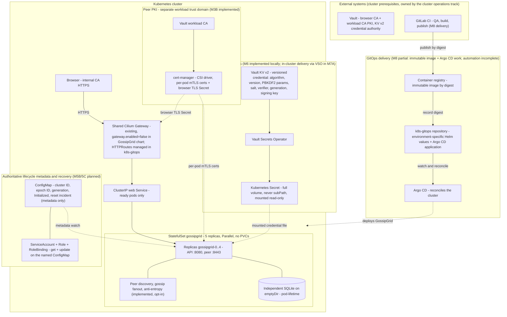

# GossipGrid

**A Kubernetes distributed systems testbed.**

A Go-based distributed systems testbed for evaluating Kubernetes orchestration, service discovery, gossip protocols,
mTLS, fault tolerance, and automated deployments.

**Status:** Milestones 0 through 5A and 6 are implemented and locally tested (tag `v0.1.0-alpha.6`). Milestone 7A
(Kubernetes staging) is **deployed and initially smoke-tested in Kubernetes**; the remaining acceptance tests in
[deploy/STAGING-RUNBOOK.md](deploy/STAGING-RUNBOOK.md) are pending. Lifecycle enforcement is disabled in 7A
because Milestones 5B and 5C are not yet implemented.

**Verified in the cluster** (operator-confirmed, 2026-11-22): five StatefulSet replicas running and ready with
zero restarts; replicas distributed across two worker nodes; Kubernetes DNS peer discovery (4 remote peers + local
replica); HTTPS access at `gossipgrid.k8s.lan` through an existing shared Cilium Gateway; working browser login
and authenticated dashboard; Vault-managed authentication credentials loaded; peer mTLS with per-pod certificates;
Go FIPS module v1.0.0 enabled in the running application; an immutable container image from a private GitLab
registry deployed through Argo CD.

**Detailed technical documentation:**
[Architecture](docs/architecture.md) ·
[Kubernetes deployment](docs/kubernetes-deployment.md) ·
[Security](docs/security.md) ·
[Development plan and milestones](docs/development-plan.md) ·
[Gossip and bootstrap](docs/gossip-and-bootstrap.md) ·
[Data loss and recovery](docs/recovery.md)

## What it does

Run a configurable number of identical Go replicas (target: five). Each replica stores string messages in a local
**GORM + SQLite** database, exposes a minimal web interface and REST API, discovers its peers, and gossips messages
to other replicas over **mutually authenticated TLS**. Newly created pods initialize their local databases by
synchronizing from a previously synchronized peer. The UI shows the serving pod, cluster membership, message
availability, and security diagnostics.

There is intentionally **no central message broker, no centralized message database, and no consensus-based guarantee
of durable writes**. Data is *eventually consistent*, and it is possible to lose messages. These tradeoffs are a
deliberate part of the testbed design.

## What is implemented

| Area | Status |
| --- | --- |
| Single-replica Go service | ✅ |
| Environment-based configuration | ✅ |
| HTTP health/ready/root endpoints | ✅ |
| GORM + SQLite local message store | ✅ |
| REST API (POST/GET /api/messages, GET /api/messages/{id}) | ✅ |
| UUIDv7 message identifiers | ✅ |
| Idempotent replicated message insertion | ✅ |
| Structured logging (slog) | ✅ |
| Graceful shutdown | ✅ |
| FIPS 140-3 build enforcement | ✅ |
| Git-based build versioning | ✅ |
| Static `scratch` Docker image (non-root) | ✅ |
| Makefile (build, test, QA, image) | ✅ |
| GitLab CI pipeline | ✅ |
| GitHub Actions CI | ✅ |
| Peer discovery (static mode) | ✅ |
| Peer discovery (DNS SRV mode) | ✅ |
| Membership tracking and reconciliation | ✅ |
| Peer mTLS transport (private HTTPS listener) | ✅ |
| Peer certificate identity authorization (SAN, EKU, StatefulSet name) | ✅ |
| Certificate and trust-bundle hot-reload without restart | ✅ |
| Authenticated peer HTTP client (dial address vs expected identity) | ✅ |
| Private `/internal/status` endpoint (mTLS-protected) | ✅ |
| Authenticated peer message exchange (POST /internal/messages, opt-in) | ✅ |
| Epidemic gossip (automatic fanout, bounded queues, retries, duplicate suppression) | ✅ |
| Anti-entropy (periodic inventory comparison, keyset pagination, cursor progression) | ✅ |
| Lifecycle state machine (7 states, concurrency-safe, opt-in) | ✅ |
| Durable SQLite epoch binding (local_metadata singleton row) | ✅ |
| Readiness gating (503 when unready, 200 for READY/DEGRADED) | ✅ |
| Initial anti-entropy sync readiness barrier (opt-in; 503 until initial sync complete, one-shot, no timeout) | ✅ |
| Epoch fencing (request headers + response envelope, 409 on mismatch, permanent) | ✅ |
| Single-snapshot fail-closed admission (reads, writes, replication; per-send re-check) | ✅ |
| Outbound epoch provider (current authorization, not stale) | ✅ |
| Legacy-peer rejection (response envelope validation; mTLS alone does not prove epoch membership) | ✅ |
| Kubernetes metadata authority (ConfigMap-backed, atomic resourceVersion update) | 🔜 Milestone 5B |
| Initial snapshot transfer (SYNCING → READY) and automatic genesis | 🔜 Milestone 5B |
| Snapshot-source eligibility (unsynced pods never source snapshots) | 🔜 Milestone 5B |
| Fail-closed behavior when authoritative metadata is unavailable | 🔜 Milestone 5B |
| Operator recovery/reset authorization (no automatic destructive reset by default) | 🔜 Milestone 5C |
| Catastrophic data-loss handling and epoch transitions with stale-data fencing | 🔜 Milestone 5C |
| Incident and recovery audit information (persistent banner, metadata record) | 🔜 Milestone 5C |
| Web UI (embedded Go templates, minimal JS) and diagnostics | ✅ Milestone 6 (local) |
| Single-administrator password authentication (enabled by default; fail-closed on missing credential) | ✅ Milestone 6 (local) |
| Credential reload without restart; password rotation invalidates sessions immediately (no overlap window) | ✅ Milestone 6 (local) |
| Session-bound CSRF protection (HMAC of the session SID) | ✅ Milestone 6 (local) |
| Secure credential CLI (`init`/`rotate`/`verify`; interactive hidden prompts, no password in args) | ✅ Milestone 6 (local) |
| Kubernetes staging: five-replica StatefulSet, `emptyDir` SQLite, peer + web Services, shared Cilium Gateway | ✅ Milestone 7A (deployed and smoke-tested; full acceptance pending) |
| cert-manager Vault PKI, per-pod mTLS via CSI, VSO-managed auth Secret | ✅ Milestone 7A (deployed and verified in cluster) |
| Helm packaging, Argo CD deployment via immutable image from private GitLab registry | ✅ Milestone 7A (deployed) |
| Live password-rotation demonstration (in-cluster) | 📦 Milestone 7A (deployed; not yet demonstrated) |
| Lifecycle-aware Kubernetes staging (5B/5C enabled, in-cluster recovery tests) | 🔜 Milestone 7B |
| GitOps delivery automation (digest-based Argo CD reconciliation, automated promotion) | 🔜 Milestone 8 (partial: immutable image publishing and digest-pinned Argo CD work; automated delivery not complete) |
| Fault injection and resilience lab | 🔜 Milestone 9 |

## Architecture at a glance

<!-- DIAGRAM:system-architecture -->


The diagram above is a logical overview of the whole application. GossipGrid is shown as one StatefulSet of
five replicas with a single independent SQLite-per-replica storage model (not five repeated pod/database
drawings). External Vault and GitLab CI are treated as external cluster prerequisites, not components inside
the cluster. The diagram renders natively on GitHub and GitLab; the
[SVG](docs/diagrams/generated/system-architecture.svg) and
[PNG](docs/diagrams/generated/system-architecture.png) links are fallbacks.

**Detailed diagrams** (each answers a distinct technical question; all generated from Mermaid sources under
[docs/diagrams/](docs/diagrams/), rendered to SVG and PNG under [docs/diagrams/generated/](docs/diagrams/generated/)):

- [System architecture](docs/diagrams/generated/system-architecture.svg) — the logical overview above (embedded).
- [Gossip and anti-entropy replication](docs/diagrams/generated/gossip-replication.svg) — the implemented
  distributed messaging mechanism (fanout, idempotency, retries, reconciliation, eventual convergence).
- [Lifecycle state machine and recovery](docs/diagrams/generated/lifecycle-recovery.svg) — the implemented 5A
  7-state machine, epoch fencing, and readiness/authorization.
- [Replacement-pod / recovery sequence](docs/diagrams/generated/lifecycle-recovery-sequence.svg) — how a
  replaced pod re-initializes and how stale-epoch peers are rejected (5A/5B/5C).
- [Security and credentials](docs/diagrams/generated/security-credentials.svg) — the browser-auth and peer-mTLS
  paths, and the eventual (not instantaneous) credential rotation flow.
- [GitOps delivery](docs/diagrams/generated/gitops-delivery.svg) — the M8 delivery pipeline and the
  CI/Argo CD ownership boundary.

Regenerate all diagrams with `make architecture` (or `make architecture DIAGRAM=<base>` for one) — see
[Regenerating the architecture diagrams](#regenerating-the-architecture-diagrams) for how to reproduce them.

The workload is deployed as a **StatefulSet without PVCs**: stable ordinal identities, but data stored in pod-lifetime
`emptyDir` volumes. The peer Service publishes unready pod addresses to avoid bootstrap deadlock; only ready pods
enter the user-facing Service.

## Principal design choices

| Area | Approach |
| --- | --- |
| Language | Go, standard library where practical |
| Database | GORM with the conventional CGO-backed SQLite driver |
| Local storage | `emptyDir`; survives container restart but not pod replacement |
| Scaling | StatefulSet, initially five replicas, `podManagementPolicy: Parallel` |
| Service discovery | Kubernetes headless Service DNS, dynamic refresh |
| Replication | Small custom epidemic gossip protocol plus periodic anti-entropy |
| Bootstrap | Explicit `STARTING -> DISCOVERING -> SYNCING -> READY` lifecycle |
| Security | Separate Vault-managed browser and workload PKI; peer mTLS required |
| Certificate delivery | cert-manager Vault issuers, CSI per-pod keys/certs, trust bundle distribution |
| Network entry | Existing shared Cilium Gateway (chart sets `gateway.enabled=false`; HTTPRoutes managed in k8s-gitops) |
| Container | Multi-stage static build; final image `scratch`, non-root user |
| FIPS | Go native FIPS 140-3 module; verify, don't assert app certification |
| CI/CD | GitLab CI (primary), GitHub Actions (public mirror) |

## Project documentation

- [Architecture and components](docs/architecture.md)
- [Gossip, membership and synchronization](docs/gossip-and-bootstrap.md)
- [Data loss and recovery](docs/recovery.md)
- [Security, certificates and FIPS](docs/security.md)
- [Kubernetes and delivery design](docs/kubernetes-deployment.md)
- [Implementation milestones and review protocol](docs/development-plan.md)
- [Milestone 7A staging runbook](deploy/STAGING-RUNBOOK.md)
- [Vault and cert-manager provisioning](deploy/vault/PROVISIONING.md)
- [Helm chart](deploy/helm/gossipgrid/Chart.yaml)
- [Argo CD Application (reusable example)](deploy/argocd/application.yaml) — the actual staging Application
  lives in the separate `k8s-gitops` repository
- Architecture decision records: [ephemeral storage](docs/decisions/0001-ephemeral-storage.md),
  [peer discovery](docs/decisions/0002-native-peer-discovery.md),
  [static/FIPS build](docs/decisions/0003-static-and-fips.md).

## Local development

Prerequisites: a Go 1.27+ toolchain, `golangci-lint` v2, `gosec` v2, and (for the Docker image) Docker with a working
daemon.

```sh
make build       # compile the binary into ./bin/gossipgrid (FIPS-enabled by default)
make run         # build and run locally (default config: :8080, hostname node)
make qa          # verify fmt, vet, lint, security, unit tests, race detection
make lint        # run golangci-lint (fails on findings)
make security    # run gosec security scan (fails on actionable findings)
make test        # unit tests only
make test-race   # unit tests with race detection
make fmt         # format Go sources
make image       # build the static Docker image
make version     # show the resolved build version, FIPS module, and image reference
make clean       # remove build outputs
```

The `make qa` target runs the following checks (read-only; it never modifies tracked files):

- Formatting (`fmt-check`) and `go vet`
- `golangci-lint` and `gosec`
- `docs-lint` (goldmark-lint) and `diagrams-check` (embedded-Mermaid source sync)
- `helm-lint` and `deploy-checks` (Helm chart validation, no cluster access)
- `go test` and `go test -race`
- `test-version-injection` and `test-deploy-pipefail` (regression tests)

### FIPS 140-3 builds

Builds are **FIPS-enabled by default** using Go's native FIPS 140-3 support (`FIPS_MODULE=v1.0.0`). The startup log
reports `fips_enabled` and `fips_module`. If a FIPS-required build is run with FIPS disabled at runtime, the
application **refuses to start**.

```sh
make build FIPS_MODULE=off   # non-FIPS development build
```

### Configuration

| Variable | Default | Description |
| --- | --- | --- |
| `GOSSIPGRID_HTTP_ADDR` | `:8080` | HTTP listener address |
| `GOSSIPGRID_NODE_ID` | hostname | Node identity |
| `GOSSIPGRID_LOG_LEVEL` | `info` | Log level (debug, info, warn, error) |
| `GOSSIPGRID_SHUTDOWN_TIMEOUT` | `10s` | Graceful shutdown grace period |
| `GOSSIPGRID_DB_PATH` | `./data/gossipgrid.db` | SQLite database path |
| `GOSSIPGRID_DISCOVERY_MODE` | `off` | Discovery mode: `off`, `static`, or `dns` |
| `GOSSIPGRID_STATIC_PEERS` | (empty) | Comma-separated `host:port` peer list (static mode) |
| `GOSSIPGRID_DISCOVERY_DNS_NAME` | (empty) | Headless Service DNS name (dns mode, e.g. `gossipgrid-headless.default.svc`) |
| `GOSSIPGRID_DISCOVERY_SRV_SERVICE` | `peer` | Named port in SRV records (dns mode) |
| `GOSSIPGRID_DISCOVERY_INTERVAL` | `10s` | DNS refresh period (dns mode) |
| `GOSSIPGRID_DISCOVERY_TIMEOUT` | `3s` | Per-lookup DNS timeout (dns mode) |
| `GOSSIPGRID_EXPECTED_REPLICAS` | `1` | Configured cluster size (StatefulSet replicas) |
| `GOSSIPGRID_STATEFULSET_NAME` | `gossipgrid` | StatefulSet name for deriving expected replica identities |
| `GOSSIPGRID_PEER_TLS_ENABLED` | `false` | Enable the private peer mTLS listener |
| `GOSSIPGRID_PEER_ADDR` | `:8443` | Private peer HTTPS listener address |
| `GOSSIPGRID_PEER_CERT_FILE` | (empty) | Path to the mounted certificate chain (PEM) |
| `GOSSIPGRID_PEER_KEY_FILE` | (empty) | Path to the mounted private key (PEM) |
| `GOSSIPGRID_PEER_TRUST_BUNDLE_FILE` | (empty) | Path to the dedicated workload CA trust bundle (PEM) |
| `GOSSIPGRID_PEER_IDENTITY_SUFFIX` | (empty) | DNS suffix following the pod name in the cert SAN (e.g. `gossipgrid-headless.default.svc.cluster.local`) |
| `GOSSIPGRID_PEER_TLS_RELOAD_INTERVAL` | `2s` | Polling interval for credential file changes |
| `GOSSIPGRID_PEER_MESSAGE_EXCHANGE_ENABLED` | `false` | Enable the private peer message exchange endpoint (POST /internal/messages). Requires peer mTLS |
| `GOSSIPGRID_GOSSIP_ENABLED` | `false` | Enable automatic epidemic gossip fanout (Milestone 4B). Requires peer mTLS, message exchange, and static or dns discovery |
| `GOSSIPGRID_GOSSIP_FANOUT` | `2` | Peers contacted per propagation round (range 1-32) |
| `GOSSIPGRID_GOSSIP_ROUNDS` | `3` | Fanout rounds per message (range 1-32) |
| `GOSSIPGRID_GOSSIP_WORKERS` | `4` | Concurrent delivery workers (range 1-64) |
| `GOSSIPGRID_GOSSIP_QUEUE_CAPACITY` | `256` | Work queue capacity (range 1-1024) |
| `GOSSIPGRID_GOSSIP_MAX_ATTEMPTS` | `3` | Total delivery attempts per peer, including initial (range 1-10) |
| `GOSSIPGRID_GOSSIP_RETRY_BASE` | `250ms` | Base duration for exponential backoff (must be positive) |
| `GOSSIPGRID_GOSSIP_RETRY_MAX` | `5s` | Maximum backoff duration (must be >= retry base) |
| `GOSSIPGRID_ANTI_ENTROPY_ENABLED` | `false` | Enable periodic anti-entropy reconciliation (Milestone 4C). Requires peer mTLS, message exchange, and static or dns discovery |
| `GOSSIPGRID_ANTI_ENTROPY_INTERVAL` | `30s` | Synchronization cycle period (range 1s–10m) |
| `GOSSIPGRID_ANTI_ENTROPY_PAGE_SIZE` | `128` | Maximum IDs per inventory page (range 1–1024) |
| `GOSSIPGRID_ANTI_ENTROPY_FETCH_BATCH_SIZE` | `8` | Maximum messages fetched per batch (range 1–8, ≤ page size) |
| `GOSSIPGRID_ANTI_ENTROPY_MAX_PAGES_PER_PEER` | `4` | Maximum inventory pages per peer per cycle (range 1–64) |
| `GOSSIPGRID_ANTI_ENTROPY_WORKERS` | `2` | Concurrent synchronization workers (range 1–16) |
| `GOSSIPGRID_ANTI_ENTROPY_REQUEST_TIMEOUT` | `5s` | Per-request timeout for sync HTTP calls (range 1ms–60s) |
| `GOSSIPGRID_INITIAL_SYNC_BARRIER_ENABLED` | `false` | Synchronization-aware Kubernetes readiness (Milestone 7A enhancement). When `true`, a new replica stays NotReady (503 from `/readyz`, reason `initial_sync_pending`) until it completes its initial anti-entropy synchronization — a successful, complete full inventory pass against every expected remote peer in the configured StatefulSet membership. One-shot (a transient peer outage after Ready does not re-open it), no timeout (never auto-Ready). Requires `GOSSIPGRID_ANTI_ENTROPY_ENABLED=true` (enabling the barrier without anti-entropy fails configuration validation). Enabled in the staging values file; disabled by default |
| `GOSSIPGRID_LIFECYCLE_ENABLED` | `false` | Enable lifecycle state machine, epoch fencing, and fail-closed admission (Milestone 5A). Requires peer mTLS |
| `GOSSIPGRID_AUTH_ENABLED` | `true` | Enable browser password authentication. **Enabled by default** (Milestone 6). Set to `false` only in a controlled environment; with it disabled all API endpoints are unauthenticated |
| `GOSSIPGRID_AUTH_INSECURE_DEV_MODE` | `false` | Insecure, **local-development-only** opt-out of authentication. When `true`, all API endpoints are unauthenticated. Never set this in a production or network-reachable deployment |
| `GOSSIPGRID_AUTH_CREDENTIAL_FILE` | (empty) | Path to the mounted credential file (JSON; format version 1). Required when `GOSSIPGRID_AUTH_ENABLED=true` and `GOSSIPGRID_AUTH_INSECURE_DEV_MODE=false`; a missing or malformed file fails closed (503) |
| `GOSSIPGRID_AUTH_RELOAD_INTERVAL` | `2s` | Polling interval for credential file changes |
| `GOSSIPGRID_AUTH_MAX_STALE` | `5m` | Maximum age of the last successfully loaded credential; when the file has been failing longer than this, authentication fails closed (503) |
| `GOSSIPGRID_AUTH_SESSION_TTL` | `2h` | Absolute session lifetime. **Note:** the Helm chart's `auth.sessionTTL` default is `24h`, overriding this Go default for Kubernetes deployments |
| `GOSSIPGRID_AUTH_SESSION_IDLE_TTL` | `30m` | Maximum session idle time |
| `GOSSIPGRID_AUTH_COOKIE_SECURE` | (auto) | Override the session cookie `Secure` attribute. Default: `true` when the public listener has a TLS certificate, `false` otherwise |
| `GOSSIPGRID_MESSAGE_RETENTION_TTL` | (empty) | Message retention TTL (e.g. `72h`, `168h`). When unset or `0`, retention is **disabled** (the default; messages are never expired or deleted). When set, messages with `created_at` older than `now - TTL` are excluded from the API, excluded from gossip/anti-entropy, and periodically deleted from SQLite. Must be >= `1m` when set. Uses Go's standard `time.ParseDuration` syntax (hours, minutes, seconds; no `d` suffix) |
| `GOSSIPGRID_MESSAGE_RETENTION_INTERVAL` | `1h` | Periodic cleanup sweep interval (only used when `GOSSIPGRID_MESSAGE_RETENTION_TTL` is set and > 0). Range `1s`–`24h` |

When `GOSSIPGRID_AUTH_ENABLED=true` (the default) and the credential file is absent or malformed, the web
endpoints **fail closed** with `503 Service Unavailable` (the browser UI and all API endpoints require
authentication). There is **no** silent fallback to anonymous access. To run unauthenticated for local
development, set `GOSSIPGRID_AUTH_INSECURE_DEV_MODE=true` (a clearly-named, insecure opt-out — never for
network-reachable deployments) or `GOSSIPGRID_AUTH_ENABLED=false`. The `GET /healthz` and `GET /readyz`
endpoints are always unauthenticated. Peer mTLS (`GOSSIPGRID_PEER_TLS_ENABLED`) is an **independent** security
mechanism and is not affected by browser authentication.

When `GOSSIPGRID_PEER_TLS_ENABLED` is `true`, all of the peer TLS file paths and the identity suffix are **required**; a
missing or malformed value fails startup clearly (no silent fallback to unauthenticated communication). When it is
`false` (the default), the peer listener is not started and local single-instance development is unchanged.

When `GOSSIPGRID_PEER_MESSAGE_EXCHANGE_ENABLED` is `true`, the private peer listener additionally registers
`POST /internal/messages`, accepting idempotent replicated message inserts from authenticated replicas. This is a
provisional, opt-in, direct-exchange capability: it does **not** by itself enable readiness gating. It
**requires** `GOSSIPGRID_PEER_TLS_ENABLED=true`; enabling it without peer mTLS fails configuration validation.
Automatic epidemic gossip fanout is enabled separately via `GOSSIPGRID_GOSSIP_ENABLED` (Milestone 4B, implemented).
Periodic anti-entropy synchronization is enabled separately via `GOSSIPGRID_ANTI_ENTROPY_ENABLED` (Milestone 4C,
implemented); it uses the message-exchange endpoint for inventory comparison and batched fetches.

### Lifecycle and epoch fencing (Milestone 5A)

When `GOSSIPGRID_LIFECYCLE_ENABLED=true` (and peer mTLS is enabled), the application enforces a lifecycle state
machine that gates readiness, admission, and epoch fencing. The feature is **opt-in**; when disabled (the default),
all existing behavior is preserved.

**What it provides:**

- A **concurrency-safe state machine** with 7 states (`STARTING`, `DISCOVERING`, `GENESIS`, `SYNCING`, `READY`,
  `DEGRADED`, `RECOVERY_REQUIRED`). Invalid transitions are rejected; no caller can silently force `READY`.
- A **durable SQLite epoch binding** (singleton row in `local_metadata`) that ties the database to a specific
  cluster ID and epoch ID. Rebinding to a different epoch fails; a nonempty database without a binding is rejected.
- **Readiness gating**: `GET /readyz` returns 503 when the replica is not in `READY` or `DEGRADED` state.
  `GET /healthz` remains 200.
- **Fail-closed admission**: `POST /api/messages` returns 503 (no message inserted) when the replica is unready.
  Private replication (inbound gossip, anti-entropy) is rejected when unready.
- **Epoch fencing**: peer status and sync endpoints carry request headers
  (`X-GossipGrid-Cluster-ID`, `X-GossipGrid-Epoch-ID`) and a response envelope
  (`X-GossipGrid-Resp-Cluster-ID`, `X-GossipGrid-Resp-Epoch-ID`,
  `X-GossipGrid-Lifecycle-Active`). A replica whose local binding does not match the peer's epoch receives 409
  (permanent, no retry) and does not merge data. A lifecycle-enabled client additionally validates the response
  envelope: a legacy peer (lifecycle disabled) that omits `X-GossipGrid-Lifecycle-Active: true` is rejected as a
  synchronization source, even with a valid mTLS certificate.
- **RECOVERY_REQUIRED lockout (implemented)**: when the local database binding does not match the authoritative
  metadata (an epoch mismatch), the replica transitions to `RECOVERY_REQUIRED` — a **fail-closed lockout**. All
  writes and replication are rejected (503 unready / 409 epoch mismatch), local data is **preserved** (never
  deleted), and the binding row is intact. This is the lockout *itself*; it is distinct from the **operator-
  authorized recovery/reset procedure** that actually returns the replica to `READY`, which is **not** implemented
  in 5A (deferred to 5B and later). A `RECOVERY_REQUIRED` replica cannot automatically return to `READY`.
- **Outbound epoch provider**: the peer client sources its outbound epoch context from the controller's current
  authorization decision (via the `EpochProvider`), not a one-time startup copy. A revoked node blocks its outbound
  requests rather than using a stale epoch. Gossip and anti-entropy re-check admission at send/sync time; there is
  no retry on a revocation.
- **Commit authorization (lock-order guarantee)**: the anti-entropy cursor commit
  (`Controller.CommitUnderAuthorization`) evaluates the complete authorization decision — ready state,
  not stopped, fresh valid metadata with `Initialized=true`, and a matching durable binding with no
  recovery lockout — from a single locked snapshot that reads all authorization fields under one
  controller read lock and one state-machine read lock (no second lock acquisition, no SQLite read
  while the locks are held). The RLocks are held until the in-memory cursor mutation completes, so a
  revocation (Stop or a state/metadata change) that linearizes before the commit is observed and the
  callback is not executed; a revocation that linearizes after the callback completes is a normal,
  permitted revocation. All lifecycle state transitions acquire the controller read lock before the
  state-machine write lock, matching the commit's lock order, so a readiness-revoking transition cannot
  linearize while a cursor commit holds the RLocks: the transition is queued behind the commit. Lock
  order is `Controller.mu` (RLock) → `Machine.mu` (RLock) → `Engine.mu` (Lock). A cached binding that
  is absent or does not match the accepted metadata fails closed (no database read inside the protected
  commit). A completed revocation prevents a subsequent commit; a commit that linearizes before a
  revocation may complete normally.

**What it does NOT provide (deferred to Milestone 5B and later):**

- No production Kubernetes metadata provider (the controller uses a no-op source that always reports metadata
  unavailable; replicas with lifecycle enabled fail closed).
- No automatic cluster genesis (a fresh replica with no binding cannot automatically initialize an empty epoch).
- No initial snapshot transfer (the path from `SYNCING` to `READY` is not yet implemented).
- No automatic epoch reset or operator reset endpoints.
- mTLS alone does **not** prove a peer's epoch membership; the response envelope is a second, independent check.
- 5A alone does **not** make GossipGrid safe for catastrophic cluster recovery.

**Local testing.** The `cmd/gossipgrid` package includes controller-driven integration tests
(`TestControllerDriven*` — 14 scenarios covering matching/missing/invalid metadata, epoch A→B transitions,
revocation fencing, legacy-peer rejection, and lifecycle-disabled convergence) and real-mTLS mixed-mode tests
(`TestMixedMode*` — 7 scenarios) that start GossipGrid nodes with lifecycle enabled, distinct identities, and
loopback mTLS listeners. All scenarios pass under the race detector.

**Security note.** mTLS remains the sole basis for peer identity. Epoch headers are fencing metadata, not
credentials: possessing an epoch ID does not grant access to any resource. A peer with a valid mTLS certificate
but a different epoch is rejected (409) — its data is not merged. mTLS alone does not prove epoch membership;
the response envelope provides a second, independent validation layer.

### Browser authentication (Milestone 6)

When `GOSSIPGRID_AUTH_ENABLED=true` (the default), all API and UI endpoints require a valid session cookie
obtained from `POST /login` (single-administrator password authentication); the root page `GET /` serves the
embedded UI to authenticated users and redirects an unauthenticated browser to `GET /login`. The web endpoints
**fail closed** (`503 Service Unavailable`) when the credential file is missing, malformed, or stale beyond
`GOSSIPGRID_AUTH_MAX_STALE` — there is no silent anonymous access. `GET /healthz` and `GET /readyz` are
**always unauthenticated** (Kubernetes probes). Authentication is **independent** from peer mTLS.

- **Sessions** are HMAC-SHA256-signed cookies bound to a credential **generation**; there is **no overlap
  window** — a session under the old generation is rejected immediately once any replica has loaded the new
  generation.
- **Password rotation** (new password + new generation + new signing key, same or new) invalidates existing
  sessions immediately. **Signing-key rotation** (new key, same generation) preserves same-generation sessions.
- **CSRF protection** is session-bound: after login, the token is `HMAC-SHA256(signing key, session SID)`, sent
  as the `gossipgrid_csrf` cookie + `X-CSRF-Token` header, and cannot be reused across sessions. It is required
  on all authenticated state-changing requests (`POST /logout`, `POST /api/messages`) when authentication is
  on. The unauthenticated `POST /login` is not gated by the session-bound CSRF token (a session does not yet
  exist); **session fixation** is mitigated by always issuing a fresh session on login rather than inheriting
  a session ID from a cookie an attacker pre-set.
- **Credential reload** is poll-based (no restart); a changed verifier, signing key, or PBKDF2 parameter is
  detected. A malformed replacement never replaces the last good snapshot.
- The in-cluster delivery path (Vault KV v2 → Vault Secrets Operator → mounted K8s Secret) is **deployed and
  verified in the staging cluster** (Milestone 7A); the local CLI (`init`/`rotate`/`verify`) provisions the
  same credential file format directly.

### Endpoints

- `GET /` — HTML page identifying GossipGrid and the serving node (authenticated when auth is enabled; an
  unauthenticated browser is redirected to `GET /login`)
- `GET /healthz` — liveness (always unauthenticated)
- `GET /readyz` — readiness (always unauthenticated)
- `GET /login` — (Milestone 6) the login page (unauthenticated)
- `POST /login` — (Milestone 6) obtain a session cookie with the administrator password (unauthenticated;
  a new session is always issued)
- `POST /logout` — (Milestone 6) end the session (requires the session-bound CSRF token)
- `POST /api/messages` — create a local message (body only; authenticated, CSRF-protected when auth is enabled)
- `GET /api/messages` — list local messages (newest first, paginated; authenticated when auth is enabled)
- `GET /api/messages/{id}` — retrieve a single message (authenticated when auth is enabled)
- `GET /api/diagnostics` — (Milestone 6) safe runtime diagnostics (authenticated when auth is enabled)

### Peer discovery

GossipGrid supports three discovery modes. Discovery is **observational**: a failed DNS
lookup does not affect the public HTTP service's readiness. When gossip is enabled
(`GOSSIPGRID_GOSSIP_ENABLED=true`), the discovery snapshot feeds the gossip engine's
peer selector through the production bridge. When anti-entropy is enabled
(`GOSSIPGRID_ANTI_ENTROPY_ENABLED=true`), the same snapshot feeds the anti-entropy
synchronization worker's peer selection (Milestone 4C, implemented).

| Mode | Use case | Behavior |
| --- | --- | --- |
| `off` | Single-instance development | No discovery; no background activity |
| `static` | Local multi-process testing | Peers read from `GOSSIPGRID_STATIC_PEERS`; deterministic, no background network I/O |
| `dns` | Kubernetes deployment | Peers discovered from headless Service DNS SRV records; periodic refresh with bounded timeouts |

**Static mode example (five local processes):**

```sh
GOSSIPGRID_NODE_ID=gossipgrid-0 GOSSIPGRID_DISCOVERY_MODE=static \
  GOSSIPGRID_STATIC_PEERS="gossipgrid-1:8443,gossipgrid-2:8443,gossipgrid-3:8443,gossipgrid-4:8443" \
  GOSSIPGRID_EXPECTED_REPLICAS=5 gossipgrid

GOSSIPGRID_NODE_ID=gossipgrid-1 GOSSIPGRID_DISCOVERY_MODE=static \
  GOSSIPGRID_STATIC_PEERS="gossipgrid-0:8443,gossipgrid-2:8443,gossipgrid-3:8443,gossipgrid-4:8443" \
  GOSSIPGRID_EXPECTED_REPLICAS=5 gossipgrid
```

**DNS mode example (Kubernetes):**

```sh
GOSSIPGRID_NODE_ID=gossipgrid-0 GOSSIPGRID_DISCOVERY_MODE=dns \
  GOSSIPGRID_DISCOVERY_DNS_NAME="gossipgrid-headless.default.svc" \
  GOSSIPGRID_EXPECTED_REPLICAS=5 gossipgrid
```

The headless Service must have a named TCP port called `peer` on port 8443 and
`publishNotReadyAddresses: true`. No Kubernetes API permissions are required for peer discovery.
DNS records are not proof that a peer is healthy, reachable, authenticated, synchronized, or ready to
supply data; those properties are established by the mTLS and lifecycle implementations in later milestones.

### Peer mTLS

GossipGrid runs a **separate private HTTPS peer listener** (default `:8443`) in addition to the public HTTP listener
(`:8080`). The peer listener:

- enforces **TLS 1.3 only** (no 1.2 or lower);
- **requires and verifies client certificates** (mutual TLS) signed by the dedicated workload CA trust bundle;
- performs **additional peer identity authorization** after the standard TLS chain/hostname verification: the
  certificate must have exactly one DNS SAN of the form `<statefulset-name>-<ordinal>.<identity-suffix>` with a
  non-negative ordinal, and the correct Extended Key Usage (`clientAuth` for clients, `serverAuth` for servers);
- rejects wildcard SANs, IP SANs, multiple SANs, and the Common Name (SAN-only validation).

The **network dial address and the expected authenticated peer identity are distinct inputs**. A client may dial
`127.0.0.1:8443` (a loopback address for local testing) while verifying a certificate for
`gossipgrid-1.gossipgrid-headless.default.svc.cluster.local` (the in-cluster FQDN). This is the mechanism that lets the
application be tested as independent local processes without Kubernetes.

The peer listener exposes the following private endpoints (all mTLS-protected, none exposed on the public HTTP
router):

- `GET /internal/status` — returns the authenticated server's node identity, application version, pod identity, and a
  safe certificate fingerprint (no private key or PEM content). Always available (200 even when unready).
- `POST /internal/messages` — (opt-in via `GOSSIPGRID_PEER_MESSAGE_EXCHANGE_ENABLED`) accepts an authenticated peer's
  message for idempotent replicated storage.
- `GET /internal/sync/ids` — (opt-in via `GOSSIPGRID_ANTI_ENTROPY_ENABLED`) returns a bounded, keyset-paginated page
  of message IDs for inventory comparison.
- `POST /internal/sync/messages` — (opt-in via `GOSSIPGRID_ANTI_ENTROPY_ENABLED`) fetches a bounded batch of messages
  by ID for anti-entropy reconciliation.

When lifecycle protection is enabled (`GOSSIPGRID_LIFECYCLE_ENABLED=true`), all private replication endpoints carry
epoch fencing headers (`X-GossipGrid-Cluster-ID`, `X-GossipGrid-Epoch-ID`) and a response envelope
(`X-GossipGrid-Resp-Cluster-ID`, `X-GossipGrid-Resp-Epoch-ID`, `X-GossipGrid-Lifecycle-Active`); a 409 epoch mismatch
is permanent (no retry).

**Certificate identity convention.** Each replica's certificate DNS identity is
`<replica>.<GOSSIPGRID_PEER_IDENTITY_SUFFIX>`, for example
`gossipgrid-0.gossipgrid-headless.default.svc.cluster.local`. The cluster DNS domain is **not** hard-coded; the
operator configures the full suffix. The same certificate is used for both the server and client roles, so it must
carry both `serverAuth` and `clientAuth` Extended Key Usages.

**Certificate rotation (hot-reload).** The application polls the certificate, key, and trust-bundle files at
`GOSSIPGRID_PEER_TLS_RELOAD_INTERVAL` (default `2s`). On a successful reload the new credentials are published
atomically and used for **new** handshakes without a process restart. A failed reload (malformed or missing file)
preserves the previous valid configuration; it never exposes partially loaded credentials or replaces a valid trust
bundle with malformed material. The trust bundle may contain multiple CAs during a CA transition. Existing
established connections are not forcibly terminated during normal leaf-certificate rotation. Reload outcomes are
reported through structured logs and the `Diagnostics` API (cert fingerprint, pod ID, load time, reload count — no
secrets). This mirrors the cert-manager CSI + trust-manager rotation flow planned for the Kubernetes deployment.

**Local testing.** The `cmd/gossipgrid` package includes a repeatable integration test
(`TestIntegrationTwoNodesMTLS`) that starts two GossipGrid nodes with distinct identities, SQLite databases, and
loopback mTLS listeners, and demonstrates: successful authenticated `GET /internal/status`, failure on a wrong
expected peer identity, failure with an untrusted client certificate, and successful credential rotation without
restart. Run it with:

```sh
make test-race
# or just the integration test:
GOFIPS140=v1.0.0 CGO_ENABLED=1 go test -tags sqlite_omit_load_extension -race -run TestIntegration ./cmd/gossipgrid/
```

No development certificates or private keys are committed: all test material is generated in memory per run.

### Authenticated peer message exchange (Milestone 4A)

When `GOSSIPGRID_PEER_MESSAGE_EXCHANGE_ENABLED=true` (and peer mTLS is enabled), the private peer listener registers:

- `POST /internal/messages` — accepts an authenticated peer's message for idempotent replicated storage.

**Wire contract.** The request body is a JSON envelope containing a complete message:

```json
{
  "message": {
    "id": "<uuidv7>",
    "body": "Hello from gossipgrid-0",
    "origin": "gossipgrid-0",
    "created_at": "2026-11-20T12:34:56.789Z"
  }
}
```

The receiver preserves the original UUIDv7 ID, body, origin, and creation timestamp — it does **not** generate a new
ID or timestamp during replication. Validation enforces:

- Maximum request body size of 8192 bytes.
- Maximum message body size of 4096 bytes (the store's limit).
- Valid canonical UUIDv7 (lowercase, hyphenated).
- Nonempty origin and message body.
- Valid nonzero timestamp (RFC3339).
- Exactly one JSON document; no unknown JSON fields.
- Appropriate Content-Type handling (application/json).

**Idempotency.** The receiver uses the existing atomic SQLite `ON CONFLICT DO NOTHING` insert:

- New valid message: inserted successfully (HTTP 200).
- Identical duplicate ID and content: success, no modification (HTTP 200).
- Duplicate ID with conflicting content: HTTP 409 Conflict; the original row is never overwritten.
- Invalid message: HTTP 400 or 413 as appropriate.
- Storage failure: HTTP 500.

**Security.** The authenticated TLS client identity establishes who transmitted a message; the receiver does **not**
accept a supplied HTTP header as proof of peer identity. The message's `origin` field is immutable metadata
identifying its original creator, which may differ from the forwarding peer. mTLS alone does **not**
cryptographically prove the historical origin of a forwarded message.

**Scope of 4A.** This is a provisional, direct, caller-initiated exchange. At the time of Milestone 4A, automatic
gossip fanout, bounded queues, retry scheduling, anti-entropy, snapshot transfer, epoch management, and
production cluster-reset guarantees were not yet implemented. Milestones 4B and 4C (both completed 2026-11-20)
subsequently implemented automatic epidemic gossip fanout and periodic anti-entropy reconciliation on top of this
endpoint. When `GOSSIPGRID_GOSSIP_ENABLED=true` (Milestone 4B, opt-in), successful local writes
(`POST /api/messages`) **do** initiate automatic propagation to eligible peers. When
`GOSSIPGRID_ANTI_ENTROPY_ENABLED=true` (Milestone 4C, opt-in), periodic inventory comparison and record retrieval
repair missed gossip. Both features are opt-in and require this endpoint plus peer mTLS.

**Local testing.** The `cmd/gossipgrid` package includes a repeatable integration test
(`TestIntegrationTwoNodesMessageExchange`) that starts two GossipGrid nodes with distinct identities, SQLite
databases, and loopback mTLS listeners, and demonstrates the full message-exchange flow including idempotency,
conflict rejection, and unauthorized-peer rejection. Run it with:

```sh
GOFIPS140=v1.0.0 CGO_ENABLED=1 go test -tags sqlite_omit_load_extension -race -run TestIntegrationTwoNodesMessageExchange ./cmd/gossipgrid/
```

The Docker image is a multistage static build with a final `scratch` stage and a non-root user (UID 65534):

```sh
make image
docker run --rm -p 8080:8080 --name gossipgrid gossipgrid:dev
```

## Regenerating the architecture diagrams

Each diagram is a Mermaid source file under `docs/diagrams/` (one diagram per file), rendered to a pair of
outputs under `docs/diagrams/generated/`:

- `<name>.svg` — the scalable documentation artifact (preferred).
- `<name>.png` — a raster convenience artifact.

To regenerate all diagrams:

```sh
make architecture
```

To regenerate a single diagram:

```sh
make architecture DIAGRAM=system-architecture
```

The target uses a pinned version of `@mermaid-js/mermaid-cli` (mmdc) via `npx`. The exact version is recorded in
the Makefile (`MERMAID_CLI_VERSION`). If the pinned version is unavailable, update `MERMAID_CLI_VERSION` and
re-run. The generated files are committed to the repository; they are not git-ignored. mmdc output for a given
`.mmd` source and pinned version is deterministic, so the committed SVG/PNG diffs reflect only genuine source
changes. Do not edit the SVG or PNG directly — edit the `.mmd` source and regenerate.

Rendering and verification are separated: `make architecture` **generates** the committed SVG/PNG outputs,
while the validation targets are read-only — `make diagrams-check` (level 1) verifies the embedded Markdown
blocks match the `.mmd` sources and lints the sources, and `make diagrams-render` (level 2) renders the
sources to a temporary directory to confirm they render without error. `make qa` runs the verification
targets but never regenerates the committed diagram outputs.

## Build efficiency

Docker image builds are expensive. For documentation, Mermaid diagram, and Makefile-only changes, **do not
invoke `docker build` or `make image`** — run targeted validation appropriate to the changed files (e.g.
`make architecture`, `make docs-lint`, `make qa`). Rebuild container images only when image contents,
application code, dependencies, build configuration, or deployment validation requires it.

## Ownership boundaries

GossipGrid is one component in a larger delivery stack. Each system owns a distinct set of resources; no
resource is owned by more than one system.

| System | Owns |
| --- | --- |
| **Ansible** | Kubernetes cluster and foundational infrastructure (nodes, network plugins, base system packages). |
| **Vault** | PKI (workload CA and browser CA roles, certificate issuance) and application credential authority (KV v2 secret path for the GossipGrid admin password). |
| **Vault Secrets Operator (VSO)** | Synchronizes Vault KV v2 secrets to Kubernetes Secrets (the GossipGrid authentication Secret). |
| **Helm** | GossipGrid resource templates (StatefulSet, Services, NetworkPolicy, cert-manager Certificate/Issuers, ServiceAccount/Role/RoleBinding). |
| **Argo CD** | Application deployment reconciliation (watches the GitOps repository and reconciles the cluster to the recorded desired state). |
| **GitLab CI** | Build, test, publish, and GitOps revision updates (QA, container build, image publish by digest, GitOps revision commit). |

The GossipGrid Helm chart does **not** create foundational cluster resources (Cilium, cert-manager, Vault, VSO,
or the cluster DNS). Those are pre-existing prerequisites owned by the cluster operations track.

## CI/CD

- **GitLab CI** (`.gitlab-ci.yml`): primary pipeline — QA (fmt, vet, lint, security, docs-lint, diagrams-check,
  helm-lint, deploy-checks, tests, race detection) and binary build. FIPS-enabled by default. Optional manual
  Docker image build for tags. The QA stage also validates the Helm chart (lint + template + deploy checks).
- **GitHub Actions** (`.github/workflows/ci.yml`): public mirror pipeline — same QA and build steps. No Docker image
  builds.
- **Helm chart** (Milestone 7A, deployed): the chart in `deploy/helm/gossipgrid/` is validated by `make helm-lint`
  and `make deploy-checks` as part of `make qa` — no cluster access is required. It is **deployed and smoke-tested**
  in the staging cluster (see the [staging runbook](deploy/STAGING-RUNBOOK.md) for the remaining acceptance tests).
- **GitOps delivery (Milestone 8, partial):** immutable image publishing and Argo CD digest-pinned reconciliation
  work in the staging cluster. Automated delivery (CI commits digest to k8s-gitops) and promotion automation are
  not yet complete.

## Roadmap

| Milestone | Scope | Status |
| --- | --- | --- |
| 0–5A | Single replica, local storage, peer discovery, peer mTLS, message exchange, gossip, anti-entropy, lifecycle state machine | ✅ Implemented and locally tested |
| 6 | Browser UI, single-administrator password authentication, credential reload | ✅ Implemented and locally tested |
| 7A | Kubernetes staging: 5-replica StatefulSet, shared Cilium Gateway, cert-manager, VSO, Argo CD | ✅ Deployed and smoke-tested; full acceptance tests pending |
| 5B | Kubernetes metadata authority (ConfigMap), initial snapshot transfer, automatic genesis, snapshot-source eligibility | 🔜 Designed but not implemented |
| 5C | Operator recovery/reset authorization, catastrophic data-loss handling, epoch transitions, incident audit | 🔜 Designed but not implemented |
| 7B | Lifecycle-aware staging: enable lifecycle enforcement, in-cluster recovery and partition tests | 🔜 Designed but not implemented |
| 8 | GitOps delivery automation: digest-based Argo CD reconciliation, automated promotion | 🔜 Partial: immutable image + Argo CD work; automation incomplete |
| 9 | Resilience/security lab: fault injection, metrics, FIPS profile verification | 🔜 Designed but not implemented |

Milestone 7A has been deployed and initially smoke-tested in the staging cluster. The remaining acceptance tests
in [deploy/STAGING-RUNBOOK.md](deploy/STAGING-RUNBOOK.md) (cross-replica convergence, recovery after pod
replacement, live password rotation, fault tolerance) are pending. Milestones 5B and 5C are required before
lifecycle enforcement can be enabled (Milestone 7B). See
[docs/development-plan.md](docs/development-plan.md) for the full milestone breakdown, acceptance criteria, and
dependencies.

## Scope

GossipGrid is a **distributed systems testbed**, not a durable production message store. It is designed for
infrastructure testing, Kubernetes validation, fault-tolerance testing, and security validation. No uptime or FIPS
compliance certification claims are made. The project is not production-ready.

## License

[Apache License, Version 2.0](LICENSE). See the [LICENSE](LICENSE) file for the full text.
