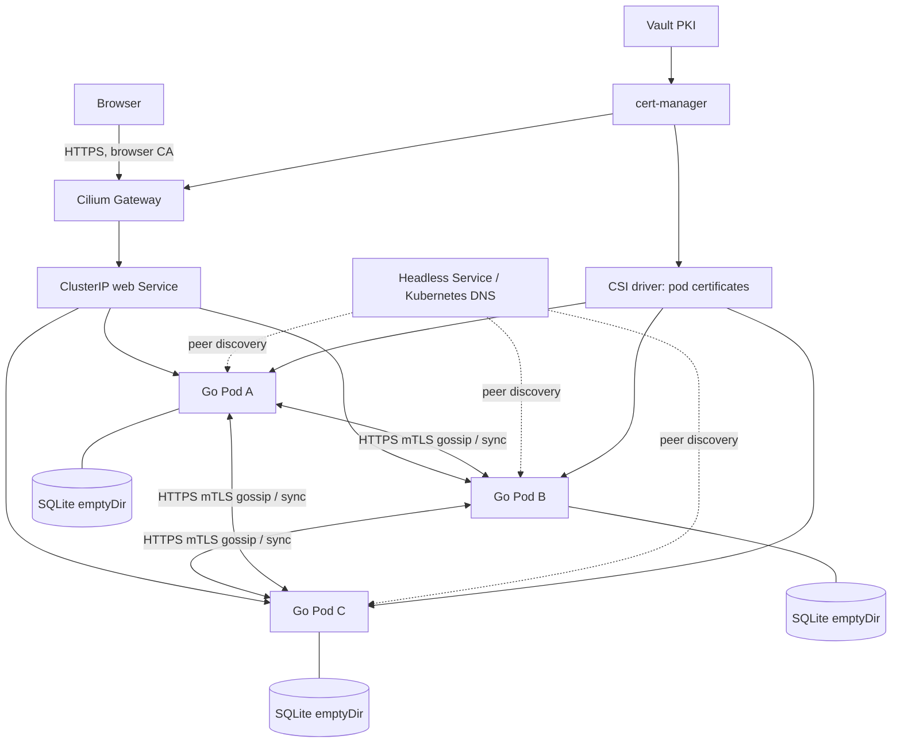

# Architecture

**Status:** Approved direction; protocol details may evolve during implementation review.

## Purpose

GossipGrid is a Kubernetes distributed systems testbed: a Go-based application for evaluating Kubernetes orchestration,
service discovery, gossip protocols, mTLS, fault tolerance, and automated deployments. It is not a production message
service.

## Goals

1. Evaluate Kubernetes concepts (DNS, EndpointSlices, readiness, pod scheduling, PKI, cert rotation, LB/Gateway,
   ephemeral storage, CI/CD) through a real, minimal application.
2. Test dynamic service discovery, secure mTLS, certificate rotation, eventual consistency, readiness, failure
   recovery, and deployment automation.
3. Keep the full application testable as five independent local processes without Kubernetes.
4. Provide a serious engineering reference for distributed replication and convergence patterns.

## Non-goals

- Strong consistency, distributed transactions, quorum writes, or a durable message service.
- Production-grade disaster recovery of message bodies.
- Installing and configuring cluster-wide components in early milestones.
- Claiming formal application-level FIPS 140-3 validation or production-readiness.

## Logical components

Three pods illustrated; default target is five, arbitrary count is configurable. All peer gossip paths are independent
of the public HTTP Service.

## Processes, storage, identity

- One process per pod, two listeners: public HTTP port `8080` (behind Gateway HTTPS) and private HTTPS peer port `8443`
  (mandatory mTLS).
- StatefulSet is used for predictable identity (`gossipgrid-0`, `gossipgrid-1`, ...), not durable data.
- One SQLite file per pod at `/data/gossipgrid.db` on disk-backed `emptyDir`. A container restart within the same pod
  retains the volume; pod replacement does not.
- GORM manages the schema; use WAL, busy timeout, transactions where appropriate, and unique message IDs.
- Web interface rendered by embedded Go templates and minimal JS; no Node/frontend pipeline.
- Health and security diagnostics do not need a ready peer to report useful information.

## Minimal message schema

| Field | Type | Meaning |
| --- | --- | --- |
| `id` | UUIDv7 text, primary key | Stable identity for idempotent replication |
| `body` | Text, max 4096 bytes | Original message |
| `origin` | Text | Pod identity at creation |
| `created_at` | UTC timestamp | Original creation time, unchanged by replication |

Primary key conflict on replicated insert is a successful no-op. Message deletion and mutation are outside v1 scope.

## Application boundaries

**Public side:** `GET /`, `GET /api/messages`, `POST /api/messages`, `GET /api/messages/{id}/status`,
`GET /api/cluster`, `GET /healthz`, `GET /readyz`. API paths and response formats are provisional until implemented.

**Private side:** `GET /internal/status`, bounded message/snapshot endpoints, inbound gossip, and membership/probe
functionality. All private methods require authenticated client certificates and peer identity validation. Unready
pods answer status requests but do not supply authoritative synchronization snapshots.

## Expected topology

- Headless peer Service: DNS/SRV discovery; `publishNotReadyAddresses: true` for initialization.
- Web ClusterIP Service: routes to ready pods only.
- Gateway + LoadBalancer IP for browser access over HTTPS (LAN); exact Cilium capabilities to be verified in cluster
  setup.
- `podManagementPolicy: Parallel` avoids StatefulSet bootstrap deadlock caused by ordered readiness.

## Consistency, failure, and observability

Eventual convergence of messages is the target under stable connectivity and surviving source data. Posting a message
to one pod confirms a local write, **not replication durability**. Per-message status must report `present`,
`missing`, or `unreachable` for every expected replica, not just members presently discovered in DNS.

Readiness means the replica is initialized and can participate, not that every replica has identical messages right
now. A temporary peer outage degrades convergence but does not automatically fail the readiness probe of an otherwise
healthy initialized pod.

Metrics (later): gossip attempts/failures, convergence lag, sync state, peer count, SQLite failures, cert expiry, reset
incidents. Logs use Go `slog` with trace/correlation IDs where useful.

## Lifecycle state machine (Milestone 5A — implemented 2026-11-21)

The `internal/lifecycle` package implements a concurrency-safe state machine that tracks whether a replica is
authorized to participate in a valid cluster epoch. It is **opt-in** (enabled via
`GOSSIPGRID_LIFECYCLE_ENABLED=true`, requires peer mTLS) and preserves all existing behavior when disabled.

**States:** `STARTING`, `DISCOVERING`, `GENESIS`, `SYNCING`, `READY`, `DEGRADED`, `RECOVERY_REQUIRED`.

**Key properties:**

- **No silent READY promotion.** The only path to `READY` is through an explicit controller method. It is never
  inferred from a started listener or a completed anti-entropy page.
- **GENESIS is never inferred.** It is entered only by explicit operator action (reserved for future milestones).
- **RECOVERY_REQUIRED does not imply data loss.** It signals the replica cannot safely participate; data is preserved.
- **Concurrency-safe.** Concurrent `Snapshot()` calls never observe an inconsistent state; transitions are serialized
  via `RWMutex`. Invalid transitions are rejected with an error, not silently dropped.
- **Fail-closed admission.** A single authoritative `AuthorizationSnapshot` gates all participation: public reads
  are quarantined, public writes return 503, and private replication (inbound gossip, anti-entropy sync) is rejected
  when the snapshot is not authorized. The snapshot requires ready state, fresh (non-stale) metadata, and a durable
  binding that matches the metadata. Outbound gossip and anti-entropy re-check admission at send/sync time — a
  revoked node blocks its outbound requests rather than using a stale decision. There is no retry on a revocation.
- **Epoch fencing.** Peer status and sync responses carry a request header
  (`X-GossipGrid-Cluster-ID`, `X-GossipGrid-Epoch-ID`) and a response envelope
  (`X-GossipGrid-Resp-Cluster-ID`, `X-GossipGrid-Resp-Epoch-ID`,
  `X-GossipGrid-Lifecycle-Active`). A replica whose local binding does not match the peer's epoch receives a 409
  (permanent, no retry) and does not merge data. A lifecycle-enabled client additionally validates the response
  envelope: a legacy peer (lifecycle disabled) that omits `X-GossipGrid-Lifecycle-Active: true` is rejected as a
  synchronization source, even with a valid mTLS certificate. The outbound epoch context is sourced from the
  controller's current authorization decision via the `EpochProvider`, not a one-time startup copy.

**Durable local binding:** A singleton row in the `local_metadata` SQLite table binds the database to a specific
cluster ID, epoch ID, and generation. Binding is atomic and idempotent: rebinding to the same values is a no-op;
rebinding to different values fails with `ErrBindingMismatch`. A nonempty database without a binding fails with
`ErrBindingNonempty`. Legacy databases (no binding row) are handled gracefully — they simply have no binding until
one is created.

**Metadata authority:** The `MetadataSource` interface provides a narrow, read-only view of authoritative cluster
metadata. In Milestone 5A, the production path uses a no-op source (`NewFakeMetadataSourceUnavailable`) that always
reports the metadata as unavailable, so the controller fails closed. The Kubernetes ConfigMap-backed provider is
reserved for Milestone 5B.

**Readiness semantics:** `GET /readyz` returns 200 only when the `AuthorizationSnapshot` is authorized
(ready state + fresh metadata + matching binding); all other states return 503 with a structured JSON body
(service, ready, state, reason). `GET /healthz` remains 200 regardless of lifecycle state.

## Risks and open implementation questions

- Define a safe multi-page snapshot protocol and follow-up reconciliation in the presence of concurrent posts.
  Bounded scans of immutable messages are sufficient for the small target size; design tests for races.
- Peer membership changes when scaling down or up; distinguish desired replicas from reachable DNS records.
- The cluster metadata control path must safely prevent two competing reset epochs (Kubernetes resourceVersion
  compare-and-swap, restricted RBAC, no secret content). Milestone 5A implements the epoch fencing and admission
  framework; the Kubernetes metadata provider and automatic genesis/reset are deferred to 5B and later.
- Choose DNS/URI SAN conventions based on deployed cert-manager CSI behavior; unit-test hostile identities.
- FIPS testing requires a pinned toolchain and module compatible with our supported build architectures; do not claim
  whole-cluster compliance.
