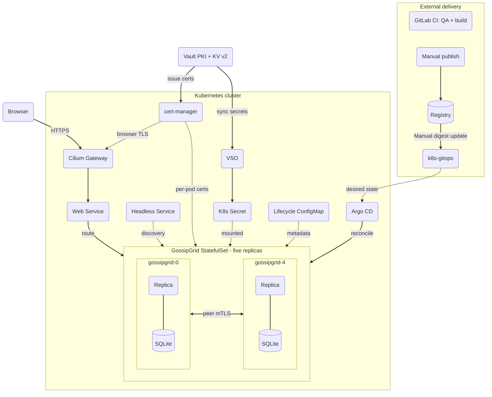

# Architecture

**Status:** Approved direction; protocol details may evolve during implementation review.

**Diagrams:** The authoritative architecture definitions are the Mermaid sources under [diagrams/](diagrams/),
rendered to SVG and PNG under [diagrams/generated/](diagrams/generated/). The main logical overview is
[system-architecture](diagrams/generated/system-architecture.svg). Regenerate all with `make architecture`
(pinned Mermaid CLI, see the Makefile). The inline diagram in this document (under "Logical components") is the
full system architecture — the same authoritative `system-architecture.mmd` source embedded natively. `make
diagrams-check` verifies the embedded block matches the `.mmd` source. Detailed companion diagrams:
[gossip/anti-entropy replication](diagrams/generated/gossip-replication.svg),
[lifecycle state machine and recovery](diagrams/generated/lifecycle-recovery.svg),
[replacement-pod/recovery sequence](diagrams/generated/lifecycle-recovery-sequence.svg),
[security and credentials](diagrams/generated/security-credentials.svg), and
[GitOps delivery](diagrams/generated/gitops-delivery.svg). For a learning-oriented walkthrough of the
distributed-systems concepts that underpin this architecture (gossip, anti-entropy, epoch fencing,
concurrency, recovery), see the [concept library](concepts/README.md).

## Purpose

GossipGrid is a Kubernetes distributed systems testbed: a Go-based application for evaluating Kubernetes orchestration,
service discovery, gossip protocols, mTLS, fault tolerance, and automated deployments. It is not a production message
service.

## Goals

1. Evaluate Kubernetes concepts (DNS, EndpointSlices, readiness, pod scheduling, PKI, cert rotation, LB/Gateway,
   ephemeral storage, CI/CD) through a real, minimal application.
2. Test dynamic service discovery, secure mTLS, certificate rotation, eventual consistency, readiness, failure
   recovery, and deployment automation.
3. Keep the full application testable as five independent local processes without Kubernetes.
4. Provide a serious engineering reference for distributed replication and convergence patterns.

## Non-goals

- Strong consistency, distributed transactions, quorum writes, or a durable message service.
- Production-grade disaster recovery of message bodies.
- Installing and configuring cluster-wide components in early milestones.
- Claiming formal application-level FIPS 140-3 validation or production-readiness.

## Roadmap and status

The implementation is phased. Milestones 0–5A and 6 are **implemented and locally tested** (Go code, unit tests, and
integration tests pass under the FIPS build and the race detector) and **deployed in the staging cluster** (M7A).
Milestone 7A (Kubernetes staging) is **deployed and initially smoke-tested in Kubernetes**: five StatefulSet
replicas are running and ready with zero restarts, peer mTLS and DNS discovery work, browser HTTPS access
through an existing shared Cilium Gateway is confirmed, Vault-managed credentials are loaded, and the immutable
image is deployed from a private GitLab registry via Argo CD. The **remaining acceptance tests** (cross-replica
convergence, recovery after pod replacement, live password rotation, fault tolerance) are pending in the
[staging runbook](../deploy/STAGING-RUNBOOK.md). Milestone 5B is **partially implemented**: Stages 0 (read-only
Kubernetes metadata provider), 1A (Kubernetes genesis grant), and 1B (operator-authorized genesis finalization)
are implemented and locally tested; Stage 2 (bootstrap replication admission, bounded insert, pinned-epoch
transport validation) is implemented, committed (`209cec1`), and locally tested (not yet cluster-verified);
Stage 3 (orchestration, automatic `READY` promotion) is designed but not implemented. Milestones 5C, 6B, 7B,
and 9 are **designed but not implemented**. Milestone 8 is **partially implemented**: immutable image
publishing and Argo CD digest-pinned reconciliation work, but automated delivery and promotion are not complete.

| Milestone | Scope | Status |
| --- | --- | --- |
| 5A | Lifecycle state machine, epoch fencing, fail-closed admission, durable binding | ✅ Implemented and locally tested |
| 5B | Kubernetes metadata authority, bootstrap replication admission (Stage 2), initial snapshot transfer, operator-controlled one-time genesis, snapshot-source eligibility (Stage 3) | 🔜 Stages 0, 1A, 1B, and 2 implemented, committed, and locally tested; Stage 3 (orchestration) designed but not implemented |
| 5C | Operator recovery/reset authorization, catastrophic data-loss handling, epoch transitions, incident audit | 🔜 Designed but not implemented |
| 6 | Web UI, single-administrator password authentication, credential reload (local; in-cluster Vault → VSO → mounted Secret is M7A) | ✅ Implemented and locally tested; in-cluster delivery deployed and verified in M7A |
| 6B | Cluster visualization: authenticated diagnostics, interactive SVG topology, native telemetry, replication/lifecycle visualization (4 feature stages) | 🔜 Designed; no implementation started. See [cluster-visualization.md](cluster-visualization.md) |
| 7A | Kubernetes staging: StatefulSet, `emptyDir` SQLite, peer + web Services, shared Cilium Gateway, cert-manager, VSO, Helm, Argo CD | ✅ Deployed and smoke-tested; full acceptance tests pending |
| 7B | Lifecycle-aware staging: enable lifecycle enforcement, in-cluster recovery and partition tests | 🔜 Designed but not implemented |
| 8 | GitOps delivery automation: immutable images, digest-based Argo CD reconciliation, automated promotion | 🔜 Partial: immutable image + Argo CD work; automation incomplete |
| 9 | Resilience/security lab: fault injection, reset authorization, metrics, FIPS profile | 🔜 Designed but not implemented |

### Milestone 5B — Authoritative metadata and initial synchronization (partial)

> **Corrected (2026-11-23).** The original 5B/5C plan contained several unsafe assumptions. The corrected
> design — one-time genesis authorization, corrected Kubernetes RBAC (no `resourceNames` on `create`),
> narrowly scoped bootstrap admission, the transient-vs-catastrophic failure model, the
> `EverAcceptedMessages` durable marker, the 7A→7B migration, and the read-only Stage 0 provider — is
> documented in [lifecycle-metadata-and-genesis.md](lifecycle-metadata-and-genesis.md), which supersedes
> the original text below where the two disagree. Summary of the corrections:

- **Authoritative metadata is a versioned document, not just flags.** A strictly versioned JSON
  document (schema version 1) in the named ConfigMap `gossipgrid-cluster-metadata` carries
  `clusterId`, `epochId`, `generation`, `initialized`, a one-time `genesisAuthorized` flag (with a
  `genesisConsumer`), `everAcceptedMessages`, and the last reset incident. The `ClusterMetadata.Revision`
  is populated from the Kubernetes `resourceVersion`.
- **Genesis is one-time, not inferred, and the ordering is corrected.** `GENESIS` requires
  the explicit one-time `genesisAuthorized` authorization in authoritative metadata **and**
  `initialized=false` **and** an empty, unbound local database **and** the canonical seed
  `gossipgrid-0`. The seed **binds** under the authorization and **stays in `GENESIS`**
  while `initialized=false` (the 5A `SetReady` gate rejects promotion while the
  authoritative metadata reports `Initialized=false`, so the seed cannot reach `READY` in
  this state). The authorization is **consumed** (set to `false`) by the operator's
  **finalization Job** — *not* by the seed (the application ServiceAccount is read-only and
  cannot `update` the ConfigMap) — in the same atomic CAS that sets `initialized=true`,
  records `genesisConsumer`, and arms `dataLossProtected=true`. Only after observing the
  finalized metadata does the seed transition to `READY` and open public writes. A
  replacement pod after data loss cannot re-enter genesis. Empty SQLite state alone is
  **never** sufficient.
- **Kubernetes RBAC is corrected.** The genesis Job (operator-triggered, **not** a Helm hook) grants
  `create` on `configmaps` **in the namespace** (a top-level `create` **cannot** be restricted by
  `resourceNames`). The running application ServiceAccount is **read-only**: `get` on the named
  ConfigMap only. The `EverAcceptedMessages` write path (if added later) requires `update` on the named
  object, which RBAC **cannot** restrict to a single JSON field — a significant trust expansion, so the
  preferred design writes it from a dedicated Job and keeps the app pods read-only.
- **Bootstrap admission is narrowly scoped, not a general relaxation.** A dedicated
  `CheckBootstrapFetch` authorizes **only** an epoch-bound `SYNCING` replica to **fetch** a baseline
  from an eligible `READY` source via the inventory/fetch endpoints. It does not authorize public
  writes, gossip, wrong-epoch replication, or a `SYNCING` source. mTLS and epoch fencing are preserved.
- **A metadata outage is not a data-loss incident.** A transient API/peer unavailability marks authority
  `invalid` (fail-closed, 503) but does **not** enter `RECOVERY_REQUIRED` and records no loss incident.
  `RECOVERY_REQUIRED` is entered **only** on a proven binding/metadata mismatch (a lockout, not data
  loss). The epoch is never silently reset. Confirmed catastrophic loss is handled by 5C, not 5B.
- **Initial snapshot transfer and eligibility are unchanged in intent.** A `SYNCING` replica pulls a
  bounded, keyset-paginated baseline from an eligible `READY`/`DEGRADED` source (matching epoch, valid
  lifecycle envelope) and transitions to `READY`. `SYNCING` replicas are never eligible as bootstrap
  sources. The existing anti-entropy transport and the initial-sync readiness barrier are reused — no
  second synchronization engine.
- **Fail-closed when authority is unavailable.** If the ConfigMap is absent or the API is unavailable,
  the replica stays in its current state with authority `invalid` (503) and does not invent an epoch.
- **7A→7B migration (design, corrected 2026-11-23).** The existing 7A cluster (lifecycle
  disabled, with messages, **no** authoritative epoch binding in the control plane) is
  migrated by a **controlled, operator-orchestrated export/import**: (a) quiesce writes;
  (b) export the **union** of all 7A peers' message sets to a **temporary** durable
  location (a `Secret`, a temporary `PersistentVolume`, or an object store); (c) provision
  the authoritative ConfigMap with a **new** 7B `ClusterID` + `EpochID` (7A has no binding
  to carry forward; the operator establishes the 7B identity explicitly) and
  `Initialized=true` / `dataLossProtected=true`; (d) deploy the 7B pods with **`emptyDir`**
  (the intentionally ephemeral architecture is preserved) and a **different**
  StatefulSet/Service/DNS name from the 7A deployment (to avoid collisions during the
  coexistence window); (e) explicitly bind each 7B pod to the authoritative epoch; (f)
  import the exported messages via an **authorized import procedure** (a dedicated,
  tightly-scoped Job that writes directly to the SQLite store, **not** via the public
  API — the 7B pods' lifecycle admission would block a `SYNCING` or unbound pod's public
  writes); (g) verify the 7B cluster (all pods `READY`, message count matches the exported
  union, lifecycle envelope present); (h) drain the 7A pods **only after** the 7B cluster
  is verified. The 7A environment remains intact until 7B is verified. Recovery through
  authorized surviving peers (the 5C path) is unchanged. Details in
  [lifecycle-metadata-and-genesis.md](lifecycle-metadata-and-genesis.md#6-migration-from-the-current-staging-7a--7b).
- **Stage 0 (implemented, inactive).** A read-only `lifecycle.MetadataSource` provider for the ConfigMap
  is implemented in `internal/lifecycle/k8smetadata` with an injectable client and full unit tests. It is
  **not** wired into the running application in Stage 0 (lifecycle remains disabled); the heavy
  `client-go` dependency is deferred to 7B.
- **Stage 2 (implemented 2026-11-24, inactive in the default build).** The bootstrap replication
  admission mechanism is implemented: `CheckBootstrapFetch` (requester-side, narrowly scoped to an
  epoch-bound `SYNCING` replica), `CheckBootstrapSourceInbound` (serving-side, requires `READY`/`DEGRADED`
  and full authorization), the `X-GossipGrid-Request-Purpose` header (untrusted metadata that only selects
  the serving-side check), `CommitUnderBootstrapAuthorization` (revalidates the dedicated bootstrap
  authorization at the local write boundary under the `c.mu RLock → m.mu RLock` lock order), and
  `FetchBootstrapBaseline` (the transport-and-commit mechanism for a joining `SYNCING` replica). The
  mechanism is wired into the production code path (`cmd/gossipgrid/main.go`) but is **only active** when
  lifecycle protection is enabled (`GOSSIPGRID_LIFECYCLE_ENABLED=true`); the default Helm build has
  lifecycle disabled, so the bootstrap admission is a passthrough (legacy behavior preserved). Stage 3
  (source discovery/selection, sweep scheduling, automatic `READY` promotion) is **not yet implemented**.
  See [gossip-and-bootstrap.md](gossip-and-bootstrap.md#milestone-5b-stage-2--bootstrap-replication-admission-implemented-2026-11-24)
  for the full admission contract.

### Milestone 5C — Controlled recovery (designed, not implemented)

> **Corrected (2026-11-23).** The boundary between a transient metadata outage and a confirmed
> catastrophic loss is defined in [lifecycle-metadata-and-genesis.md](lifecycle-metadata-and-genesis.md#4-transient-versus-catastrophic-metadata-failure):
> 5B only **fails closed** (no reset) on a transient outage or an unbound/mismatched replica; 5C is the
> **only** milestone that performs an operator-authorized epoch reset, and only on **confirmed** total loss.

- **Explicit operator authorization.** A `RECOVERY_REQUIRED` replica returns to `READY` only after an explicit
  operator action (a dedicated endpoint or a controlled job with tightly scoped RBAC). There is **no automatic
  destructive reset by default**.
- **Catastrophic data-loss handling.** A reset is attempted only when every expected identity responds conclusively
  that all eligible data sources are gone **and** the control-plane metadata permits a reset. The preconditions are
  rechecked immediately before the atomic update.
- **Epoch transitions and stale-data fencing.** Old-epoch replicas are quarantined and never silently rejoin or
  inject messages into the new epoch. An old-epoch return requires explicit operator inspection.
- **Incident and recovery audit.** A completed reset does not hide history: a persistent, dismissible incident
  banner reports the previous/current epoch, detection time, mode (manual/automatic), and an explicit message-loss
  warning. The ConfigMap records the reset cause and acknowledgment state.

### Milestone 6 — Web UI and authentication (implemented locally; in-cluster delivery deployed and verified in M7A)

The browser interface, single-administrator password authentication, credential reload, and session-bound CSRF
protection are **implemented and locally tested**. The in-cluster delivery path (Vault KV v2 → Vault Secrets
Operator → mounted K8s Secret) is **deployed and verified in the staging cluster** (Milestone 7A — Vault-managed
credentials load successfully, and browser login works); the same credential file format is provisioned locally
by the `gossipgrid credential` CLI.

- **Browser interface.** Embedded Go templates and minimal JS (no frontend build pipeline). The UI shows the
  serving pod, cluster membership, message availability, and security diagnostics. A browser refresh can land on
  another ready replica; the UI explicitly displays which replica responded.
- **Single-administrator password authentication.** One administrator password, stored in external HashiCorp Vault
  KV v2. Vault Secrets Operator (VSO) synchronizes the Vault secret to a Kubernetes Secret. The Secret is mounted
  **read-only** into GossipGrid pods. Credentials are **never** delivered through environment variables.
- **Authentication enabled by default (fail-closed).** Browser password authentication is **enabled by
  default** (`GOSSIPGRID_AUTH_ENABLED=true`). With it enabled and the credential file absent or malformed, the
  web endpoints **fail closed** with `503 Service Unavailable` — there is no silent fallback to anonymous
  access. `GET /healthz` and `GET /readyz` remain unauthenticated (Kubernetes probes). To run unauthenticated
  for local development, set `GOSSIPGRID_AUTH_INSECURE_DEV_MODE=true` (a clearly-named, insecure,
  local-development-only opt-out) or `GOSSIPGRID_AUTH_ENABLED=false`.
- **Credential reload without restart.** The application polls the credential file (the same poll-based mechanism
  used for peer mTLS certificate reload) at `GOSSIPGRID_AUTH_RELOAD_INTERVAL` (default 2s). Reload is
  **change-detecting** over all security-relevant fields (verifier, signing key, PBKDF2 parameters, generation):
  a no-op when unchanged, an atomic swap to an immutable snapshot when changed. A malformed replacement never
  replaces the last good snapshot and does not reset its freshness. When the file has been failing longer than
  `GOSSIPGRID_AUTH_MAX_STALE` (default 5m), authentication fails closed (503). A changed verifier or signing key
  is never silently ignored.
- **Password rotation semantics (no overlap window).** A password rotation (new password + new generation + new
  signing key) invalidates the previous credential and **all** existing sessions. There is **no overlap
  window**: a session under the old generation is rejected immediately once a replica has loaded the new
  generation. The new password is verified against the loaded material; the old password is no longer accepted.
  **Signing-key rotation** (new key, same generation) preserves same-generation sessions.
- **Authentication scope.** Public message API endpoints (`POST /api/messages`, `GET /api/messages`,
  `GET /api/messages/{id}`) require authentication. `GET /healthz` and `GET /readyz` remain unauthenticated.
  Peer mTLS is **independent** of browser authentication: the peer listener's security is unchanged.
- **Local-development support.** The credential file is read from an ordinary filesystem path
  (`GOSSIPGRID_AUTH_CREDENTIAL_FILE`, the same `GOSSIPGRID_*_FILE` convention used for peer TLS material).
  Local development provisions it with the `gossipgrid credential` CLI (`init`/`rotate`/`verify` — interactive
  hidden prompts, no password in process arguments, 0600 atomic writes); Kubernetes mounts it from a Secret
  volume. An explicit `GOSSIPGRID_AUTH_INSECURE_DEV_MODE` is available for unauthenticated local development.
- **Verification scheme (implemented).** PBKDF2-HMAC-SHA-256 (RFC 2898) with a calibrated iteration count, a
  randomly generated per-credential salt, and a constant-time verifier comparison, all using FIPS-approved
  Go primitives (`crypto/pbkdf2`, `crypto/hmac`, `crypto/sha256`, `crypto/rand`) verified against the
  existing `GOFIPS140` build profile. The credential file is a versioned structure (format version 1) recording
  algorithm, iteration count, salt, verifier, credential generation, and the common session-signing key
  (all 32-byte hex-encoded fields). The session cookie is a **signed session value that any replica can
  verify independently** (not a per-process server-side store, and not a self-contained JWT) with
  `GOSSIPGRID_AUTH_SESSION_TTL` (Go default 2h; Helm chart default 24h) and `GOSSIPGRID_AUTH_SESSION_IDLE_TTL`
  (default 30m), and
  `HttpOnly`, `Secure`, `SameSite=Strict` flags; it never carries the password or verifier. Sessions are
  bound to the credential **generation**, so a rotation invalidates previously issued sessions (no overlap
  window). CSRF protection uses a double-submit cookie token (`gossipgrid_csrf` cookie + `X-CSRF-Token`
  header) that is **session-bound** — `HMAC-SHA256(signing key, session SID)` — so a token cannot be reused
  across sessions.
- **Logging and secret handling.** Passwords, credential file contents, and session tokens are never logged.
  Diagnostics report credential state (loaded, reload count, last reload time) without disclosing the credential
  material.

### Milestone 7A — Initial Kubernetes staging (deployed and smoke-tested; full acceptance tests pending)

- **Five configurable StatefulSet replicas** with `podManagementPolicy: Parallel` and no PVC templates.
- **Independent SQLite databases** on `emptyDir` (pod-lifetime, not pod-replacement-surviving).
- **Headless peer Service** with a named `peer` port (8443) and `publishNotReadyAddresses: true` for
  bootstrap deadlock avoidance.
- **Ready-only public web Service** (ClusterIP) routing to ready pods only.
- **Kubernetes DNS peer discovery** via the headless Service's SRV/A records.
- **Separate workload PKI and per-pod peer mTLS** via cert-manager CSI with an external Vault PKI issuer.
- **Browser HTTPS** through the existing shared Cilium Gateway. The GossipGrid Helm chart sets
  `gateway.enabled=false`; the cluster's shared Gateway and GitOps-managed HTTPRoutes handle browser traffic.
  The browser certificate is managed separately in the `gateway-system` namespace. The chart uses a
  CiliumNetworkPolicy for the Gateway's reserved ingress identity.
- **VSO-managed authentication Secret** mounted read-only into the pods.
- **Helm packaging** and **Argo CD ownership** of the GossipGrid resources. The Argo CD Application for the
  staging deployment is maintained in the separate `k8s-gitops` repository with environment-specific Helm values;
  `deploy/argocd/application.yaml` in this repository is a reusable example.
- **Non-root containers** and appropriate resource/probe configuration.
- **Gossip and anti-entropy convergence tests** in-cluster.
- **Live password-rotation demonstration** without pod restarts (eventual, not instantaneous: VSO and Secret
  propagation are asynchronous, and the rotation window is measured in staging).
- **Initial anti-entropy synchronization barrier (7A enhancement, opt-in).** `GOSSIPGRID_INITIAL_SYNC_BARRIER_ENABLED`
  (Helm `initialSync.enabled`) holds a replacement pod in NotReady until it completes its initial anti-entropy
  synchronization against all expected peers in the configured StatefulSet membership. Disabled by default; enabled
  in the staging values file. A completed pass is a useful rollout barrier, not an atomic cluster snapshot. See
  [kubernetes-deployment.md](kubernetes-deployment.md#synchronization-aware-kubernetes-readiness).
- **What 7A validates.** Existing gossip, anti-entropy, peer discovery, peer mTLS, web authentication, and
  live password rotation. Pod replacement in 7A is re-reconciled by anti-entropy (a best-effort test); it is
  **not** validated as authoritative initial snapshot synchronization, safe genesis, or lifecycle readiness
  gating — those guarantees belong to 5B and 7B. The initial-sync barrier improves the *probability* of recovery
  during a rolling update but is **not** an authoritative-snapshot guarantee.
- **Lifecycle enforcement remains disabled** in 7A because the required 5B implementation is incomplete. This
  means the staging phase has **reduced safety guarantees**: a pod replacement loses its local SQLite data and
  is re-reconciled by anti-entropy (best effort, not an authoritative-snapshot guarantee), but there is no
  authoritative epoch fencing, no snapshot-source eligibility check, and no recovery lockout. The reduced
  guarantees are an intentional tradeoff to validate the Kubernetes plumbing (DNS, mTLS, Gateway, VSO,
  cert-manager) before enabling the lifecycle layer.

### Milestone 7B — Lifecycle-aware Kubernetes staging (designed, not implemented)

- **Enable lifecycle enforcement** (`GOSSIPGRID_LIFECYCLE_ENABLED=true`).
- **Exercise authoritative metadata and epoch fencing** in-cluster (ConfigMap-backed metadata, 409 epoch mismatch,
  response envelope validation).
- **Verify safe genesis and initial synchronization** (a fresh pod joins via snapshot transfer from an eligible
  source; `SYNCING` pods are never eligible as bootstrap data sources).
- **Validate recovery authorization and stale-state rejection** (a `RECOVERY_REQUIRED` pod returns to READY only
  after explicit operator action; old-epoch pods are rejected as sync sources).
- **Run fail-closed, partition, and catastrophic-recovery tests** in-cluster.

### Milestone 8 — GitOps delivery automation (partial: immutable image + Argo CD work; automation incomplete)

- **GitLab CI** performs QA and security checks. Container image build and publish are currently **manual**
  (`make image` + push to the private GitLab Container Registry); automated CI-driven publishing is not yet
  implemented.
- **Publish immutable container images** by commit SHA / digest; never use `latest` as a deployment identity.
  ✅ **Done in staging (manual)** — an immutable image was built with `make image`, pushed to the private
  GitLab Container Registry, and deployed in the cluster.
- **Argo CD reconciles Kubernetes deployment state** (watches the k8s-gitops repository, syncs the cluster to the
  recorded desired state). ✅ **Done in staging** — the Argo CD Application is maintained in the separate
  `k8s-gitops` repository with environment-specific Helm values; the image is digest-pinned (manually updated).
- **Record and deploy images by immutable digest** in the GitOps repository. 🔜 **Pending** — automated digest
  recording (CI commits the digest to k8s-gitops) is not yet implemented.
- **Update the GitOps desired application revision** (a commit in the GitOps repository referencing the image
  digest). 🔜 **Pending** — the revision update is currently manual.
- **No direct CI deployments** that compete with Argo CD. All deployment goes through Argo CD.
- **Document release promotion, rollback, and failure handling.** A failed Argo CD sync is observable and
  reversible. 🔜 **Pending**.
- **Clear responsibility boundaries** between Ansible, GitLab CI, Helm, Vault, and Argo CD (see the ownership
  boundaries section in [kubernetes-deployment.md](kubernetes-deployment.md)).

### Milestone 9 — Resilience/security lab (designed, not implemented)

- **Fault injection** (pod loss, partition, network impairment, CA rotation).
- **Reset authorization** (M5C operator procedure, tested in-cluster).
- **Metrics** (gossip attempts/failures, convergence lag, sync state, peer count, SQLite failures, cert expiry,
  reset incidents).
- **FIPS profile verification** (runtime FIPS state, TLS behavior, binary static linkage, container digest).
- **Logged and reproducible experiments** (a full-pod-loss scenario fails closed, is manually reset, and the
  incident persists in metadata).

## Logical components

[View full-size SVG](diagrams/generated/system-architecture.svg) · [View PNG](diagrams/generated/system-architecture.png)

<!-- DIAGRAM:system-architecture -->

The diagram above is the full system architecture (the same authoritative
`system-architecture.mmd` source embedded in the README). GossipGrid is shown
as one StatefulSet whose five configured replicas each keep an independent
SQLite store; the two illustrated replicas (`gossipgrid-0` and `gossipgrid-4`,
each in its own compact replica group with its SQLite database immediately
below) are representative of the five deployed replicas (`gossipgrid-0..4`).
The Web Service routes to the StatefulSet as a group. Peer mTLS is direct and
bidirectional between the illustrated replicas — it does not flow through the
Web Service or the headless Service. The external "External delivery" group
shows GitLab CI (QA and build), a manual publish step, the registry, and the
`k8s-gitops` repository, each separate from the automated CI; the registry
feeds a manual digest update into `k8s-gitops`. The Registry and `k8s-gitops`
repository sit outside the cluster; Argo CD is declared only inside the
Kubernetes cluster. External Vault is treated as an external cluster
prerequisite. Automated CI-driven image publication and automated GitOps
updates are not depicted because they are not yet implemented (Milestone 8).
All peer gossip paths are independent of the public HTTP Service. The diagram
renders natively on GitHub and GitLab; the
[SVG](diagrams/generated/system-architecture.svg) and
[PNG](diagrams/generated/system-architecture.png) links are fallbacks.

## Processes, storage, identity

- One process per pod, two listeners: public HTTP port `8080` (behind Gateway HTTPS) and private HTTPS peer port `8443`
  (mandatory mTLS).
- StatefulSet is used for predictable identity (`gossipgrid-0`, `gossipgrid-1`, ...), not durable data.
- One SQLite file per pod at `/data/gossipgrid.db` on disk-backed `emptyDir`. A container restart within the same pod
  retains the volume; pod replacement does not.
- GORM manages the schema; use WAL, busy timeout, transactions where appropriate, and unique message IDs.
- Web interface rendered by embedded Go templates and minimal JS; no Node/frontend pipeline.
- Health and security diagnostics do not need a ready peer to report useful information.

## Minimal message schema

| Field | Type | Meaning |
| --- | --- | --- |
| `id` | UUIDv7 text, primary key | Stable identity for idempotent replication |
| `body` | Text, max 4096 bytes | Original message |
| `origin` | Text | Pod identity at creation |
| `created_at` | UTC timestamp | Original creation time, unchanged by replication |

Primary key conflict on replicated insert is a successful no-op. Message deletion and mutation are outside v1 scope.

## Message retention (opt-in)

Retention is **disabled by default** (`GOSSIPGRID_MESSAGE_RETENTION_TTL` unset or `0`). When enabled, messages
expire based on their immutable `created_at` timestamp: a message is expired when
`created_at < now - TTL` (strict less-than; a message exactly at the cutoff is retained).

When enabled, expired messages are:

- **Excluded from the API**: `GET /api/messages` omits them (and the `total` count reflects only retained
  messages); `GET /api/messages/{id}` returns `404` for them (indistinguishable from an absent message).
- **Excluded from gossip and anti-entropy**: the sync inventory (`GET /internal/sync/ids`) does not advertise
  expired IDs, and the sync fetch (`POST /internal/sync/messages`) reports expired IDs as "not found"
  (defense in depth). This prevents anti-entropy from re-inserting (resurrecting) a message that a
  replica has already expired.
- **Periodically deleted**: a background sweeper runs an initial sweep on startup and then on a configurable
  interval (`GOSSIPGRID_MESSAGE_RETENTION_INTERVAL`, default 1h), deleting rows where
  `created_at < now - TTL`. The sweeper shuts down cleanly with the application.

**Operational limitations:**

- **Clock skew**: expiration uses each replica's local clock. If replicas' clocks diverge by more than the TTL,
  a message may be expired on one replica but retained on another. Keep clocks synchronized (NTP) to minimize
  this window.
- **Per-replica TTL**: each replica independently evaluates its own `created_at < now - TTL` check. All replicas
  should be configured with the **same** `GOSSIPGRID_MESSAGE_RETENTION_TTL` for consistent behavior.
- **No tombstones**: expired messages are simply deleted from the local SQLite database. There is no
  distributed tombstone or "delete" record that propagates to peers. A peer that has not yet expired a message
  (e.g. because its TTL is longer or its clock is behind) will retain it until its own sweep runs.
- **Sub-minute TTLs are rejected**: the minimum `GOSSIPGRID_MESSAGE_RETENTION_TTL` is `1m` (to avoid
  excessive sweep churn and clock-skew sensitivity).
- **Sub-second intervals are rejected**: the minimum `GOSSIPGRID_MESSAGE_RETENTION_INTERVAL` is `1s`.

### SQLite storage maintenance

When retention is enabled, each sweep also performs bounded SQLite maintenance to keep the logical
database size (and, with incremental vacuum, the physical file size) in check over long-running
operation:

- **Incremental auto-vacuum**: new databases are created with `auto_vacuum=INCREMENTAL` so that
  deleted pages are tracked on the freelist and can be reclaimed without a full `VACUUM`. When
  enabled, SQLite can truncate the physical main database file down to the logical size
  (`page_count × page_size`) as freelist pages are reclaimed (subject to WAL-mode checkpoint
  behavior); a full `VACUUM` also rebuilds and shrinks the physical database file. The logical page
  count, freelist page count, main database file length, and physical WAL file length are distinct
  quantities and are reported separately. Existing databases (created before this feature) are
  **not** silently converted — the operator can run a one-time `VACUUM` during a maintenance window
  to enable incremental reclamation.
- **Bounded page reclamation**: after each cleanup sweep, `PRAGMA incremental_vacuum(N)` reclaims
  up to N freelist pages (default N=100, ~800 KiB at 8 KiB page size). This is a single bounded
  operation that does not hold the writer lock for long and does not perform a full `VACUUM`.
- **WAL maintenance**: `PRAGMA journal_size_limit=64 MiB` sets the target size
  SQLite retains for the WAL file under normal (unobstructed) checkpointing.
  This is a retained-file-size management setting, **not** an absolute
  maximum: SQLite can let the WAL file exceed this value, particularly when
  checkpoint progress is obstructed by active readers. A
  `PRAGMA wal_checkpoint(PASSIVE)` is run after each sweep to copy outstanding
  WAL frames into the main database file (moving the uncheckpointed data from
  the WAL into the main file). A PASSIVE checkpoint does not block readers; if
  readers are active, the checkpoint is deferred to the next cycle. A
  "successful empty" checkpoint (no outstanding frames) is reported as
  success, not as a failure.
- **Cancellable**: all maintenance operations accept the cleaner's context, so shutdown
  cancellation interrupts in-flight work (no unbounded cleanup loop monopolizing SQLite).
- **Disabled by default**: when retention is disabled (`TTL=0`), no cleaner is started and no
  maintenance runs. Enabling retention in an existing deployment does not automatically trigger
  a destructive cleanup; the first sweep only deletes rows already past the expiration threshold.

**Observability:** the cleaner logs (via `slog`) the number of rows deleted, cleanup duration,
pages reclaimed, freelist page count (before/after), database logical size, WAL file size,
and checkpoint status. Routine maintenance cycles are logged at `DEBUG` level; deletions and
failures at `INFO`/`WARN`. The cumulative `TotalDeleted` and `TotalPagesReclaimed` counters are
available for diagnostics.

## Application boundaries

**Public side:** `GET /`, `GET /api/messages`, `POST /api/messages`, `GET /api/messages/{id}/status`,
`GET /api/cluster`, `GET /healthz`, `GET /readyz`. API paths and response formats are provisional until implemented.

**Private side:** `GET /internal/status`, bounded message/snapshot endpoints, inbound gossip, and membership/probe
functionality. All private methods require authenticated client certificates and peer identity validation. Unready
pods answer status requests but do not supply authoritative synchronization snapshots.

## Expected topology

- Headless peer Service: DNS/SRV discovery; `publishNotReadyAddresses: true` for initialization.
- Web ClusterIP Service: routes to ready pods only.
- Browser HTTPS through the existing shared Cilium Gateway (the GossipGrid chart sets `gateway.enabled=false`;
  HTTPRoutes are managed in the `k8s-gitops` repository); the browser certificate is managed separately in
  `gateway-system`.
- `podManagementPolicy: Parallel` avoids StatefulSet bootstrap deadlock caused by ordered readiness.

## Consistency, failure, and observability

Eventual convergence of messages is the target under stable connectivity and surviving source data. Posting a message
to one pod confirms a local write, **not replication durability**. Per-message status must report `present`,
`missing`, or `unreachable` for every expected replica, not just members presently discovered in DNS.

Readiness means the replica is initialized and can participate, not that every replica has identical messages right
now. A temporary peer outage degrades convergence but does not automatically fail the readiness probe of an otherwise
healthy initialized pod.

**Initial anti-entropy synchronization barrier (Milestone 7A enhancement, opt-in).** In a StatefulSet with ephemeral
`emptyDir` storage, a replacement pod starts empty and recovers via anti-entropy. An opt-in readiness barrier
(`GOSSIPGRID_INITIAL_SYNC_BARRIER_ENABLED=true`, enabled in the staging values file) holds the replacement pod in
NotReady until it has completed its **initial** anti-entropy synchronization — a successful, complete full inventory
pass against **every** expected remote peer in the configured StatefulSet membership. A completed pass is a useful
rollout barrier (the replacement has retrieved the surviving peers' inventory and fetched the missing records before
becoming Ready), but it is **not** a mathematically atomic cluster snapshot: messages written after a peer's last full
sweep are not in the replacement's store until the next anti-entropy cycle. The barrier is one-shot (a transient peer
outage after Ready does not re-open it), has no timeout (a pod is never auto-marked Ready), and is a single logical
combination with lifecycle authorization in `/readyz` (200 only when both hold; the barrier never overrides a
metadata/epoch/lockout/recovery/stopped failure). An unready pod still serves its peer listener and inventory
endpoints (and the headless peer Service keeps `publishNotReadyAddresses: true`), so a simultaneous startup of all
replicas does not deadlock. See
[kubernetes-deployment.md](kubernetes-deployment.md#synchronization-aware-kubernetes-readiness) for the full
semantics, configuration, and diagnostics.

Metrics (later): gossip attempts/failures, convergence lag, sync state, peer count, SQLite failures, cert expiry, reset
incidents. Logs use Go `slog` with trace/correlation IDs where useful.

## Lifecycle state machine (Milestone 5A — implemented 2026-11-21)

The `internal/lifecycle` package implements a concurrency-safe state machine that tracks whether a replica is
authorized to participate in a valid cluster epoch. It is **opt-in** (enabled via
`GOSSIPGRID_LIFECYCLE_ENABLED=true`, requires peer mTLS) and preserves all existing behavior when disabled.

**States:** `STARTING`, `DISCOVERING`, `GENESIS`, `SYNCING`, `READY`, `DEGRADED`, `RECOVERY_REQUIRED`.

**Key properties:**

- **No silent READY promotion.** The only path to `READY` is through an explicit controller method. It is never
  inferred from a started listener or a completed anti-entropy page.
- **GENESIS is never inferred.** It is entered only by explicit operator action (reserved for future milestones).
- **RECOVERY_REQUIRED does not imply data loss.** It signals the replica cannot safely participate; data is preserved.
- **Concurrency-safe.** Concurrent `Snapshot()` calls never observe an inconsistent state; transitions are serialized
  via `RWMutex`. Invalid transitions are rejected with an error, not silently dropped.
- **Fail-closed admission.** A single authoritative `AuthorizationSnapshot` gates all participation: public reads
  are quarantined, public writes return 503, and private replication (inbound gossip, anti-entropy sync) is rejected
  when the snapshot is not authorized. The snapshot requires ready state, fresh (non-stale) metadata, and a durable
  binding that matches the metadata. Outbound gossip and anti-entropy re-check admission at send/sync time — a
  revoked node blocks its outbound requests rather than using a stale decision. There is no retry on a revocation.
- **Epoch fencing.** Peer status and sync responses carry a request header
  (`X-GossipGrid-Cluster-ID`, `X-GossipGrid-Epoch-ID`) and a response envelope
  (`X-GossipGrid-Resp-Cluster-ID`, `X-GossipGrid-Resp-Epoch-ID`,
  `X-GossipGrid-Lifecycle-Active`). A replica whose local binding does not match the peer's epoch receives a 409
  (permanent, no retry) and does not merge data. A lifecycle-enabled client additionally validates the response
  envelope: a legacy peer (lifecycle disabled) that omits `X-GossipGrid-Lifecycle-Active: true` is rejected as a
  synchronization source, even with a valid mTLS certificate. The outbound epoch context is sourced from the
  controller's current authorization decision via the `EpochProvider`, not a one-time startup copy.

**Durable local binding:** A singleton row in the `local_metadata` SQLite table binds the database to a specific
cluster ID, epoch ID, and generation. Binding is atomic and idempotent: rebinding to the same values is a no-op;
rebinding to different values fails with `ErrBindingMismatch`. A nonempty database without a binding fails with
`ErrBindingNonempty`. Legacy databases (no binding row) are handled gracefully — they simply have no binding until
one is created.

**Metadata authority:** The `MetadataSource` interface provides a narrow, read-only view of authoritative cluster
metadata. In Milestone 5A, the production path uses a no-op source (`NewFakeMetadataSourceUnavailable`) that always
reports the metadata as unavailable, so the controller fails closed. The Kubernetes ConfigMap-backed provider is
reserved for Milestone 5B.

**Readiness semantics:** `GET /readyz` returns 200 only when the `AuthorizationSnapshot` is authorized
(ready state + fresh metadata + matching binding); all other states return 503 with a structured JSON body
(service, ready, state, reason). `GET /healthz` remains 200 regardless of lifecycle state.

## Risks and open implementation questions

Resolved (2026-11-21, M5A committed as `v0.1.0-alpha.5`):

- Safe multi-page snapshot protocol and follow-up reconciliation (M4C, implemented with bounded keyset pagination,
  cursor progression, and the 256 KiB response limit).
- Pod certificate identity SAN conventions and Go-side authorization logic (M3B, implemented with strict
  SAN-only validation).
- FIPS toolchain and module pinning (M1, implemented with Go 1.27 and FIPS module v1.0.0).

Still open, to be resolved as their milestones are implemented:

- **M5B — Genesis and reset contract (corrected, 2026-11-23).** The one-time genesis authorization, the
  corrected RBAC (no `resourceNames` on `create`), the narrowly scoped bootstrap admission, the
  transient-vs-catastrophic failure model, the `EverAcceptedMessages` durable marker, and the 7A→7B
  migration are documented in [lifecycle-metadata-and-genesis.md](lifecycle-metadata-and-genesis.md).
  The `resourceVersion` compare-and-swap is designed; the metadata write paths (genesis finalization,
  `EverAcceptedMessages`) and 5C reset authorization are deferred to 5B/5C.
- **M5C — Recovery procedure details.** The exact operator recovery/reset mechanism (endpoint vs. controlled job),
  the RBAC scope, and the incident audit format.
- **M6 (resolved and deployed in M7A).** The PBKDF2-HMAC-SHA-256 iteration count, signed session cookie
  format, lifetime, and credential generation binding, the common session-signing key (no overlap window —
  generation binding governs revocation), and the session-bound CSRF token mechanism are all implemented,
  verified under the `GOFIPS140` build profile, and deployed in the staging cluster.
- **M7A — Remaining acceptance tests.** The 14 acceptance tests in the [staging
  runbook](../deploy/STAGING-RUNBOOK.md) (cross-replica convergence, recovery after pod replacement, live
  password rotation, fault tolerance) have not all been run yet. The initial smoke tests (replicas running,
  peer discovery, HTTPS access, login, FIPS, mTLS) are confirmed.
- **M8 — Automated GitOps delivery.** The k8s-gitops repository layout, the image digest recording format, the
  Argo CD sync policy (pruning, self-heal), and automated digest recording by CI are pending. Immutable image
  publishing and Argo CD digest-pinned reconciliation already work in the staging cluster.
- **M9 — Fault-injection harness.** The exact tooling and the set of experiments.

Peer membership changes when scaling down or up; distinguishing desired replicas from reachable DNS records is
part of the 5B snapshot-source eligibility design.
