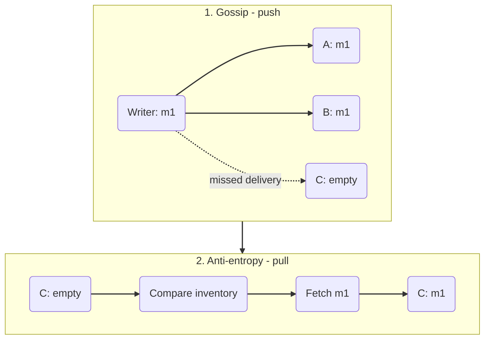

# Anti-entropy

**One-line summary:** Anti-entropy is a PULL-based reconciliation mechanism: each replica periodically
fetches a bounded ID inventory from each eligible peer, diffs it against its own local store, and
fetches the records it is missing. It repairs the gaps that gossip (a PULL-less, PUSH-based,
probabilistic mechanism) leaves behind, and is the mechanism that closes gaps (given the convergence
conditions: surviving retained records, successful communication, eligible and authorized
participants, sufficient successful reconciliation, no unresolved conflicts).

## 1. The problem the concept solves

Gossip is push-based and probabilistic: a message is pushed to a bounded set of random peers, for a
bounded number of local fanout rounds. This is fast and lightweight, but it is best-effort: a
partitioned peer, a queue overflow, a dropped propagation event, or a process restart can all cause
a replica to miss a message. Gossip alone does not guarantee that every replica eventually has
every message.

Anti-entropy solves the "how to close gaps" problem with a periodic, pull-based reconciliation:
each replica pulls the set of messages it is missing from its peers. Because every participating
replica pulls from others, information moves in both directions without a separate push-based
implementation.

## 2. The underlying distributed-systems principle

Anti-entropy is a class of anti-entropy / reconciliation protocols (sometimes called
"convergence" or "replication repair" mechanisms). The core principle:

- **Pull, not push.** The receiver initiates the transfer: it asks a peer for the set of IDs it has,
  then fetches the ones it is missing. (Gossip is the opposite: the sender initiates.)
- **Periodic.** Reconciliation runs on a schedule (a timer), not on every write. This keeps the
  per-write cost low; the repair is amortized over many writes.
- **Bounded.** Each cycle transfers a bounded amount of data (bounded ID pages, bounded fetch
  batches, bounded pages per peer per cycle). This keeps the network and memory cost predictable and
  prevents a single reconciliation from saturating the network.
- **Idempotent application.** Fetched records are applied idempotently (`ON CONFLICT DO NOTHING`); a
  duplicate is a no-op, a same-ID content conflict is rejected (409) without altering the original.
- **Complementarity with gossip.** Gossip handles the hot path (fast dissemination of new messages);
  anti-entropy handles the cold path (repairing gaps). The two are complementary, not competing:
  they use the same transport and the same idempotent insert, but they trigger on different events
  (a write vs. a timer) and in different directions (push vs. pull).

## 3. Why GossipGrid uses it

GossipGrid uses anti-entropy because gossip alone is best-effort and probabilistic, and the
testbed's point is to observe eventual consistency — including the gaps gossip leaves and the
repair that closes them. Anti-entropy is the mechanism that makes "eventual consistency" a
reality (given the convergence conditions) rather than a hope:

- It **repairs gossip gaps**: a partitioned peer that missed a message during propagation gets it
  on a later anti-entropy cycle.
- It **handles replica replacement**: a new pod (with an empty `emptyDir`) pulls the full message
  set from an eligible peer (this is the bootstrap baseline fetch — see
  [bootstrap replication admission](../gossip-and-bootstrap.md#milestone-5b-stage-2--bootstrap-replication-admission-implemented-2026-11-24-committed-209cec1)
  and [ephemeral state and recovery](ephemeral-state-and-recovery.md)).
- It **is bounded and predictable**: the per-cycle cost is bounded (page size, fetch batch size,
  pages per peer), so a reconciliation does not saturate the network or exhaust memory.
- It **is independent of gossip**: anti-entropy can repair data even when gossip is disabled. This
  means the gap-closing does not depend on the probabilistic gossip mechanism; it depends on the
  deterministic (if periodic) anti-entropy sweeps.
- It **is opt-in**: `GOSSIPGRID_ANTI_ENTROPY_ENABLED` defaults to `false`; enabling it requires peer
  mTLS, message exchange, and static or DNS discovery. Gossip need not be enabled.

## 4. How GossipGrid currently implements it

Implemented, committed, and locally tested (Milestone 4C, 2026-11-20). The anti-entropy engine lives
in `internal/antientropy`. The authoritative specification is the
[Anti-entropy (Milestone 4C)](../gossip-and-bootstrap.md#anti-entropy-milestone-4c--implemented-2026-11-20)
section.

Key implemented behavior (verify against the code, not this summary):

- **Protocol.** For each eligible peer (from discovery, excluding self, respecting stale DNS), the
  engine:
  1. Fetches a bounded inventory page of message IDs (keyset pagination:
     `WHERE id > ? ORDER BY id ASC LIMIT ?+1`).
  2. Determines which IDs are missing locally (a bounded `WHERE id IN ?` query).
  3. Fetches the missing records in bounded batches via `POST /internal/sync/messages`.
  4. Inserts each using the existing atomic `ON CONFLICT DO NOTHING` store path.
  5. Advances the per-peer cursor only after the page is fully processed.
  6. Repeats until the per-cycle page budget (`MaxPagesPerPeer`) is exhausted.
- **Cursor progression.** Per-peer in-memory cursors resume across cycles. When a full sweep
  completes (`has_more=false`), the cursor resets to the beginning so later-inserted lower-sorting IDs
  are eventually found. In-memory cursors reset on process restart; correctness does not depend on
  their persistence (a reset cursor just means the next sweep starts from the beginning, which is
  still correct — it just does a bit of redundant work).
- **Bounded resources.** Page size (default 128, max 1024), fetch batch size (default 8, max 8, less
  than or equal to page size), max pages per peer per cycle (default 4, max 64), worker count
  (default 2, max 16), request timeout (default 5 s, max 60 s). No unbounded goroutines, timers, or
  memory allocations.
- **Response limits.** Sync requests use a 256 KiB (262,144 bytes) response limit. The validated field
  bounds that establish the limit are: a message body of at most 4,096 stored bytes (which can
  escape up to 6x in JSON when every byte becomes a 6-byte `\uXXXX` sequence, for a worst-case
  encoded body of 24,576 bytes); an `origin` field bounded to 253 bytes (the DNS name cap); a
  36-byte canonical UUIDv7 `id`; and an RFC3339 `created_at` timestamp. The per-record wire-size
  allowance is 32,768 bytes; the fetch batch limit of 8 keeps a batch of 8 records within the
  response limit (8 x 32,768 = 262,144 = 256 KiB; 9 records would exceed it). These bounds are
  enforced at store insert, at client fetch validation, and at the server (413/404/500 above the
  bound).
- **Conflict handling.** A fetched message whose ID exists locally with different immutable fields is
  never overwritten. The conflict fails the affected page: the cursor is not advanced past the
  conflicting page, and the pass is not reported as completed. Already-committed unrelated records in
  the same batch are preserved (no rollback). The failed page is retried on a future cycle (cursor
  unchanged).
- **Completed-sweep accounting.** A pass is counted as completed only when the fetch returns
  `has_more=false` (a full sweep reached the end). A partial sweep, a failed page, or a
  budget-exhausted page does not increment the completed-sweep counter.
- **Independence.** Anti-entropy operates independently from the gossip queue and retry scheduler. It
  can repair data even when epidemic gossip is disabled. A duplicate anti-entropy insert does not
  trigger a new gossip propagation event (the callback is only invoked for the message-exchange
  endpoint, not the sync fetch endpoint).
- **Admission re-check (M5A).** Before network operations, the engine checks the lifecycle admission
  and classifies an epoch mismatch (409) as a permanent error (no retry). See
  [epoch fencing](epoch-fencing.md).
- **Private endpoints (M4C).** Registered only on the authenticated peer listener when anti-entropy is
  enabled:
  - `GET /internal/sync/ids?after=<optional-uuidv7>&limit=<1-1024>` — returns a bounded page of IDs
    in ascending order, `next_cursor`, and `has_more`.
  - `POST /internal/sync/messages` — accepts `{"ids":[...]}` (bounded count, canonical UUIDv7, no
    duplicates) and returns complete message records in ascending ID order. Missing IDs return 404 (no
    silent partial results).
- **Configuration.** `GOSSIPGRID_ANTI_ENTROPY_ENABLED` (default `false`),
  `GOSSIPGRID_ANTI_ENTROPY_INTERVAL` (30 s, range 1 s to 10 m),
  `GOSSIPGRID_ANTI_ENTROPY_PAGE_SIZE` (128, range 1 to 1024),
  `GOSSIPGRID_ANTI_ENTROPY_FETCH_BATCH_SIZE` (8, range 1 to 8, less than or equal to page size),
  `GOSSIPGRID_ANTI_ENTROPY_MAX_PAGES_PER_PEER` (4, range 1 to 64),
  `GOSSIPGRID_ANTI_ENTROPY_WORKERS` (2, range 1 to 16),
  `GOSSIPGRID_ANTI_ENTROPY_REQUEST_TIMEOUT` (5 s, range 1 ms to 60 s).
- **Test.** The five-node integration test
  (`TestIntegrationFiveNodesAntiEntropy`) runs scenarios: repair gossip misses (node down, recovery),
  replica replacement (convergence on identical message sets), concurrent writers, pagination stress
  (cursor advances across multiple cycles), recovery and isolation (disconnect, verify
  responsiveness, reconnect, repair). All nodes shut down cleanly; repeated Stop is safe.

## 5. Visual example

The diagram below illustrates push-based dissemination (gossip) and pull-based reconciliation
(anti-entropy) as complementary mechanisms, and how anti-entropy can repair a missed gossip
delivery. The "missed delivery" is conceptual (illustrative); the mechanism shown (the ID
inventory diff, the bounded fetch, the idempotent insert) is actual GossipGrid behavior.

[View full-size SVG](../diagrams/generated/concept-gossip-vs-antientropy.svg) · [View PNG](../diagrams/generated/concept-gossip-vs-antientropy.png)

<!-- DIAGRAM:concept-gossip-vs-antientropy -->

Reading the diagram. This is an **illustrative successful reconciliation scenario**, not observed
telemetry. In the "Gossip - push" panel, the writer pushes `m1` to two random peers (A and B) via
local fanout rounds; the dashed edge to C represents a **missed delivery** (C was partitioned or
the delivery failed transiently), so C remains empty. In the "Anti-entropy - pull" panel, C
**requests the ID inventory and the missing records from an eligible replica that contains m1**:
it compares the inventory against its local store, sees `m1` is missing, fetches it in a bounded
batch, and inserts it idempotently. C now holds `m1`. The diagram does **not** imply guaranteed
convergence: the gap-closing is conditional — it requires surviving retained records, successful
communication, eligible and authorized participants, and no unresolved conflicts. The ID-only
inventory cannot detect a same-ID content divergence (a theoretical limitation; a content-digest
extension would close it).

## 6. Important failure scenarios

- A permanent partition. Anti-entropy can only repair gaps between reachable peers. A permanent
  partition prevents convergence (the same limitation as gossip).
- A same-ID content conflict. A fetched message whose ID exists locally with different immutable
  fields is never overwritten. The page is not advanced; the pass is not reported as completed; the
  page is retried on a future cycle. The pre-existing local content is preserved.
- A budget-exhausted page. If the per-cycle page budget (`MaxPagesPerPeer`) is exhausted before a
  full sweep completes, the cursor is not reset; the next cycle resumes from the same cursor. The
  pass is not counted as completed.
- A failed fetch (404/413/500). A failed page does not advance the cursor; it is retried on a
  future cycle. A 404 (missing IDs) is not a silent partial result — it is a signal that the peer's
  inventory is stale or the request is malformed.
- In-memory cursor loss on restart. In-memory cursors reset on process restart. This is safe (a
  reset cursor just means the next sweep starts from the beginning), but it can do redundant work
  (re-fetching records the replica already has — which are no-ops under idempotency).
- Retention (if enabled). If retention is enabled and a message is expired while a replica is
  offline, the replica may not be able to recover it after the retention window closes. The
  inventory is not monotonically increasing; records can leave the store.

## 7. Guarantees and limitations

**Guaranteed (implemented, under the convergence conditions — surviving retained records,
successful communication, eligible and authorized participants, sufficient successful
reconciliation, no unresolved conflicts):**

- A committed local message is never lost or rolled back (on the replica where it was committed).
- A duplicate insert is a no-op; a same-ID content conflict is rejected (409) without altering
  the original.
- Given the convergence conditions, message IDs converge across eligible, authorized, reachable
  replicas (sufficient cycles; no permanent partition).
- The per-cycle cost is bounded (page size, fetch batch size, pages per peer).
- A failed or partial sweep does not corrupt the local store (no rollback; already-committed
  records are preserved).

**Not guaranteed (by design):**

- Immediate consistency: reconciliation is periodic, not instantaneous. A gap persists until the
  next anti-entropy cycle reaches the affected peer.
- A bound on convergence time: the system does not guarantee convergence within N seconds; it
  closes gaps eventually (given the convergence conditions).
- Content-level convergence (M4C): the ID-only inventory guarantees convergence of IDs; a
  same-ID content divergence is not detected by the inventory (a theoretical limitation; a
  content-digest extension would close it).
- Convergence under a permanent partition: a permanent partition prevents convergence.
- Lossless operation: GossipGrid can lose messages (local commit + ephemeral storage; retention
  makes records disappear).

## 8. Relevant implementation files and tests

- **Engine:** `internal/antientropy/antientropy.go` (the per-cycle sweep, the ID inventory diff, the
  bounded fetch, the cursor progression, the completed-sweep accounting, the admission re-check).
- **Store (idempotent insert):** `internal/store/store.go` (`InsertReplicatedMessage`).
- **Peer transport:** `internal/peertls/client.go` (`FetchMessages`, the inventory and fetch client).
- **Sync endpoints:** `internal/web/` (the `GET /internal/sync/ids` and `POST /internal/sync/messages`
  handlers on the private peer listener).
- **Integration test:** `cmd/gossipgrid/` (`TestIntegrationFiveNodesAntiEntropy`).
- **Authoritative spec:** [Anti-entropy (Milestone 4C)](../gossip-and-bootstrap.md#anti-entropy-milestone-4c--implemented-2026-11-20).

## 9. Practical experiment

To observe anti-entropy repairing a gossip gap locally:

1. Start five replicas (as in the gossip experiment) with gossip and anti-entropy enabled
   (`GOSSIPGRID_ANTI_ENTROPY_ENABLED=true GOSSIPGRID_ANTI_ENTROPY_INTERVAL=5s`).
2. Stop one replica (e.g. `gossipgrid-3`).
3. Post a message to `gossipgrid-0`. Observe that `gossipgrid-3` (stopped) does not receive it.
4. Start `gossipgrid-3` again. Observe its structured logs: the anti-entropy timer fires, it
   pulls the ID inventory from an eligible peer, sees the missing ID, fetches it, and inserts it.
5. Query `GET /api/messages/{id}` on `gossipgrid-3`. The message is now present — the gap was
   repaired by anti-entropy (given the convergence conditions).
6. Observe the structured logs for the completed-sweep accounting (a sweep is counted as
   completed only when `has_more=false`).

## 10. Related documentation and concepts

- **Previous in the progression:** [Eventual consistency](eventual-consistency.md) — the property
  that anti-entropy closes gaps for (given the convergence conditions).
- **The dissemination mechanism:** [Gossip protocols](gossip-protocols.md) — the complementary
  push-based mechanism.
- **Bootstrap:** [Ephemeral state and recovery](ephemeral-state-and-recovery.md) — the
  `SYNCING` baseline fetch reuses the same anti-entropy transport.
- **Authority:** [Distributed authority](distributed-authority.md) and [Epoch fencing](epoch-fencing.md)
  — the admission and fencing that gate anti-entropy sends.
- **Authoritative spec:** [Anti-entropy (Milestone 4C)](../gossip-and-bootstrap.md#anti-entropy-milestone-4c--implemented-2026-11-20).
- **Diagrams:** the [gossip vs. anti-entropy](../diagrams/generated/concept-gossip-vs-antientropy.svg)
  ([PNG](../diagrams/generated/concept-gossip-vs-antientropy.png)) concept diagram and the
  [gossip and anti-entropy replication](../diagrams/generated/gossip-replication.svg)
  ([PNG](../diagrams/generated/gossip-replication.png)) architecture diagram.
- **Visual conventions:** [GossipGrid visual design system](../visual-design.md).
