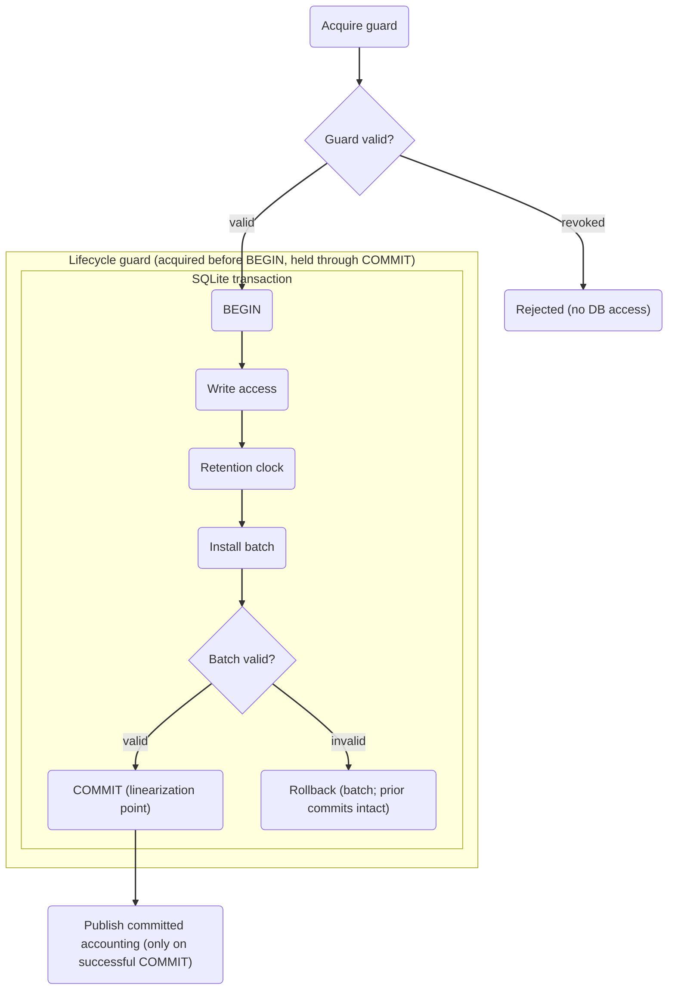
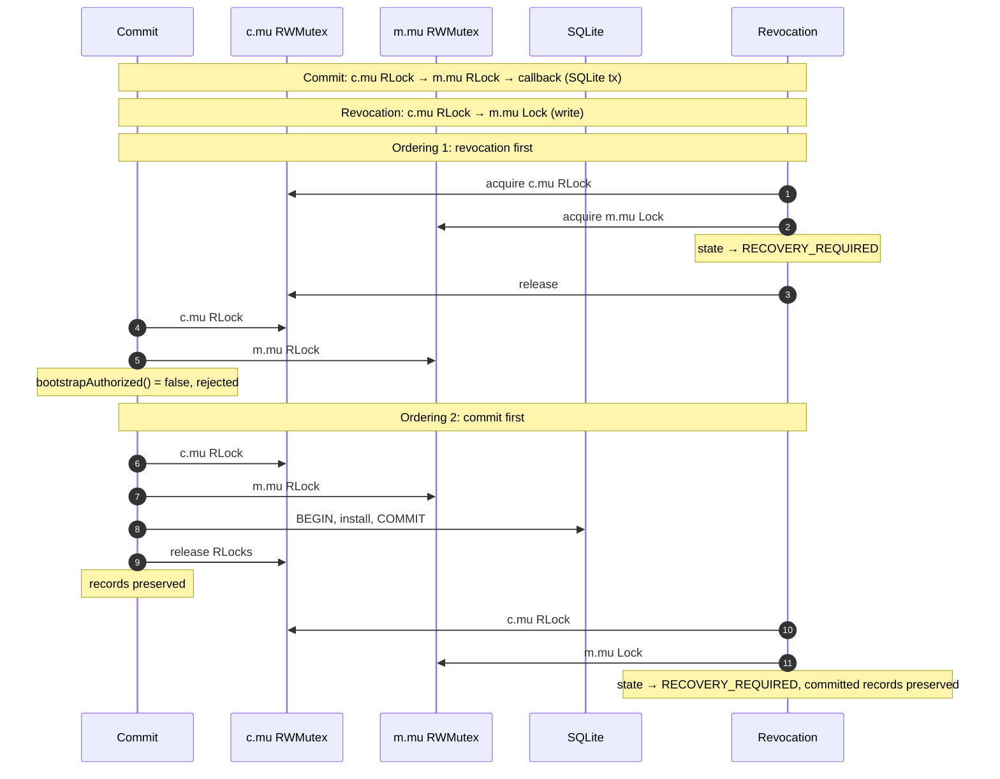

# Concurrency and linearization

**One-line summary:** Concurrency and linearization is the set of lock-ordering, commit-boundary,
and atomicity rules that make a concurrent revocation (lifecycle authorization changes) and a
commit (a bootstrap or anti-entropy record install) safe: the actual lock order
(`c.mu RLock` to `m.mu RLock` to callback), the single-transaction commit boundary (one SQLite
transaction with the retention evaluation and immutable-content conflict check inside), and the
partial-404 retry regression (a retry re-checks the dedicated bootstrap authorization decision
and the pinned cluster/epoch; it is not a bypass of the fencing).

## 1. The problem the concept solves

A distributed system with eventual consistency, ephemeral storage, and operator-controlled
recovery has concurrent operations that touch the same state:

- A revocation (a `RECOVERY_REQUIRED` state, a lockout, a peer revocation) changes the lifecycle
  authorization at the same time as a commit (a bootstrap baseline fetch, an anti-entropy fetch,
  a gossip insert) writes records to the local SQLite.
- A partial-404 retry (a bootstrap fetch that returns a partial 404, some IDs missing) retries
  the fetch for the remaining IDs — but the authorization state may change between the initial
  request and the retry.

The concurrency problem: how to ensure that a concurrent revocation and a commit do not corrupt
the local store (no rollback of earlier committed batches, no stale data merged, no race on the
mutex or the transaction), and that a partial-404 retry does not bypass the epoch fencing (the
dedicated bootstrap authorization decision and the pinned context comparison are not skipped on
retry).

The linearization problem: how to determine the legal ordering of two concurrent operations (a
revocation and a commit) so that the observed behavior is consistent with some total order of the
operations (a linearization point exists).

## 2. The underlying distributed-systems principle

The core principle is **linearizability via a total order that is enforced by the lock order and
the commit boundary**:

- A linearization point is a moment in the total order at which an operation's effect is
  observed. For a commit, the linearization point is the COMMIT of the SQLite transaction. For a
  revocation, the linearization point is the write to the lifecycle state (the `RECOVERY_REQUIRED`
  state, the lockout, the peer revocation). A concurrent operation's effect is determinable based
  on the relative position of its linearization point in the total order.

- The lock order is enforced, not assumed. The actual lock order for a bootstrap commit is
  `c.mu RLock` (the Controller mutex, held for the duration of the callback) to `m.mu RLock` (the
  Machine mutex, held for the duration of the callback) to the callback (the SQLite transaction).
  A state-transition revocation (the `transitionTo` path used by `SetRecoveryRequired` and the
  other ordinary lifecycle state transitions) takes `c.mu RLock` to `m.mu Lock` (write) to perform
  the state transition. `Stop` is a distinct operation: it takes `c.mu Lock` (write) to set the
  `stopped` flag and does not take the machine lock. The lock order is enforced by the code
  (the mutual exclusion of the mutexes); it is not assumed. The bootstrap engine briefly reads
  its guard config under `e.mu` (the Engine mutex), releases it, and then invokes the controller
  guard; `e.mu` is not held through the SQLite install.

- The commit boundary is atomic. A commit (a bootstrap or anti-entropy record install) is a
  single SQLite transaction: the lifecycle guard acquisition and validation, the retention
  evaluation, the immutable-content conflict check, and the record insert are all inside the
  same transaction (or, for the guard, immediately before the transaction begins but held
  through the COMMIT). The retention evaluation (a message is expired if its age exceeds the
  retention TTL) is inside the transaction (not before the transaction). The immutable-content
  conflict check (a fetched message whose ID exists locally with different content is rejected)
  is inside the transaction (not after the commit). A concurrent insert that changes the content
  of a same-ID record between the check and the commit is caught by the transaction (the batch
  is rolled back; the original row is preserved).

- The partial-404 retry is not a bypass of the fencing. A partial-404 retry (a bootstrap fetch
  that returns a partial 404 with a missing-IDs list) validates the 404 envelope, excludes the
  confirmed-absent IDs, and retries once for the remaining IDs. The retry independently
  re-checks the dedicated bootstrap authorization decision and the pinned cluster/epoch
  (unchanged epoch alone is insufficient — the authorization must still be granted). If all
  requested IDs were confirmed absent, no retry occurs. A retry is subject to the same
  validation as the initial request.

## 3. Why GossipGrid uses it

GossipGrid uses concurrency and linearization rules because it has concurrent operations that
touch the same state:

- A revocation changes the lifecycle authorization at the same time as a commit writes records
  to the local SQLite. The concurrent operations must be safe (no corruption, no stale data
  merged, no race on the mutex or the transaction).
- A partial-404 retry retries the fetch — but the authorization state may change between the
  initial request and the retry. The retry must not bypass the fencing (the dedicated bootstrap
  authorization decision and the pinned context comparison are not skipped).
- The retention is evaluated inside the commit transaction (not before the transaction) — this
  is the critical distinction: time advances between the retention evaluation and the COMMIT;
  the transaction does not freeze the clock.

## 4. How GossipGrid currently implements it

Implemented, committed, and locally tested (Milestones 5A, 5B Stages 0–2). The concurrency and
linearization rules are enforced by the lock order, the commit boundary, and the pinned-context
validation.

Key implemented behavior (verify against the code, not this summary):

- **The lock order is enforced (the actual order).** The actual lock order for a bootstrap
  commit: `CommitUnderBootstrapAuthorization` acquires `c.mu RLock` (the Controller mutex) and
  `m.mu RLock` (the Machine mutex) and holds both through the callback (the SQLite transaction
  including the COMMIT). A state-transition revocation (the `transitionTo` path used by
  `SetRecoveryRequired` and the other ordinary lifecycle state transitions) takes `c.mu RLock`
  and `m.mu Lock` (write) to perform the state transition. `Stop` is a distinct operation: it
  takes `c.mu Lock` (write) to set the `stopped` flag and does not take the machine lock. The
  bootstrap engine briefly reads its guard config under `e.mu` (the Engine mutex), releases it,
  and then invokes the controller guard; `e.mu` is not held through the SQLite install. The
  machine write lock is used for state transitions; the controller write lock is used for Stop.
  The lock order is enforced by the code (the mutual exclusion of the
  mutexes); it is not assumed.

- **The commit boundary is atomic (a single SQLite transaction).** A bootstrap baseline commit
  is a single, bounded, context-aware SQLite transaction (`InsertReplicatedMessagesBounded`):
  1. Acquire and validate the lifecycle guard (`CommitUnderBootstrapAuthorization`:
     `bootstrapAuthorized()` + pinned context validated). The guard is acquired and evaluated
     **before** the SQLite transaction begins and is held through the COMMIT.
  2. Acquire the SQLite pooled connection and BEGIN the transaction.
  3. If retention is enabled, acquire write access inside the same transaction
     (`DELETE FROM messages WHERE 0=1`).
  4. Evaluate the injected retention clock (threshold = now - TTL). Time advances between this
     step and the COMMIT; the clock is not frozen.
  5. Classify expired records (skipped, not stored) and install retained records
     (`ON CONFLICT DO NOTHING`).
  6. Check immutable-content conflicts (a fetched message whose ID exists locally with
     different content is rejected; the batch is rolled back).
  7. COMMIT (the database-content linearization point).
  8. Publish committed-record accounting (Inserted, AlreadyPresent, Expired).

  An unsuccessful batch rolls back; earlier committed batches are preserved (no rollback of
  prior commits).

- **The retention evaluation is inside the transaction, not before it.** The retention
  evaluation (step 4) is inside the same transaction as the install (step 5). Time advances
  between the retention evaluation and the COMMIT — the transaction does not freeze the
  clock. A concurrent operation that commits new records between the retention evaluation and
  the COMMIT is not "caught" by the transaction in the sense of being rolled back; rather, the
  retention threshold is computed at the moment of evaluation and new records committed after
  that moment are subject to the retention of the next batch. The critical property is that the
  retention classification and the install happen in the same transaction, so a record
  classified as retained is not concurrently deleted by a retention sweep within the same
  transaction.

- **The SQLite busy timeout is a limitation, not a guarantee.** The SQLite busy timeout (the
  busy handler that waits for a contended lock to be released, default 5 seconds) is a
  limitation: it waits for a bounded time for a contended lock to be released; if the lock is
  not released within the timeout, the transaction is aborted (a busy error). The busy timeout
  is not fully context-aware: the Go context may expire during the busy wait, causing the
  operation to be interrupted even if the lock would have been released shortly after. The
  busy timeout does not guarantee linearizability (it is a best-effort contention resolution);
  the linearizability is guaranteed by the lock order and the commit boundary (the atomic
  transaction), not by the busy timeout.

- **The partial-404 retry regression is enforced.** A partial-404 retry (a bootstrap fetch that
  returns a partial 404 with a missing-IDs list) validates the 404 envelope and the
  missing-IDs list, excludes the confirmed-absent IDs, and retries once for the remaining IDs.
  The retry independently re-checks the dedicated bootstrap authorization decision and the
  pinned cluster/epoch (unchanged epoch alone is insufficient — the authorization must still be
  granted). If all requested IDs were confirmed absent, no retry occurs. The regression
  example (TestBootstrapE2E_BootstrapAuthRevokedAtRetryBoundary): the initial request is
  authorized; a valid partial-404 is returned; the response-consumption authorization succeeds;
  the real controller then enters RECOVERY_REQUIRED; the retry's pre-transmission authorization
  check rejects. Three authorization decisions (initial, response-consumption, retry), exactly
  one transmitted HTTP request.

- **The revocation and commit have two legal orderings.** A concurrent revocation and a commit
  have two legal orderings: (a) the revocation linearizes before the commit (the commit is
  rejected: the guard sees RECOVERY_REQUIRED and the callback is not executed); or (b) the
  commit linearizes before the revocation (the committed records are preserved; subsequent
  operations are rejected). The actual ordering is determined by the lock order (the relative
  position of the linearization points in the total order); a concurrent operation cannot
  bypass the lock order.

## 5. Visual examples

The diagrams below illustrate the concurrency and linearization rules: the single-transaction
commit boundary (the retention evaluation and immutable-content conflict check inside the
transaction, the COMMIT as the linearization point), the SQLite busy timeout limitation, and
the partial-404 retry regression.

### 5a. The single-transaction commit boundary

[View full-size SVG](../diagrams/generated/concept-transactional-install.svg) · [View PNG](../diagrams/generated/concept-transactional-install.png)

<!-- DIAGRAM:concept-transactional-install -->

Reading the diagram. The guard nodes (`G1`, `G2`) show the lifecycle authorization guard:
`CommitUnderBootstrapAuthorization` acquires `c.mu RLock` (the Controller mutex) and `m.mu RLock`
(the Machine mutex) and evaluates `bootstrapAuthorized()` and the pinned context. The guard is
acquired and validated **before** the SQLite transaction begins and is held through the COMMIT.
If the guard fails (revoked, stale, not bound, locked out, or stopped), the installation is
rejected before any DB access (the `FAIL` node) and no transaction is started. The `GUARD`
subgraph represents the lifecycle guard held through the entire operation; the `TX` subgraph
inside it represents the SQLite transaction boundary, which spans BEGIN, write access, the
retention clock, the batch install, the immutable-content conflict check, and both the COMMIT
and the ROLLBACK. The `Batch valid?` decision is the transaction's install gate: it covers
**every** failure that prevents the batch from committing — an immutable-content conflict, a
cancellation (the request context expires mid-transaction), a database error, or a failed COMMIT.
Only when the batch is valid does the transaction reach COMMIT (the database-content
linearization point) and publish committed-record accounting (the `OK` node); any failure rolls
back the affected batch (the `ROLLBACK` node; previously committed batches remain intact) and
publishes no committed-record accounting. The diagram does not imply every error occurs at the
same stage, or that retention is enabled in all configurations — the retention clock is part of
the install path only when retention is configured.

The SQLite busy timeout (a contended write lock is waited for up to 5 seconds; if not released in
time the transaction is aborted) is a limitation, not a guarantee: it is not fully context-aware
(the Go context may expire during the busy wait). It is not shown in this diagram to keep the
transaction boundary focused.

### 5b. The revocation and commit have two legal orderings

[View full-size SVG](../diagrams/generated/concept-revocation-linearization.svg) · [View PNG](../diagrams/generated/concept-revocation-linearization.png)

<!-- DIAGRAM:concept-revocation-linearization -->

Reading the diagram. The lock order is: `Controller.mu RLock` to `Machine.mu RLock` to callback
for a commit; `Controller.mu RLock` to `Machine.mu Lock` (write) for a state-transition
revocation (the `transitionTo` path used by `SetRecoveryRequired` and the other ordinary
lifecycle state transitions). Note that `Stop` is a different operation: it takes
`Controller.mu Lock` (write) to set the `stopped` flag (it does not take the machine lock at
all). Ordering 1: the revocation acquires its read lock and the machine write lock first,
transitions to `RECOVERY_REQUIRED`, and releases. The commit then acquires its read locks
and observes the already-revoked state (it is not blocked by a lock that has already been
released — it simply sees `bootstrapAuthorized()` false and is rejected; the callback is not
executed). Ordering 2: the commit acquires the RLocks first, validates the guard, performs
the SQLite transaction (BEGIN, install, COMMIT), and releases. The committed records are
preserved. The revocation then acquires the RLock and the machine write lock, transitions to
`RECOVERY_REQUIRED`, and subsequent operations are rejected (the committed records are
preserved). COMMIT is the database-content linearization point.

**Ordinary anti-entropy is a separate path.** The bootstrap commit contract shown here
(`CommitUnderBootstrapAuthorization` + the single-transaction `InsertReplicatedMessagesBounded`)
applies to the bounded bootstrap baseline install. Ordinary anti-entropy uses its own
admission decision (which requires a ready state, a state a joining `SYNCING` replica does not
have) and its own insert path; it does not go through the bootstrap commit guard or the
`InsertReplicatedMessagesBounded` transaction. See [anti-entropy](anti-entropy.md).

## 6. Important failure scenarios

- A concurrent revocation and commit. The bootstrap authorization is revoked concurrently
  with a bootstrap commit. The lock order and the commit boundary ensure the revocation
  linearizes either before the commit (the commit is rejected: the guard sees
  `RECOVERY_REQUIRED` and the callback is not executed) or after the commit (the committed
  records are preserved; later operations are rejected). It is never "during" the commit.

- A concurrent operation that changes the retention state between the retention evaluation
  and the COMMIT. The retention evaluation (step 4) is inside the transaction. Time advances
  between the retention evaluation and the COMMIT — the clock is not frozen. A concurrent
  operation that commits new records between the retention evaluation and the COMMIT is not
  rolled back; those records are subject to the retention of the next batch. The critical
  property is that the retention classification and the install happen in the same
  transaction, so a record classified as retained is not concurrently deleted by a retention
  sweep within the same transaction.

- A concurrent insert that changes the content of a same-ID record between the
  immutable-content conflict check and the COMMIT. The immutable-content conflict check
  (step 6) is inside the transaction. If a concurrent insert changes the content of a same-ID
  record between the check and the COMMIT, the batch is rolled back (the original row is
  preserved; no partial commit).

- A partial-404 retry after an authorization change. A bootstrap fetch returns a partial 404
  (some IDs missing); the client validates the 404 envelope, excludes the confirmed-absent
  IDs, and retries once for the remaining IDs. The retry independently re-checks the
  dedicated bootstrap authorization decision and the pinned cluster/epoch. If the
  authorization was revoked between the initial request and the retry, the retry is rejected
  before transmission (the dedicated bootstrap authorization decision is no longer granted).
  The regression example (TestBootstrapE2E_BootstrapAuthRevokedAtRetryBoundary): three
  authorization decisions (initial, response-consumption, retry), exactly one transmitted HTTP
  request.

- A contended lock held longer than the busy timeout. A concurrent operation that holds a
  lock longer than the busy timeout (the SQLite busy handler waits for a bounded time,
  default 5 seconds) causes a transaction abort (a busy error). The busy timeout is not
  fully context-aware: the Go context may expire during the busy wait. The busy timeout does
  not guarantee linearizability; the linearizability is guaranteed by the lock order and the
  commit boundary (the atomic transaction), not by the busy timeout.

## 7. Guarantees and limitations

**Guaranteed (implemented, when the lock order and the commit boundary are enforced):**

- A concurrent revocation and commit have two legal orderings: the revocation linearizes
  before the commit (the commit is rejected) or after the commit (the committed records are
  preserved). A concurrent operation cannot bypass the lock order.
- The commit boundary is atomic (a single SQLite transaction); the retention evaluation, the
  immutable-content conflict check, and the record insert are all inside the same transaction
  (the linearization point is the COMMIT statement).
- An unsuccessful batch rolls back; earlier committed batches are preserved (no rollback of
  prior commits).
- The retention evaluation is inside the transaction (not before it). Time advances between
  the retention evaluation and the COMMIT; the clock is not frozen.
- A partial-404 retry validates the 404 envelope, excludes confirmed-absent IDs, and retries
  once for the remaining IDs. The retry independently re-checks the dedicated bootstrap
  authorization decision and the pinned cluster/epoch (a retry is not a bypass of the
  fencing).

**Not guaranteed / limitations (by design):**

- The SQLite busy timeout is a limitation, not a guarantee. The busy timeout waits for a
  bounded time (default 5 seconds) for a contended lock to be released; if the lock is not
  released within the timeout, the transaction is aborted. The busy timeout is not fully
  context-aware (the Go context may expire during the busy wait). The linearizability is
  guaranteed by the lock order and the commit boundary, not by the busy timeout.
- The temporal boundary (the retention evaluation to the COMMIT) is non-zero. Time advances
  between the retention evaluation and the COMMIT; the transaction does not freeze the clock.
  New records committed during this window are subject to the retention of the next batch.

## 8. Relevant implementation files and tests

- **Lock order (the actual order):** `internal/lifecycle/controller.go` (`CommitUnderBootstrapAuthorization`:
  `c.mu RLock` + `m.mu RLock` held through the callback; `authorizationSnapshotLocked` reads
  under held RLocks), `internal/lifecycle/lifecycle.go` (the Machine `m.mu RWMutex`; the
  `c.mu` to `m.mu` lock order documented).
- **Commit boundary (the single SQLite transaction):** `internal/store/store.go`
  (`InsertReplicatedMessagesBounded`: the 8-step transaction — guard, BEGIN, retention,
  classify+install, conflict check, COMMIT, accounting).
- **Bootstrap engine (the guard config read):** `internal/antientropy/antientropy.go`
  (`commitBootstrap`: briefly reads guard config under `e.mu`, then invokes
  `CommitUnderBootstrapAuthorization`; `e.mu` is not held through the install).
- **Partial-404 retry (the pinned context comparison):** `internal/peertls/client.go` (the
  doRequest bootstrap branch: the partial-404 retry; the dedicated bootstrap authorization
  re-check; the pinned-context comparison; the in-flight recheck).
- **Bootstrap transport test:** `internal/peertls/bootstrap_transport_test.go` (the
  pinned-context validation: incomplete context rejected, mismatch rejected, match allowed,
  partial-404 retry also performs the comparison).
- **Admission test:** `internal/lifecycle/admission_test.go` (the bootstrap authorization
  predicates, the 409 on mismatch, the commit revalidation).
- **Integration test:** `cmd/gossipgrid/bootstrap_integration_test.go` (
  TestBootstrapE2E_BootstrapAuthRevokedAtRetryBoundary: 3 authorization decisions, exactly 1
  transmitted HTTP request; TestBootstrapE2E_BootstrapAuthRevokedAtRetryTransport).
- **Authoritative spec:** [Bootstrap replication admission (5B Stage 2)](../gossip-and-bootstrap.md#milestone-5b-stage-2--bootstrap-replication-admission-implemented-2026-11-24-committed-209cec1).

## 9. Practical experiment

To observe concurrency and linearization locally (without Kubernetes):

1. Build with `make build FIPS_MODULE=off`.
2. (In a 5B-enabled configuration) Start a SYNCING replica (the requester) and a READY
   replica (the source). Have the SYNCING replica send a bootstrap fetch (a partial-404
   scenario: the source has some of the requested IDs but not all).
3. Simultaneously, revoke the SYNCING replica (trigger a `RECOVERY_REQUIRED` state or a
   lockout on the SYNCING replica during the bootstrap fetch).
4. Observe the result: if the revocation linearizes before the commit (the SYNCING replica
   is revoked before the commit linearizes), the commit is rejected (the guard sees
   `RECOVERY_REQUIRED` and the callback is not executed). If the commit linearizes before
   the revocation, the committed records are preserved and the revocation is observed
   later (subsequent operations are rejected).
5. (In a 5B-enabled configuration with the pinned context) Have a SYNCING replica send a
   bootstrap fetch, receive a partial 404, and retry — but the authorization is revoked
   between the initial request and the retry. Observe the retry being rejected (the
   dedicated bootstrap authorization decision is no longer granted; the retry is rejected
   before transmission).
6. Observe the structured logs for the lock order (the relative position of the
   linearization points in the total order), the commit boundary (the single SQLite
   transaction), and the partial-404 retry (the dedicated bootstrap authorization re-check
   and the pinned context comparison).

## 10. Related documentation and concepts

- **Previous in the progression:** [Epoch fencing](epoch-fencing.md) — the fencing (the 409 on
  mismatch) that the concurrent operations must respect.
- **Recovery:** [Ephemeral state and recovery](ephemeral-state-and-recovery.md) — the
  `RECOVERY_REQUIRED` state and the operator recovery procedure (the concurrent revocation
  that triggers a recovery).
- **Authority:** [Distributed authority](distributed-authority.md) — the admission that the
  concurrent commit must respect (the lifecycle guard in the commit boundary).
- **Authoritative spec:** [Bootstrap replication admission (5B Stage 2)](../gossip-and-bootstrap.md#milestone-5b-stage-2--bootstrap-replication-admission-implemented-2026-11-24-committed-209cec1).
- **Diagrams:** the [transactional installation](../diagrams/generated/concept-transactional-install.svg)
  ([PNG](../diagrams/generated/concept-transactional-install.png)) and
  [revocation and linearization](../diagrams/generated/concept-revocation-linearization.svg)
  ([PNG](../diagrams/generated/concept-revocation-linearization.png)) concept diagrams, and the
  [bootstrap admission](../diagrams/generated/concept-bootstrap-admission.svg)
  ([PNG](../diagrams/generated/concept-bootstrap-admission.png)) concept diagram.
- **Visual conventions:** [GossipGrid visual design system](../visual-design.md).
