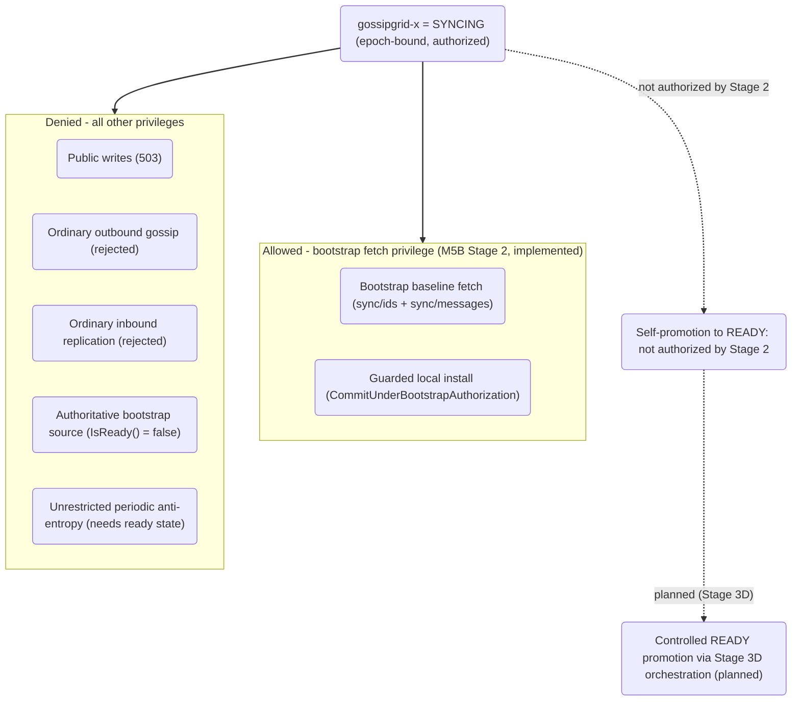

# Distributed authority

**One-line summary:** Distributed authority is the mechanism by which a leaderless, multi-replica
cluster decides who is allowed to do what — which replicas may accept writes, which may serve reads,
which may replicate, and which may act as an authoritative synchronization source — without a central
coordinator. In GossipGrid, this is the lifecycle state machine plus the fail-closed admission
guard plus the authoritative metadata authority (the Kubernetes ConfigMap).

## 1. The problem the concept solves

In a leaderless system, there is no single authority that says "you may write" or "you may not."
Every replica must decide for itself whether it is authorized to perform an operation, based on its
local view of the cluster. The problem: how does a replica decide this consistently and safely,
without a leader, and without inventing authority it does not have?

The risks this concept addresses:

- A replica invents an epoch. A fresh replica with an empty database might assume it is the first
  replica and create an empty cluster as authoritative. This is the "replacement seed after data
  loss" flaw — an empty database is not evidence that the cluster was never initialized.
- A replica acts before it is ready. A `SYNCING` replica (still obtaining its baseline) might
  accept public writes or act as a bootstrap source for other unsynced pods, propagating an
  incomplete or inconsistent state.
- A stale-epoch replica rejoin. A replica carrying old-epoch data might silently rejoin a newer
  epoch and inject stale data.
- Authority is not observed, it is inferred. A failed network request (a peer unreachable) is not
  evidence that the peer is absent or unbound; inferring authority from failed requests is
  fail-open and is explicitly forbidden.

Distributed authority is the set of rules that prevents all of these: a replica is authorized to
act only when it has a fresh, valid, matching authoritative observation and a durable local
binding and a permitted lifecycle state and is not stopped and is not in recovery lockout. All
conditions must hold; if any fails, the replica fails closed (it refuses the operation).

## 2. The underlying distributed-systems principle

The core principle is fail-closed authorization from a single, consistent snapshot:

- A single, consistent authorization snapshot. The admission guard reads the controller's
  single, internally consistent `AuthorizationSnapshot` in one read-lock acquisition. The snapshot
  bundles the lifecycle state, the authoritative metadata observation, the durable database
  binding, the recovery lockout flag, and the stopped flag. A state, metadata, or binding change
  cannot interleave between reading the state and reading the metadata or binding — the snapshot
  is atomic.
- Fail-closed, not fail-open. If any condition fails (stale metadata, mismatched binding, not
  ready, stopped, in recovery), the operation is rejected (503 or 409). The replica does not
  guess or infer; it refuses. This is the opposite of a fail-open system that would allow the
  operation when it is unsure.
- Authority is observed, not inferred. The authoritative metadata is read from a durable,
  external source (the Kubernetes ConfigMap in production; a no-op source that always reports
  unavailable in 5A). A replica does not invent an epoch; it observes the epoch from the
  authoritative metadata and binds its local database to it. A failed read (the ConfigMap
  unavailable) does not mean "no epoch exists" — it means "I cannot observe the epoch, so I
  fail closed."
- Authority is durable and local. The local database is bound to a cluster ID and epoch ID (the
  `local_metadata` singleton row). This binding is durable (it survives a process restart; it
  is in SQLite, not memory) and local (it is the replica's own record of which epoch its
  database belongs to). The binding is atomic (only one row), idempotent (rebinding to the same
  values is a no-op), and exclusive (rebinding to different values fails with
  `ErrBindingMismatch`).
- Per-send re-check. The admission is re-read before every network send and before every insert
  — not only at enqueue. A work item admitted while authorized may be delivered (it was
  authorized when the check passed); a revoked node blocks all new work. This ensures that a
  concurrent revocation linearizes either before or after a given operation, never "during" it.

## 3. Why GossipGrid uses it

GossipGrid uses distributed authority because it is a leaderless cluster with ephemeral storage
and eventual consistency: without a leader to coordinate, each replica must safely decide for
itself whether it is authorized to act. The specific reasons:

- Prevent a fresh replica from inventing an empty cluster. The "replacement seed after data loss"
  flaw is closed by the one-time genesis authorization (the `GenesisAuthorized` token in the
  authoritative metadata, consumed by an operator action — see
  [operator-controlled genesis](../lifecycle-metadata-and-genesis.md#1-one-time-genesis-authorization)
  and [ephemeral state and recovery](ephemeral-state-and-recovery.md)). An empty database alone is
  never sufficient to claim genesis.
- Prevent a `SYNCING` replica from acting as a bootstrap source or accepting writes. The
  narrowly scoped bootstrap admission (M5B Stage 2) authorizes a `SYNCING` replica to fetch a
  baseline, but not to accept public writes, send ordinary gossip, or act as a bootstrap
  source. See [bootstrap replication admission](../gossip-and-bootstrap.md#milestone-5b-stage-2--bootstrap-replication-admission-implemented-2026-11-24-committed-209cec1).
- Fail closed when authority is unavailable. If the ConfigMap is absent, unwatchable, or stale,
  the replica stays in `DISCOVERING` or transitions to `RECOVERY_REQUIRED`; it does not invent
  an epoch. This is the transient-versus-catastrophic failure model: a transient metadata outage
  fails closed (503) but does not enter `RECOVERY_REQUIRED` and records no data-loss incident;
  a proven binding/metadata mismatch does enter `RECOVERY_REQUIRED`. See
  [transient versus catastrophic](../lifecycle-metadata-and-genesis.md#4-transient-versus-catastrophic-metadata-failure).
- Make the admission atomic and concurrency-safe. The single-snapshot design (one read-lock
  acquisition) ensures that a concurrent state/metadata/binding change cannot interleave with
  the admission decision. This is the foundation for the safe linearization of a concurrent
  revocation and commit (see [concurrency and linearization](concurrency-and-linearization.md)).

## 4. How GossipGrid currently implements it

Implemented, committed, and locally tested (Milestones 5A, 5B Stages 0–2). The lifecycle package
lives in `internal/lifecycle`. The authoritative specifications are:

- [Milestone 5A — what is enforced vs. deferred to 5B](../gossip-and-bootstrap.md#milestone-5a--what-is-enforced-vs-deferred-to-5b)
- [Durable local binding](../gossip-and-bootstrap.md#durable-local-binding)
- [Metadata authority](../gossip-and-bootstrap.md#metadata-authority)
- [Milestone 5B, Stage 2 — Bootstrap replication admission](../gossip-and-bootstrap.md#milestone-5b-stage-2--bootstrap-replication-admission-implemented-2026-11-24-committed-209cec1)
- [One-time genesis authorization](../lifecycle-metadata-and-genesis.md#1-one-time-genesis-authorization)

Key implemented behavior (verify against the code, not this summary):

- **The 7-state lifecycle machine.** `STARTING`, `DISCOVERING`, `GENESIS`, `SYNCING`, `READY`,
  `DEGRADED`, `RECOVERY_REQUIRED`. A concurrency-safe state machine (RWMutex; `State()` and
  `Snapshot()` take a read lock; `transition` takes a write lock). Invalid transitions are
  rejected with `ErrInvalidTransition`; no caller can silently force `READY`. The transition log
  is bounded (64 entries, newest first) and independently locked. The [lifecycle state machine
  diagram](../diagrams/generated/lifecycle-5a.svg) shows the transitions.
- **The `AuthorizationSnapshot` (the single, consistent snapshot).** The controller's
  `Authorization()` method returns a single, internally consistent snapshot bundling: the
  lifecycle state, the authoritative metadata observation (with a `Stale`/`AuthorityState`
  flag), the durable database binding, the recovery lockout flag, and the stopped flag. The
  admission guard reads this snapshot in one read-lock acquisition. The `authorized()`
  predicate requires: ready state (`READY` or `DEGRADED`) + a fresh (not stale) valid
  authoritative observation + a matching durable database binding + no recovery lockout + not
  stopped.
- **The `Admission` guard (fail-closed).** When lifecycle protection is enabled, an `Admission`
  guard is checked at every replication protocol boundary. It reads the single
  `AuthorizationSnapshot` and applies the full fail-closed policy. The `enabled` flag is `true`
  only when `GOSSIPGRID_LIFECYCLE_ENABLED=true`; when disabled (the default), all checks return
  `Allowed: true` immediately (legacy behavior preserved).
  - Public writes (`POST /api/messages`): rejected with 503 when the snapshot is not authorized.
  - Public reads (`GET /api/messages`): rejected with 503 ("message database quarantined") when
    not authorized. The local records are preserved (never deleted) but are not exposed.
  - Inbound replication (`POST /internal/messages`, sync endpoints): rejected with 503
    (unready) or 409 (epoch mismatch). A 409 includes the peer's epoch; the client classifies
    it as permanent (no retry).
  - Outbound replication (gossip, anti-entropy): the admission is read before every network
    send and before every insert. A revoked node blocks all new work; an already-in-flight
    send may complete in the bounded in-flight window.
- **The narrowly scoped bootstrap admission (M5B Stage 2).** A separate `CheckBootstrapFetch`
  (requester-side) and `CheckBootstrapSourceInbound` (serving-side) check authorize only an
  epoch-bound `SYNCING` replica to fetch a baseline from an eligible `READY`/`DEGRADED` source.
  The `bootstrapAuthorized()` predicate requires: exactly `SYNCING` + not stopped + fresh valid
  initialized metadata + genesis finalization complete (for genesis-managed configurations) +
  data-loss protection armed where required + a durable binding matching the authoritative
  cluster/epoch + no conflicting or revoked authority. A `SYNCING` replica is never an
  authoritative bootstrap source (its state is not ready, so the full `authorized()` decision
  fails). See [bootstrap privilege isolation](../gossip-and-bootstrap.md#privilege-isolation).
- **The durable local binding.** The `local_metadata` SQLite table stores a singleton row (ID=1)
  binding the database to a cluster ID, epoch ID, and generation. `Bind` is atomic (`INSERT ... ON
  CONFLICT DO NOTHING`), idempotent (same values → no-op), exclusive (different values →
  `ErrBindingMismatch`), and backward-compatible (a legacy database with no binding row simply
  has no binding; `GetBinding` returns nil).
- **The authoritative metadata authority.** In 5A, the production path uses a no-op source that
  always reports metadata unavailable (the controller fails closed without inventing an epoch).
  In 5B Stage 0, the Kubernetes ConfigMap-backed provider (`internal/lifecycle/k8smetadata`) is
  implemented (a read-only `MetadataSource` that reads the `gossipgrid-cluster-metadata`
  ConfigMap with a bounded poll interval); it is inactive in the default build (lifecycle
  disabled). In 5B Stages 1A/1B, the operator-authorized genesis grant and finalization Jobs are
  implemented (they write the ConfigMap; the application pods are read-only). See
  [Kubernetes metadata authority](../lifecycle-metadata-and-genesis.md#metadata-schema).
- **The `dataLossProtected` marker.** The `dataLossProtected` flag is armed during genesis
  finalization (the same CAS that sets `Initialized=true` and consumes `GenesisAuthorized`),
  before public writes are enabled. This replaces the original first-write `EverAcceptedMessages`
  CAS (which would require `update` by the application pods — a significant trust expansion).
  The `dataLossProtected` flag is written only by the operator's finalization Job; the
  application pods are read-only. See
  [Data-loss protection](../lifecycle-metadata-and-genesis.md#5-data-loss-protection-and-the-first-write-marker).
- **Stale observations fail closed.** A metadata observation older than 2x the poll interval is
  considered stale and does not authorize operations, even if the state is `READY`. This is
  enforced by the authorization snapshot's `Stale` flag.
- **Opt-in; default preserves legacy behavior.** `GOSSIPGRID_LIFECYCLE_ENABLED` defaults to
  `false`; when disabled, all existing Milestone 4 behavior is preserved (no admission, no epoch
  fencing, no readiness gating).

## 5. Visual example

The [lifecycle state machine diagram](../diagrams/generated/lifecycle-5a.svg) (refreshed with the
semantic palette) shows the states and the transitions. The [bootstrap privilege
isolation](../diagrams/generated/concept-bootstrap-privilege-isolation.svg) concept diagram (below)
shows which operations a `SYNCING` replica may and may not perform — the privilege isolation that
is the core of distributed authority in the bootstrap context.

[View full-size SVG](../diagrams/generated/concept-bootstrap-privilege-isolation.svg) · [View PNG](../diagrams/generated/concept-bootstrap-privilege-isolation.png)

<!-- DIAGRAM:concept-bootstrap-privilege-isolation -->

Reading the diagram. A `SYNCING` replica (epoch-bound, authorized) has exactly two privileges: it
may fetch a bootstrap baseline (the two sync endpoints, with the bootstrap request-purpose
header) and install it through the guarded commit boundary. It may not do anything else: it
cannot accept public writes (503), cannot send ordinary gossip (rejected: not ready), cannot
accept ordinary inbound replication (rejected: not ready), cannot act as an authoritative
source (never a bootstrap source), cannot access unrelated endpoints, cannot run unrestricted
periodic anti-entropy (the anti-entropy admission requires a ready state). Self-promotion to
`READY` is **not authorized by Stage 2**: there is no `PromoteToReady` path in the current
code, and a `SYNCING` replica cannot move itself to `READY`. A controlled `READY` promotion
through authorized Stage 3D orchestration (synchronization-completion promotion; the operator's
finalization and lifecycle coordination) is planned, not implemented; Stages 3C–3D do not imply
unrestricted self-promotion. The
request-purpose header is untrusted — it only selects which admission check the serving replica
applies; it never grants a privilege. mTLS and epoch validation apply regardless of the header.

## 6. Important failure scenarios

- A transient metadata outage. The ConfigMap is temporarily unavailable (the API is down, the
  ConfigMap is being updated). The replica's metadata observation becomes stale (older than 2x
  the poll interval). The admission fails closed (503) but the replica does not enter
  `RECOVERY_REQUIRED` and records no data-loss incident. When the metadata recovers (a fresh
  observation with a matching epoch), the replica returns to its prior state automatically.
  This is the transient side of the transient-vs-catastrophic failure model.
- A proven binding/metadata mismatch. The authoritative metadata changes to a different cluster
  or epoch than the local database binding. The controller's `reevaluateState` detects the
  mismatch; the state machine transitions to `RECOVERY_REQUIRED`. All writes and replication
  are rejected (503 for unready, 409 for epoch mismatch). The local database and its messages
  are preserved; the binding row is intact. The replica cannot return to `READY` without an
  operator-performed recovery procedure (M5C). This is the catastrophic (lockout) side.
- A concurrent revocation and commit. The bootstrap authorization is revoked concurrently with
  a bootstrap commit. The lock order and the commit boundary ensure the revocation linearizes
  either before the commit (the commit is rejected) or after the commit (the committed data is
  preserved; later operations are rejected). It is never "during" the commit. See
  [concurrency and linearization](concurrency-and-linearization.md).
- A `SYNCING` replica attempting to act as a source. A `SYNCING` replica cannot pass
  `CheckBootstrapSourceInbound` (the `authorized()` predicate requires a ready state). The
  request-purpose header cannot be used to make a non-ready replica serve bootstrap data. A
  malformed or missing header falls back to the ordinary policy.
- A failed network request used as evidence of absence. A peer-status request that fails
  (network, timeout, DNS) is not evidence that the peer is absent or unbound. The seed must
  treat an unreachable peer as unverified (the rule-1 fourth condition for genesis is
  satisfied only when the peer is affirmatively observed as unbound; an unreachable peer is
  neither). A failed request must not be used to conclude "no other expected identity has
  bound" (that is a fail-open inference, explicitly forbidden).

## 7. Guarantees and limitations

**Guaranteed (implemented, when lifecycle is enabled):**

- A replica is authorized to act only when it has a fresh, valid, matching authoritative
  observation and a durable local binding and a permitted lifecycle state and is not stopped
  and is not in recovery lockout. All conditions must hold.
- The admission decision is atomic (a single, consistent snapshot; no interleaving of
  state/metadata/binding changes).
- A revoked node blocks all new work (per-send re-check); an already-in-flight send may
  complete in the bounded in-flight window.
- Stale observations (older than 2x the poll interval) fail closed, even if the state is
  `READY`.
- A transient metadata outage fails closed (503) but does not enter `RECOVERY_REQUIRED` and
  records no data-loss incident.
- A `SYNCING` replica is never an authoritative bootstrap source.
- When lifecycle is disabled (the default), all existing behavior is preserved (no admission,
  no fencing, no gating).

**Not guaranteed / limitations (by design):**

- No global authority. There is no leader; each replica decides for itself from its local view.
  Two replicas with different views (e.g. one sees a fresh epoch, the other sees a stale one)
  can temporarily disagree about authorization. The per-send re-check and the epoch fencing
  (409 on mismatch) prevent a stale view from injecting data, but they do not synchronize the
  views.
- No automatic recovery. A `RECOVERY_REQUIRED` replica cannot automatically return to `READY`;
  operator intervention (M5C) is required. The procedure is not yet defined.
- No invention of authority. A replica does not invent an epoch; it observes it from the
  authoritative metadata. A failed read means "fail closed," not "no epoch exists."

## 8. Relevant implementation files and tests

- **State machine:** `internal/lifecycle/lifecycle.go` (the 7 states, the transition table, the
  RWMutex, the bounded transition log).
- **Controller (metadata worker, re-evaluation, snapshots):** `internal/lifecycle/controller.go`
  (the `AuthorizationSnapshot`, the `Authorization()` method, the `reevaluateState`, the
  metadata worker, `CommitUnderBootstrapAuthorization`).
- **Admission guard:** `internal/lifecycle/admission.go` (`CheckWrite`, `CheckRead`,
  `CheckReplicationOutbound`, `CheckReplicationInbound`, `CheckBootstrapFetch`,
  `CheckBootstrapSourceInbound`).
- **Durable binding:** `internal/store/binding.go` (`Bind`, `GetBinding`, `ErrBindingMismatch`,
  `ErrBindingNonempty`, the `local_metadata` table).
- **K8s metadata provider (5B Stage 0):** `internal/lifecycle/k8smetadata/` (the read-only
  ConfigMap-backed `MetadataSource`).
- **Bootstrap integration test:** `cmd/gossipgrid/bootstrap_integration_test.go` (the
  TestBootstrapE2E_BootstrapAuthRevokedAtRetryBoundary and related tests).
- **Admission test:** `internal/lifecycle/admission_test.go` (the bootstrap authorization
  predicates, the commit revalidation).
- **Authoritative specs:** [gossip-and-bootstrap.md](../gossip-and-bootstrap.md),
  [lifecycle-metadata-and-genesis.md](../lifecycle-metadata-and-genesis.md).

## 9. Practical experiment

To observe fail-closed admission locally (without Kubernetes):

1. Build with `make build FIPS_MODULE=off`.
2. Start two replicas with `GOSSIPGRID_LIFECYCLE_ENABLED=true` and a static metadata source (the
   no-op source that always reports unavailable — the 5A default). Observe that both replicas
   stay in `DISCOVERING` (no fresh, valid, matching observation) and that `GET /readyz`
   returns 503 (the admission fails closed).
3. (In a 5B-enabled configuration with the K8s provider) start a replica that can observe the
   ConfigMap. Observe it transition to `SYNCING` (or `READY` if the cluster is initialized and
   it has a matching binding), and that `GET /readyz` returns 200.
4. (In a 5B-enabled configuration) post a message to a `SYNCING` replica via `POST
   /api/messages`. Observe the 503 (the public-write admission rejects it: the replica is not
   ready).
5. (In a 5B-enabled configuration) attempt to use the `SYNCING` replica as a bootstrap source
   (a different `SYNCING` replica sends a bootstrap-baseline request to it). Observe the
   503/409 (the `CheckBootstrapSourceInbound` rejects it: the source is not ready).

## 10. Related documentation and concepts

- **Next in the progression:** [Epoch fencing](epoch-fencing.md) — the second layer (on top of
  authority) that prevents a stale-epoch replica from injecting data.
- **Concurrency:** [Concurrency and linearization](concurrency-and-linearization.md) — how the
  lock order makes a concurrent revocation and commit safe.
- **Recovery:** [Ephemeral state and recovery](ephemeral-state-and-recovery.md) — the
  `RECOVERY_REQUIRED` state and the operator recovery procedure.
- **Genesis:** [Operator-controlled genesis](../lifecycle-metadata-and-genesis.md#1-one-time-genesis-authorization)
  — the one-time authorization that closes the "replacement seed" flaw.
- **Authoritative specs:** [gossip-and-bootstrap.md](../gossip-and-bootstrap.md),
  [lifecycle-metadata-and-genesis.md](../lifecycle-metadata-and-genesis.md).
- **Diagrams:** the [lifecycle state machine](../diagrams/generated/lifecycle-5a.svg)
  ([PNG](../diagrams/generated/lifecycle-5a.png)), the
  [bootstrap privilege isolation](../diagrams/generated/concept-bootstrap-privilege-isolation.svg)
  ([PNG](../diagrams/generated/concept-bootstrap-privilege-isolation.png)), and the
  [transactional installation](../diagrams/generated/concept-transactional-install.svg)
  ([PNG](../diagrams/generated/concept-transactional-install.png)) concept diagrams.
- **Visual conventions:** [GossipGrid visual design system](../visual-design.md).
