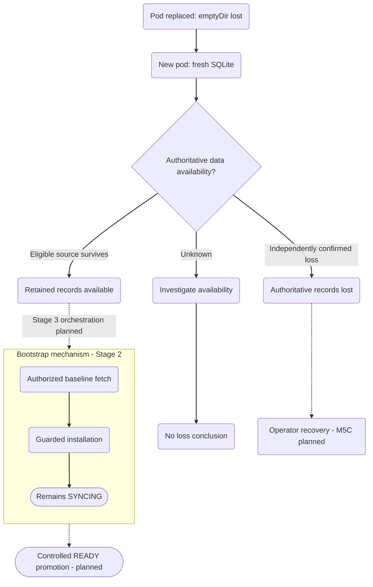
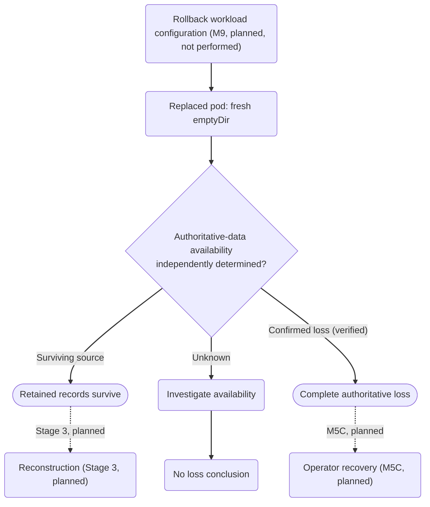

# Ephemeral state and recovery

**One-line summary:** Ephemeral state and recovery is the model for what happens when a pod's local
SQLite (an emptyDir volume) is lost. Stage 2 (M5B, implemented) provides the authorized bootstrap
inventory retrieval, bounded message retrieval, and guarded local installation while the requester
remains SYNCING. Stage 3 (M5B, planned) supplies the reconstruction orchestration: source
selection, scheduling, retry coordination, catch-up, and controlled READY promotion. Ordinary
periodic anti-entropy is a separate replication path and is **not** authorized for a
lifecycle-enabled SYNCING replica. Unknown, unreachable, ineligible, or unbound peers do **not**
establish complete authoritative-data loss; confirmed complete loss requires independent evidence
that authoritative retained records have been lost. M5C operator-controlled recovery remains
planned. A GitOps rollback restores the Kubernetes workload configuration, not the SQLite
contents.

## 1. The problem the concept solves

In a cluster with ephemeral storage (a StatefulSet with no PVCs; the SQLite database is on an
emptyDir volume), a pod can lose its local state:

- A pod is replaced (a node failure, a rolling update, a reschedule): its emptyDir volume is lost;
  a new pod starts with a fresh, empty emptyDir.
- The authoritative metadata (the ConfigMap) moves on to a newer epoch (a reset after a catastrophic
  loss); the new pod is in a different epoch than the surviving bound peers.

The recovery problem: how does a replaced pod (with a fresh, empty emptyDir) reconstruct its
retained state from surviving replicas? Stage 2 (implemented) provides the mechanism — an
authorized bootstrap inventory retrieval, bounded message retrieval, and guarded local
installation while the requester remains SYNCING. Stage 3 (planned) supplies the orchestration —
source selection, scheduling, retry coordination, catch-up, and controlled READY promotion.
Ordinary periodic anti-entropy is a **separate** replication path and is **not** authorized for a
lifecycle-enabled SYNCING replica.

How is a confirmed complete authoritative-data loss handled? Unknown, unreachable, ineligible, or
unbound peers do **not** establish complete authoritative-data loss. Confirmed complete loss
requires **independent evidence** that authoritative retained records have been lost — not merely
the absence of currently reachable or bound peers. M5C operator-controlled recovery remains
planned.

The GitOps rollback problem: how does a rollback to an old Kubernetes workload revision (an Argo
rollback, a Helm rollback) interact with the SQLite contents? A rollback to an old revision does
not restore the SQLite contents committed in the new revision — the SQLite contents are on an
emptyDir volume, and a rolling update replaces the affected pods with fresh, empty emptyDir
volumes. Not every rollback necessarily replaces every pod.

## 2. The underlying distributed-systems principle

The core principle is **reconstruction from surviving sources, with operator recovery for
complete loss**:

- **Ephemeral storage is by design.** The SQLite database is on an emptyDir volume (a StatefulSet
  with no PVCs). This is a deliberate design choice: it keeps the cluster lightweight (no
  persistent storage provisioning), it matches the testbed purpose (a testbed for Kubernetes
  orchestration, service discovery, and fault tolerance; not a production message service), and it
  forces the system to rely on peer-to-peer replication (not local persistence) for recovery.
- **Reconstruction from surviving replicas (Stage 2 mechanism, Stage 3 orchestration).** Stage 2
  (M5B, implemented) provides the authorized baseline retrieval and guarded installation
  mechanism: a SYNCING replica (the requester) sends a bootstrap fetch to an eligible source (a
  READY or DEGRADED replica in the same epoch, not revoked, not stopped); the source validates the
  requester's pinned context; the source serves a bounded batch of records from its local store;
  the requester validates the response envelope; the requester commits the records in a single
  SQLite transaction. The requester **remains SYNCING** — it does not self-promote to READY. The
  transition to READY is orchestrated by the lifecycle controller (Stage 3, planned). Stage 3
  (planned) supplies the reconstruction orchestration: source selection, scheduling, retry
  coordination, catch-up, and controlled READY promotion. Ordinary periodic anti-entropy is a
  **separate** replication path and is **not** authorized for a lifecycle-enabled SYNCING
  replica. See the admission vs. orchestration distinction in §4.
- **Confirmed complete loss requires operator recovery (M5C, planned).** Confirmed complete
  authoritative-data loss requires **independent evidence** that authoritative retained records
  have been lost — not merely the absence of currently reachable or bound peers. The ConfigMap
  does not carry a bound-replica count, and peer-status evidence alone is not conclusive proof of
  total loss. The recovery path is operator recovery (M5C, planned). The exact procedure is not
  yet defined; it is deliberately operator-controlled rather than automated.
- **Distinguish three cases of source unavailability — do not equate them with confirmed total
  loss.** (1) A **temporarily unreachable or ineligible source** (the eligible source is
  partitioned, stopped, or momentarily unready) is a transient condition: the Stage 3
  orchestration (planned) would retry on a later cycle and drive the Stage 2 mechanism once the
  source is reachable again. A currently unreachable or ineligible peer does **not** establish
  complete authoritative-data loss. (2) **Unknown authoritative-data availability** (the new pod
  has not yet established whether any surviving bound peer is reachable) is a state of
  not-yet-knowing, not a confirmed loss. (3) **Confirmed complete authoritative-data loss**
  (independent evidence establishes that authoritative retained records have been lost — peer-
  status evidence alone is not conclusive proof of total loss) is the only case that requires
  operator recovery (M5C, planned). The first two cases must not be treated as confirmed total
  loss.
- **The complete new-pod reconstruction workflow is not yet fully implemented.** Stage 2
  (M5B) provides the baseline retrieval and installation *mechanism* (the bootstrap fetch +
  guarded single-transaction install). Stage 3 (M5B, planned) supplies the *orchestration*
  (discovery, source selection, sweep scheduling, initial catch-up) and the READY promotion. M5C
  (operator recovery) remains planned. The mechanism exists; the full orchestration-to-READY
  workflow does not.
- **A GitOps rollback restores configuration, not data.** A rollback to an old Kubernetes
  workload revision (an Argo or Helm rollback) restores the workload configuration (the Helm chart
  values, the Argo application spec). If the rollback replaces a pod, that pod gets a fresh,
  empty emptyDir. Surviving replicas (pods not replaced by the rollback) retain their records.
  The M9 GitOps rollback experiment is planned, not performed.

## 3. Why GossipGrid uses it

GossipGrid uses the ephemeral state and recovery model because it has ephemeral storage (a
StatefulSet with no PVCs; the SQLite database is on an emptyDir volume) and eventual
consistency: a pod can lose its local state (a node failure, a rolling update), and the system
must rely on peer-to-peer replication (not local persistence) for recovery. The model ensures
that:

- A replaced pod can reconstruct its retained state from surviving replicas (the bootstrap
  admission (M5B Stage 2, implemented) enables the baseline fetch and guarded installation; Stage
  3, planned, supplies the orchestration — source selection, scheduling, retry coordination,
  catch-up, and controlled READY promotion).
- A confirmed complete authoritative-data loss is handled by operator recovery (M5C, planned).
  The procedure is not yet defined; it is deliberately operator-controlled.
- A GitOps rollback is independent of the SQLite contents: a rollback restores the workload
  configuration; if it replaces a pod, that pod gets a fresh, empty emptyDir; surviving replicas
  retain their records.

## 4. How GossipGrid currently implements it

Implemented, committed, and locally tested (Milestones 5B Stages 0–2, 4C). The recovery model is
enforced by the bootstrap admission (M5B Stage 2), the lifecycle state machine (M5A), and the
epoch-fencing protocol (M5A). Ordinary periodic anti-entropy (M4C) is a separate replication path
that is **not** authorized for a lifecycle-enabled SYNCING replica.

Key implemented behavior (verify against the code, not this summary):

- **The bootstrap admission (M5B Stage 2, implemented): the reconstruction mechanism.** A
  SYNCING replica (the requester) sends a bootstrap fetch to an eligible source (a READY or
  DEGRADED replica in the same epoch, not revoked, not stopped); the source validates the
  requester's pinned context (both the cluster ID and the epoch ID must be present and valid);
  the source serves a bounded batch of records (the inventory of message IDs from the source's
  local store; the page size and the batch size are bounded); the requester validates the
  response envelope (the source's cluster and epoch context from the source's authorization
  snapshot); the requester commits the records in a single SQLite transaction (the retention
  evaluation and the immutable-content conflict check are inside the transaction).

- **The admission vs. orchestration distinction.** The bootstrap admission (M5B Stage 2,
  implemented) permits a SYNCING replica to fetch a bootstrap inventory, fetch the corresponding
  records, and install them through a guarded local commit. It does not permit ordinary inbound
  or outbound replication, periodic anti-entropy sweeps, public writes, authoritative source
  privileges, or self-promotion to READY. The orchestration of the full initial catch-up and the
  transition from SYNCING to READY is Stage 3 (planned, not implemented). Distinguish this from
  the lifecycle-disabled initial sync (M4C), which is a separate mechanism that gates readiness
  on a completed anti-entropy pass without any lifecycle state.

- **Ordinary periodic anti-entropy (M4C, implemented): a separate replication path.** When
  lifecycle is disabled (the M4C default), anti-entropy is the primary recovery mechanism: a
  replaced pod joins the cluster and converges via periodic anti-entropy (the anti-entropy engine
  periodically pulls a bounded ID inventory from each eligible peer, diffs against its local
  store, and fetches missing records) without any lifecycle state. When lifecycle is **enabled**,
  ordinary periodic anti-entropy is a **separate replication path** that is **not authorized for a
  lifecycle-enabled SYNCING replica**: the bootstrap admission (Stage 2) is the narrow mechanism
  that permits a SYNCING requester to fetch and install a baseline; the discovery, scheduling,
  retry coordination, catch-up, and `READY` promotion that make that a complete reconstruction
  *workflow* are Stage 3 (planned). The bootstrap admission (Stage 2) does **not** authorize
  ordinary periodic anti-entropy sweeps.

- **The lifecycle state machine (M5A, implemented): the state transitions.** The lifecycle state
  machine (a 7-state machine: STARTING, DISCOVERING, GENESIS, SYNCING, READY, DEGRADED,
  RECOVERY_REQUIRED) enforces the state transitions: a replaced pod starts in STARTING,
  transitions to DISCOVERING (it discovers peers via DNS or static discovery), transitions to
  GENESIS (if it is eligible for genesis: the one-time genesis authorization is not consumed;
  the replica is gossipgrid-0; peer-status evidence confirms no other expected identity has
  bound), or transitions to SYNCING (if it is not eligible for genesis: the one-time genesis
  authorization is consumed; the authoritative metadata confirms the cluster is initialized). The
  state machine then **fails closed** based on the authoritative metadata and the durable epoch
  binding: a replica whose binding does not match the authoritative metadata, or whose genesis
  authorization has been revoked, transitions to the fail-closed RECOVERY_REQUIRED lockout. The
  absence of a surviving bound peer is not itself a proven binding/metadata mismatch, so it does
  not by itself necessarily move every replica to RECOVERY_REQUIRED. The source selection, the
  baseline reconstruction, and the transition from SYNCING to READY are orchestrated by the
  lifecycle controller (M5B Stage 3, planned) and are not yet implemented end to end.

- **The operator recovery procedure (M5C, planned): the complete loss recovery.** Confirmed
  complete authoritative-data loss requires **independent evidence** that authoritative retained
  records have been lost — not merely the absence of currently reachable or bound peers. The
  recovery path is operator recovery (M5C, planned). The exact procedure is not yet defined; it
  is deliberately operator-controlled rather than automated. The lifecycle recovery sequence
  diagram ([lifecycle-recovery-sequence](../diagrams/generated/lifecycle-recovery-sequence.svg))
  shows the target design for the recovery path.

- **The GitOps rollback (M9, planned): the Kubernetes workload revision history.** A rollback to
  an old Kubernetes workload revision (an Argo or Helm rollback) restores the workload
  configuration. If the rollback replaces a pod, that pod gets a fresh, empty emptyDir.
  Surviving replicas retain their records. The M9 GitOps rollback experiment is planned, not
  performed. The GitOps delivery diagram
  ([gitops-delivery](../diagrams/generated/gitops-delivery.svg)) shows the M9 experiment as a
  planned feature (a dashed, slate edge).

## 5. Visual examples

The diagrams below illustrate the ephemeral state and recovery model: a replaced pod (losing its
SQLite, obtaining a fresh, empty emptyDir) reconstructing from surviving replicas (the bootstrap
admission (M5B Stage 2, implemented) and the Stage 3 orchestration (planned)), and a confirmed
complete loss requiring operator recovery (M5C, planned).

### 5a. A replaced pod reconstructing from surviving replicas

[View full-size SVG](../diagrams/generated/concept-ephemeral-recovery.svg) · [View PNG](../diagrams/generated/concept-ephemeral-recovery.png)

<!-- DIAGRAM:concept-ephemeral-recovery -->


Reading the diagram. This is a **conceptual reconstruction workflow** containing implemented
mechanisms and planned orchestration. The top row (LOSS → NEW) shows a pod being replaced (its
`emptyDir` lost) and a new pod starting with a fresh, empty SQLite. The **availability
decision** (the "Authoritative data availability?" diamond) represents an **assessment**, not an
already-implemented automatic loss-detection algorithm: it must be evaluated **before** baseline
retrieval, and its three outcomes must not be conflated.

- **Eligible source survives** (a surviving bound peer in the same epoch is reachable and
  eligible): the retained records are available. The dashed edge to the "Bootstrap mechanism -
  Stage 2" panel indicates that the **Stage 3 orchestration** (source selection, scheduling,
  retry coordination) is what would drive the requester to use the Stage 2 mechanism; the
  Stage 2 mechanism itself (authorized baseline fetch + guarded installation) is **implemented**,
  but the requester **remains SYNCING** — the controlled READY promotion is Stage 3 (planned).
- **Unknown** (the new pod has not yet established whether any surviving bound peer is
  reachable): this is a state of **not-yet-knowing**. It leads to **no loss conclusion** — a
  currently unreachable or ineligible peer does **not** establish complete authoritative-data
  loss.
- **Independently confirmed loss** (independent evidence establishes that authoritative retained
  records have been lost): the recovery path is **operator recovery (M5C, planned)**, whose
  procedure is not yet defined. The dashed edge indicates that M5C is planned, not implemented.

The "Bootstrap mechanism - Stage 2" panel shows the implemented mechanism: an authorized baseline
fetch (the requester, a SYNCING replica, sends a bootstrap fetch to an eligible source; the source
validates the requester's pinned context and serves a bounded batch of records) followed by a
guarded installation (a single SQLite transaction). The requester **remains SYNCING** — it does
not self-promote to READY. The dashed edge to "Controlled READY promotion - planned" indicates
that the READY transition is orchestrated by the lifecycle controller (Stage 3, planned).

### 5b. A GitOps rollback restores configuration, not data

[View full-size SVG](../diagrams/generated/concept-gitops-rollback.svg) · [View PNG](../diagrams/generated/concept-gitops-rollback.png)

<!-- DIAGRAM:concept-gitops-rollback -->


Reading the diagram. A GitOps workload rollback (M9, planned, not performed) **restores the
workload configuration, not the SQLite contents**: only the pods actually replaced by Kubernetes
receive fresh, empty `emptyDir` volumes; the SQLite contents committed under the newer revision are
not restored. The decision `Authoritative data availability?` splits the outcome into three
cases that must not be conflated. A **surviving eligible source** (a pod not replaced by the
rollback) retains its records under the same cluster/epoch, so the retained data **survives**; a
replaced pod can reconstruct it via the Stage 2 bootstrap mechanism (implemented) driven by the
Stage 3 orchestration (planned, shown as the dashed `Reconstruction` path). **Unknown**
availability (the replaced pods' `emptyDir` is gone but it is not yet established whether any
surviving bound peer exists) is a state of *not-yet-knowing*: it leads to **no loss conclusion**
and to an availability investigation. Only an **independently confirmed** loss — independent
evidence establishes that authoritative retained records have been lost, established by
verification and not by peer-status evidence alone — is a **complete authoritative-data loss**,
whose recovery path is operator recovery (M5C, planned).

Critically, the absence of a currently bound peer is **not** itself proof that no authoritative
retained data survives anywhere: unknown or unavailable sources are not proof of complete
authoritative-data loss. A workload rollback and the M9 controlled rollback experiment are
**planned, not performed**.

## 6. Important failure scenarios

- A node failure (the emptyDir is lost). A node failure (a hardware failure, a software failure,
  a cloud provider failure) loses the emptyDir volume; the pod is rescheduled to a new node; the
  new pod starts with a fresh, empty emptyDir volume; the SQLite contents are lost. The recovery
  path is the Stage 2 bootstrap mechanism (implemented) driven by the Stage 3 orchestration
  (planned).
- A rolling update (the emptyDir is lost). A rolling update (a Helm upgrade, an Argo sync)
  replaces the pods; the old pods' emptyDir volumes are lost; the new pods start with fresh,
  empty emptyDir volumes; the SQLite contents are lost. The recovery path is the same as for a
  node failure.
- A confirmed complete authoritative-data loss. If a failure replaces all pods simultaneously (a
  catastrophic failure, e.g. a node group failure, a misconfigured rolling update that replaces
  all pods at once), no surviving bound peer remains in the current epoch. Replacing all pods is
  a **mechanism** that can produce loss, but it is **not itself proof** that no authoritative
  retained data survives: complete loss must be **independently verified** (independent evidence
  establishes that authoritative retained records have been lost; peer-status evidence alone is
  not conclusive proof of total loss). Only once that verification establishes the loss does the
  recovery path become operator recovery (M5C, planned), whose procedure is not yet defined.
- A stale DNS membership (the discovery snapshot is stale). If the DNS discovery snapshot is
  stale (a stale A record from a replaced pod), the requester may attempt to bootstrap from a
  stale peer (a replaced pod that no longer exists). The request fails (a connection error). The
  discovery manager refreshes the DNS snapshot on a schedule, so a later cycle can present a fresh
  snapshot with a surviving bound peer; a successful bootstrap from that survivor is the
  mechanism Stage 2 provides. Automatic retry, source selection, and eventual bootstrap completion
  are **not** current lifecycle-enabled behavior — they belong to the Stage 3 orchestration
  (planned), which is what would schedule and coordinate the retry-and-converge loop.
- A GitOps rollback without a snapshot backup. An Argo or Helm rollback to an old revision
  restores the workload configuration. If the rollback replaces a pod, that pod gets a fresh,
  empty emptyDir; the SQLite contents from the new revision are lost. Surviving replicas retain
  their records. If independent evidence establishes that authoritative retained records have
  been lost (a confirmed complete authoritative-data loss), the recovery path is operator
  recovery (M5C, planned).

## 7. Guarantees and limitations

**Guaranteed (implemented, when the mechanism is explicitly invoked and its prerequisites
are satisfied):**

- When a `SYNCING` requester (with a complete, valid pinned cluster/epoch context) sends a
  bootstrap fetch to an eligible `READY`/`DEGRADED` source in the same epoch, the authorized
  inventory retrieval, the bounded message retrieval, and the guarded installation are
  performed while the requester remains `SYNCING`. The source validates the requester's pinned
  context; the requester validates the response envelope; the records are committed in a single
  SQLite transaction. This is a **narrow, explicit, mechanism-level** guarantee: it applies to a
  fetch that is actually sent to an eligible source; it does **not** by itself guarantee that a
  replaced pod will automatically locate a source, complete a bootstrap, or reach `READY` (that
  orchestration is Stage 3, planned — see below).
- The bootstrap admission is a narrow authorization: a `SYNCING` replica may fetch a bootstrap
  inventory, fetch the corresponding records, and install them through a guarded commit. It may
  not write to the public API, it may not send ordinary gossip, it may not accept ordinary
  inbound replication, it may not act as a bootstrap source, it may not self-promote to `READY`.
- The commit boundary is atomic (a single SQLite transaction); the retention evaluation and the
  immutable-content conflict check are inside the transaction (the linearization point is the
  `COMMIT` statement).
- The lifecycle state machine enforces its fail-closed state transitions (a fresh replica starts
  in `STARTING`, transitions to `DISCOVERING`, and — depending on the authoritative metadata and
  the durable epoch binding — to `GENESIS`, `SYNCING`, or the fail-closed `RECOVERY_REQUIRED`).
  The `SYNCING` to `READY` transition is **not** currently automatic: it is orchestrated by the
  lifecycle controller (M5B Stage 3, planned).

**Not guaranteed / limitations (by design):**

- **Full lifecycle-enabled reconstruction to READY is planned, not currently executable end to
  end.** The complete workflow — a newly restarted lifecycle-enabled replica automatically
  discovers an eligible surviving bound peer, selects it as a bootstrap source, completes a
  guarded baseline install, catches up, and is promoted to `READY` — is driven by the Stage 3
  orchestration (M5B, planned) and is **not** implemented end to end. What **is** implemented is
  the Stage 2 *mechanism*: an authorized, guarded install when a bootstrap fetch is explicitly
  sent to an eligible source whose prerequisites are satisfied (see the guaranteed list above).
  Do not read the Stage 2 mechanism as a claim that a replaced pod will automatically
  reconstruct itself and become `READY` today.
- **The fail-closed `RECOVERY_REQUIRED` lockout is not the same as confirmed authoritative-data
  loss.** A replica transitions to `RECOVERY_REQUIRED` on a **proven binding/metadata mismatch**
  (for example, a binding that does not match the authoritative metadata, or a revoked
  genesis authorization) — a fail-closed **lockout** of a specific replica. The **absence** of a
  surviving bound peer is a state of *not-yet-knowing* or *unavailability*; it does **not** by
  itself necessarily transition every replica to `RECOVERY_REQUIRED`, and it is **not**
  independent evidence that authoritative retained records have been lost. A confirmed complete
  loss requires independent evidence that authoritative retained records have been lost;
  peer-status or lockout evidence alone is not conclusive proof of total loss.
- A confirmed complete authoritative-data loss (independent evidence establishes that
  authoritative retained records have been lost) requires operator recovery (M5C, planned). The
  procedure is not yet defined; it is deliberately operator-controlled. A pod emptyDir loss is
  not the same as the loss of all surviving authoritative data: if surviving replicas exist, the
  Stage 2 bootstrap mechanism (driven by the Stage 3 orchestration) can reconstruct the retained
  state.
- A GitOps rollback restores the workload configuration, not the SQLite contents. If the
  rollback replaces a pod, that pod gets a fresh, empty emptyDir. The M9 experiment is planned,
  not performed.
- The lifecycle controller (Stage 3, planned) orchestrates the SYNCING to READY transition. The
  requester remains SYNCING until the orchestration completes catch-up. The bootstrap admission
  (Stage 2) is a narrow authorization; it does not orchestrate the transition.

## 8. Relevant implementation files and tests

- **Bootstrap admission (M5B Stage 2, implemented):** `internal/lifecycle/admission.go`
  (CheckBootstrapFetch and CheckBootstrapSourceInbound predicates; the pinned context
  validation; the response envelope validation).
- **Peer transport (the bootstrap fetch):** `internal/peertls/client.go` (the doRequest
  bootstrap branch; the dedicated bootstrap authorization decision; the no-fallback behavior;
  the partial-404 retry with pinned-context revalidation).
- **Anti-entropy (M4C, implemented):** `internal/antientropy/antientropy.go` (the per-cycle
  sweep; the ID inventory diff; the bounded fetch; the cursor progression; the completed-sweep
  accounting; the admission re-check).
- **Store (the commit boundary):** `internal/store/store.go` (InsertReplicatedMessagesBounded —
  the 8-step transaction: guard, BEGIN, retention, classify+install, conflict check, COMMIT,
  accounting; ON CONFLICT DO NOTHING insert).
- **Lifecycle state machine (M5A, implemented):** `internal/lifecycle/lifecycle.go` (the
  7-state machine; the transition table; the RWMutex; the bounded 64-entry log).
- **Bootstrap transport test:** `internal/peertls/bootstrap_transport_test.go` (the
  pinned-context validation: incomplete context rejected, mismatch rejected, match allowed,
  partial-404 retry also performs the comparison).
- **Admission test:** `internal/lifecycle/admission_test.go` (the bootstrap authorization
  predicates, the 409 on mismatch, the commit revalidation).
- **Integration test:** `cmd/gossipgrid/bootstrap_integration_test.go` (the bootstrap admission
  tests including TestBootstrapE2E_BootstrapAuthRevokedAtRetryBoundary: 3 authorization decisions,
  exactly 1 transmitted HTTP request).
- **Authoritative spec:** [Bootstrap replication admission (5B Stage 2)](../gossip-and-bootstrap.md#milestone-5b-stage-2--bootstrap-replication-admission-implemented-2026-11-24-committed-209cec1)
  and [Recovery](../recovery.md).
- **GitOps delivery diagram:** [gitops-delivery](../diagrams/generated/gitops-delivery.svg) (the M9
  experiment shown as a planned feature, a dashed, slate edge).

## 9. Practical experiment

This section distinguishes two experiments: **Experiment A** is currently executable end to end
with the implemented, committed behavior (lifecycle enforcement **disabled**); **Experiment B**
is the lifecycle-enabled reconstruction-to-`READY` experiment, which is **planned** and not yet
executable end to end (it depends on the Stage 3 orchestration, M5B).

### Experiment A — Executable integration test: initial-sync replacement recovery

This is the [TestIntegrationInitialSyncReplacementRecoversBeforeReady](../../cmd/gossipgrid/initial_sync_integration_test.go)
integration test in `cmd/gossipgrid/initial_sync_integration_test.go`. It is an executable
demonstration of the **lifecycle-disabled** initial-sync mechanism (Milestone 7A enhancement,
synchronization-aware Kubernetes readiness) — not the M5B Stage 3 lifecycle-aware READY
promotion. It requires no manual setup, no database deletion, and no Kubernetes cluster.

Run it with:

```sh
GOFIPS140=v1.0.0 CGO_ENABLED=1 go test \
  -tags sqlite_omit_load_extension \
  -v -count=1 \
  -run '^TestIntegrationInitialSyncReplacementRecoversBeforeReady$' \
  ./cmd/gossipgrid
```

**What the test demonstrates:**

1. **Five disposable replicas** with independent SQLite databases and real peer mTLS (TLS 1.3,
   per-pod certificates, a shared test CA). Lifecycle enforcement is **disabled** (the
   default); the initial-sync barrier is **enabled** on each replica.
2. **Three historical messages are posted across three replicas** (one each to gossipgrid-0, -1,
   and -2), and converge among four surviving replicas (gossipgrid-0..3) via ordinary anti-entropy.
   The test waits until all four survivors hold the three historical message IDs.
3. **The fifth replica is replaced** with a fresh, empty SQLite database. The original
   gossipgrid-4 is stopped and a new node with the same pod identity (`gossipgrid-4`) is
   started with an empty store and the initial-sync barrier enabled.
4. **The replacement initially reports HTTP 503** with reason `initial_sync_pending` —
   the readiness barrier is pending (0 of 4 expected remote peers synced).
5. **Ordinary anti-entropy sweeps reconcile missing records.** The replacement's anti-entropy
   engine pulls ID inventories from each surviving peer, diffs against its empty local store,
   and fetches the missing records (idempotent insert).
6. **The replacement completes its initial-sync readiness barrier** — a full, successful
   inventory pass against every expected remote peer (the one-shot barrier closes).
7. **HTTP readiness becomes 200** — `/readyz` reports `Ready=true`, `initial_sync_complete=true`.
8. **Historical message IDs are present** in the replacement's store, and their `body` and
   `origin` fields match a survivor reference (identical immutable fields).
9. **The surviving replicas remain operational** — their message counts are unchanged.

**What the test verifies and what it does not prove:**

- It verifies that the **lifecycle-disabled** initial-sync mechanism (a completed anti-entropy
  pass as the readiness gate) recovers a replaced replica's lost state from surviving
  replicas. This is the mechanism in force for the deployed 7A staging cluster (lifecycle
  enforcement disabled).
- It does **not** prove that this is an actual Kubernetes rollback or an M9 experiment.
- It does **not** demonstrate the lifecycle-enabled Stage 2 bootstrap mechanism or the
  Stage 3 lifecycle-aware READY promotion (M5B, planned).
- It does not require readers to delete databases manually; the test creates and tears down
  its own temporary SQLite databases via `t.TempDir()`.

### Stage 2 mechanism demonstration: TestBootstrapE2E_FullPage

The [TestBootstrapE2E_FullPage](../../cmd/gossipgrid/bootstrap_integration_test.go)
integration test in `cmd/gossipgrid/bootstrap_integration_test.go` demonstrates the
**lifecycle-enabled** Stage 2 bootstrap mechanism: authorized baseline retrieval and guarded
installation while the requester remains `SYNCING`.

Run it with:

```sh
GOFIPS140=v1.0.0 CGO_ENABLED=1 go test \
  -tags sqlite_omit_load_extension \
  -v -count=1 \
  -run '^TestBootstrapE2E_FullPage$' \
  ./cmd/gossipgrid
```

**What the test demonstrates:**

1. A **READY source** (gossipgrid-0, bound to cluster `c1`/epoch `e1`, forced to `READY`) and
   a **SYNCING requester** (gossipgrid-1, bound to the same cluster/epoch, forced to
   `SYNCING`), with real peer mTLS and the production bootstrap wiring
   (`SetBootstrapAdmissionCheck`, `SetBootstrapAuthorizationSource`, `SetBootstrapGuard`).
2. The source is **seeded with 128 messages**. The requester calls
   `FetchBootstrapBaseline` with a 128-ID page size. The missing IDs are split into
   **16 bounded batches of 8 records each** (the engine's `FetchBatchSize`); each batch is
   fetched from the source and installed in its **own guarded transaction** — the entire
   page is **not** a single atomic transaction.
3. **All 128 records are inventoried and inserted** (0 already present, 0 expired,
   0 conflicts). The page is `Completed`.
4. **All 128 records are present** in the requester's local store.
5. **The requester remains `SYNCING`** — the bootstrap does not self-promote to `READY`.
6. **The `SYNCING` requester cannot perform ordinary replication or public writes** after
   the bootstrap: `CheckReplicationOutbound` and `CheckWrite` both reject the `SYNCING`
   state.

**What the test actually asserts (from the test code):**

- The page is `Completed` with 128 inventoried IDs, 128 inserted, 0 already present, 0
  expired, and 0 conflicts.
- All 128 records are present in the requester's local store (verified by `GetByID` for
  each seeded ID).
- The requester's state is `SYNCING` after bootstrap (it did not self-promote to `READY`).
- The `SYNCING` requester is rejected by `CheckReplicationOutbound` (no ordinary
  replication) and `CheckWrite` (no public writes) after the bootstrap install.

**What is inferred from the implementation (not a direct test assertion):**

- The per-batch transactional install: the test asserts the final count (128 inserted)
  but does not assert the number of transactions or the per-batch boundary. The
  per-batch transaction structure (16 bounded batches of 8 records, each with its own
  guarded transaction) is a property of the `FetchBootstrapBaseline` implementation, not
  a direct test assertion.

**What the test does not prove:**

- It does **not** demonstrate automatic reconstruction orchestration (source selection,
  scheduling, retry coordination, catch-up) — that is Stage 3 (M5B, planned).
- It does **not** demonstrate a replaced pod automatically discovering a source or reaching
  `READY`. The fetch is explicitly invoked by the test against a known, eligible source.

### Experiment B — Lifecycle-enabled reconstruction (planned, not currently executable)

The full lifecycle-enabled workflow — a newly restarted lifecycle-enabled replica
(`GOSSIPGRID_LIFECYCLE_ENABLED=true`) automatically discovering an eligible surviving bound
peer, selecting it as a bootstrap source, completing a guarded baseline install, catching up,
and being promoted to `READY` — is **planned** and **not currently executable end to end**. It
depends on the **Stage 3 orchestration (M5B)**, which is designed but not implemented: source
selection, sweep scheduling, retry coordination, initial catch-up, and controlled `READY`
promotion. Do **not** claim that a newly restarted lifecycle-enabled replica will automatically
discover a source, complete bootstrap, or become `READY` with the current implementation.

**What is already implemented and locally tested (Stage 2, M5B).** The Stage 2 *mechanism*
is implemented: an authorized bootstrap inventory retrieval, a bounded message retrieval, and
a guarded single-transaction install while the requester remains `SYNCING`, gated by the
narrow bootstrap admission. The existing Stage 2 integration tests demonstrate these pieces:
authorized inventory retrieval, bounded message retrieval, guarded installation, and
retention/epoch authorization. See:

- [Bootstrap replication admission (5B Stage 2)](../gossip-and-bootstrap.md#milestone-5b-stage-2--bootstrap-replication-admission-implemented-2026-11-24-committed-209cec1)
- [Recovery](../recovery.md)
- The Stage 2 integration tests: `cmd/gossipgrid/bootstrap_integration_test.go` (including
  `TestBootstrapE2E_BootstrapAuthRevokedAtRetryBoundary`) and
  `internal/peertls/bootstrap_transport_test.go` (pinned-context validation) and
  `internal/lifecycle/admission_test.go` (the bootstrap authorization predicates).

**Stage 3 prerequisites (to make Experiment B executable):** source selection (choose an
eligible `READY`/`DEGRADED` peer in the same epoch), scheduling and retry coordination, initial
catch-up, and the controlled `SYNCING` → `READY` promotion — all orchestrated by the lifecycle
controller (M5B Stage 3, planned). Until that orchestration is implemented, the Stage 2
mechanism can be exercised by an explicitly sent bootstrap fetch to an eligible source, but it
will not by itself drive a replaced replica to `READY`.

## 10. Related documentation and concepts

- **Previous in the progression:** [Concurrency and linearization](concurrency-and-linearization.md)
  — the concurrent operations (the revocation and the commit) that the recovery model must
  handle.
- **Authority:** [Distributed authority](distributed-authority.md) — the admission that the
  bootstrap fetch must respect (the lifecycle guard in the commit boundary; the pinned context
  validation; the response envelope validation).
- **Fencing:** [Epoch fencing](epoch-fencing.md) — the fencing (the 409 on mismatch) that the
  bootstrap fetch must respect (the source validates the requester's pinned context; the
  requester validates the response envelope).
- **Genesis:** [Operator-controlled genesis](../lifecycle-metadata-and-genesis.md#1-one-time-genesis-authorization)
  — the one-time authorization that closes the "replacement seed" flaw (a replacement
  `gossipgrid-0` after data loss cannot claim genesis; it joins the surviving bound peer or
  fails closed to RECOVERY_REQUIRED).
- **Authoritative spec:** [Recovery](../recovery.md) and
  [Bootstrap replication admission (5B Stage 2)](../gossip-and-bootstrap.md#milestone-5b-stage-2--bootstrap-replication-admission-implemented-2026-11-24-committed-209cec1).
- **Diagrams:** the [ephemeral recovery](../diagrams/generated/concept-ephemeral-recovery.svg)
  ([PNG](../diagrams/generated/concept-ephemeral-recovery.png)) and
  [GitOps rollback](../diagrams/generated/concept-gitops-rollback.svg)
  ([PNG](../diagrams/generated/concept-gitops-rollback.png)) concept diagrams, the
  [lifecycle recovery sequence](../diagrams/generated/lifecycle-recovery-sequence.svg)
  ([PNG](../diagrams/generated/lifecycle-recovery-sequence.png)) diagram, and the
  [GitOps delivery](../diagrams/generated/gitops-delivery.svg)
  ([PNG](../diagrams/generated/gitops-delivery.png)) diagram (the M9 experiment shown as a
  planned feature).
- **Visual conventions:** [GossipGrid visual design system](../visual-design.md).
