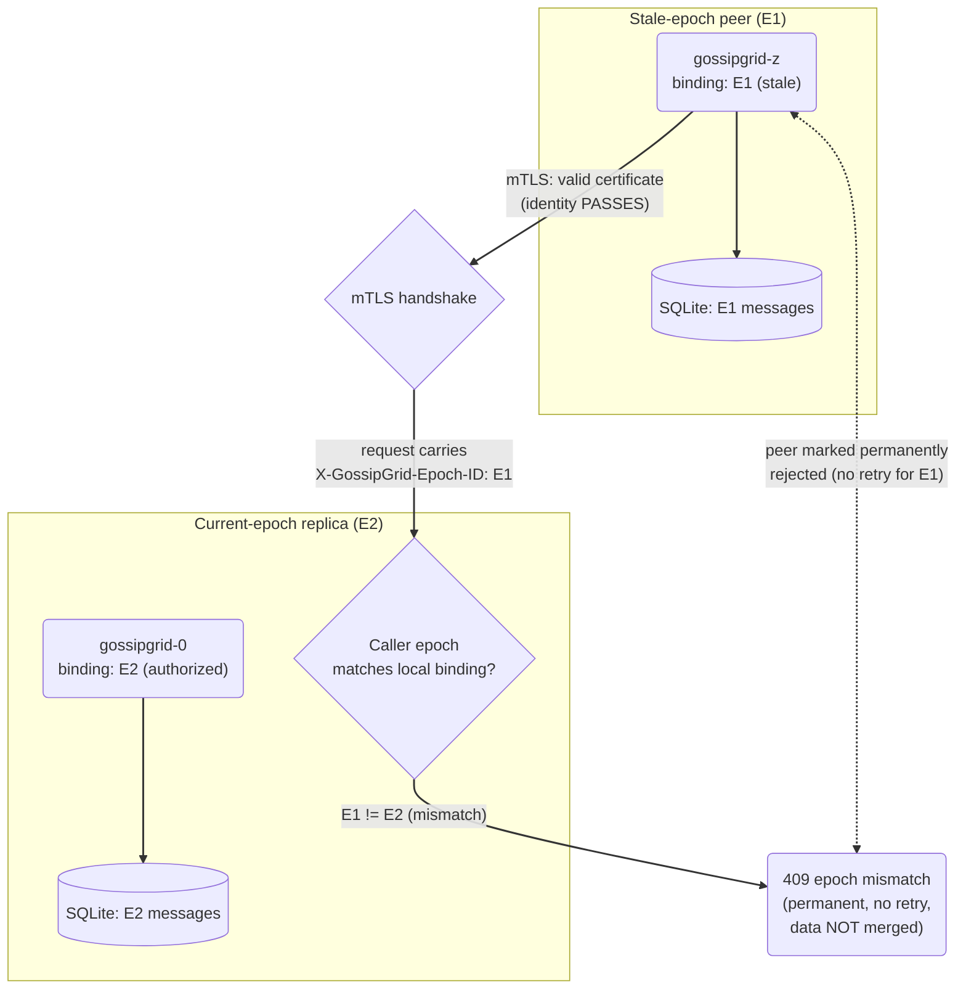

# Epoch fencing

**One-line summary:** Epoch fencing is the mechanism that prevents a stale-epoch replica (one
carrying data from an old cluster epoch) from injecting that data into a newer epoch. Each peer's
status response and sync endpoints carry epoch context via HTTP headers; a receiving replica compares
the caller's epoch against its own local database binding, and a mismatch returns 409 (the data is
not merged). The 409 is permanent (no retry). mTLS proves identity; epoch headers prove epoch
membership — the two are independent layers.

## 1. The problem the concept solves

In a cluster with ephemeral storage and eventual consistency, a pod can be replaced: its `emptyDir`
volume is lost, and a new pod starts with an empty database. But the authoritative metadata (the
ConfigMap) may have moved on to a newer epoch (a reset, a new epoch after a catastrophic loss). A
stale-epoch replica — one that was not replaced but is still carrying data from an old epoch (e.g.
it was partitioned during an epoch transition, or it has not yet re-evaluated the metadata) — might
rejoin the cluster and inject its old-epoch data into the newer epoch.

Epoch fencing solves this: even if a peer is mTLS-authorized (it holds a valid certificate from the
workload CA), its data is not merged unless its epoch context matches the local binding. A
stale-epoch replica is fenced out: its requests are rejected with 409, and it is permanently marked
as rejected (no retry).

The key distinction this concept makes explicit:

- **mTLS proves identity, not epoch membership.** A valid mTLS certificate is necessary (the peer is
  an authorized workload) but not sufficient (the peer's data may belong to a different epoch). mTLS
  alone cannot distinguish a current-epoch replica from a stale-epoch replica that happens to hold a
  valid certificate.
- **Epoch headers are fencing metadata, not authentication.** The epoch headers (the cluster ID and
  epoch ID in the request, the response envelope in the response) are metadata that determine
  whether the data is eligible for merging. They are not a bearer token; possessing an epoch ID does
  not grant access to any resource. They are not signed, not encrypted, not hashed — they are
  visible in peer status responses and HTTP headers.

## 2. The underlying distributed-systems principle

The core principle is fencing via an epoch token that is observed, not invented:

- **An epoch is a logical version of the cluster.** Each epoch has a globally unique cluster ID and
  a globally unique epoch ID (both UUIDv7), plus a display generation number. When the cluster is
  reset (a catastrophic loss, an operator action), a new epoch is created; the old epoch's data is
  stale.
- **Fencing is comparative, not absolute.** A replica does not check "is my epoch valid?"; it checks
  "does the caller's epoch match my local binding?" A mismatch (the caller's epoch is different from
  the local binding) means the caller is stale (or in a different cluster); the data is not merged.
  A match means the caller is in the same epoch; the data is eligible for merging (subject to the
  other admission conditions).
- **Fencing is permanent for a given epoch.** A 409 (epoch mismatch) is classified as a permanent
  error (no retry). The peer is marked permanently rejected (for that epoch). This prevents endless
  retries against a stale-epoch peer. When the local epoch changes (a reset), the permanently
  rejected set is re-evaluated (a peer that was rejected for the old epoch may be eligible for the
  new epoch).
- **Fencing is independent of identity.** mTLS (the identity layer) and epoch fencing (the
  membership layer) are independent. A peer with a valid certificate (mTLS passes) but a stale epoch
  (fencing fails) is rejected (409). A peer with a stale certificate (mTLS fails) is rejected at the
  TLS handshake (no HTTP request is processed). The two layers are orthogonal.
- **The response envelope is auditable metadata.** Every lifecycle-enabled response carries exactly
  three headers: `X-GossipGrid-Lifecycle-Active: true`, `X-GossipGrid-Cluster-Id`, and
  `X-GossipGrid-Epoch-Id`. The values come from the original admission snapshot (the
  `AuthorizationSnapshot` captured at the moment the serving-side admission check first passed),
  not from a fresh re-read that could reflect a concurrent epoch change. The requester's client
  validates the envelope against the captured request context (the `RequestContext` read once from
  the `EpochProvider` before the HTTP request was sent). A legacy peer (lifecycle disabled, no
  envelope headers) is rejected as a synchronization source by a lifecycle-enabled client. This is
  the mixed-mode fencing — it prevents a lifecycle-enabled replica from ingesting data from a peer
  that does not run the epoch-fencing protocol.

## 3. Why GossipGrid uses it

GossipGrid uses epoch fencing because it has ephemeral storage and eventual consistency: a pod can
be replaced (its `emptyDir` lost), and the authoritative metadata can move on to a newer epoch.
Without fencing, a stale-epoch replica could silently rejoin and inject old-epoch data, corrupting
the newer epoch. Fencing ensures that:

- **A stale-epoch replica is fenced out.** Its requests are rejected with 409 (permanent, no retry);
  its data is not merged into the newer epoch.
- **A replaced pod (with an empty `emptyDir`) does not re-enter genesis.** The one-time genesis
  authorization (the `GenesisAuthorized` token, consumed by an operator action) ensures that a
  replacement `gossipgrid-0` after data loss cannot claim genesis; it joins the surviving bound peer
  or fails closed to `RECOVERY_REQUIRED`. See
  [operator-controlled genesis](../lifecycle-metadata-and-genesis.md#1-one-time-genesis-authorization).
- **A legacy peer (lifecycle disabled) is not ingested** by a lifecycle-enabled replica. The
  response envelope validation (mixed-mode fencing) rejects a legacy peer as a synchronization
  source. This prevents a lifecycle-enabled replica from ingesting data from a peer that does not
  run the epoch-fencing protocol (e.g. a 7A image in a 7B cluster).
- **Fencing is preserved by the bootstrap admission.** The bootstrap baseline fetch (M5B Stage 2)
  preserves epoch fencing: the request carries the epoch context headers; the source rejects a 409
  on mismatch. Bootstrap adds a narrow, read-only authorization on top of the existing fencing, not
  a bypass.

## 4. How GossipGrid currently implements it

Implemented, committed, and locally tested (Milestones 5A, 5B Stages 0–2). The fencing protocol lives
in `internal/lifecycle` (the admission guard, the `AuthorizationSnapshot`) and `internal/peertls`
(the request and response envelope, the `EpochProvider`, the bootstrap transport validation). The
authoritative specification is the
[Epoch fencing protocol](../gossip-and-bootstrap.md#epoch-fencing-protocol) section.

Key implemented behavior (verify against the code, not this summary):

- **The request carries the caller's epoch context.** The request headers
  `X-GossipGrid-Cluster-ID` and `X-GossipGrid-Epoch-ID` carry the caller's accepted epoch context
  (from the caller's authoritative metadata). The headers are bounded to 64 bytes each; duplicate or
  oversized headers are rejected.
- **The response carries the peer's self-reported context (the response envelope).** The response
  headers `X-GossipGrid-Resp-Cluster-ID`, `X-GossipGrid-Resp-Epoch-ID`, and
  `X-GossipGrid-Lifecycle-Active` carry the peer's authorized cluster/epoch (from its authorization
  snapshot) and whether it has lifecycle protection enabled. A legacy peer (lifecycle disabled)
  never sets these.
- **A mismatch returns 409 (permanent, no retry, data not merged).** A receiving replica compares
  the caller's epoch against its own local database binding. A mismatch (the caller's epoch is
  different from the local binding) returns 409; the data is not merged. The 409 response includes
  the peer's epoch in the response; the receiving client classifies epoch mismatch as a permanent
  error (no retry) and marks the peer permanently rejected.
- **A replica with no local binding cannot validate an epoch; it fails closed.** A replica with no
  `local_metadata` binding row cannot compare the caller's epoch against a binding; it fails closed
  (503) rather than guessing.
- **The response envelope validation (mixed-mode fencing).** A lifecycle-enabled client requires the
  peer's response to carry `X-GossipGrid-Lifecycle-Active: true` and a cluster/epoch matching the
  client's request context. A legacy peer (lifecycle disabled) that returns a successful response
  without the envelope is rejected as a synchronization source. When both peers have lifecycle
  disabled (legacy-legacy), the envelope is not required and the exchange proceeds as before
  (legacy behavior preserved).
- **The outbound epoch context is sourced from the current authorization decision.** The peer
  client's outbound epoch is sourced from the controller's current authorization decision (via the
  `EpochProvider`), not a one-time startup copy. When the controller is not authorized (lockout, no
  fresh observation, or stopped), the client blocks the outbound request with a `PeerBlockedError`
  rather than using a stale or missing epoch.
- **The data-serving recheck (the mutation layer).** Immediately before reading from SQLite and
  writing the response body, the handler re-reads the current `AuthorizationSnapshot` and
  revalidates the original request's epoch context against the current metadata. If the snapshot is
  no longer authorized (the replica was revoked, changed state, or stopped) or the epoch changed
  (the current metadata's cluster/epoch no longer matches the request context), the response is
  rejected with a permanent error before any data is read. The response envelope is always bound to
  the original admission snapshot (not to this recheck snapshot) — this prevents a valid epoch-A
  request from being processed using epoch-B authorization.
- **The bootstrap transport validation (M5B Stage 2, the pinned context).** For a bootstrap
  operation (the `X-GossipGrid-Request-Purpose: bootstrap-baseline` header) with lifecycle
  enforcement enabled, the dedicated bootstrap authorization decision is required: the pinned
  context must be non-nil and complete, the bootstrap provider must be configured, the decision must
  be authorized with no error, and the returned cluster/epoch must match the pinned context. Any
  failed condition is rejected with `PeerBlockedError` before network transmission. There is no
  fallback to the general `EpochProvider` for lifecycle-enabled bootstrap requests. A mismatch (the
  provider's current epoch differs from the pinned context) blocks the request before network I/O,
  or rejects the response (if the epoch changes while the request is in flight). The partial-404
  retry also re-checks the dedicated bootstrap authorization and the pinned cluster/epoch before
  retransmitting (a retry is not a bypass of the fencing). See
  [concurrency and linearization](concurrency-and-linearization.md) for the partial-404 retry
  regression.
- **mTLS is preserved (the identity layer).** The peer listener is unchanged; bootstrap uses the same
  authenticated peer transport. mTLS proves the requester holds a certificate issued by the same
  workload PKI; it does not prove the requester's epoch membership or its lifecycle state (the
  caller's headers are untrusted).
- **The epoch ID is not an authorization secret.** The epoch ID is metadata, not a credential: it is
  visible in peer status responses and HTTP headers; it is not signed, not encrypted, not hashed; it
  is not a bearer token (possessing an epoch ID does not grant access to any resource).
  Authorization is established by mTLS (client certificate) + identity policy (SAN, EKU, StatefulSet
  name). The epoch ID only determines whether the data from an authenticated peer is eligible for
  merging.
- **Opt-in; default preserves legacy behavior.** `GOSSIPGRID_LIFECYCLE_ENABLED` defaults to `false`;
  when disabled, the `setResponseEpochEnvelope` function is never called (the legacy handlers do not
  call it), and the client's `validateResponseEnvelope` returns `nil` immediately (no envelope
  validation). Legacy-legacy exchanges proceed as before.

## 5. Visual example

The diagram below illustrates a request carrying an obsolete epoch being rejected by a replica
operating under a newer authorized epoch. It distinguishes identity authentication (mTLS, the
identity layer) from epoch authorization (fencing, the membership layer) — the two are independent.
The rejection (409, permanent, no retry, data not merged) is actual GossipGrid behavior (M5A); the
scenario (a stale-epoch peer rejoining after an epoch transition) is conceptual (illustrative).

[View full-size SVG](../diagrams/generated/concept-epoch-fencing.svg) · [View PNG](../diagrams/generated/concept-epoch-fencing.png)

<!-- DIAGRAM:concept-epoch-fencing -->

Reading the diagram. The stale-epoch peer (`gossipgrid-z`) holds a valid workload certificate
(mTLS passes — it is an authorized workload), but its local binding is `E1` (the old epoch). It
sends a request carrying `X-GossipGrid-Epoch-ID: E1`. The current-epoch replica (`gossipgrid-0`,
binding `E2`) compares the caller's epoch (`E1`) against its local binding (`E2`): they mismatch,
so it returns 409 (permanent, no retry, data not merged). The peer is permanently marked as
rejected (no further attempts for `E1`). mTLS proves identity (is the peer an authorized
workload?); epoch fencing proves membership (is the peer in the same epoch?); the two are
independent — a valid certificate does not prove epoch membership. The epoch ID is metadata
(visible, unsigned, not a bearer token), not a credential.

## 6. Important failure scenarios

- **A stale-epoch peer rejoining after an epoch transition.** A peer that was partitioned during
  an epoch transition (it still carries `E1` data; the cluster has moved to `E2`) attempts to
  rejoin. Its mTLS passes (valid certificate), but its epoch mismatches (E1 ≠ E2); it is fenced
  out (409, permanent, no retry, data not merged). It is permanently marked as rejected (for E1).
  It cannot inject its old-epoch data into E2.
- **A replaced pod (empty `emptyDir`) attempting genesis.** A replacement `gossipgrid-0` (with a
  fresh, empty `emptyDir`) attempts to enter `GENESIS`. The one-time genesis authorization
  (`GenesisAuthorized`) has already been consumed (it is `false`); the replacement cannot claim
  genesis. It joins the surviving bound peer (if one exists) or fails closed to
  `RECOVERY_REQUIRED`. The data-loss protection flag (`dataLossProtected`, armed during genesis
  finalization) ensures that a replacement cannot re-enter genesis on a fresh empty `emptyDir`
  alone. See
  [operator-controlled genesis](../lifecycle-metadata-and-genesis.md#1-one-time-genesis-authorization).
- **A legacy peer (lifecycle disabled) in a lifecycle-enabled cluster.** A 7A image (lifecycle
  disabled) in a 7B cluster (lifecycle enabled): a 7B peer that attempts to sync from the 7A pod
  rejects the 7A pod as a synchronization source (the response envelope validation; a legacy peer
  without the envelope is rejected). This is the expected M5A behavior: a lifecycle-enabled
  replica does not ingest data from a peer that does not run the epoch-fencing protocol.
- **A concurrent epoch change while a request is in flight.** The data-serving recheck (the
  mutation layer) re-reads the current `AuthorizationSnapshot` immediately before reading from
  SQLite. If the epoch changed (the current metadata's cluster/epoch no longer matches the request
  context), the response is rejected with a permanent error before any data is read. The response
  envelope is bound to the original admission snapshot (not to the recheck) — this prevents a
  valid epoch-A request from being processed using epoch-B authorization.
- **A partial-404 retry after an epoch change.** A bootstrap fetch returns a partial 404 (some
  IDs missing); the client validates the 404 envelope and the `missing_ids` field, excludes the
  confirmed-absent IDs from the retry set, and retries once for the remaining IDs. The partial-404
  retry also re-checks the dedicated bootstrap authorization and the pinned cluster/epoch before
  retransmitting: if the provider's epoch changed (the current epoch differs from the pinned
  context) between the initial request and the retry, the retry is rejected (the pinned context no
  longer matches the current authorization). If all requested IDs are confirmed absent, no retry
  occurs. This is the partial-404 retry regression — see
  [concurrency and linearization](concurrency-and-linearization.md#the-partial-404-retry-authorization-regression).
- **A stale metadata observation.** A stale metadata observation (older than 2x the poll interval)
  fails closed (503); it does not authorize operations. A matching epoch restored later returns the
  replica to `DISCOVERING` automatically (a transient outage; no `RECOVERY_REQUIRED`).

## 7. Guarantees and limitations

**Guaranteed (implemented, when lifecycle is enabled):**

- A mismatch (caller's epoch ≠ local binding) returns 409 (permanent, no retry, data not merged);
  the peer is permanently marked as rejected (for that epoch).
- mTLS (the identity layer) and epoch fencing (the membership layer) are independent: a valid
  certificate does not prove epoch membership.
- A legacy peer (lifecycle disabled) is rejected as a synchronization source by a
  lifecycle-enabled client (the response envelope validation).
- The outbound epoch is sourced from the current authorization decision (not a one-time startup
  copy); a revoked node blocks its outbound requests rather than using a stale epoch.
- The data-serving recheck (the mutation layer) re-validates the epoch before reading data; a
  concurrent epoch change rejects the response before any data is read.
- The bootstrap transport validation (M5B Stage 2) requires a complete pinned context and the
  dedicated bootstrap authorization; there is no fallback to the general `EpochProvider`. A
  partial-404 retry also re-checks the dedicated bootstrap authorization and the pinned
  cluster/epoch.
- When lifecycle is disabled (the default), legacy-legacy exchanges proceed as before (no envelope
  validation, no fencing).

**Not guaranteed / limitations (by design):**

- **No synchronization of epoch views.** Fencing prevents a stale view from injecting data, but it
  does not synchronize the views. Two replicas with different epoch views (one sees E1, the other
  sees E2) temporarily disagree; the per-send re-check and the 409 prevent a stale view from
  injecting data, but they do not synchronize the views.
- **The permanently rejected set is per-epoch.** A peer permanently rejected for E1 may be eligible
  for E2 (a reset). The permanently rejected set is re-evaluated when the local epoch changes.
- **No content-level fencing.** Fencing is epoch-based (a mismatch of the epoch ID); it does not
  check content digests (a same-ID content divergence within the same epoch is not fenced out — it
  is the M4C ID-only inventory limitation, not an epoch-fencing limitation).

## 8. Relevant implementation files and tests

- **Admission guard (the 409 on mismatch):** `internal/lifecycle/admission.go`
  (`CheckReplicationOutbound`, `CheckReplicationInbound`, `CheckBootstrapFetch`,
  `CheckBootstrapSourceInbound`).
- **Request and response envelope:** `internal/peertls/client.go` (`doRequest`, the request header
  setup, `validateResponseEnvelope`, `setResponseEpochEnvelope`).
- **The EpochProvider (the current authorization decision):** `internal/lifecycle/` (the
  `EpochProvider` interface; the controller's `AuthorizationSnapshot`).
- **The bootstrap transport validation (M5B Stage 2, the pinned context):** `internal/peertls/client.go`
  (the `doRequest` bootstrap branch: the pinned context check, the dedicated bootstrap
  authorization, the no-fallback behavior).
- **Bootstrap transport test:** `internal/peertls/bootstrap_transport_test.go` (the pinned-context
  validation: incomplete context rejected, mismatch rejected, match allowed, partial-404 retry also
  performs the comparison).
- **Admission test:** `internal/lifecycle/bootstrap_admission_test.go` (the bootstrap authorization
  predicates, the 409 on mismatch, the commit revalidation).
- **Authoritative spec:** [Epoch fencing protocol](../gossip-and-bootstrap.md#epoch-fencing-protocol).

## 9. Practical experiment

To observe epoch fencing locally (without Kubernetes):

1. Build with `make build FIPS_MODULE=off`.
2. Start two replicas with `GOSSIPGRID_LIFECYCLE_ENABLED=true` and a static metadata source that
   reports different epochs (a test fixture that can be configured to report E1 for one replica and
   E2 for the other).
3. Have the E1 replica send a sync request (a gossip or anti-entropy request) to the E2 replica,
   carrying `X-GossipGrid-Epoch-ID: E1`.
4. Observe the 409 response (the E2 replica compares E1 against its binding E2; mismatch; data not
   merged). Observe the structured log (the 409, the permanent classification, the permanently
   rejected marking).
5. (In a 5B-enabled configuration with the pinned context) have a `SYNCING` replica send a
   bootstrap fetch with a pinned context of E1, but the provider's current epoch is E2. Observe
   the block (the pinned context does not match the current authorization; `PeerBlockedError`; no
   request is sent).
6. (In a 5B-enabled configuration) have a `SYNCING` replica send a bootstrap fetch, receive a
   partial 404, and retry — but the provider's epoch changes (E1 → E2) between the initial request
   and the retry. Observe the retry being rejected (the pinned context no longer matches the
   current authorization).

## 10. Related documentation and concepts

- **Previous in the progression:** [Distributed authority](distributed-authority.md) — the first
  layer (the admission that gates operations). Epoch fencing is the second layer (the 409 on
  mismatch).
- **Concurrency:** [Concurrency and linearization](concurrency-and-linearization.md) — the
  partial-404 retry regression and the lock order that makes a concurrent revocation and commit
  safe.
- **Recovery:** [Ephemeral state and recovery](ephemeral-state-and-recovery.md) — the
  `RECOVERY_REQUIRED` state and the operator recovery procedure (the path a fenced-out replica
  takes to rejoin).
- **Genesis:** [Operator-controlled genesis](../lifecycle-metadata-and-genesis.md#1-one-time-genesis-authorization)
  — the one-time authorization that closes the "replacement seed" flaw.
- **Authoritative spec:** [Epoch fencing protocol](../gossip-and-bootstrap.md#epoch-fencing-protocol).
- **Diagrams:** the [epoch fencing](../diagrams/generated/concept-epoch-fencing.svg)
  ([PNG](../diagrams/generated/concept-epoch-fencing.png)) concept diagram, the
  [lifecycle state machine](../diagrams/generated/lifecycle-5a.svg)
  ([PNG](../diagrams/generated/lifecycle-5a.png)), and the
  [revocation and linearization](../diagrams/generated/concept-revocation-linearization.svg)
  ([PNG](../diagrams/generated/concept-revocation-linearization.png)) concept diagram.
- **Visual conventions:** [GossipGrid visual design system](../visual-design.md).
