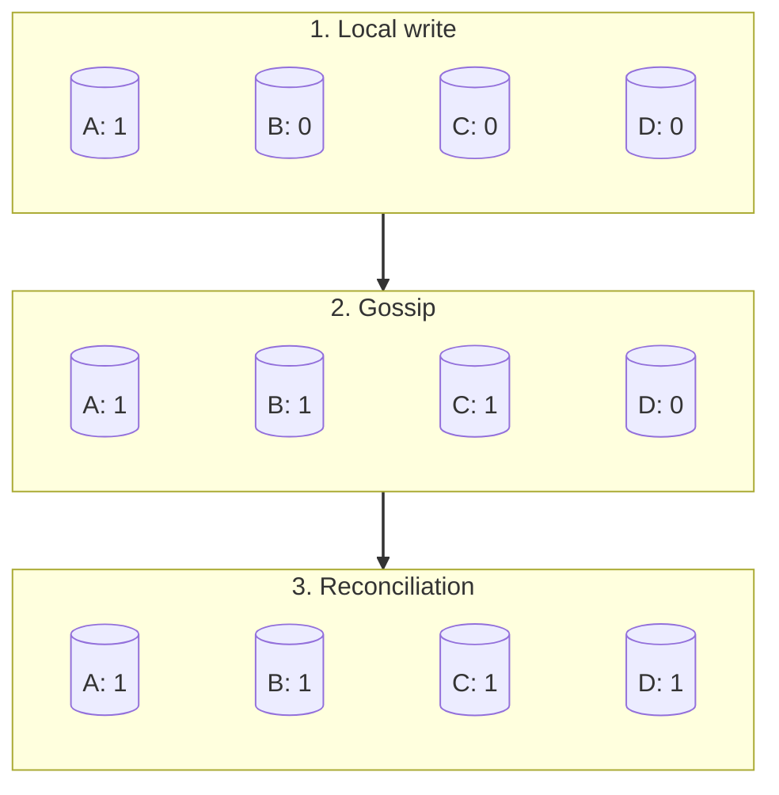

# Eventual consistency

**One-line summary:** Eventual consistency is the property that, given the convergence conditions
(surviving retained records, successful communication, eligible and authorized participants,
sufficient successful reconciliation, no unresolved conflicts), all replicas converge to the same
state — but at any given moment, the replicas may disagree, and the system gives no upper bound on
how long convergence takes. GossipGrid can lose messages (local commit + ephemeral storage), and
retention makes records disappear.

## 1. The problem the concept solves

In a strongly consistent (synchronous) system, every replica sees the same data at the same time: a
write blocks until it is durably replicated to a quorum, and a read returns the latest committed
value. This is expensive (it blocks on the slowest replica), fragile (a partition makes the system
unavailable), and unnecessary for many workloads.

Eventual consistency is the relaxation of that guarantee: a write succeeds as soon as it is committed
locally; other replicas see it later. In exchange, the system is:

- **Available** during a temporary partition (a side of the partition can still serve and accept
  writes, even though the other side has not seen them yet).
- **Low-latency** (a write does not block on cross-replica replication).
- **Decentralized** (no quorum coordinator).

The price: the replicas can disagree at any moment, and there is no bound on convergence time.

## 2. The underlying distributed-systems principle

Eventual consistency is a consistency model, not a protocol. It is the model that
asynchronous replication protocols (gossip, anti-entropy, log-based replication with async
replicas) implement. The CAP theorem context: when a network partition occurs, a system must choose
between consistency (all replicas agree) and availability (every request is answered). Eventual
consistency chooses availability during the partition and consistency after it heals.

The key properties:

- **Local write, eventual propagation.** A write is immediately visible on the writer; eventually
  visible on all reachable replicas.
- **Convergence, not simultaneity.** Replicas converge to the same state, but at different times.
- **No upper bound on convergence time.** In the worst case (a long partition, a slow peer, a
  dropped propagation event), convergence can take arbitrarily long. The system does not guarantee a
  deadline.
- **Repair mechanisms are required.** Gossip alone is best-effort and probabilistic; a repair
  mechanism (anti-entropy) is required to close gaps in the presence of gaps. See
  [anti-entropy](anti-entropy.md).

**Convergence conditions.** Convergence is not unconditional. For replicas to converge, the
following must hold:

- Surviving retained records exist (the records have not been deleted by retention or lost to a
  pod emptyDir loss with no surviving replicas).
- Successful communication is possible between the replicas (no permanent partition).
- Eligible and authorized participants (the replicas are in a permitted lifecycle state, not
  revoked, not stopped, with a fresh valid matching authoritative observation and a durable
  local binding).
- Sufficient successful reconciliation (enough anti-entropy cycles have completed for the
  replicas to discover and fetch all missing records).
- No unresolved conflicts (no same-ID content divergence that would block the reconciliation).

GossipGrid can lose messages: a locally committed message is never rolled back, but it is stored
on an ephemeral emptyDir volume. If all replicas holding the message are lost (a pod emptyDir
loss with no surviving replicas), the message is lost. Retention (if enabled) makes records
disappear after the TTL expires — the inventory is not monotonically increasing; records can
leave the store.

**A critical subtlety: equal message counts are not proof of equal message contents, and equal ID
sets are not proof of equal content.** GossipGrid's anti-entropy uses an ID-only inventory (a
list of message IDs, not the message bodies). Two replicas can both report "5 messages" while
holding different 5 messages (a same-ID content divergence that ID-only inventory cannot detect).
This is a documented M4C limitation — there are no content digests or Merkle trees in this
milestone. Convergence of IDs is a necessary but not sufficient condition for convergence of
contents. The local immutable-content conflict check (inside the commit transaction) detects a
same-ID content conflict during an install, but it is not a full content-comparison
reconciliation: it only catches a conflict when a fetched message is being installed and its ID
already exists locally with different content.

## 3. Why GossipGrid uses it

GossipGrid's design is deliberately eventually consistent, not accidentally so. The
[architecture](../architecture.md) states it explicitly:

> There is intentionally **no central message broker, no centralized message database, and no
> consensus-based guarantee of durable writes**. Data is *eventually consistent*, and it is possible to
> lose messages. These tradeoffs are a deliberate part of the testbed design.

GossipGrid uses eventual consistency because:

- It is a **testbed for Kubernetes orchestration, service discovery, and fault tolerance** — not a
  production message service. The point is to observe the consequences of eventual consistency
  (replicas disagreeing, gaps, partitions, recovery), not to eliminate them.
- It is **available during partitions**: a partitioned replica can still serve local reads and accept
  writes; it does not block waiting for the other side.
- It is **low-latency for the writer**: a `POST /api/messages` returns after the local SQLite commit
  and enqueue; it does not wait for network replication.
- It is **honest**: the system does not claim durability or strong consistency it does not provide.
  The diagnostics and the recovery model are designed to surface the actual (eventual) state, not a
  fabricated consistent view.

## 4. How GossipGrid currently implements it

Implemented, committed, and locally tested (Milestones 4A–4C). The relevant mechanisms:

- **Local commit is the write barrier.** `POST /api/messages` commits to the local SQLite (idempotent
  `ON CONFLICT DO NOTHING` insert with a canonical UUIDv7) and returns 200. The message is immediately
  available on the writer.
- **Gossip disseminates.** A committed message is enqueued for propagation (fanout 2, local rounds 3,
  by default); it spreads through the peer network asynchronously. See
  [gossip protocols](gossip-protocols.md).
- **Anti-entropy closes gaps.** Periodically (default 30 s), each replica pulls a bounded ID inventory
  from each eligible peer, diffs against its local store, and fetches missing records. This is the
  mechanism that closes gaps (given the convergence conditions in §2). See
  [anti-entropy](anti-entropy.md).
- **Idempotency makes installs safe.** A duplicate insert is a no-op; a same-ID content conflict
  returns 409 without altering the original row. Records are only added, not overwritten.
- **No global clock, no quorum.** There is no leader, no quorum, no global sequence number. The
  "converged" state is simply "all reachable, eligible, authorized replicas hold the same set of
  retained message IDs (and, with a content-digest extension, the same contents)."

**What GossipGrid does not implement (planned / out of scope):**

- **Content digests / Merkle trees.** The M4C inventory is ID-only; same-ID content divergence is not
  detected by the inventory. A content-digest extension would be a future enhancement.
- **A bounded convergence time.** There is no mechanism that guarantees all replicas converge within
  N seconds. Convergence is eventual, not bounded.
- **Strong consistency / synchronous replication.** Out of scope by design (see the non-goals in
  [architecture](../architecture.md#non-goals)).
- **Monotonically increasing inventory.** Retention (if enabled) makes records disappear after the
  TTL expires. The inventory is not monotonically increasing; records can leave the store.

## 5. Visual example

The diagram below shows multiple replicas temporarily holding different message sets, then
converging under suitable conditions (reachable peers, no permanent partition, anti-entropy
running, eligible and authorized participants, no unresolved conflicts). The middle panel is a
conceptual "divergence" state; it is illustrative, not a record of a specific observed run.

[View full-size SVG](../diagrams/generated/concept-eventual-consistency.svg) · [View PNG](../diagrams/generated/concept-eventual-consistency.png)

<!-- DIAGRAM:concept-eventual-consistency -->

The number inside each cylinder is a **presence indicator for the one illustrated message `m1`**,
not a count of the replica's total messages. `1` means `m1` is present on that replica; `0`
means it is absent. A replica may hold other messages not shown here; the indicator tracks only
`m1`, the specific message this diagram follows.

Reading the diagram. In panel 1 (local write), only replica `A` has `m1`. In panel 2 (gossip),
gossip has spread `m1` to `B` and `C`, but `D` was partitioned during propagation and missed it
— the cluster is diverged (three replicas have `m1`, one does not). In panel 3 (reconciliation),
anti-entropy runs: `D` pulls the ID inventory from an eligible peer, sees that `m1` is missing
locally, fetches it, and inserts it idempotently — the cluster has converged. The
convergence is conditional: it requires surviving retained records, successful communication,
eligible and authorized participants, sufficient successful reconciliation, and no unresolved
conflicts. Convergence of IDs is necessary but not sufficient for convergence of contents (the
M4C ID-only inventory cannot detect a same-ID content divergence).

## 6. Important failure scenarios

- A permanent partition. If a partition is permanent (not temporary), the two sides do not
  converge. Anti-entropy can only repair gaps between reachable peers. A permanent partition is a
  design limitation, not a bug.
- A slow or overloaded peer. A peer that is slow to process propagation events or to run
  anti-entropy converges later than the others. The system does not block waiting for it; it
  simply lags.
- Same-ID content divergence. If two replicas independently create a message with the same ID
  but different content (an ID collision), the ID-only inventory cannot detect the divergence.
  This is an extremely rare event (UUIDv7 collisions are astronomically unlikely) but it is a
  theoretical limitation of the ID-only inventory. The local immutable-content conflict check
  (inside the commit transaction) catches a same-ID content conflict during an install, but it
  is not a full content-comparison reconciliation.
- A replica that is down for a long time. A replica that is down for a long time (longer than
  the anti-entropy interval times the number of surviving replicas) may miss many messages. On
  recovery, it runs anti-entropy against all eligible peers and pulls all missing records in
  bounded batches; it converges, but the catch-up may take a while (bounded by the fetch batch
  size and the page budget).
- Retention (if enabled). If `GOSSIPGRID_MESSAGE_RETENTION_TTL` is set, old messages are expired
  and deleted. A replica that was offline while a message was within the retention window may
  not be able to recover it after the window closes. The inventory is not monotonically
  increasing; records can leave the store. Retention is disabled by default.
- Pod emptyDir loss with no surviving replicas. If all replicas holding a message are lost
  (a pod emptyDir loss with no surviving replicas), the message is lost. This is not
  recoverable through ordinary bootstrap admission (no eligible source exists). The recovery
  path is operator recovery (M5C, planned), whose procedure is not yet defined.

## 7. Guarantees and limitations

**Guaranteed (implemented, under the convergence conditions — surviving retained records,
successful communication, eligible and authorized participants, sufficient successful
reconciliation, no unresolved conflicts):**

- A committed local message is never lost or rolled back (on the replica where it was committed).
- A duplicate insert is a no-op; a same-ID content conflict is rejected (409) without altering
  the original.
- Records are only added, not overwritten (idempotent install; the local immutable-content
  conflict check prevents overwriting existing content).
- Given the convergence conditions, message IDs converge across eligible, authorized, reachable
  replicas (sufficient anti-entropy cycles; no permanent partition).

**Not guaranteed (by design):**

- Immediate consistency: at any given moment, replicas may disagree.
- A bound on convergence time: the system does not guarantee convergence within N seconds.
- Convergence under a permanent partition: a permanent partition prevents convergence.
- Content-level convergence (M4C): the ID-only inventory guarantees convergence of IDs; a
  same-ID content divergence is not detected by the inventory (a theoretical limitation; a
  content-digest extension would close it).
- Lossless operation: GossipGrid can lose messages (local commit + ephemeral storage; retention
  makes records disappear). A pod emptyDir loss with no surviving replicas loses the message.

## 8. Relevant implementation files and tests

- **Store (idempotent insert):** `internal/store/store.go` (`InsertReplicatedMessage`, the
  `ON CONFLICT DO NOTHING` insert; `ErrBindingMismatch`, `ErrBindingNonempty` for the durable binding).
- **Gossip (dissemination):** `internal/gossip/gossip.go`.
- **Anti-entropy (repair):** `internal/antientropy/antientropy.go` (the per-cycle sweep, the ID
  inventory diff, the bounded fetch, the cursor progression).
- **Integration tests:** `cmd/gossipgrid/` (the five-node gossip and anti-entropy integration tests;
  `TestIntegrationFiveNodesGossip`, `TestIntegrationFiveNodesAntiEntropy`).
- **Authoritative spec:** [Anti-entropy (Milestone 4C)](../gossip-and-bootstrap.md#anti-entropy-milestone-4c--implemented-2026-11-20).

## 9. Practical experiment

To observe eventual consistency locally:

1. Start five replicas (as in the gossip experiment) with gossip and anti-entropy enabled
   (`GOSSIPGRID_ANTI_ENTROPY_ENABLED=true GOSSIPGRID_ANTI_ENTROPY_INTERVAL=5s` for a fast cycle).
2. Post a message to one replica.
3. Immediately query `GET /api/messages/{id}` on all five replicas. You will likely see the message
   on the writer and on some of the others, but not necessarily all — this is the divergence.
4. Wait a few anti-entropy cycles (or stop one replica and post a message, then start it again).
5. Re-query all five replicas. The message is now on all five — this is the convergence (given
   the convergence conditions: all replicas reachable, eligible, authorized, no conflicts).
6. Observe the structured logs for the anti-entropy sweeps (inventory diff, fetch, insert) and the
   gossip propagation events.

## 10. Related documentation and concepts

- **Previous in the progression:** [Gossip protocols](gossip-protocols.md) — the dissemination mechanism.
- **The repair mechanism:** [Anti-entropy](anti-entropy.md) — what actually closes gaps (given the
  convergence conditions).
- **Authority:** [Distributed authority](distributed-authority.md) — the admission that gates both
  gossip and anti-entropy.
- **Authoritative spec:** [Gossip and bootstrap protocol](../gossip-and-bootstrap.md).
- **Diagrams:** the [eventual consistency](../diagrams/generated/concept-eventual-consistency.svg)
  ([PNG](../diagrams/generated/concept-eventual-consistency.png)) concept diagram and the
  [gossip and anti-entropy replication](../diagrams/generated/gossip-replication.svg)
  ([PNG](../diagrams/generated/gossip-replication.png)) architecture diagram.
- **Visual conventions:** [GossipGrid visual design system](../visual-design.md).
