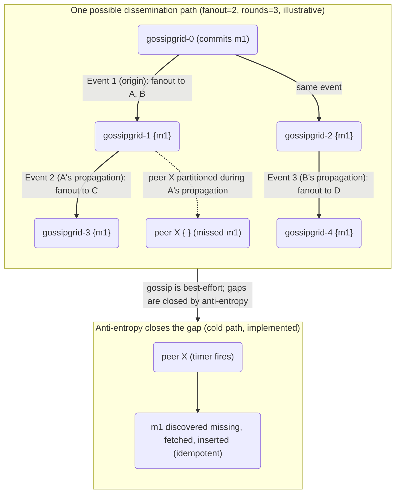

# Gossip protocols

**One-line summary:** Gossip is an epidemic dissemination mechanism — a new message is pushed to a
bounded set of randomly chosen peers, and each recipient in turn pushes it to its own peers, so the
message spreads through the network like a rumor (or an infection) without a central coordinator.

## 1. The problem the concept solves

In a multi-replica system with no leader and no central broker, how does a message written on one
replica reach the others? Options:

- **Synchronous replication to all replicas** — requires knowing all replicas, blocking on the slowest
  one, and tolerates no partition. It is the behavior of a quorum-based or strongly consistent system,
  which GossipGrid is deliberately not.
- **A central broker** — a single point of coordination and a bottleneck; it contradicts the
  "no central message broker" design constraint.
- **Gossip** — each replica pushes to a few random peers; the message propagates through the peer
  network without any replica needing to know the full topology or coordinate with a leader.

Gossip solves the "how to disseminate without a coordinator" problem with a probabilistic,
decentralized mechanism.

## 2. The underlying distributed-systems principle

Gossip protocols are a class of ant-epidemic / epidemic broadcast protocols. The core principle:

- **Push, not pull.** The sender initiates the transfer; the receiver does not have to request it.
- **Randomized fanout.** Each hop contacts a bounded number of randomly chosen peers (the fanout
  factor), not all peers.
- **Bounded local rounds.** Propagation proceeds for a bounded number of local fanout rounds per
  propagation event, not until every replica has the message. The fanout and rounds are per local
  propagation event, not globally synchronized network-wide rounds: each replica independently
  schedules its own propagation events, and a newly inserted replicated message may enqueue its own
  forwarding event. A forwarding hop (one replica pushing to a peer) is distinct from a local fanout
  round (one replica contacting up to `fanout` peers in a single propagation event).
- **Idempotent application.** Every receiver applies the message idempotently (a duplicate is a no-op),
  so a message arriving multiple times is harmless.
- **Convergence is eventual, not immediate.** A message probably reaches most replicas within a few
  local fanout rounds, but the protocol does not guarantee delivery to every replica in a fixed number
  of rounds. Finite fanout + bounded local rounds means a partitioned or slow peer can miss a message.

The spread is probabilistic: the probability of full dissemination rises with fanout and local
rounds, but there is no exponential-spread formula that describes observed execution. A single
dissemination path is possible (one origin, a sequence of local fanout rounds), but it is
illustrative, not a record of a specific observed run.

## 3. Why GossipGrid uses it

GossipGrid's design constraints — no central broker, no leader, ephemeral storage, a small fixed
replica count (five) — make gossip a natural fit:

- It is **decentralized**: every replica runs the same gossip loop; there is no coordinator to
  coordinate with.
- It is **lightweight**: bounded fanout and bounded local rounds keep the per-message network cost small.
- It **pairs with anti-entropy** (the PULL-based reconciliation) to provide eventual convergence:
  gossip handles the "hot path" (fast dissemination of new messages); anti-entropy handles the
  "cold path" (repairing gaps gossip left behind). See
  [anti-entropy](anti-entropy.md).
- It is **opt-in** and **best-effort**: a committed local message is never rolled back because gossip
  failed. This matches the "data is eventually consistent, and it is possible to lose messages"
  tradeoff that is a deliberate part of the testbed design.

## 4. How GossipGrid currently implements it

Implemented, committed, and locally tested (Milestones 4B, 2026-11-20). The gossip engine lives in
`internal/gossip`. The authoritative specification is the
[Epidemic gossip (Milestone 4B)](../gossip-and-bootstrap.md#epidemic-gossip-milestone-4b--implemented-2026-11-20)
section.

Key implemented behavior (verify against the code, not this summary):

- **Trigger.** A locally committed message (`POST /api/messages`) or a newly received replicated message
  (`POST /internal/messages` with `inserted=true`) enqueues a propagation event. Replication is
  asynchronous: the public API returns after the local SQLite commit; it does not wait for network
  replication. A newly inserted replicated message may enqueue its own forwarding event.
- **Fanout and rounds.** The engine selects up to `fanout` random peers per local fanout round (default 2),
  for up to `rounds` local fanout rounds per propagation event (default 3). The fanout and rounds are
  per local propagation event, not globally synchronized network-wide rounds. Peer selection excludes
  self, the authenticated sender (when a valid sender identity is present), and already-contacted peers.
  The excluded set grows only on successful delivery, so transient-failure retries can re-contact the
  same peer. A peer already contacted in a previous local fanout round is not re-selected in a later
  round (unless illustrating supported retry for a transient failure).
- **Delivery.** Delivery uses the existing `peertls.Client.SendMessage` (TLS 1.3, mTLS, exact identity
  verification, no redirects, bounded timeouts). The `origin` field is immutable and unchanged through
  all forwarding hops.
- **Retries.** Exponential backoff with jitter (base 250 ms, max 5 s). `MaxAttempts` (default 3) is the
  total delivery attempts per peer, including the initial attempt. A peer that exhausts its budget
  stops receiving attempts; a failing peer never prevents attempts to other eligible peers. Permanent
  errors (HTTP 409, 400, 413, invalid acknowledgment) are not retried. Transient errors (network,
  timeout, 5xx, 429) are retried. Ambiguous failures (timeout after remote insert) are treated as
  transient: the receiver's idempotent insert makes a bounded retry safe.
- **Duplicate suppression.** The engine maintains a pending set of in-flight message IDs. A message
  already in the pending set is not re-enqueued. The pending entry is released only when all
  in-flight work units for the message have completed (fanout rounds and delayed retries), preventing
  premature release that would allow re-enqueue while a retry is still in flight.
- **Bounded resources.** Queue capacity (default 256), worker count (default 4), per-message propagation
  budget (`rounds × fanout`), per-peer delivery budget (`MaxAttempts`). Queue overflow drops the
  propagation event (not the committed message). A full queue is observable via `Stats()`.
- **Admission re-check (M5A).** Before every network send and every insert, the engine re-reads the
  lifecycle admission snapshot. A revoked node blocks all new work. See
  [distributed authority](distributed-authority.md).
- **Configuration.** All opt-in; gossip is disabled by default. `GOSSIPGRID_GOSSIP_ENABLED`,
  `GOSSIPGRID_GOSSIP_FANOUT` (1–32, default 2), `GOSSIPGRID_GOSSIP_ROUNDS` (1–32, default 3),
  `GOSSIPGRID_GOSSIP_WORKERS` (1–64, default 4), `GOSSIPGRID_GOSSIP_QUEUE_CAPACITY` (1–1024, default
  256), `GOSSIPGRID_GOSSIP_MAX_ATTEMPTS` (1–10, default 3), `GOSSIPGRID_GOSSIP_RETRY_BASE` (250 ms),
  `GOSSIPGRID_GOSSIP_RETRY_MAX` (5 s).
- **Test.** The five-node local integration test
  (`TestIntegrationFiveNodesGossip`) runs five independent replicas with separate SQLite DBs, distinct
  workload certificates, real mTLS, and static peer discovery. One node is permanently down from the
  start; the other 4 converge on two messages. The down node's attempts are exhausted; the other nodes
  remain responsive and their stored messages intact.

Not a guarantee. Finite fanout does not guarantee convergence under arbitrary failures. A
message may not reach all nodes if the selected peers are partitioned or if the fanout/rounds
budget is exhausted before a reachable peer is selected. Milestone 4C anti-entropy is required
for full convergence (given the convergence conditions in [eventual
consistency](eventual-consistency.md)).

## 5. Visual example

The diagram below shows one possible dissemination path for a message originating on one replica.
The fanout and rounds shown (fanout=2, rounds=3) are the GossipGrid defaults; the path is
illustrative, not a record of a specific observed run. The local fanout rounds are per
propagation event, not globally synchronized network-wide rounds. A partitioned peer that misses
the message is repaired by anti-entropy.

[View full-size SVG](../diagrams/generated/concept-gossip-propagation.svg) · [View PNG](../diagrams/generated/concept-gossip-propagation.png)

<!-- DIAGRAM:concept-gossip-propagation -->

Reading the diagram. In the PATH panel, the origin (`gossipgrid-0`) commits `m1` and enqueues a
local propagation event (Event 1). Event 1 is the origin's own fanout: it contacts up to
`fanout` random peers in a single local propagation event, reaching `gossipgrid-1` (A) and
`gossipgrid-2` (B). Each newly receiving replica then runs its **own** local propagation event
independently: A's event (Event 2) contacts up to `fanout` peers (excluding already-contacted),
reaching `gossipgrid-3` (C); B's event (Event 3) reaches `gossipgrid-4` (D). These are separate
local propagation events, not the origin's subsequent fanout rounds — the origin does not
forward on behalf of its peers. In a full 3-round budget the excluded set is eventually
exhausted (self, sender, already-contacted), so no new peers are reached in later rounds; the
duplicate to an already-reached replica is a no-op (idempotent insert). Peer X was partitioned
during A's propagation and missed `m1` (best-effort). The REPAIR panel shows anti-entropy
closing the gap:
peer X's timer fires, it pulls the ID inventory from an eligible peer, discovers `m1` is
missing, fetches and inserts it idempotently. The diagram does not imply guaranteed delivery to
every replica in a fixed number of rounds, and it does not present an exponential-spread
formula as observed execution.

## 6. Important failure scenarios

- A peer is partitioned during propagation. If the fanout/rounds budget is exhausted before a
  reachable peer is selected, the message does not reach the partitioned peer. Anti-entropy
  repairs it on a later cycle (see [anti-entropy](anti-entropy.md)).
- Queue overflow under load. A burst of messages fills the bounded work queue; new propagation
  events are dropped (the committed message is not lost). The drop is observable via
  `Stats().MessagesDropped`. Anti-entropy repairs the gap.
- A permanent delivery error (409/400/413). The peer is marked permanently rejected (no retry).
  For a 409 (epoch mismatch), this is the epoch-fencing behavior (see
  [epoch fencing](epoch-fencing.md)); the peer will not be re-contacted for that epoch.
- Stale DNS membership (dns discovery mode). A stale discovery snapshot is not treated as
  current — no new fanout is performed while the snapshot is stale. Static mode is
  deterministic and never stale.
- Process restart. In-memory queue items are lost on restart; a late-joining replica may miss
  messages until anti-entropy repairs the gap.

## 7. Guarantees and limitations

**Guaranteed (implemented):**

- A committed local message is never rolled back or deleted because gossip failed.
- Duplicate delivery is a no-op (idempotent insert; a duplicate ID with conflicting content returns
  409 without altering the original row).
- A peer with a permanent error is not retried indefinitely.
- Resources are bounded (queue, workers, per-message and per-peer budgets).
- When lifecycle is enabled, a revoked node blocks all new propagation (per-send admission re-check).

**Not guaranteed (by design):**

- Immediate consistency: a message is available on the origin immediately, but on other replicas
  only eventually.
- Delivery to every replica in a fixed number of local fanout rounds: finite fanout + bounded
  local rounds means a partitioned or slow peer can miss a message.
- Convergence under arbitrary permanent partitions: without anti-entropy, a permanent partition
  can leave the two sides divergent.

## 8. Relevant implementation files and tests

- **Engine:** `internal/gossip/gossip.go` (the `Engine`, peer selection, fanout, retry scheduling,
  duplicate suppression, `Stats()`).
- **Peer transport:** `internal/peertls/client.go` (`SendMessage`, the authenticated peer HTTP client).
- **Admission re-check:** `internal/lifecycle/admission.go` (`CheckReplicationOutbound`).
- **Integration test:** `cmd/gossipgrid/` (the five-node gossip integration test
  `TestIntegrationFiveNodesGossip`).
- **Unit tests:** `internal/gossip/gossip_test.go` (fanout, duplicate suppression, retry, queue
  overflow).

## 9. Practical experiment

To observe gossip propagation locally (without Kubernetes):

1. Build with `make build FIPS_MODULE=off`.
2. Start five replicas with static discovery, peer mTLS, message exchange, and gossip enabled:
   `GOSSIPGRID_GOSSIP_ENABLED=true GOSSIPGRID_PEER_TLS_ENABLED=true
   GOSSIPGRID_PEER_MESSAGE_EXCHANGE_ENABLED=true GOSSIPGRID_DISCOVERY_MODE=static
   GOSSIPGRID_STATIC_PEERS=... GOSSIPGRID_GOSSIP_FANOUT=2 GOSSIPGRID_GOSSIP_ROUNDS=3`.
3. Post a message to one replica (`POST /api/messages`); observe the other four replicas' SQLite
   databases (via `GET /api/messages/{id}`) and the structured logs (queue overflow, delivery
   failures, acks).
4. Stop one replica before posting; observe that the remaining 4 converge and the stopped
   replica's attempts are exhausted (the five-node integration test does exactly this).

## 10. Related documentation and concepts

- **Next in the progression:** [Eventual consistency](eventual-consistency.md).
- **Complementary mechanism:** [Anti-entropy](anti-entropy.md) — the PULL-based repair for gossip gaps.
- **Authority:** [Distributed authority](distributed-authority.md) — the admission re-check that
  gates gossip sends.
- **Authoritative spec:** [Epidemic gossip (Milestone 4B)](../gossip-and-bootstrap.md#epidemic-gossip-milestone-4b--implemented-2026-11-20).
- **Diagrams:** the [gossip and anti-entropy replication](../diagrams/generated/gossip-replication.svg)
  ([PNG](../diagrams/generated/gossip-replication.png)) architecture diagram and the
  [gossip propagation](../diagrams/generated/concept-gossip-propagation.svg)
  ([PNG](../diagrams/generated/concept-gossip-propagation.png)) concept diagram.
- **Visual conventions:** [GossipGrid visual design system](../visual-design.md).
