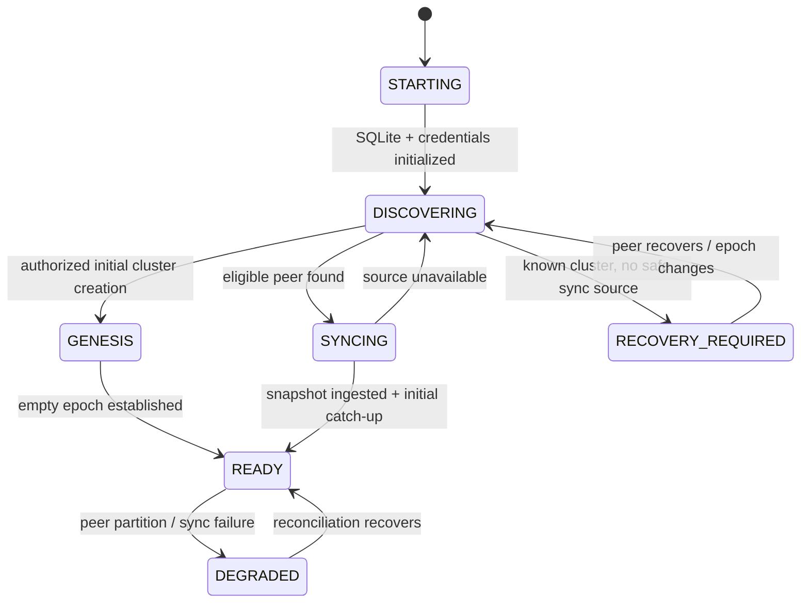

# Gossip and bootstrap protocol

**Intent:** A compact, inspectable protocol that teaches real replication behavior without a separate broker or
leader. This is a design spec; no wire protocol has been implemented.

## Membership

- Kubernetes mode uses DNS for a headless Service with a named peer port; periodically refresh SRV/A lookup data and
  apply request timeouts.
- `publishNotReadyAddresses: true` allows discovery of pods before they are ready.
- Local test mode takes a static list of peer addresses. It exercises the same message and mTLS flows.
- Track **expected members** separately from **discovered / reachable members**. DNS records are not proof of readiness
  or successful synchronization.
- For the initial StatefulSet design, expected ordinal members can be derived from the configured replica count. Later
  scaling and peer IDs need careful reconciliation.

## Lifecycle

`DEGRADED` is a ready operational status for surviving local functionality unless local store or TLS fails. Do not
equate it with a globally consistent membership snapshot.

`SYNCING` replicas may advertise state and accept sync-related control requests, but **must not act as a bootstrap
data source** for other unsynced pods. They do not enter the user-facing Service until ready. The public diagnostics
path can remain accessible via port-forward during bootstrap failures.

## First installation (genesis)

A deliberate, idempotent initialization creates a durable metadata epoch for a brand-new cluster. One eligible pod is
designated initial seed and becomes ready with an empty message set, then others synchronize from it. A ConfigMap or
narrow API-backed record holds **only metadata**, never messages. This should not be inferred from 'no peers
answered'.

## Joining an existing epoch

1. Start, open local SQLite, obtain TLS credentials, report the current state.
2. Learn expected membership and discover peer endpoints.
3. Ask peers for identity, epoch, and readiness over mTLS.
4. Select a peer matching the current metadata epoch and eligible to supply a snapshot.
5. Transfer message IDs/records in bounded, deterministic pages. Preserve IDs, origin, timestamps; upsert
   idempotently.
6. Reconcile changes occurring during the transfer. Eventual periodic anti-entropy remains required even after ready.
7. Mark locally ready when a consistent baseline is installed and initial catch-up succeeds; continue reconciliation
   in background.

If no valid source can be found, do **not** silently initialize an empty epoch. Report `RECOVERY_REQUIRED` or a more
specific waiting status.

## Authenticated peer message exchange (Milestone 4A — implemented)

A provisional, opt-in, caller-initiated direct-exchange capability for authenticated GossipGrid replicas. When
`GOSSIPGRID_PEER_MESSAGE_EXCHANGE_ENABLED=true` (and peer mTLS is enabled), the private peer listener registers
`POST /internal/messages`. A caller explicitly transfers an existing message to a specific peer over mTLS; the
receiver validates the message (canonical UUIDv7, nonempty body/origin, valid timestamp, bounded size) and inserts it
idempotently via the existing atomic `ON CONFLICT DO NOTHING` store operation.

Key properties:

- **Private endpoint.** The endpoint is registered only on the authenticated peer listener (port 8443, TLS 1.3, mTLS).
  It is never registered on the public HTTP router.
- **Identity.** The authenticated TLS client identity establishes who transmitted the message; the receiver does not
  trust any HTTP header as proof of peer identity. The message's `origin` field is immutable metadata identifying
  its original creator, which may differ from the forwarding peer. mTLS alone does not cryptographically prove the
  historical origin of a forwarded message.
- **Idempotency.** A new valid message is stored (200); an identical duplicate is a no-op (200); a duplicate ID with
  conflicting content returns 409 without altering the original row.
- **Opt-in.** Default is `false`. When disabled, the endpoint is not registered (404/405). Enabling it requires
  `GOSSIPGRID_PEER_TLS_ENABLED=true`; otherwise configuration validation fails.
- **No automatic replication.** This milestone does NOT implement automatic gossip fanout, bounded queues, retry
  scheduling, anti-entropy, or readiness gating. `POST /api/messages` does not automatically replicate.
- **No epoch management.** Cluster genesis, epoch management, and recovery lockout are reserved for Milestone 5. This
  milestone is a provisional direct-exchange capability, not a complete safe cluster bootstrap protocol.

## Epidemic gossip (Milestone 4B — implemented 2026-11-20)

- On locally committed message (POST /api/messages) or newly received replicated message
  (POST /internal/messages with inserted=true), enqueue a propagation event; replication
  is asynchronous. The public API returns success after the local SQLite commit; it does
  not wait for network replication.
- The Engine selects up to fanout random peers per round (default 2), for up to rounds
  rounds per message (default 3). Peer selection excludes self, the authenticated sender
  (when a valid sender identity is present), and already-contacted peers (the excluded
  set grows only on successful delivery, so transient-failure retries can re-contact
  the same peer). Unknown sender identities are NOT added to the exclusion set.
- Delivery uses the existing peertls.Client.SendMessage (TLS 1.3, mTLS, exact identity
  verification, no redirects, bounded timeouts). The origin field is immutable and
  unchanged through all forwarding hops.
- Retries use exponential backoff with jitter (base 250ms, max 5s). MaxAttempts (default
  3) is the TOTAL delivery attempts per peer, including the initial attempt. A peer that
  exhausts its budget stops receiving attempts; a failing peer never prevents attempts
  to other eligible peers. Permanent errors (HTTP 409, 400, 413, invalid acknowledgment)
  are NOT retried. Transient errors (network, timeout, 5xx, 429) are retried. Ambiguous
  failures (timeout after remote insert) are treated as transient: the receiver's
  idempotent insert makes a bounded retry safe.
- Duplicate suppression: the Engine maintains a pending set of in-flight message IDs.
  A message already in the pending set is not re-enqueued. The pending entry is released
  only when all in-flight work units for the message have completed (fanout rounds
  and delayed retries), preventing premature release that would allow re-enqueue while
  a retry is still in flight.
- Bounded, non-blocking retry scheduling: workers never sleep for backoff. Delayed
  retries are held in a bounded channel (same capacity as the work queue) and their
  backoff is applied by short-lived timer goroutines that deliver onto that channel.
  Queue pressure and delayed-retry exhaustion are observable via Stats().
- Bounded resources: queue capacity (default 256), worker count (default 4), per-message
  propagation budget (rounds x fanout), per-peer delivery budget (MaxAttempts). Queue
  overflow drops the propagation event (not the committed message). A full queue is
  observable via Stats().MessagesDropped.
- Stale DNS membership: for dns discovery mode, a stale snapshot is not treated as
  current discovery — no new fanout is performed while the snapshot is stale. Static
  mode is deterministic and never stale, so its configured addresses remain usable.
  After DNS membership recovers, newly enqueued messages use the refreshed snapshot.
- Failure semantics: gossip is best-effort. A committed local message is never rolled back
  due to gossip failure. In-memory queue items are lost on process restart; a late-joining
  replica may miss messages until Milestone 4C anti-entropy repairs the gap.
- Lifecycle: Start creates an engine-owned context derived from the caller's context.
  Workers and network sends use that derived context. Stop cancels it promptly (aborting
  in-flight deliveries) and waits for all workers to exit, bounded by the supplied
  context. Stop is idempotent and safe to call from multiple goroutines. Stop before
  Start returns promptly. A stopped engine cannot be restarted.
- Configuration (all opt-in; gossip is disabled by default; malformed values are rejected
  with errors that name the specific environment variable):
  - GOSSIPGRID_GOSSIP_ENABLED (default false)
  - GOSSIPGRID_GOSSIP_FANOUT (default 2, range 1-32)
  - GOSSIPGRID_GOSSIP_ROUNDS (default 3, range 1-32)
  - GOSSIPGRID_GOSSIP_WORKERS (default 4, range 1-64)
  - GOSSIPGRID_GOSSIP_QUEUE_CAPACITY (default 256, range 1-1024)
  - GOSSIPGRID_GOSSIP_MAX_ATTEMPTS (default 3, range 1-10)
  - GOSSIPGRID_GOSSIP_RETRY_BASE (default 250ms, must be positive)
  - GOSSIPGRID_GOSSIP_RETRY_MAX (default 5s, must be >= retry base)
- Enabling gossip requires: peer mTLS enabled, peer message exchange enabled, and
  discovery mode static or dns. When gossip is disabled, malformed gossip values are
  ignored (gossip is a best-effort, opt-in feature).
- Observability: Engine.Stats() returns counters for queued, dropped, delivery attempts,
  successful acks, failures, retries, queue depth, delayed retries, and pending work.
  Structured slog messages for queue overflow, delivery failures, and shutdown.
- Five-node local integration test (TestIntegrationFiveNodesGossip): five independent
  replicas with separate SQLite DBs, distinct workload certificates, real mTLS, and
  static peer discovery through the production bridge (discMgr.Snapshot() →
  gossip.PeerSnapshot). One node is permanently down from the start; the other 4
  converge on two messages. The down node's attempts are exhausted; other nodes
  remain responsive and their stored messages intact. All nodes shut down cleanly;
  repeated Stop is safe. Transient-recovery-within-retry-budget is tested at the
  unit level (internal/gossip/gossip_test.go) because the static discovery snapshot
  has fixed addresses and a node that restarts on a new port is no longer reachable
  at its original address.
- Limitations: finite fanout does NOT guarantee convergence under arbitrary failures.
  A message may not reach all nodes if the selected peers are partitioned or if the
  fanout/rounds budget is exhausted before a reachable peer is selected. Milestone 4C
  anti-entropy is required for full convergence guarantees.

## Anti-entropy

Periodically compare bounded inventories of immutable message IDs with one or more peers, fetching records absent
locally. For a small learning application, paginated ID sets and deterministic order are acceptable; a future
milestone may add Merkle-tree or digest optimizations. Missing a gossip round must not permanently lose a replicated
message if a live source remains.

Possible edge cases to test: posts during snapshot; two pods posting concurrently; dropped gossip request; pod restart
with old `emptyDir` data; replaced pod with new `emptyDir`; partitions, reconnect, and scale-up.

## Proposed API behavior (not final wire contract)

- `POST /api/messages`: return success after *local* commit and enqueue; never imply cluster-wide durability.
- `GET /api/messages/{id}/status`: report each expected pod's `present`, `missing`, or `unreachable`, including the
  current epoch and timestamp of observation.
- `GET /internal/status`: always available on a healthy peer listener; returns pod identity, epoch, state, message
  count, and readiness eligibility.
- Internal sync attempts to a non-ready source return `503` with an explicit state code.
- Wrong epoch responses are rejected and surfaced as security/consistency incidents, not merged.
