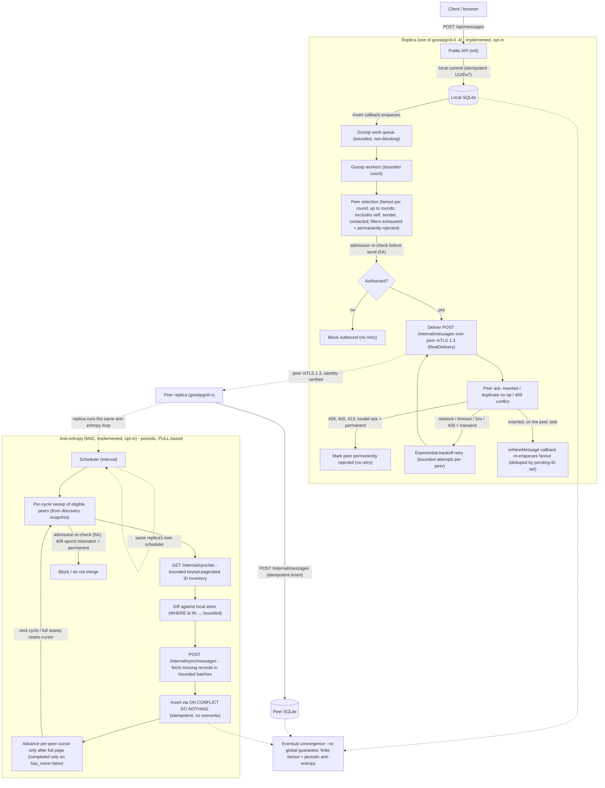

# Gossip and bootstrap protocol

**Intent:** A compact, inspectable protocol that teaches real replication behavior without a separate broker or
leader. Milestones 4A–4C implement the gossip and anti-entropy wire protocols (all **implemented and locally
tested**); Milestone 5A (implemented 2026-11-21, `v0.1.0-alpha.5`) adds the lifecycle state machine, durable epoch
binding, epoch fencing, and fail-closed admission (**implemented and locally tested**). Milestone 5B (Kubernetes
metadata provider, initial snapshot transfer, automatic genesis, snapshot-source eligibility) is **designed but
not implemented**.

**Replication diagram:** The implemented distributed messaging mechanism (local persistence, gossip fanout,
idempotent peer transfer, retries, and anti-entropy reconciliation toward eventual convergence) is illustrated
in [gossip-replication](diagrams/generated/gossip-replication.svg)
([PNG](diagrams/generated/gossip-replication.png)). The lifecycle state machine and the replacement-pod/recovery
sequence are in [lifecycle-recovery](diagrams/generated/lifecycle-recovery.svg) and
[lifecycle-recovery-sequence](diagrams/generated/lifecycle-recovery-sequence.svg).

## Replication mechanism (gossip and anti-entropy)

The implemented distributed messaging mechanism — local persistence, gossip fanout, idempotent peer transfer,
retries, and anti-entropy reconciliation toward eventual convergence — is shown below (the authoritative
`gossip-replication.mmd` source embedded natively). The [SVG](diagrams/generated/gossip-replication.svg) and
[PNG](diagrams/generated/gossip-replication.png) links are fallbacks.

<!-- DIAGRAM:gossip-replication -->


## Milestone 5A — what is enforced vs. deferred to 5B

Milestone 5A provides the **foundations** for fail-closed authority and epoch fencing. It does **not** implement
the **procedures** for safe bootstrap and recovery, which are reserved for Milestone 5B:

| Enforced in 5A | Deferred to 5B |
| --- | --- |
| 7-state lifecycle machine with a transition table | Authorized genesis (control-plane-coordinated; empty SQLite state alone is never sufficient) |
| Durable SQLite `local_metadata` binding (atomic, idempotent, exclusive) | Cluster epoch creation/reset (operator endpoints) |
| Fail-closed admission (single consistent authorization snapshot) | Initial snapshot promotion (SYNCING → READY) |
| Epoch fencing via HTTP request headers (409 permanent / 503 unready) | Snapshot-source selection (which peer to sync from) |
| Response-envelope validation (lifecycle-enabled client rejects legacy peers) | K8s ConfigMap-backed metadata provider |
| Public read/write quarantine (503 when unauthorized; records preserved) | Operator reset endpoints |
| Outbound epoch context sourced from the current controller decision | |
| Per-send admission re-check (gossip + anti-entropy) | |
| Metadata freshness (bounded: 2× poll interval; stale observations fail closed) | |

**Key clarifications (guarantees actually enforced):**

- **Stale observations fail closed.** A metadata observation older than 2× the poll interval is considered stale
  and does NOT authorize operations, even if the state is READY. This is enforced by the authorization snapshot's
  `Stale` flag.
- **Inserts do NOT re-verify the epoch binding.** The store's `Bind` operation is the only binding check. A message
  insert (via `ON CONFLICT DO NOTHING`) does not re-check the epoch binding; the fail-closed admission guard is the
  line of defense before the insert.
- **Queued replication is fenced at the moment of the check.** A gossip or anti-entropy work item admitted while
  authorized (the admission check passed at enqueue or at the per-send re-check) may be delivered if it was
  authorized when the check passed. The guarantee is that **no NEW work is authorized after a revocation**: the
  admission check is re-read before every network send and every insert, and a revoked node blocks all new work.
  An already-in-flight send (authorized when it started) may complete in the bounded in-flight window.
- **mTLS alone does NOT prove epoch membership.** A valid mTLS certificate is necessary but not sufficient. A
  lifecycle-enabled client additionally requires the peer's **response envelope** (`X-GossipGrid-Lifecycle-Active:
  true` + matching cluster/epoch headers) to confirm the peer runs the epoch-fencing protocol. A legacy peer
  (lifecycle disabled) that returns a successful response without the envelope is rejected as a synchronization
  source.
- **5A does NOT provide full safe bootstrap or recovery.** The state machine, binding, and fencing are in place,
  but the procedures to establish a new cluster (genesis), promote a snapshot (SYNCING → READY), or recover from a
  lockout (operator reset) are deferred to 5B. A 5A replica with a conflicting binding enters `RECOVERY_REQUIRED`
  and stays there until an operator (5B) performs a recovery procedure.

## Membership

- Kubernetes mode uses DNS for a headless Service with a named peer port; periodically refresh SRV/A lookup data and
  apply request timeouts.
- `publishNotReadyAddresses: true` allows discovery of pods before they are ready.
- Local test mode takes a static list of peer addresses. It exercises the same message and mTLS flows.
- Track **expected members** separately from **discovered / reachable members**. DNS records are not proof of readiness
  or successful synchronization.
- For the initial StatefulSet design, expected ordinal members can be derived from the configured replica count. Later
  scaling and peer IDs need careful reconciliation.

## Lifecycle (Milestone 5A — implemented 2026-11-21)

The `internal/lifecycle` package implements the state machine defined below. It is **opt-in** via
`GOSSIPGRID_LIFECYCLE_ENABLED=true` (requires `GOSSIPGRID_PEER_TLS_ENABLED=true`). When disabled (the default), all
existing Milestone 4 behavior is preserved.

```mermaid
stateDiagram-v2
  [*] --> STARTING
  STARTING --> DISCOVERING: SQLite + credentials initialized
  DISCOVERING --> SYNCING: eligible peer found
  DISCOVERING --> GENESIS: authorized initial cluster creation
  DISCOVERING --> READY: metadata available; no local binding; cluster initialized
  DISCOVERING --> RECOVERY_REQUIRED: known cluster, no safe sync source
  GENESIS --> READY: authorized epoch established (operator action, 5B)
  SYNCING --> READY: snapshot ingested + initial catch-up
  SYNCING --> DISCOVERING: source unavailable
  RECOVERY_REQUIRED --> DISCOVERING: peer recovers / epoch changes
  READY --> DEGRADED: peer partition / sync failure
  DEGRADED --> READY: reconciliation recovers
```



**Transition table** (all other transitions are rejected with `ErrInvalidTransition`):

| From | Permitted to |
| --- | --- |
| `STARTING` | `DISCOVERING`, `RECOVERY_REQUIRED` |
| `DISCOVERING` | `GENESIS`, `SYNCING`, `RECOVERY_REQUIRED`, `READY` |
| `GENESIS` | `READY`, `RECOVERY_REQUIRED` |
| `SYNCING` | `DISCOVERING`, `READY`, `RECOVERY_REQUIRED` |
| `READY` | `DEGRADED`, `RECOVERY_REQUIRED` |
| `DEGRADED` | `READY`, `RECOVERY_REQUIRED` |
| `RECOVERY_REQUIRED` | `DISCOVERING` |

**State semantics:**

- `STARTING`: local SQLite, configuration, and credentials are initializing. Not ready.
- `DISCOVERING`: local dependencies are available, but the replica has not established authorization to participate
  in a valid cluster epoch. Not ready.
- `GENESIS`: explicitly authorized first initialization. Entered only by an explicit controller method, never
  inferred from missing peers or empty data. Not ready.
- `SYNCING`: the replica has an authorized epoch and is obtaining an initial data baseline. Not an authoritative
  bootstrap source. Not ready.
- `READY`: the replica has established its permitted epoch and completed the required initialization criteria. May
  accept normal requests and supply synchronization data.
- `DEGRADED`: previously became `READY` and retains valid local authority but is experiencing a peer or convergence
  failure. May remain ready when the problem is only peer availability.
- `RECOVERY_REQUIRED`: the replica cannot safely establish or continue participation (epoch mismatch, uncertain
  metadata, incompatible local database binding). Data is preserved; not ready.

`DEGRADED` is a ready operational status for surviving local functionality unless local store or TLS fails. Do not
equate it with a globally consistent membership snapshot.

`SYNCING` replicas may advertise state and accept sync-related control requests, but **must not act as a bootstrap
data source** for other unsynced pods. They do not enter the user-facing Service until ready. The public diagnostics
path can remain accessible via port-forward during bootstrap failures.

**Concurrency guarantees:**

- The state machine uses `RWMutex`: `State()` and `Snapshot()` take a read lock; `transition` takes a write lock.
- Concurrent `Snapshot()` calls never observe an inconsistent state.
- Concurrent transitions are serialized; invalid transitions return an error (never silently dropped).
- The transition log is bounded (64 entries, newest first) and independently locked.
- The Controller does NOT hold a lock across network operations; it publishes immutable snapshots atomically.

**Admission gating (fail-closed):**

When lifecycle protection is enabled, an `Admission` guard is checked at every replication protocol boundary. The
guard reads the controller's **single, internally consistent `AuthorizationSnapshot`** (one read lock) and applies
the full fail-closed policy: ready state + a **fresh** (not stale), valid authoritative observation + a matching
durable database binding + no recovery lockout + not stopped. A state, metadata, or binding change cannot
interleave between reading the state and reading the metadata or binding.

- **Public writes** (`POST /api/messages`): rejected with 503 when the authorization snapshot is not authorized.
  No message is inserted.
- **Public reads** (`GET /api/messages`, `GET /api/messages/{id}`): rejected with 503 ("message database
  quarantined") when the authorization snapshot is not authorized. The local records are **preserved** (never
  deleted) but are not exposed as ordinary current-epoch API data.
- **Inbound replication** (`POST /internal/messages`, sync endpoints): rejected with 503 (unready) or 409 (epoch
  mismatch). A 409 response includes the peer's epoch in the response; the receiving client classifies epoch
  mismatch as a **permanent** error (no retry).
- **Outbound replication** (gossip engine, anti-entropy engine): the admission check is read **before every network
  send** (not only at enqueue) and **before every insert**. A work item admitted while authorized may be delivered
  (it was authorized when the check passed); a revoked node blocks all new work. No endless retries: a 409
  epoch mismatch or a `PeerBlockedError` is classified as a permanent error (the peer is marked permanently
  rejected and no further attempts are made).

**Readiness and peer status reflect the same decision.** `GET /readyz` and the peer `/internal/status` handler
both read the controller's `Authorization()` snapshot and use `snapshot.Authorized()` — the same decision the
admission guard uses. They cannot diverge.

**Epoch fencing protocol:**

Each peer's status response and sync endpoints carry epoch context via HTTP headers. The **request** carries the
caller's accepted epoch context; the **response** carries the peer's self-reported authorization context (the
response envelope).

| Header (request) | Value |
| --- | --- |
| `X-GossipGrid-Cluster-ID` | The cluster ID from the caller's authoritative metadata |
| `X-GossipGrid-Epoch-ID` | The epoch ID from the caller's authoritative metadata |

| Header (response envelope) | Value |
| --- | --- |
| `X-GossipGrid-Resp-Cluster-ID` | The peer's authorized ClusterID (from its authorization snapshot) |
| `X-GossipGrid-Resp-Epoch-ID` | The peer's authorized EpochID |
| `X-GossipGrid-Lifecycle-Active` | `"true"` when the peer has lifecycle protection enabled (a legacy peer never sets this) |

- Headers are bounded to 64 bytes each; duplicate or oversized headers are rejected.
- A receiving replica compares the caller's epoch against its own local database binding. A mismatch returns 409
  and the data is not merged.
- mTLS remains the sole basis for peer identity. Epoch headers are **not** proof of identity; they are fencing
  metadata that prevent cross-epoch data transfer.
- A replica with no local binding cannot validate an epoch; it fails closed.
- **Response-envelope validation (mixed-mode fencing).** A lifecycle-enabled **client** requires the peer's
  response to carry `X-GossipGrid-Lifecycle-Active: true` and a cluster/epoch matching the client's request
  context. A **legacy** peer (lifecycle disabled) that returns a successful response without the envelope is
  rejected as a synchronization source: a valid mTLS certificate is necessary but not sufficient. This prevents a
  lifecycle-enabled replica from ingesting data from a peer that does not run the epoch-fencing protocol. When
  both peers have lifecycle disabled (legacy-legacy), the envelope is not required and the exchange proceeds as
  before (legacy behavior preserved).
- **Outbound epoch context.** The peer client's outbound epoch is sourced from the controller's **current**
  authorization decision (via the `EpochProvider`), not a one-time startup copy. When the controller is not
  authorized (lockout, no fresh observation, or stopped), the client blocks the outbound request with a
  `PeerBlockedError` rather than using a stale or missing epoch.

**Durable local binding:**

The `local_metadata` SQLite table stores a singleton row (ID=1) binding the database to a cluster ID, epoch ID, and
generation. Binding is:

- **Atomic:** `INSERT ... ON CONFLICT DO NOTHING` — only one row can exist.
- **Idempotent:** rebinding to the same values is a no-op.
- **Exclusivity:** rebinding to different values fails with `ErrBindingMismatch`; a nonempty database without a
  binding fails with `ErrBindingNonempty`.
- **Backward-compatible:** legacy databases (no binding row) simply have no binding; `GetBinding` returns nil.

**Metadata authority:**

The `MetadataSource` interface provides a narrow, read-only view of authoritative cluster metadata:

```go
type MetadataSource interface {
    Read(ctx context.Context) (ClusterMetadata, error)
}
```

`ClusterMetadata` fields: `ClusterID`, `EpochID`, `Generation`, `Initialized`, `EverAcceptedMessages`, `Revision`.

In Milestone 5A, the production path uses `NewFakeMetadataSourceUnavailable()` — a no-op source that always returns
`ErrMetadataUnavailable`. The controller correctly fails closed (stays in `DISCOVERING` or transitions to
`RECOVERY_REQUIRED`) without inventing an epoch. The Kubernetes ConfigMap-backed provider is reserved for Milestone
5B.

**Readiness semantics:**

- `GET /readyz`: returns 200 only when the controller's authorization snapshot is **authorized** (ready state +
  fresh, valid, matching observation + matching binding + no lockout + not stopped); all other cases return 503
  with a structured JSON body (`{"service":"gossipgrid","ready":false,"state":"STARTING","reason":"..."}`). The
  readiness check uses the **same** `AuthorizationSnapshot` the admission guard uses, so they cannot diverge.
- `GET /healthz`: always 200 when the process is alive, regardless of lifecycle state.
- When lifecycle is disabled (default), `GET /readyz` always returns 200 (existing behavior preserved).

## First installation (genesis)

A deliberate, idempotent initialization creates a durable metadata epoch for a brand-new cluster. One eligible pod is
designated initial seed and becomes ready with an empty message set, then others synchronize from it. A ConfigMap or
narrow API-backed record holds **only metadata**, never messages. This should not be inferred from 'no peers
answered'.

**Status:** The genesis protocol is **designed but not implemented** (Milestone 5B). The 5A state machine has the
`GENESIS` state and the transition to it is defined, but the control-plane-coordinated genesis procedure (the
mechanism that atomically sets the `Initialized` flag in the ConfigMap and designates the seed pod) is deferred to
5B.

## Milestone 5B — Authoritative metadata and initial synchronization (designed, not implemented)

Milestone 5B adds the Kubernetes metadata authority, the initial snapshot transfer, and the snapshot-source
eligibility rules that complete the bootstrap protocol.

- **Kubernetes ConfigMap-backed authoritative metadata.** A narrowly scoped ConfigMap holds the globally unique
  cluster ID, the unpredictable epoch ID (plus a display generation number), the `Initialized` flag, the
  `EverAcceptedMessages` flag, and the last reset incident with acknowledgment state. The ConfigMap is
  **metadata only** — it never stores message bodies. All transitions use the Kubernetes `resourceVersion`
  compare-and-swap; restricted RBAC (get + update on the named ConfigMap only) prevents competing reset attempts.
- **Safe genesis.** A fresh cluster with no prior epoch is initialized by an explicit, control-plane-coordinated
  action (not inferred from "no peers answered"). One eligible pod is designated seed, the ConfigMap's
  `Initialized` flag is set atomically via CAS, and the seed becomes ready with an empty message set. Others
  synchronize from it. Empty SQLite state alone is never sufficient to claim genesis.
- **Initial snapshot transfer.** A `SYNCING` replica pulls a bounded, keyset-paginated baseline from an eligible
  source (using the existing anti-entropy `GET /internal/sync/ids` and `POST /internal/sync/messages` endpoints,
  but in a single, larger transfer rather than the periodic reconciliation) and transitions to `READY` when the
  baseline is installed and initial catch-up succeeds. The same bounded, idempotent `ON CONFLICT DO NOTHING`
  insert path is used.
- **Snapshot-source eligibility.** A peer is eligible to supply a snapshot only when it is in `READY` or
  `DEGRADED` state and its epoch matches the caller's. `SYNCING` replicas are **never** eligible as bootstrap
  data sources. The eligibility check uses the same `AuthorizationSnapshot` the admission guard uses (ready
  state + fresh metadata + matching binding).
- **Fail-closed when authority is unavailable.** If the ConfigMap is absent, unwatchable, or returns a stale
  revision, the replica stays in `DISCOVERING` or transitions to `RECOVERY_REQUIRED`; it does not invent an
  epoch. The `MetadataSource` interface (defined in 5A) is implemented with the ConfigMap-backed provider in
  5B.

## Joining an existing epoch

1. Start, open local SQLite, obtain TLS credentials, report the current state.
2. Learn expected membership and discover peer endpoints.
3. Ask peers for identity, epoch, and readiness over mTLS.
4. Select a peer matching the current metadata epoch and eligible to supply a snapshot.
5. Transfer message IDs/records in bounded, deterministic pages. Preserve IDs, origin, timestamps; upsert
   idempotently.
6. Reconcile changes occurring during the transfer. Eventual periodic anti-entropy remains required even after ready.
7. Mark locally ready when a consistent baseline is installed and initial catch-up succeeds; continue reconciliation
   in background.

If no valid source can be found, do **not** silently initialize an empty epoch. Report `RECOVERY_REQUIRED` or a more
specific waiting status.

## Authenticated peer message exchange (Milestone 4A — implemented)

A provisional, opt-in, caller-initiated direct-exchange capability for authenticated GossipGrid replicas. When
`GOSSIPGRID_PEER_MESSAGE_EXCHANGE_ENABLED=true` (and peer mTLS is enabled), the private peer listener registers
`POST /internal/messages`. A caller explicitly transfers an existing message to a specific peer over mTLS; the
receiver validates the message (canonical UUIDv7, nonempty body/origin, valid timestamp, bounded size) and inserts it
idempotently via the existing atomic `ON CONFLICT DO NOTHING` store operation.

Key properties:

- **Private endpoint.** The endpoint is registered only on the authenticated peer listener (port 8443, TLS 1.3, mTLS).
  It is never registered on the public HTTP router.
- **Identity.** The authenticated TLS client identity establishes who transmitted the message; the receiver does not
  trust any HTTP header as proof of peer identity. The message's `origin` field is immutable metadata identifying
  its original creator, which may differ from the forwarding peer. mTLS alone does not cryptographically prove the
  historical origin of a forwarded message.
- **Idempotency.** A new valid message is stored (200); an identical duplicate is a no-op (200); a duplicate ID with
  conflicting content returns 409 without altering the original row.
- **Opt-in.** Default is `false`. When disabled, the endpoint is not registered (404/405). Enabling it requires
  `GOSSIPGRID_PEER_TLS_ENABLED=true`; otherwise configuration validation fails.
- **4A scope.** At the time of Milestone 4A, automatic gossip fanout, bounded queues, retry scheduling, anti-entropy,
  and readiness gating were not yet implemented. `POST /api/messages` did not automatically replicate in 4A.
  Milestone 4B (2026-11-20) subsequently implemented automatic epidemic gossip fanout; when
  `GOSSIPGRID_GOSSIP_ENABLED=true` (opt-in), successful local writes **do** initiate automatic propagation.
  Milestone 4C (2026-11-20) added periodic anti-entropy reconciliation. Milestone 5A (2026-11-21) added readiness
  gating and epoch fencing. All three are opt-in and build on this endpoint.
- **No epoch management in 4A.** Cluster genesis and recovery lockout were reserved for Milestones 5A/5B.
  Milestone 5A (2026-11-21) implemented epoch fencing: when lifecycle protection is enabled, the message exchange
  endpoint checks the peer's epoch context against the local binding and rejects mismatches with 409.
  Automatic genesis is still deferred to 5B.

## Epidemic gossip (Milestone 4B — implemented 2026-11-20)

- On locally committed message (POST /api/messages) or newly received replicated message
  (POST /internal/messages with inserted=true), enqueue a propagation event; replication
  is asynchronous. The public API returns success after the local SQLite commit; it does
  not wait for network replication.
- The Engine selects up to fanout random peers per round (default 2), for up to rounds
  rounds per message (default 3). Peer selection excludes self, the authenticated sender
  (when a valid sender identity is present), and already-contacted peers (the excluded
  set grows only on successful delivery, so transient-failure retries can re-contact
  the same peer). Unknown sender identities are NOT added to the exclusion set.
- Delivery uses the existing peertls.Client.SendMessage (TLS 1.3, mTLS, exact identity
  verification, no redirects, bounded timeouts). The origin field is immutable and
  unchanged through all forwarding hops.
- Retries use exponential backoff with jitter (base 250ms, max 5s). MaxAttempts (default
  3) is the TOTAL delivery attempts per peer, including the initial attempt. A peer that
  exhausts its budget stops receiving attempts; a failing peer never prevents attempts
  to other eligible peers. Permanent errors (HTTP 409, 400, 413, invalid acknowledgment)
  are NOT retried. Transient errors (network, timeout, 5xx, 429) are retried. Ambiguous
  failures (timeout after remote insert) are treated as transient: the receiver's
  idempotent insert makes a bounded retry safe.
- Duplicate suppression: the Engine maintains a pending set of in-flight message IDs.
  A message already in the pending set is not re-enqueued. The pending entry is released
  only when all in-flight work units for the message have completed (fanout rounds
  and delayed retries), preventing premature release that would allow re-enqueue while
  a retry is still in flight.
- Bounded, non-blocking retry scheduling: workers never sleep for backoff. Delayed
  retries are held in a bounded channel (same capacity as the work queue) and their
  backoff is applied by short-lived timer goroutines that deliver onto that channel.
  Queue pressure and delayed-retry exhaustion are observable via Stats().
- Bounded resources: queue capacity (default 256), worker count (default 4), per-message
  propagation budget (rounds x fanout), per-peer delivery budget (MaxAttempts). Queue
  overflow drops the propagation event (not the committed message). A full queue is
  observable via Stats().MessagesDropped.
- Stale DNS membership: for dns discovery mode, a stale snapshot is not treated as
  current discovery — no new fanout is performed while the snapshot is stale. Static
  mode is deterministic and never stale, so its configured addresses remain usable.
  After DNS membership recovers, newly enqueued messages use the refreshed snapshot.
- Failure semantics: gossip is best-effort. A committed local message is never rolled back
  due to gossip failure. In-memory queue items are lost on process restart; a late-joining
  replica may miss messages until Milestone 4C anti-entropy repairs the gap.
- Lifecycle: Start creates an engine-owned context derived from the caller's context.
  Workers and network sends use that derived context. Stop cancels it promptly (aborting
  in-flight deliveries) and waits for all workers to exit, bounded by the supplied
  context. Stop is idempotent and safe to call from multiple goroutines. Stop before
  Start returns promptly. A stopped engine cannot be restarted.
- Configuration (all opt-in; gossip is disabled by default; malformed values are rejected
  with errors that name the specific environment variable):
  - GOSSIPGRID_GOSSIP_ENABLED (default false)
  - GOSSIPGRID_GOSSIP_FANOUT (default 2, range 1-32)
  - GOSSIPGRID_GOSSIP_ROUNDS (default 3, range 1-32)
  - GOSSIPGRID_GOSSIP_WORKERS (default 4, range 1-64)
  - GOSSIPGRID_GOSSIP_QUEUE_CAPACITY (default 256, range 1-1024)
  - GOSSIPGRID_GOSSIP_MAX_ATTEMPTS (default 3, range 1-10)
  - GOSSIPGRID_GOSSIP_RETRY_BASE (default 250ms, must be positive)
  - GOSSIPGRID_GOSSIP_RETRY_MAX (default 5s, must be >= retry base)
- Enabling gossip requires: peer mTLS enabled, peer message exchange enabled, and
  discovery mode static or dns. When gossip is disabled, malformed gossip values are
  ignored (gossip is a best-effort, opt-in feature).
- Observability: Engine.Stats() returns counters for queued, dropped, delivery attempts,
  successful acks, failures, retries, queue depth, delayed retries, and pending work.
  Structured slog messages for queue overflow, delivery failures, and shutdown.
- Five-node local integration test (TestIntegrationFiveNodesGossip): five independent
  replicas with separate SQLite DBs, distinct workload certificates, real mTLS, and
  static peer discovery through the production bridge (discMgr.Snapshot() →
  gossip.PeerSnapshot). One node is permanently down from the start; the other 4
  converge on two messages. The down node's attempts are exhausted; other nodes
  remain responsive and their stored messages intact. All nodes shut down cleanly;
  repeated Stop is safe. Transient-recovery-within-retry-budget is tested at the
  unit level (internal/gossip/gossip_test.go) because the static discovery snapshot
  has fixed addresses and a node that restarts on a new port is no longer reachable
  at its original address.
- Limitations: finite fanout does NOT guarantee convergence under arbitrary failures.
  A message may not reach all nodes if the selected peers are partitioned or if the
  fanout/rounds budget is exhausted before a reachable peer is selected. Milestone 4C
  anti-entropy is required for full convergence guarantees.

## Anti-entropy (Milestone 4C — implemented 2026-11-20)

Periodic, PULL-based reconciliation: each replica periodically compares bounded message ID inventories with
authenticated peers and retrieves records missing locally. Because every participating replica pulls from others,
information moves in both directions without a separate push-based implementation.

- **Protocol.** For each eligible peer (from discovery, excluding self, respecting stale DNS), the engine:
  1. Fetches a bounded inventory page of message IDs (keyset pagination: `WHERE id > ? ORDER BY id ASC LIMIT ?+1`).
  2. Determines which IDs are missing locally (bounded `WHERE id IN ?` query).
  3. Fetches missing records in bounded batches via `POST /internal/sync/messages`.
  4. Inserts each using the existing atomic `ON CONFLICT DO NOTHING` store path.
  5. Advances the per-peer cursor only after the page is fully processed.
  6. Repeats until the per-cycle page budget (`MaxPagesPerPeer`) is exhausted.
- **Cursor progression.** Per-peer in-memory cursors resume across cycles. When a full sweep completes
  (`has_more=false`), the cursor resets to the beginning so later-inserted lower-sorting IDs are eventually
  found. In-memory cursors reset on process restart; correctness does not depend on their persistence.
- **Bounded resources.** Page size (default 128, max 1024), fetch batch size (default 8, max 8),
  max pages per peer per cycle (default 4, max 64), worker count (default 2, max 16), request timeout
  (default 5s, max 60s). No unbounded goroutines, timers, or memory allocations.
- **Conflict handling.** A fetched message whose ID exists locally with different immutable fields is never
  overwritten. The conflict fails the affected page: the cursor is NOT advanced past the conflicting page,
  and the pass is NOT reported as completed. Already-committed unrelated records in the same batch are
  preserved (no rollback). The failed page is retried on a future cycle (cursor unchanged). An ID-only
  inventory cannot detect different contents for an ID that already exists on both nodes (no content
  digests in this milestone).
- **Independence.** Anti-entropy operates independently from the gossip queue and retry scheduler. It can
  repair data even when epidemic gossip is disabled. A duplicate anti-entropy insert does NOT trigger a new
  gossip propagation event (the callback is only invoked for the message-exchange endpoint, not the sync
  fetch endpoint).
- **Opt-in.** Default is `false`. Enabling requires peer mTLS, peer message exchange, and static or DNS
  discovery. Gossip need not be enabled.
- **Configuration:**
  - GOSSIPGRID_ANTI_ENTROPY_ENABLED (default false)
  - GOSSIPGRID_ANTI_ENTROPY_INTERVAL (default 30s, range 1s–10m)
  - GOSSIPGRID_ANTI_ENTROPY_PAGE_SIZE (default 128, range 1–1024)
  - GOSSIPGRID_ANTI_ENTROPY_FETCH_BATCH_SIZE (default 8, range 1–8, ≤ page size)
  - GOSSIPGRID_ANTI_ENTROPY_MAX_PAGES_PER_PEER (default 4, range 1–64)
  - GOSSIPGRID_ANTI_ENTROPY_WORKERS (default 2, range 1–16)
  - GOSSIPGRID_ANTI_ENTROPY_REQUEST_TIMEOUT (default 5s, range 1ms–60s)
- **Private endpoints (Milestone 4C).** Registered only on the authenticated peer listener when anti-entropy
  is enabled:
  - `GET /internal/sync/ids?after=<optional-uuidv7>&limit=<1-1024>` — returns a bounded page of IDs in
    ascending order, `next_cursor`, and `has_more`.
  - `POST /internal/sync/messages` — accepts `{"ids":[...]}` (bounded count, canonical UUIDv7, no duplicates)
    and returns complete message records in ascending ID order. Missing IDs return 404 (no silent partial results).
- **Response limits.** Sync requests use a 256 KiB (262,144 bytes) response limit (vs. 8 KiB for
  status/single-message); oversized responses are rejected explicitly. The **validated field bounds** that
  establish the limit are: a message body of at most 4,096 stored bytes, which can escape up to 6× in JSON
  when every byte becomes a 6-byte `\uXXXX` sequence (e.g. `<` → `\u003c`) for a worst-case encoded body of
  24,576 bytes; an `origin` field bounded to 253 bytes (the DNS name cap); a 36-byte canonical UUIDv7 `id`;
  and an RFC3339 `created_at` timestamp. These bounds are enforced at store insert, at client fetch
  validation, and at the server (413/404/500 above the bound), so an authenticated client cannot request an
  unbounded response. The per-record wire-size **allowance** is 32,768 bytes, sized with headroom above the
  worst-case body plus the `origin`/`id`/`timestamp` overhead.
  - The fetch batch limit of 8 keeps a batch of 8 records at the per-record allowance within the response
    limit (8 × 32,768 = 262,144 = 256 KiB); 9 records (294,912) would exceed it. This is a conservative
    sizing of the validated field bounds, **not** a proof that the final encoded envelope always fits:
    `8 × 32,768` counts only the per-record allowance and omits the JSON envelope overhead (the enclosing
    object, the `message`/`records` array, and per-field name/quote/comma tokens). The actual final encoded
    response is bounded to 256 KiB by the server, which marshals the full response and rejects it explicitly
    (500) if it exceeds the limit; the client likewise rejects oversized individual records. The
    conservative per-record headroom (32,768 vs. the ~25,000-byte worst-case record) provides the margin that
    keeps a fully-populated 8-record response within the limit.
- **Five-node integration test.** Five independent replicas with separate SQLite DBs, distinct workload
  certificates, real mTLS, static discovery, and the production peer client. Scenarios: repair gossip misses
  (node down → recovery), replica replacement (convergence on identical message sets), concurrent writers,
  pagination stress (cursor advances across multiple cycles), recovery and isolation (disconnect → verify
  responsiveness → reconnect → repair). All nodes shut down cleanly; repeated Stop is safe.
- **Limitations.** ID-only inventory cannot detect same-ID content divergence. No Merkle trees or content
  digests in this milestone. In-memory cursors reset on process restart. A previously authorized replica
  carrying old-epoch data is prevented from reintroducing it by the Milestone 5A epoch fencing: when
  lifecycle protection is enabled, the anti-entropy engine checks admission before network operations and
  classifies epoch mismatch (409) as a permanent error (no retry).

## Proposed API behavior (not final wire contract)

- `POST /api/messages`: return success after *local* commit and enqueue; never imply cluster-wide durability.
- `GET /api/messages/{id}/status`: report each expected pod's `present`, `missing`, or `unreachable`, including the
  current epoch and timestamp of observation.
- `GET /internal/status`: always available on a healthy peer listener; returns pod identity, epoch, state, message
  count, and readiness eligibility.
- Internal sync attempts to a non-ready source return `503` with an explicit state code.
- Wrong epoch responses are rejected and surfaced as security/consistency incidents, not merged.
