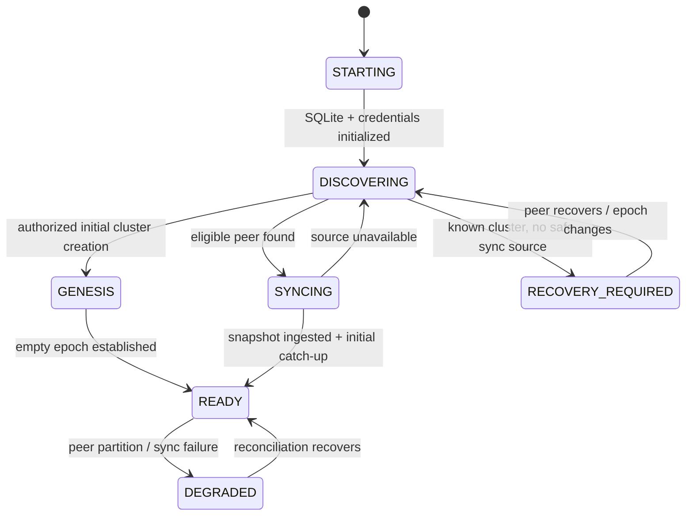

# Gossip and bootstrap protocol

**Intent:** A compact, inspectable protocol that teaches real replication behavior without a separate broker or
leader. This is a design spec; no wire protocol has been implemented.

## Membership

- Kubernetes mode uses DNS for a headless Service with a named peer port; periodically refresh SRV/A lookup data and
  apply request timeouts.
- `publishNotReadyAddresses: true` allows discovery of pods before they are ready.
- Local test mode takes a static list of peer addresses. It exercises the same message and mTLS flows.
- Track **expected members** separately from **discovered / reachable members**. DNS records are not proof of readiness
  or successful synchronization.
- For the initial StatefulSet design, expected ordinal members can be derived from the configured replica count. Later
  scaling and peer IDs need careful reconciliation.

## Lifecycle

`DEGRADED` is a ready operational status for surviving local functionality unless local store or TLS fails. Do not
equate it with a globally consistent membership snapshot.

`SYNCING` replicas may advertise state and accept sync-related control requests, but **must not act as a bootstrap
data source** for other unsynced pods. They do not enter the user-facing Service until ready. The public diagnostics
path can remain accessible via port-forward during bootstrap failures.

## First installation (genesis)

A deliberate, idempotent initialization creates a durable metadata epoch for a brand-new cluster. One eligible pod is
designated initial seed and becomes ready with an empty message set, then others synchronize from it. A ConfigMap or
narrow API-backed record holds **only metadata**, never messages. This should not be inferred from 'no peers
answered'.

## Joining an existing epoch

1. Start, open local SQLite, obtain TLS credentials, report the current state.
2. Learn expected membership and discover peer endpoints.
3. Ask peers for identity, epoch, and readiness over mTLS.
4. Select a peer matching the current metadata epoch and eligible to supply a snapshot.
5. Transfer message IDs/records in bounded, deterministic pages. Preserve IDs, origin, timestamps; upsert
   idempotently.
6. Reconcile changes occurring during the transfer. Eventual periodic anti-entropy remains required even after ready.
7. Mark locally ready when a consistent baseline is installed and initial catch-up succeeds; continue reconciliation
   in background.

If no valid source can be found, do **not** silently initialize an empty epoch. Report `RECOVERY_REQUIRED` or a more
specific waiting status.

## Epidemic gossip

- On locally committed message, enqueue an event; replication is asynchronous.
- Pick up to two random peers (fanout configurable) per round; peer selection rotates and excludes self.
- Receiver validates mTLS identity and epoch, validates payload bounds, inserts idempotently, and may forward a newly
  accepted message.
- Bound worker count and queue capacity. Retry with backoff and jitter; never allow infinite forwarding or unbounded
  memory.
- Repeated duplicates are normal and must not generate new messages or infinite requeues.
- Failures are observable; regular anti-entropy is the correctness fallback.

## Anti-entropy

Periodically compare bounded inventories of immutable message IDs with one or more peers, fetching records absent
locally. For a small learning application, paginated ID sets and deterministic order are acceptable; a future
milestone may add Merkle-tree or digest optimizations. Missing a gossip round must not permanently lose a replicated
message if a live source remains.

Possible edge cases to test: posts during snapshot; two pods posting concurrently; dropped gossip request; pod restart
with old `emptyDir` data; replaced pod with new `emptyDir`; partitions, reconnect, and scale-up.

## Proposed API behavior (not final wire contract)

- `POST /api/messages`: return success after *local* commit and enqueue; never imply cluster-wide durability.
- `GET /api/messages/{id}/status`: report each expected pod's `present`, `missing`, or `unreachable`, including the
  current epoch and timestamp of observation.
- `GET /internal/status`: always available on a healthy peer listener; returns pod identity, epoch, state, message
  count, and readiness eligibility.
- Internal sync attempts to a non-ready source return `503` with an explicit state code.
- Wrong epoch responses are rejected and surfaced as security/consistency incidents, not merged.
