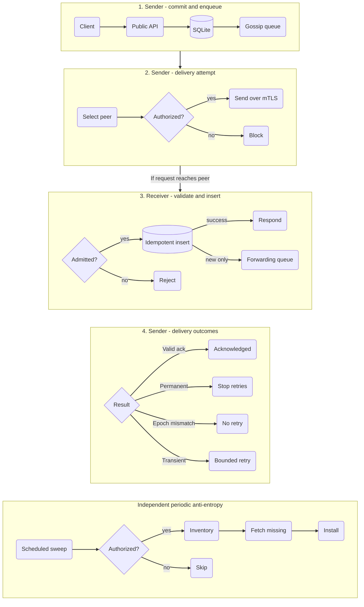
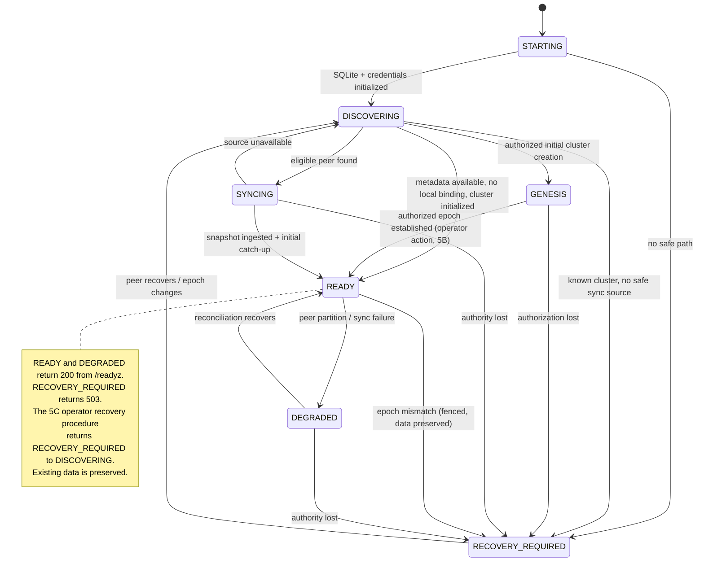
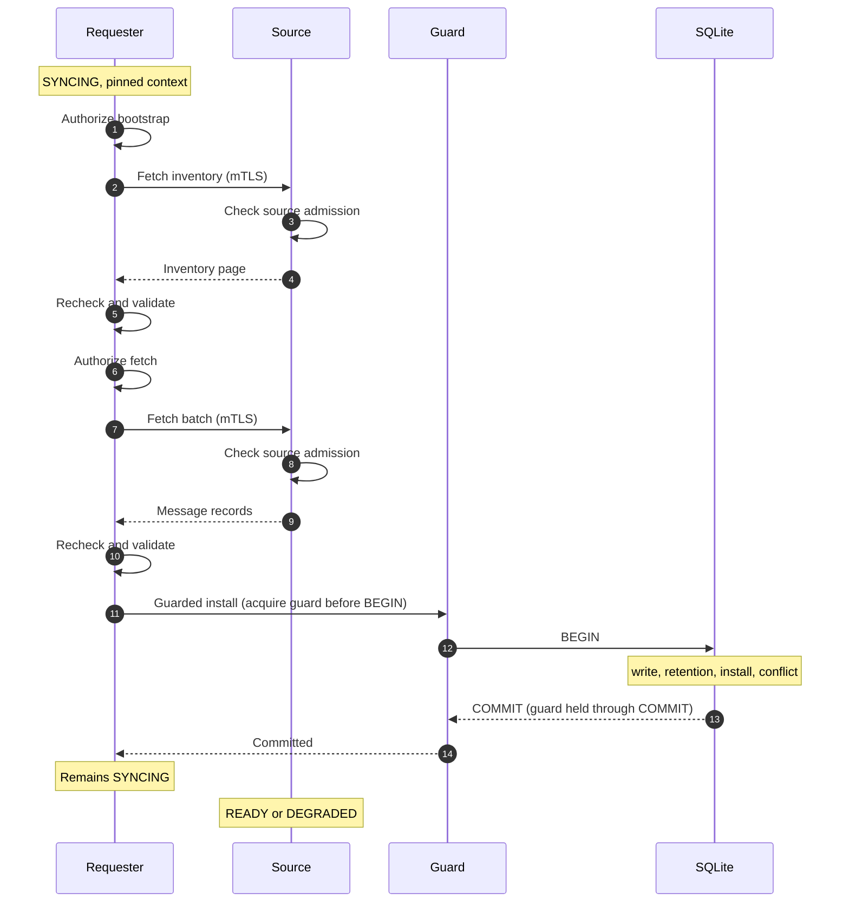

# Gossip and bootstrap protocol

**Intent:** A compact, inspectable protocol that teaches real replication behavior without a separate broker or
leader. Milestones 4A–4C implement the gossip and anti-entropy wire protocols (all **implemented and locally
tested**); Milestone 5A (implemented 2026-11-21, `v0.1.0-alpha.5`) adds the lifecycle state machine, durable epoch
binding, epoch fencing, and fail-closed admission (**implemented and locally tested**). Milestone 5B is
**partially implemented**: Stage 0 (read-only Kubernetes metadata authority, ConfigMap-backed, schema v1) is
implemented; Stage 1A (operator-controlled genesis authorization, Kubernetes genesis grant) is implemented;
Stage 1B (operator-authorized genesis finalization, one-time idempotent) is implemented; Stage 2 (dedicated
bootstrap replication admission and guarded `FetchBootstrapBaseline` installation, transport-and-commit
mechanism) is implemented, committed, and locally tested (not yet cluster-verified); Stage 3A (durable binding
provenance, `AuthorizeJoin` with final authorization guard, trusted source-observation boundary,
context-aware binding operations, and seed-restart privilege isolation) is implemented and locally tested (not yet
cluster-verified, uncommitted pending operator review); Stage 3B–3D (reconstruction orchestration: source
discovery/selection, sweep scheduling, synchronization-completion `READY` promotion) are designed but not
implemented. Milestone 5C
(operator recovery) is designed but not implemented. Milestone 5B overall is **incomplete and not yet
cluster-verified**: the one-time genesis authorization and finalization (Stages 1A/1B), the dedicated bootstrap
admission and fail-closed authority handling (Stages 0, 2), and the authorized joining and durable binding
foundation with final guard (Stage 3A) are implemented; the reconstruction orchestration (Stages 3B–3D) and
operator recovery (5C) remain planned.

**Replication diagram:** The implemented distributed messaging mechanism (local persistence, gossip fanout,
idempotent peer transfer, retries, and anti-entropy reconciliation toward eventual convergence) is illustrated
in [gossip-replication](diagrams/generated/gossip-replication.svg)
([PNG](diagrams/generated/gossip-replication.png)). The lifecycle state machine and the replacement-pod/recovery
sequence are in [lifecycle-recovery](diagrams/generated/lifecycle-recovery.svg) and
[lifecycle-recovery-sequence](diagrams/generated/lifecycle-recovery-sequence.svg). For a
learning-oriented walkthrough of the gossip, anti-entropy, and bootstrap concepts that underpin
this protocol, see the [concept library](concepts/README.md).

## Replication mechanism (gossip and anti-entropy)

The implemented distributed messaging mechanism — local persistence, gossip fanout, idempotent peer transfer,
retries, and anti-entropy reconciliation toward eventual convergence — is shown below (the authoritative
`gossip-replication.mmd` source embedded natively). The detailed anti-entropy reconciliation cycle
(inventory diff, bounded fetch, cursor advancement, admission re-check) is in the
[anti-entropy concept diagram](concepts/anti-entropy.md).

[View full-size SVG](diagrams/generated/gossip-replication.svg) · [View PNG](diagrams/generated/gossip-replication.png)

<!-- DIAGRAM:gossip-replication -->


**Reading the panels.** Panel 4 ("Sender — delivery outcomes") describes any sender delivery
attempt, including attempts that never reach the receiver (a transient network failure, for example).
A successful receiver insertion **or** an already-present identical record can produce a successful
response. Newly inserted records may enqueue independent receiver-side forwarding when gossip is
enabled; that asynchronous forwarding is **not** triggered by the sender's acknowledgment. Transient
failures can produce another bounded delivery attempt; the backward retry edge is intentionally
omitted to preserve diagram readability. A timeout after a remote insertion remains an ambiguous
transient result (idempotency makes the bounded retry safe), **not** a successful delivery.

**Delivery outcome classification (verify against `classifyError` in
`internal/gossip/gossip.go`).** Panel 4 distinguishes four distinct results, not just success and
failure:

- **Successful validated acknowledgment** (HTTP 200 with a valid response envelope): the peer is
  added to the excluded set (never contacted again for this message) and counted as an
  acknowledged delivery.
- **Permanent rejection** (HTTP 400/404/409/413/415, or an invalid acknowledgment that is not an
  epoch mismatch): the peer is marked permanently rejected for this message; no further attempts
  are made to it. The peer is excluded from all subsequent fanout rounds.
- **Epoch mismatch** (HTTP 409 with a body containing "epoch", or a `PeerAckError` mentioning
  "epoch"/"cluster"): treated as a permanent, non-retried rejection. The peer belongs to a
  different epoch and will not accept messages until the local epoch is corrected. Retrying
  indefinitely would be wasteful and could mask a configuration error.
- **Transient failure** (HTTP 429, 5xx, network errors, timeouts, ambiguous transport errors): a
  targeted retry is scheduled with exponential backoff (capped at `RetryMax`), within the
  per-peer `MaxAttempts` budget. The receiver's idempotent insert makes a bounded retry safe
  (a timeout after a remote insert is not a failure).

The receiver's successful idempotent insert can produce **two separate consequences**: a
successful response to the sender (the 200 acknowledgment) and, **only if the record was newly
inserted** (not already present), a new local propagation event via the `onNewMsg` callback.
An already-present record does **not** trigger the new-message callback. The diagram does
**not** imply a fixed ordering between the queued asynchronous forwarding (the "new only →
forwarding queue" edge) and the acknowledgment receipt — they are independent side effects of the
insert.

The anti-entropy path (the "Independent periodic anti-entropy" panel) is a **separate, independently
scheduled** replication path with its own admission requirements; it is not triggered by gossip
completion and is not part of the gossip delivery outcome classification above. When lifecycle
protection is enabled, the anti-entropy sweep is subject to the lifecycle admission check
(`CheckReplicationOutbound`): a replica in `SYNCING` or another unready state is not authorized to
perform anti-entropy sweeps, regardless of whether its database exists. The inventory endpoint is
`GET /internal/sync/ids`; the bounded message-fetch endpoint is `POST /internal/sync/messages`.

## Milestone 5A — what is enforced vs. deferred to 5B

Milestone 5A provides the **foundations** for fail-closed authority and epoch fencing. It does **not** implement
the **procedures** for safe bootstrap and recovery, which are reserved for Milestone 5B:

| Enforced in 5A | Deferred to 5B |
| --- | --- |
| 7-state lifecycle machine with a transition table | Authorized genesis (control-plane-coordinated; empty SQLite state alone is never sufficient) |
| Durable SQLite `local_metadata` binding (atomic, idempotent, exclusive) | Cluster epoch creation/reset (operator endpoints) |
| Fail-closed admission (single consistent authorization snapshot) | Initial snapshot promotion (SYNCING → READY) |
| Epoch fencing via HTTP request headers (409 permanent / 503 unready) | Snapshot-source selection (which peer to sync from) |
| Response-envelope validation (lifecycle-enabled client rejects legacy peers) | K8s ConfigMap-backed metadata provider |
| Public read/write quarantine (503 when unauthorized; records preserved) | Operator reset endpoints |
| Outbound epoch context sourced from the current controller decision | |
| Per-send admission re-check (gossip + anti-entropy) | |
| Metadata freshness (bounded: 2× poll interval; stale observations fail closed) | |

**Key clarifications (guarantees actually enforced):**

- **Stale observations fail closed.** A metadata observation older than 2× the poll interval is considered stale
  and does NOT authorize operations, even if the state is READY. This is enforced by the authorization snapshot's
  `Stale` flag.
- **Inserts do NOT re-verify the epoch binding.** The store's `Bind` operation is the only binding check. A message
  insert (via `ON CONFLICT DO NOTHING`) does not re-check the epoch binding; the fail-closed admission guard is the
  line of defense before the insert.
- **Queued replication is fenced at the moment of the check.** A gossip or anti-entropy work item admitted while
  authorized (the admission check passed at enqueue or at the per-send re-check) may be delivered if it was
  authorized when the check passed. The guarantee is that **no NEW work is authorized after a revocation**: the
  admission check is re-read before every network send and every insert, and a revoked node blocks all new work.
  An already-in-flight send (authorized when it started) may complete in the bounded in-flight window.
- **mTLS alone does NOT prove epoch membership.** A valid mTLS certificate is necessary but not sufficient. A
  lifecycle-enabled client additionally requires the peer's **response envelope** (`X-GossipGrid-Lifecycle-Active:
  true` + matching cluster/epoch headers) to confirm the peer runs the epoch-fencing protocol. A legacy peer
  (lifecycle disabled) that returns a successful response without the envelope is rejected as a synchronization
  source.
- **5A does NOT provide full safe bootstrap or recovery.** The state machine, binding, and fencing are in place,
  but the procedures to establish a new cluster (genesis), promote a snapshot (SYNCING → READY), or recover from a
  lockout (operator reset) are deferred to 5B. A 5A replica with a conflicting binding enters `RECOVERY_REQUIRED`
  and stays there until an operator (5B) performs a recovery procedure.

## Membership

- Kubernetes mode uses DNS for a headless Service with a named peer port; periodically refresh SRV/A lookup data and
  apply request timeouts.
- `publishNotReadyAddresses: true` allows discovery of pods before they are ready.
- Local test mode takes a static list of peer addresses. It exercises the same message and mTLS flows.
- Track **expected members** separately from **discovered / reachable members**. DNS records are not proof of readiness
  or successful synchronization.
- For the initial StatefulSet design, expected ordinal members can be derived from the configured replica count. Later
  scaling and peer IDs need careful reconciliation.

## Lifecycle (Milestone 5A — implemented 2026-11-21)

The `internal/lifecycle` package implements the state machine defined below. It is **opt-in** via
`GOSSIPGRID_LIFECYCLE_ENABLED=true` (requires `GOSSIPGRID_PEER_TLS_ENABLED=true`). When disabled (the default), all
existing Milestone 4 behavior is preserved.

[View full-size SVG](diagrams/generated/lifecycle-5a.svg) · [View PNG](diagrams/generated/lifecycle-5a.png)

<!-- DIAGRAM:lifecycle-5a -->


**Transition table** (all other transitions are rejected with `ErrInvalidTransition`):

| From | Permitted to |
| --- | --- |
| `STARTING` | `DISCOVERING`, `RECOVERY_REQUIRED` |
| `DISCOVERING` | `GENESIS`, `SYNCING`, `RECOVERY_REQUIRED`, `READY` |
| `GENESIS` | `READY`, `RECOVERY_REQUIRED` |
| `SYNCING` | `DISCOVERING`, `READY`, `RECOVERY_REQUIRED` |
| `READY` | `DEGRADED`, `RECOVERY_REQUIRED` |
| `DEGRADED` | `READY`, `RECOVERY_REQUIRED` |
| `RECOVERY_REQUIRED` | `DISCOVERING` |

**State semantics:**

- `STARTING`: local SQLite, configuration, and credentials are initializing. Not ready.
- `DISCOVERING`: local dependencies are available, but the replica has not established authorization to participate
  in a valid cluster epoch. Not ready.
- `GENESIS`: explicitly authorized first initialization. Entered only by an explicit controller method, never
  inferred from missing peers or empty data. Not ready.
- `SYNCING`: the replica has an authorized epoch and is obtaining an initial data baseline. Not an authoritative
  bootstrap source. Not ready.
- `READY`: the replica has established its permitted epoch and completed the required initialization criteria. May
  accept normal requests and supply synchronization data.
- `DEGRADED`: previously became `READY` and retains valid local authority but is experiencing a peer or convergence
  failure. May remain ready when the problem is only peer availability.
- `RECOVERY_REQUIRED`: the replica cannot safely establish or continue participation (epoch mismatch, uncertain
  metadata, incompatible local database binding). Data is preserved; not ready.

`DEGRADED` is a ready operational status for surviving local functionality unless local store or TLS fails. Do not
equate it with a globally consistent membership snapshot.

`SYNCING` replicas may advertise state and accept sync-related control requests, but **must not act as a bootstrap
data source** for other unsynced pods. They do not enter the user-facing Service until ready. The public diagnostics
path can remain accessible via port-forward during bootstrap failures.

**Concurrency guarantees:**

- The state machine uses `RWMutex`: `State()` and `Snapshot()` take a read lock; `transition` takes a write lock.
- Concurrent `Snapshot()` calls never observe an inconsistent state.
- Concurrent transitions are serialized; invalid transitions return an error (never silently dropped).
- The transition log is bounded (64 entries, newest first) and independently locked.
- The Controller does NOT hold a lock across network operations; it publishes immutable snapshots atomically.

**Admission gating (fail-closed):**

When lifecycle protection is enabled, an `Admission` guard is checked at every replication protocol boundary. The
guard reads the controller's **single, internally consistent `AuthorizationSnapshot`** (one read lock) and applies
the full fail-closed policy: ready state + a **fresh** (not stale), valid authoritative observation + a matching
durable database binding + no recovery lockout + not stopped. A state, metadata, or binding change cannot
interleave between reading the state and reading the metadata or binding.

- **Public writes** (`POST /api/messages`): rejected with 503 when the authorization snapshot is not authorized.
  No message is inserted.
- **Public reads** (`GET /api/messages`, `GET /api/messages/{id}`): rejected with 503 ("message database
  quarantined") when the authorization snapshot is not authorized. The local records are **preserved** (never
  deleted) but are not exposed as ordinary current-epoch API data.
- **Inbound replication** (`POST /internal/messages`, sync endpoints): rejected with 503 (unready) or 409 (epoch
  mismatch). A 409 response includes the peer's epoch in the response; the receiving client classifies epoch
  mismatch as a **permanent** error (no retry).
- **Outbound replication** (gossip engine, anti-entropy engine): the admission check is read **before every network
  send** (not only at enqueue) and **before every insert**. A work item admitted while authorized may be delivered
  (it was authorized when the check passed); a revoked node blocks all new work. No endless retries: a 409
  epoch mismatch or a `PeerBlockedError` is classified as a permanent error (the peer is marked permanently
  rejected and no further attempts are made).

**Readiness and peer status reflect the same decision.** `GET /readyz` and the peer `/internal/status` handler
both read the controller's `Authorization()` snapshot and use `snapshot.Authorized()` — the same decision the
admission guard uses. They cannot diverge.

**Epoch fencing protocol:**

Each peer's status response and sync endpoints carry epoch context via HTTP headers. The **request** carries the
caller's accepted epoch context; the **response** carries the peer's self-reported authorization context (the
response envelope).

| Header (request) | Value |
| --- | --- |
| `X-GossipGrid-Cluster-ID` | The cluster ID from the caller's authoritative metadata |
| `X-GossipGrid-Epoch-ID` | The epoch ID from the caller's authoritative metadata |

| Header (response envelope) | Value |
| --- | --- |
| `X-GossipGrid-Resp-Cluster-ID` | The peer's authorized ClusterID (from its authorization snapshot) |
| `X-GossipGrid-Resp-Epoch-ID` | The peer's authorized EpochID |
| `X-GossipGrid-Lifecycle-Active` | `"true"` when the peer has lifecycle protection enabled (a legacy peer never sets this) |

- Headers are bounded to 64 bytes each; duplicate or oversized headers are rejected.
- A receiving replica compares the caller's epoch against its own local database binding. A mismatch returns 409
  and the data is not merged.
- mTLS remains the sole basis for peer identity. Epoch headers are **not** proof of identity; they are fencing
  metadata that prevent cross-epoch data transfer.
- A replica with no local binding cannot validate an epoch; it fails closed.
- **Response-envelope validation (mixed-mode fencing).** A lifecycle-enabled **client** requires the peer's
  response to carry `X-GossipGrid-Lifecycle-Active: true` and a cluster/epoch matching the client's request
  context. A **legacy** peer (lifecycle disabled) that returns a successful response without the envelope is
  rejected as a synchronization source: a valid mTLS certificate is necessary but not sufficient. This prevents a
  lifecycle-enabled replica from ingesting data from a peer that does not run the epoch-fencing protocol. When
  both peers have lifecycle disabled (legacy-legacy), the envelope is not required and the exchange proceeds as
  before (legacy behavior preserved).
- **Outbound epoch context.** The peer client's outbound epoch is sourced from the controller's **current**
  authorization decision (via the `EpochProvider`), not a one-time startup copy. When the controller is not
  authorized (lockout, no fresh observation, or stopped), the client blocks the outbound request with a
  `PeerBlockedError` rather than using a stale or missing epoch.

**Durable local binding:**

The `local_metadata` SQLite table stores a singleton row (ID=1) binding the database to a cluster ID, epoch ID, and
generation. Binding is:

- **Atomic:** `INSERT ... ON CONFLICT DO NOTHING` — only one row can exist.
- **Idempotent:** rebinding to the same values is a no-op.
- **Exclusivity:** rebinding to different values fails with `ErrBindingMismatch`; a nonempty database without a
  binding fails with `ErrBindingNonempty`.
- **Backward-compatible:** legacy databases (no binding row) simply have no binding; `GetBinding` returns nil.

**Metadata authority:**

The `MetadataSource` interface provides a narrow, read-only view of authoritative cluster metadata:

```go
type MetadataSource interface {
    Read(ctx context.Context) (ClusterMetadata, error)
}
```

`ClusterMetadata` fields: `ClusterID`, `EpochID`, `Generation`, `Initialized`, `EverAcceptedMessages`, `Revision`.

In Milestone 5A, the production path uses `NewFakeMetadataSourceUnavailable()` — a no-op source that always returns
`ErrMetadataUnavailable`. The controller correctly fails closed (stays in `DISCOVERING` or transitions to
`RECOVERY_REQUIRED`) without inventing an epoch. The Kubernetes ConfigMap-backed provider is reserved for Milestone
5B.

**Readiness semantics:**

- `GET /readyz`: returns 200 only when the controller's authorization snapshot is **authorized** (ready state +
  fresh, valid, matching observation + matching binding + no lockout + not stopped); all other cases return 503
  with a structured JSON body (`{"service":"gossipgrid","ready":false,"state":"STARTING","reason":"..."}`). The
  readiness check uses the **same** `AuthorizationSnapshot` the admission guard uses, so they cannot diverge.
- `GET /healthz`: always 200 when the process is alive, regardless of lifecycle state.
- When lifecycle is disabled (default), `GET /readyz` always returns 200 (existing behavior preserved).

## First installation (genesis)

A deliberate, idempotent initialization creates a durable metadata epoch for a brand-new cluster. One eligible pod is
designated initial seed and becomes ready with an empty message set, then others synchronize from it. A ConfigMap or
narrow API-backed record holds **only metadata**, never messages. This should not be inferred from 'no peers
answered'.

**Status:** The one-time genesis authorization and finalization are **implemented** (Milestone 5B, Stages 1A and
1B). Stage 1A implements operator-controlled genesis authorization through a dedicated, restricted-RBAC genesis
grant Job (namespace-scoped ConfigMap create permission and get permission restricted to the named metadata
ConfigMap; among GossipGrid's dedicated ServiceAccounts, only the genesis grant identity has create permission).
The application ServiceAccount remains read-only and cannot grant or consume its own genesis authorization. Stage 1B
implements operator-authorized genesis finalization (the mechanism that atomically sets the `Initialized` flag in
the ConfigMap via CAS, consumes the
authorization, arms `DataLossProtected`, and promotes the seed to `READY` via seed-restart reconciliation). The 5A
state machine's `GENESIS` state and transition are defined and used by these stages. **What remains planned:**
Stage 3 implements reconstruction orchestration (source discovery/selection, sweep scheduling,
synchronization-completion `READY` promotion for replacement replicas that join an already-initialized cluster —
distinct from one-time genesis) and 5C implements operator recovery. The full `SYNCING` → `READY` reconstruction
path for replacement replicas is **not yet complete** (Milestone 5B, Stage 3; Milestone 5C).

## Milestone 5B — Authoritative metadata and initial synchronization (partially implemented)

Milestone 5B adds the Kubernetes metadata authority, the initial snapshot transfer, and the snapshot-source
eligibility rules that complete the bootstrap protocol.

- **Kubernetes ConfigMap-backed authoritative metadata.** A narrowly scoped ConfigMap holds the globally unique
  cluster ID, the unpredictable epoch ID (plus a display generation number), the `Initialized` flag, the
  `EverAcceptedMessages` flag, and the last reset incident with acknowledgment state. The ConfigMap is
  **metadata only** — it never stores message bodies. All transitions use the Kubernetes `resourceVersion`
  compare-and-swap; restricted RBAC (get + update on the named ConfigMap only) prevents competing reset attempts.
- **Safe genesis.** A fresh cluster with no prior epoch is initialized by an explicit, control-plane-coordinated
  action (not inferred from "no peers answered"). One eligible pod is designated seed, the ConfigMap's
  `Initialized` flag is set atomically via CAS, and the seed becomes ready with an empty message set. Others
  synchronize from it. Empty SQLite state alone is never sufficient to claim genesis.
- **Initial snapshot transfer.** A `SYNCING` replica pulls a bounded, keyset-paginated baseline from an eligible
  source (using the existing anti-entropy `GET /internal/sync/ids` and `POST /internal/sync/messages` endpoints,
  but in a single, larger transfer rather than the periodic reconciliation) and transitions to `READY` when the
  baseline is installed and initial catch-up succeeds. The same bounded, idempotent `ON CONFLICT DO NOTHING`
  insert path is used.
- **Snapshot-source eligibility.** A peer is eligible to supply a snapshot only when it is in `READY` or
  `DEGRADED` state and its epoch matches the caller's. `SYNCING` replicas are **never** eligible as bootstrap
  data sources. The eligibility check uses the same `AuthorizationSnapshot` the admission guard uses (ready
  state + fresh metadata + matching binding).
- **Fail-closed when authority is unavailable.** If the ConfigMap is absent, unwatchable, or returns a stale
  revision, the replica stays in `DISCOVERING` or transitions to `RECOVERY_REQUIRED`; it does not invent an
  epoch. The `MetadataSource` interface (defined in 5A) is implemented with the ConfigMap-backed provider in
  5B.

## Milestone 5B, Stage 2 — Bootstrap replication admission (implemented 2026-11-24, committed `209cec1`)

Milestone 5B, Stage 2 implements the **narrowly scoped bootstrap baseline fetch authorization** that enables an
authenticated, epoch-bound `SYNCING` replica to retrieve an initial data baseline from an eligible authoritative
source **without** granting ordinary replication, public-write, or source privileges to an incompletely
synchronized replica. The implementation is complete, committed (`209cec1`), and locally tested (unit tests,
race-enabled tests, real SQLite store tests, and per-package integration tests; not yet cluster-verified). The
production wiring in `cmd/gossipgrid/main.go` connects the bootstrap admission
(`CheckBootstrapFetch`), authorization source (`BootstrapAuthorizationSnapshot`), and commit guard
(`CommitUnderBootstrapAuthorization`) to the lifecycle controller. The mechanism is **only active** when
lifecycle protection is enabled (`GOSSIPGRID_LIFECYCLE_ENABLED=true`); the default build has lifecycle disabled,
so the bootstrap admission is a passthrough (legacy behavior preserved).

### Authorization concepts (explicitly distinguished)

The bootstrap admission contract defines **seven distinct authorization concepts**, each with its own predicate,
boundary, and privilege. They are not interchangeable:

| Concept | Predicate | Boundary | Privilege granted |
| --- | --- | --- | --- |
| **Bootstrap fetch authorization** | `AuthorizationSnapshot.bootstrapAuthorized()` | Before issuing a peer HTTP request (`CheckBootstrapFetch`) | Permits the replica to send `GET /internal/sync/ids` and `POST /internal/sync/messages` with the bootstrap request-purpose header |
| **Bootstrap data insertion authorization** | `AuthorizationSnapshot.bootstrapAuthorized()` (revalidated) | At the local write boundary (`CommitUnderBootstrapAuthorization`) | Permits the replica to install a fetched bootstrap response into its local SQLite store |
| **Ordinary replication authorization** | `AuthorizationSnapshot.authorized()` | Before every gossip/anti-entropy send and insert (`CheckReplicationOutbound` / `CheckReplicationInbound`) | Permits ordinary outbound gossip, ordinary inbound replication writes, and periodic anti-entropy |
| **Public-write authorization** | `AuthorizationSnapshot.authorized()` | Before `POST /api/messages` (`CheckWrite`) | Permits the replica to accept public API writes |
| **Authoritative source eligibility** | `StateSnapshot.IsReady()` + `AuthorizationSnapshot.authorized()` | Before serving any sync data (`CheckBootstrapSourceInbound`) | Permits the replica to serve a bootstrap baseline **or** ordinary sync data to other replicas |
| **Kubernetes readiness** | `AuthorizationSnapshot.authorized()` | `GET /readyz` and peer `/internal/status` | Controls whether the replica is admitted to the user-facing Service |
| **Synchronization completion / READY promotion** | Full baseline installed + initial catch-up | `Controller.PromoteToReady` (Stage 3D, not yet implemented) | Transitions `SYNCING` → `READY`, enabling all ordinary privileges |

### Bootstrap fetch authorization (requester side)

A `SYNCING` replica may **fetch** a bootstrap baseline only when **all** of the following hold (the
`bootstrapAuthorized()` predicate, evaluated from a single consistent `AuthorizationSnapshot`):

1. Lifecycle enforcement is enabled (`Config.Enabled == true`).
2. The lifecycle state is **exactly `SYNCING`** (not `READY`, `DEGRADED`, `GENESIS`, `STARTING`, `DISCOVERING`, or
   `RECOVERY_REQUIRED`).
3. The controller is **not stopped**.
4. The authoritative metadata is **fresh** (`AuthorityState == "fresh"`, not stale or invalid).
5. The authoritative metadata is **valid** and **initialized** (`Metadata != nil`, `Metadata.Initialized ==
   true`).
6. Genesis finalization is **complete** for genesis-managed configurations (the record is `GenesisAuthorized`,
   `GenesisConsumer`, `DataLossProtected`, and `Initialized`).
7. Data-loss protection is **armed** where required (the `DataLossProtected` flag is set for a genesis-managed
   record).
8. The local SQLite has a **durable binding** matching the authoritative `ClusterID` and `EpochID`
   (`Binding != nil`, `Binding.MatchesMetadata(*Metadata)`).
9. **No conflicting or revoked authority exists** (the observation is not stale, the binding is not mismatched,
   and the controller has not been stopped).

When any of these conditions fail, `CheckBootstrapFetch` returns a rejection (503-style unready or 409-style
epoch mismatch), and **no peer HTTP request is sent**.

### Bootstrap source eligibility (serving side)

A peer is eligible to **serve** a bootstrap baseline only when:

- Its lifecycle state is **`READY` or `DEGRADED`** (the `IsReady()` predicate; `SYNCING`, `GENESIS`,
  `RECOVERY_REQUIRED`, `STARTING`, and `DISCOVERING` are never eligible).
- It is **fully authorized** (the broad `authorized()` decision: ready state + fresh valid metadata + matching
  binding + not stopped).
- The request's epoch context **matches** its local authorized metadata (409 on mismatch/missing).

A `SYNCING` replica is **never** an authoritative bootstrap source: its state is not ready, so the full
`authorized()` decision fails regardless of the bootstrap request-purpose header. The request-purpose header is
**untrusted metadata** — it only selects the serving-side admission check; it never grants a privilege.

### Request-purpose header (untrusted metadata)

The `X-GossipGrid-Request-Purpose` header carries the requester's intent (`bootstrap-baseline` or
`ordinary-sync`). It is **not** authentication and **not** identity. Its only effect is to select the
serving-side admission check:

- `present && purpose == "bootstrap-baseline"` → routes to the bootstrap serving-side handler
  (`CheckBootstrapSourceInbound`).
- Missing, malformed, or unsupported → falls back to the ordinary serving-side handler
  (`CheckReplicationInbound` / `authorized()`).

A malformed or unsupported value is **never an error** and **never grants a privilege**. The mTLS identity and
epoch validation continue to apply regardless of the header.

### Bootstrap data insertion authorization (commit boundary)

A successful bootstrap HTTP request **does not automatically authorize** insertion of its response. The
`CommitUnderBootstrapAuthorization` method is the linearization point: it revalidates the **dedicated**
bootstrap authorization (`bootstrapAuthorized()`) at the **actual local write boundary**, holding the
controller's `c.mu RLock` and the machine's `m.mu RLock` (the established lock-order contract:
`c.mu RLock → m.mu RLock → Engine.mu Lock`).

If the bootstrap authorization is no longer valid at commit time (the replica left `SYNCING`, the epoch/metadata
changed, the observation is stale or invalid, the binding changed, or the controller stopped), the callback is
**not executed** and a rejection error is returned. Already-committed valid data is preserved (no rollback, no
deletion).

### Privilege isolation

A bootstrap-authorized `SYNCING` replica:

- **May** fetch a bootstrap baseline (`GET /internal/sync/ids` + `POST /internal/sync/messages` with the
  bootstrap request-purpose header) and install it through the guarded commit boundary.
- **May not** accept public writes (`POST /api/messages` → 503).
- **May not** send ordinary outbound gossip (`CheckReplicationOutbound` → rejected: not ready).
- **May not** accept ordinary inbound replication writes (`CheckReplicationInbound` → rejected: not ready).
- **May not** act as an authoritative source for other replicas (`IsReady()` → false).
- **May not** access unrelated endpoints (the sync endpoints are the only ones the bootstrap privilege
  reaches).
- **May not** self-promote to `READY` (the bootstrap commit path is not a promotion mechanism; only the full
  synchronization completion in Stage 3 can do that).
- **May not** enable unrestricted periodic anti-entropy (the anti-entropy engine's admission check is
  `CheckReplicationOutbound`, not `CheckBootstrapFetch`; a `SYNCING` replica is not authorized for periodic
  anti-entropy).

### Lock ordering and revocation handling

The lock-order contract is: `Controller.mu (c.mu) RLock → Machine.mu (m.mu) RLock → Engine.mu (Lock)`. All
bootstrap authorization reads (admission checks, `CommitUnderBootstrapAuthorization`) acquire `c.mu RLock` then
`m.mu RLock`. All state transitions (`SetRecoveryRequired`, `Stop`, etc.) acquire `c.mu RLock` then `m.mu Lock`.
This ensures a revocation linearizes **either before or after** the commit, never "during" it.

The bootstrap fetch and commit boundaries are tested at 5 deterministic contention boundaries:

1. **Before issuing a bootstrap request** — the admission check rejects; no request is sent.
2. **While a peer request is in flight** — the admission is checked at pass entry; the in-flight revocation is
   observed at the commit boundary.
3. **After receiving the response but before insertion** — the commit guard revalidates at the write boundary
   and rejects.
4. **During the guarded local commit** — the commit guard holds the RLocks; a concurrent revocation is queued
   behind them; the commit linearizes first and succeeds.
5. **While the controller is stopping** — Stop takes `c.mu Lock`; the commit guard's RLocks are queued behind
   it, or the stopped flag is observed and the commit is rejected.

### Trust boundary and response envelope (source-side)

The bootstrap source-side (serving replica) trust boundary has three distinct layers, each independently
validated. A compromise of any single layer does not break the others:

1. **mTLS identity (transport layer).** The serving replica authenticates the requester's TLS certificate
   against the workload CA trust bundle and verifies the exact expected DNS SAN identity. A peer without a
   valid, workload-CA-issued certificate is rejected at the TLS handshake — no HTTP request is ever
   processed. mTLS proves the requester holds a certificate issued by the same workload PKI; it does **not**
   prove the requester's epoch membership or its lifecycle state (the caller's headers are untrusted).

2. **Response epoch envelope (protocol layer).** Every lifecycle-enabled response carries exactly three
   headers: `X-GossipGrid-Lifecycle-Active: true`, `X-GossipGrid-Cluster-Id`, and
   `X-GossipGrid-Epoch-Id`. The values come from the **original admission snapshot** — the
   `AuthorizationSnapshot` captured at the moment the serving-side admission check first passed, **not**
   from a fresh re-read of the controller that could reflect a concurrent epoch change between admission
   and response generation. The requester's client validates the envelope against the **captured request
   context** (the `RequestContext` read once from the `EpochProvider` before the HTTP request was sent):
   the envelope's cluster and epoch must match the request context exactly. A legacy peer (lifecycle
   disabled, no envelope headers) is rejected as a synchronization source by a lifecycle-enabled client.
   A peer whose envelope does not match the request context (a concurrent epoch change on the source
   between the initial admission check and the recheck, or a different cluster) is rejected with a
   permanent error (no retry). The envelope is **auditable metadata**, not bearer credentials: the
   headers are bounded, compared, and never used to grant a privilege on their own.

3. **Data-serving recheck (mutation layer).** Immediately before reading from SQLite and writing the
   response body, the handler re-reads the **current** `AuthorizationSnapshot` and revalidates the
   original request's epoch context against the current metadata using
   `finalAdmissionCheckWithPredicate` (the serving-side bootstrap predicate: `CheckBootstrapSourceInbound`).
   If the snapshot is no longer authorized (the replica was revoked, changed state, or stopped) **or**
   the epoch changed (the current metadata's cluster/epoch no longer matches the request context), the
   response is rejected with a permanent error **before any data is read**. The response envelope is
   always bound to the **original** admission snapshot (step 2), not to this recheck snapshot — this
   prevents a valid epoch-A request from being processed using epoch-B authorization.

**The request-purpose header is untrusted in all three layers.** It only selects which admission check
(`CheckBootstrapSourceInbound` vs. `CheckReplicationInbound`) the handler applies. A `SYNCING` replica can
never pass `CheckBootstrapSourceInbound` (the `authorized()` predicate requires a ready state), so the
header cannot be used to make a non-ready replica serve bootstrap data. A malformed or missing header
falls back to the ordinary policy. mTLS, the envelope, and the recheck are all independent of the header.

**Ordinary replication isolation.** The bootstrap source-side handler and the ordinary anti-entropy
source-side handler are **separate** functions (`newLifecycleBootstrapSyncInventoryHandler` vs.
`newLifecycleSyncInventoryHandler`). They are selected by the request-purpose header at dispatch time
(`dispatchSyncInventoryHandler` / `dispatchSyncFetchHandler`). The bootstrap handler applies
`CheckBootstrapSourceInbound` (ready state + full authorization + epoch match). The ordinary handler
applies `CheckReplicationInbound` / `authorized()` (the same full authorization but without the explicit
`IsBootstrapSourceEligible` belt-and-suspenders check). Both paths apply mTLS, envelope validation, and
the data-serving recheck. A `SYNCING` replica cannot pass either check.

**Lifecycle-disabled compatibility.** When `GOSSIPGRID_LIFECYCLE_ENABLED=false` (the default build), the
`Admission` guard's `enabled` flag is `false`: `CheckBootstrapSourceInbound` and all other checks return
`Allowed: true` immediately. The `setResponseEpochEnvelope` function is **never called** (the legacy
handlers do not call it), and the client's `validateResponseEnvelope` returns `nil` immediately when the
local `EpochProvider` reports enforcement disabled. The bootstrap request-purpose header is still sent
by the client (it is set whenever `requestPurpose != ""` in `doRequest`), but it has no effect on the
serving-side check (lifecycle disabled → all checks pass). This preserves the M4 anti-entropy behavior
for a 7A cluster that has no authoritative epoch.

### Remaining Stage 3 requirements (not yet implemented)

Milestone 5B, Stage 3A (implemented, locally tested, uncommitted) provides the **authorized joining and
durable binding foundation** with a final authorization guard:

- **Durable binding provenance** — every `local_metadata` binding row carries a `provenance` column
  (`genesis`, `join`, `legacy`) that records how the binding was created. The provenance is persisted
  atomically with the binding, is immutable, and is validated on read (out-of-range values fail closed
  with `ErrBindingMalformed`). Pre-Stage 3A databases are migrated by GORM `AutoMigrate` (the zero-value
  is interpreted as `genesis`; explicit unknown values fail closed). The admission predicates
  (`AuthorizationSnapshot.authorized` and `bootstrapAuthorized`) each carry a positive provenance
  allowlist (only `genesis` or `join`): an explicitly-unknown (`legacy`) or out-of-range provenance
  denies both ordinary participation and bootstrap fetch, independent of the state or metadata
  checks — the state restriction alone is not sufficient to fail closed an unrecognized provenance.
- **`AuthorizeJoin` with final authorization guard** — a narrow, explicitly invoked controller operation
  for beginning an ordinary replica join to an already-initialized cluster epoch. It creates a
  join-provenance binding and transitions the replica to `SYNCING`. The authorization sequence is:
  (1) pre-binding validation (no I/O, no locks: caller context live, lifecycle enabled, not stopped,
  metadata present/fresh/valid/initialized, finalization complete, state permits joining, no conflicting
  binding); (2) source observation (network I/O, no locks: the trusted observer performs an
  authenticated mTLS observation, the result is revalidated against the current metadata before any
  durable write); (3) durable `Bind` (SQLite I/O, no locks: the transaction is the linearization
  point); (4) post-Bind authoritative re-read (a direct `c.source.Read(ctx)` call validates the
  re-read observation to confirm the authorization was not revoked between the pre-guard snapshot
  and the Bind; the re-read does not overwrite newer controller-accepted metadata); (5) final
  local guard (`c.mu.Lock` + `m.mu.Lock`, no I/O: 14 checks revalidated under the held lock pair,
  including caller context live, not stopped, controller context live, metadata fresh/valid/matching,
  the complete finalized-genesis invariant where applicable, binding provenance join, the source
  observation valid and consistent (via the same single controller-side validator as the pre-binding
  guard, passing the ORIGINAL pinned target and expected identity from `AuthorizeJoin`), and the
  legal transition into SYNCING).
  **Committed bindings are never rolled back**: the SQLite transaction is the linearization point;
  once it commits, the binding is durable and is preserved on a guard rejection. A subsequent
  `AuthorizeJoin` call with a restored authorization will find the matching binding and succeed
  idempotently. It is distinct from `AuthorizeGenesis` (the one-time, operator-authorized first-epoch
  establishment by the designated seed). A replacement canonical seed follows the ordinary joining
  contract once the epoch is initialized; its ordinal does not confer genesis privileges.
- **Trusted source-observation boundary** — `AuthorizeJoin` requires a `BootstrapSourceObserver`
  (interface) that performs an authenticated mTLS peer-status observation and returns a
  `SourceObservationResult`. The production implementation (`peertls.BootstrapSourceObserver`)
  uses a purpose-specific transport path (`doStatusObservationRequest`) that does NOT require the
  local `EpochProvider` to be configured (production-compatible pre-binding observation: the local
  database is unbound, so the normal EpochProvider cannot establish an outbound context). It
  validates: TLS 1.3 mutual authentication (peer identity from the certificate), strict response
  envelope (unconditional header/body/expected-target triple agreement: both cluster and epoch
  headers present, exactly one each, nonempty, bounded, matching the pinned expected target AND the
  status body), lifecycle state READY or DEGRADED, `BootstrapSourceEligible=true`, readiness=true,
  authenticated PodID matches the certificate identity (not the self-reported value), and
  self-observation rejection. The result is valid for a bounded TTL (10 seconds, matching
  `lifecycle.MaxSourceObservationTTL`). The result is not a trusted boolean; it must be obtained
  through an authenticated, same-epoch peer observation.
- **Context-aware binding operations** — the store `Bind` accepts a `context.Context` and uses
  `WithContext` for the SQLite transaction. A cancelled or stopped context aborts the bind, preventing
  a partial or orphaned binding row.
- **Seed-restart privilege isolation** — a replacement `gossipgrid-0` with a join-provenance binding
  must never be promoted to `READY` through the genesis-restart reconciliation path. This is enforced
  in `reconcileSeedRestartLocked`, `validateGenesisPromotion`, and `promoteFromGenesisLocked`.
  Additionally, `SetReady` is atomic under a single lock pair (`c.mu.Lock` + `m.mu.Lock`) and requires
  genesis provenance for non-DEGRADED states; a join-provenance binding in a non-DEGRADED state (e.g.
  `SYNCING`, where synchronization is not yet complete) is rejected. The guard also validates the
  binding (`Binding.Validate`), the complete finalized-genesis invariant when a seed is designated,
  and a positive provenance allowlist: an explicitly-unknown or out-of-range provenance is rejected
  in ALL states, including `DEGRADED` recovery, while a recognized (`genesis` or `join`) binding is
  permitted. A join-origin `SYNCING` replica therefore cannot achieve initial `READY` promotion during
  Stage 3A, but a valid `DEGRADED` recovery remains allowed. `SetSyncingForTest` is a test-only
  method (the production path for entering SYNCING is `AuthorizeJoin`).

Milestone 5B, Stages 3B–3D will implement the full bootstrap orchestration:

- **Source discovery and selection** (3B) — a `SYNCING` replica must discover eligible sources (peers in
  `READY` or `DEGRADED` state with a matching epoch) and select one deterministically.
- **Sweep scheduling** (3C) — the bootstrap baseline fetch is a single, bounded transfer (not the periodic
  anti-entropy loop). Stage 3C defines when and how the sweep is scheduled (e.g., on transition to `SYNCING`,
  with a bounded retry budget).
- **Synchronization-completion READY promotion** (3D) — when the baseline is fully installed and initial
  catch-up succeeds, the `SYNCING` replica transitions to `READY` (via `Controller.PromoteToReady`). This
  is the only path to `READY` for a `SYNCING` replica.
- **Complete sweep accounting** (3D) — the bootstrap sweep must track progress (per-peer cursor, completed
  passes) and handle partial sweeps (page-budget exhaustion) correctly.

**Milestone 5B is NOT complete.** Stages 0, 1A, 1B, 2, and 3A are implemented and locally tested (Stage 2
provides the admission and transport-and-commit mechanism; Stage 3A provides the authorized joining and
durable binding foundation with final guard, trusted observation boundary, and context-aware binding);
Stages 3B–3D provide the orchestration (source discovery, sweep scheduling, synchronization-completion
`READY` promotion) that uses it. The initial snapshot transfer orchestration (the `SYNCING` → `READY`
promotion path) is the remaining work (Stages 3B–3D).

### Visual example: the bootstrap admission sequence

The diagram below shows the *focused* bootstrap admission sequence with four concise
participants: the `SYNCING` *requester*, the *source*, the *commit guard*, and the *local SQLite*
store. Local admission checks are drawn as self-messages and notes rather than as separate
lifelines: the requester's *dedicated* bootstrap authorization (the `CheckBootstrapFetch`
predicate) and *pinned* cluster/epoch context, the source's *dedicated* admission
(`CheckBootstrapSourceInbound`) applied per request for both the *inventory* page and the *bounded
message batches*, the requester's *response-consumption* authorization and *envelope* validation,
and the *guarded* *transactional* *install* (the guard is acquired and validated before the SQLite
transaction and held through `COMMIT`). The requester *stays `SYNCING`*. The *Stage 3*
orchestration (source discovery, sweep scheduling, synchronization-completion `READY` promotion) is *not
implemented* and is *labeled as such* in the diagram; long method names, the `X-GossipGrid-Request-Purpose`
header, the lock-ordering details, and the Stage 3 limitations are described in the prose below.

[View full-size SVG](diagrams/generated/concept-bootstrap-admission.svg) · [View PNG](diagrams/generated/concept-bootstrap-admission.png)

<!-- DIAGRAM:concept-bootstrap-admission -->


**Reading the diagram.** The *sequence* shows the *focused* bootstrap admission: (1) the
*requester* (exactly `SYNCING`, epoch-bound, fresh valid initialized metadata, durable binding)
checks the *dedicated* bootstrap authorization (the `bootstrapAuthorized()` predicate; lifecycle
enforcement enabled); (2) the requester sends the *bootstrap fetch* (a `GET /internal/sync/ids`
with the `X-GossipGrid-Request-Purpose: bootstrap-baseline` header and the *pinned* cluster/epoch
context headers); (3) the *source* validates the request-purpose header (untrusted; selects the
serving-side check) and applies `CheckBootstrapSourceInbound` (state is `READY` or `DEGRADED`,
full `authorized()`, epoch match); (4) the source serves a bounded inventory page (keyset
pagination; the response envelope is set from the original admission snapshot); (5) the
requester validates the response envelope (the source's cluster/epoch must match the pinned
context; a legacy peer without the envelope is rejected) and fetches the missing records in
bounded batches (the batch size is bounded, default 8); the source applies the same
`CheckBootstrapSourceInbound` for the bounded message-fetch request before serving the message
records (the source's eligibility is re-validated per request, not only for the inventory page);
(6) the commit guard
(`CommitUnderBootstrapAuthorization`) is acquired and validated BEFORE the SQLite transaction
(holding `c.mu RLock` and `m.mu RLock` through the callback); inside the transaction: acquire
write access if retention is enabled, evaluate the injected retention clock, classify expired
records, install retained records (`ON CONFLICT DO NOTHING`), check immutable-content conflicts,
then `COMMIT` (the linearization point) with the guard still held; (7) the requester remains in
`SYNCING`. Stage 3A (authorized joining and durable binding foundation: `AuthorizeJoin` with final
authorization guard, trusted source-observation boundary, binding provenance, context-aware
binding, seed-restart privilege isolation) is implemented and locally tested (uncommitted).
Stages 3B–3D (discovery, source selection, sweep scheduling, catch-up orchestration,
synchronization-completion `READY` promotion) are planned, not implemented. The bootstrap commit is
not a promotion mechanism; there is no `PromoteToReady` method in the current code.

The rendered diagram is available as
[concept-bootstrap-admission.svg](diagrams/generated/concept-bootstrap-admission.svg) and
[concept-bootstrap-admission.png](diagrams/generated/concept-bootstrap-admission.png).

## Joining an existing epoch

**Stage 3A (implemented, locally tested, uncommitted):** The authorization is
implemented by `Controller.AuthorizeJoin` in the following steps: (1) pre-binding
validation (no I/O, no locks: caller context live, lifecycle enabled, not stopped,
metadata present/fresh/valid/initialized, finalization complete, state permits
joining, no conflicting binding); (2) source observation (network I/O, no locks:
the production `peertls.BootstrapSourceObserver` performs a real mTLS peer-status
request using a purpose-specific transport path that does NOT require the local
`EpochProvider` — production-compatible pre-binding observation — and validates
the strict response envelope with unconditional header/body/expected-target triple
agreement); (3) pre-binding revalidation after the observation (a FRESH
authorization snapshot is read; ctx live, not stopped, authority fresh/not stale,
metadata initialized, finalized-genesis invariant, cluster/epoch match the pinned
target, state permits joining, binding absent or suitable, and the observation
revalidated against the current metadata, the pinned target, and the expected peer
identity — a blocking-observer regression proves an authority change, invalidation,
or state change accepted during the observation rejects the join BEFORE the
durable Bind, with the database remaining unbound); (4) durable `Bind` (SQLite I/O,
no locks: the transaction is the linearization point); (5) post-Bind authoritative
re-read (a direct `c.source.Read(ctx)` validates the re-read to confirm the
authorization was not revoked, explicitly requiring `Initialized=true` and the
complete finalized-genesis invariant where applicable); (6)
final local guard (`c.mu.Lock` + `m.mu.Lock`, no I/O: all checks revalidated under
the held lock pair against the FRESH current metadata, with the source
observation validated by the same single controller-side validator used in the
pre-binding guard — passing the original pinned target and expected identity —
and the binding provenance required to be join). Committed bindings are
never rolled back: the SQLite transaction is the linearization point; once it
commits, the binding is durable and is preserved on a guard rejection. On success
the replica has a durable join-provenance binding and is in `SYNCING`. A
replacement canonical seed follows this same path once the epoch is initialized;
its ordinal does not confer genesis privileges, and a join-provenance binding is
never eligible for the genesis-restart `READY` promotion.

The completed Stage 3A integration regressions are in
`cmd/gossipgrid/lifecycle_integration_test.go`:
`TestOrdinaryJoin_RealTLS_JoinObservation` (an ordinary, non-seed replica joining
via the production mTLS observer over a canonical seed, verifying join provenance,
SYNCING, and not-READY after restart); `TestReplacementSeed_JoinBinding_RestartRemainsUnready`
(the ACTUAL canonical replacement-seed restart: NodeID=SeedIdentity=gossipgrid-0
with a join binding; before joining, the unbound requester is asserted to be denied
both ordinary replication and bootstrap-fetch authorization; the initial join uses
the normal lifecycle-enabled peer client (wired with the ordinary EpochProvider and
the dedicated BootstrapEpochProvider) for the purpose-specific pre-binding status
observation without weakening those boundaries; the original controller is stopped
and its store closed; the SAME database is reopened; a genuinely NEW Controller and
Machine are started through the real metadata reconciliation path — not
`SetAcceptedMetadataForTest`, not a forced state, not the stopped controller — with
the resumed observer client configured with the same normal providers referencing the
new controller; the NEW controller does NOT enter GENESIS/READY/DEGRADED; the
reopened binding remains join-provenance; resuming via `AuthorizeJoin` reaches SYNCING
with all admission restrictions and premature-READY rejection repeated; two distinct
controller instances exist in the scenario); and
`TestOriginalSeed_GenesisBinding_RestartPromotesReady` (the original genesis-seed
comparison: genesis provenance established through the legitimate `AuthorizeGenesis`
path; stop/close/reopen the same database; a NEW controller with the canonical
seed identity and finalized authoritative metadata enters ACTUAL READY through
production reconciliation — reading provenance alone is insufficient; the binding
must be valid, the finalization invariant must hold, and the state must permit
promotion).

The observation's temporal policy is enforced by a single consistent
controller-side validator (no divergent locked/unlocked copies): a future
observation timestamp, an invalid or expired lifetime, or a lifetime exceeding the
maximum (clamped to `MaxSourceObservationTTL` by `NewSourceObservationResult`)
rejects the joining operation; at both the pre-binding revalidation and the final
authorization guard, the observation is validated by the SAME validator, passing
the original pinned target and expected identity from `AuthorizeJoin`, and the
reported cluster/epoch must match the current authoritative metadata. The
expired-observation regression
(`TestAuthorizeJoin_PostCommit_MetadataBarrierStaleObservation`) isolates this
gate from the metadata-staleness gate: it uses a deterministic clock and a
sufficiently long metadata poll interval so the authoritative metadata stays
fresh and valid across a controlled clock advance past the observation's
expiration; the committed binding is preserved, the replica does not acquire
unauthorized participation, and the final guard rejects specifically because the
source observation expired. A separate regression covers the metadata-staleness
gate. The observer is an explicitly trusted in-process dependency; the Go type is
an engineering control, not a security boundary against an in-process attacker.

The remaining steps (sweep, catch-up, `READY` promotion) are Stages 3B–3D (designed, not implemented):

1. Transfer message IDs/records in bounded, deterministic pages. Preserve IDs, origin, timestamps; upsert
   idempotently.
2. Reconcile changes occurring during the transfer. Eventual periodic anti-entropy remains required even after ready.
3. Mark locally ready when a consistent baseline is installed and initial catch-up succeeds; continue reconciliation
   in background.

If no valid source can be found, do **not** silently initialize an empty epoch. Report `RECOVERY_REQUIRED` or a more
specific waiting status.

## Authenticated peer message exchange (Milestone 4A — implemented)

A provisional, opt-in, caller-initiated direct-exchange capability for authenticated GossipGrid replicas. When
`GOSSIPGRID_PEER_MESSAGE_EXCHANGE_ENABLED=true` (and peer mTLS is enabled), the private peer listener registers
`POST /internal/messages`. A caller explicitly transfers an existing message to a specific peer over mTLS; the
receiver validates the message (canonical UUIDv7, nonempty body/origin, valid timestamp, bounded size) and inserts it
idempotently via the existing atomic `ON CONFLICT DO NOTHING` store operation.

Key properties:

- **Private endpoint.** The endpoint is registered only on the authenticated peer listener (port 8443, TLS 1.3, mTLS).
  It is never registered on the public HTTP router.
- **Identity.** The authenticated TLS client identity establishes who transmitted the message; the receiver does not
  trust any HTTP header as proof of peer identity. The message's `origin` field is immutable metadata identifying
  its original creator, which may differ from the forwarding peer. mTLS alone does not cryptographically prove the
  historical origin of a forwarded message.
- **Idempotency.** A new valid message is stored (200); an identical duplicate is a no-op (200); a duplicate ID with
  conflicting content returns 409 without altering the original row.
- **Opt-in.** Default is `false`. When disabled, the endpoint is not registered (404/405). Enabling it requires
  `GOSSIPGRID_PEER_TLS_ENABLED=true`; otherwise configuration validation fails.
- **4A scope.** At the time of Milestone 4A, automatic gossip fanout, bounded queues, retry scheduling, anti-entropy,
  and readiness gating were not yet implemented. `POST /api/messages` did not automatically replicate in 4A.
  Milestone 4B (2026-11-20) subsequently implemented automatic epidemic gossip fanout; when
  `GOSSIPGRID_GOSSIP_ENABLED=true` (opt-in), successful local writes **do** initiate automatic propagation.
  Milestone 4C (2026-11-20) added periodic anti-entropy reconciliation. Milestone 5A (2026-11-21) added readiness
  gating and epoch fencing. All three are opt-in and build on this endpoint.
- **No epoch management in 4A.** Cluster genesis and recovery lockout were reserved for Milestones 5A/5B.
  Milestone 5A (2026-11-21) implemented epoch fencing: when lifecycle protection is enabled, the message exchange
  endpoint checks the peer's epoch context against the local binding and rejects mismatches with 409.
  Operator-controlled one-time genesis is still deferred to 5B.

## Epidemic gossip (Milestone 4B — implemented 2026-11-20)

- On locally committed message (POST /api/messages) or newly received replicated message
  (POST /internal/messages with inserted=true), enqueue a propagation event; replication
  is asynchronous. The public API returns success after the local SQLite commit; it does
  not wait for network replication.
- The Engine selects up to fanout random peers per round (default 2), for up to rounds
  rounds per message (default 3). Peer selection excludes self, the authenticated sender
  (when a valid sender identity is present), and already-contacted peers (the excluded
  set grows only on successful delivery, so transient-failure retries can re-contact
  the same peer). Unknown sender identities are NOT added to the exclusion set.
- Delivery uses the existing peertls.Client.SendMessage (TLS 1.3, mTLS, exact identity
  verification, no redirects, bounded timeouts). The origin field is immutable and
  unchanged through all forwarding hops.
- Retries use exponential backoff with jitter (base 250ms, max 5s). MaxAttempts (default
  3) is the TOTAL delivery attempts per peer, including the initial attempt. A peer that
  exhausts its budget stops receiving attempts; a failing peer never prevents attempts
  to other eligible peers. Permanent errors (HTTP 409, 400, 413, invalid acknowledgment)
  are NOT retried. Transient errors (network, timeout, 5xx, 429) are retried. Ambiguous
  failures (timeout after remote insert) are treated as transient: the receiver's
  idempotent insert makes a bounded retry safe.
- Duplicate suppression: the Engine maintains a pending set of in-flight message IDs.
  A message already in the pending set is not re-enqueued. The pending entry is released
  only when all in-flight work units for the message have completed (fanout rounds
  and delayed retries), preventing premature release that would allow re-enqueue while
  a retry is still in flight.
- Bounded, non-blocking retry scheduling: workers never sleep for backoff. Delayed
  retries are held in a bounded channel (same capacity as the work queue) and their
  backoff is applied by short-lived timer goroutines that deliver onto that channel.
  Queue pressure and delayed-retry exhaustion are observable via Stats().
- Bounded resources: queue capacity (default 256), worker count (default 4), per-message
  propagation budget (rounds x fanout), per-peer delivery budget (MaxAttempts). Queue
  overflow drops the propagation event (not the committed message). A full queue is
  observable via Stats().MessagesDropped.
- Stale DNS membership: for dns discovery mode, a stale snapshot is not treated as
  current discovery — no new fanout is performed while the snapshot is stale. Static
  mode is deterministic and never stale, so its configured addresses remain usable.
  After DNS membership recovers, newly enqueued messages use the refreshed snapshot.
- Failure semantics: gossip is best-effort. A committed local message is never rolled back
  due to gossip failure. In-memory queue items are lost on process restart; a late-joining
  replica may miss messages until Milestone 4C anti-entropy repairs the gap.
- Lifecycle: Start creates an engine-owned context derived from the caller's context.
  Workers and network sends use that derived context. Stop cancels it promptly (aborting
  in-flight deliveries) and waits for all workers to exit, bounded by the supplied
  context. Stop is idempotent and safe to call from multiple goroutines. Stop before
  Start returns promptly. A stopped engine cannot be restarted.
- Configuration (all opt-in; gossip is disabled by default; malformed values are rejected
  with errors that name the specific environment variable):
  - GOSSIPGRID_GOSSIP_ENABLED (default false)
  - GOSSIPGRID_GOSSIP_FANOUT (default 2, range 1-32)
  - GOSSIPGRID_GOSSIP_ROUNDS (default 3, range 1-32)
  - GOSSIPGRID_GOSSIP_WORKERS (default 4, range 1-64)
  - GOSSIPGRID_GOSSIP_QUEUE_CAPACITY (default 256, range 1-1024)
  - GOSSIPGRID_GOSSIP_MAX_ATTEMPTS (default 3, range 1-10)
  - GOSSIPGRID_GOSSIP_RETRY_BASE (default 250ms, must be positive)
  - GOSSIPGRID_GOSSIP_RETRY_MAX (default 5s, must be >= retry base)
- Enabling gossip requires: peer mTLS enabled, peer message exchange enabled, and
  discovery mode static or dns. When gossip is disabled, malformed gossip values are
  ignored (gossip is a best-effort, opt-in feature).
- Observability: Engine.Stats() returns counters for queued, dropped, delivery attempts,
  successful acks, failures, retries, queue depth, delayed retries, and pending work.
  Structured slog messages for queue overflow, delivery failures, and shutdown.
- Five-node local integration test (TestIntegrationFiveNodesGossip): five independent
  replicas with separate SQLite DBs, distinct workload certificates, real mTLS, and
  static peer discovery through the production bridge (discMgr.Snapshot() →
  gossip.PeerSnapshot). One node is permanently down from the start; the other 4
  converge on two messages. The down node's attempts are exhausted; other nodes
  remain responsive and their stored messages intact. All nodes shut down cleanly;
  repeated Stop is safe. Transient-recovery-within-retry-budget is tested at the
  unit level (internal/gossip/gossip_test.go) because the static discovery snapshot
  has fixed addresses and a node that restarts on a new port is no longer reachable
  at its original address.
- Limitations: finite fanout does NOT guarantee convergence under arbitrary failures.
  A message may not reach all nodes if the selected peers are partitioned or if the
  fanout/rounds budget is exhausted before a reachable peer is selected. Milestone 4C
  anti-entropy is required for full convergence guarantees.

## Anti-entropy (Milestone 4C — implemented 2026-11-20)

Periodic, PULL-based reconciliation: each replica periodically compares bounded message ID inventories with
authenticated peers and retrieves records missing locally. Because every participating replica pulls from others,
information moves in both directions without a separate push-based implementation.

- **Protocol.** For each eligible peer (from discovery, excluding self, respecting stale DNS), the engine:
  1. Fetches a bounded inventory page of message IDs (keyset pagination: `WHERE id > ? ORDER BY id ASC LIMIT ?+1`).
  2. Determines which IDs are missing locally (bounded `WHERE id IN ?` query).
  3. Fetches missing records in bounded batches via `POST /internal/sync/messages`.
  4. Inserts each using the existing atomic `ON CONFLICT DO NOTHING` store path.
  5. Advances the per-peer cursor only after the page is fully processed.
  6. Repeats until the per-cycle page budget (`MaxPagesPerPeer`) is exhausted.
- **Cursor progression.** Per-peer in-memory cursors resume across cycles. When a full sweep completes
  (`has_more=false`), the cursor resets to the beginning so later-inserted lower-sorting IDs are eventually
  found. In-memory cursors reset on process restart; correctness does not depend on their persistence.
- **Bounded resources.** Page size (default 128, max 1024), fetch batch size (default 8, max 8),
  max pages per peer per cycle (default 4, max 64), worker count (default 2, max 16), request timeout
  (default 5s, max 60s). No unbounded goroutines, timers, or memory allocations.
- **Conflict handling.** A fetched message whose ID exists locally with different immutable fields is never
  overwritten. The conflict fails the affected page: the cursor is NOT advanced past the conflicting page,
  and the pass is NOT reported as completed. Already-committed unrelated records in the same batch are
  preserved (no rollback). The failed page is retried on a future cycle (cursor unchanged). An ID-only
  inventory cannot detect different contents for an ID that already exists on both nodes (no content
  digests in this milestone).
- **Independence.** Anti-entropy operates independently from the gossip queue and retry scheduler. It can
  repair data even when epidemic gossip is disabled. A duplicate anti-entropy insert does NOT trigger a new
  gossip propagation event (the callback is only invoked for the message-exchange endpoint, not the sync
  fetch endpoint).
- **Opt-in.** Default is `false`. Enabling requires peer mTLS, peer message exchange, and static or DNS
  discovery. Gossip need not be enabled.
- **Configuration:**
  - GOSSIPGRID_ANTI_ENTROPY_ENABLED (default false)
  - GOSSIPGRID_ANTI_ENTROPY_INTERVAL (default 30s, range 1s–10m)
  - GOSSIPGRID_ANTI_ENTROPY_PAGE_SIZE (default 128, range 1–1024)
  - GOSSIPGRID_ANTI_ENTROPY_FETCH_BATCH_SIZE (default 8, range 1–8, ≤ page size)
  - GOSSIPGRID_ANTI_ENTROPY_MAX_PAGES_PER_PEER (default 4, range 1–64)
  - GOSSIPGRID_ANTI_ENTROPY_WORKERS (default 2, range 1–16)
  - GOSSIPGRID_ANTI_ENTROPY_REQUEST_TIMEOUT (default 5s, range 1ms–60s)
- **Private endpoints (Milestone 4C).** Registered only on the authenticated peer listener when anti-entropy
  is enabled:
  - `GET /internal/sync/ids?after=<optional-uuidv7>&limit=<1-1024>` — returns a bounded page of IDs in
    ascending order, `next_cursor`, and `has_more`.
  - `POST /internal/sync/messages` — accepts `{"ids":[...]}` (bounded count, canonical UUIDv7, no duplicates)
    and returns complete message records in ascending ID order. Missing IDs return 404 (no silent partial results).
- **Response limits.** Sync requests use a 256 KiB (262,144 bytes) response limit (vs. 8 KiB for
  status/single-message); oversized responses are rejected explicitly. The **validated field bounds** that
  establish the limit are: a message body of at most 4,096 stored bytes, which can escape up to 6× in JSON
  when every byte becomes a 6-byte `\uXXXX` sequence (e.g. `<` → `\u003c`) for a worst-case encoded body of
  24,576 bytes; an `origin` field bounded to 253 bytes (the DNS name cap); a 36-byte canonical UUIDv7 `id`;
  and an RFC3339 `created_at` timestamp. These bounds are enforced at store insert, at client fetch
  validation, and at the server (413/404/500 above the bound), so an authenticated client cannot request an
  unbounded response. The per-record wire-size **allowance** is 32,768 bytes, sized with headroom above the
  worst-case body plus the `origin`/`id`/`timestamp` overhead.
  - The fetch batch limit of 8 keeps a batch of 8 records at the per-record allowance within the response
    limit (8 × 32,768 = 262,144 = 256 KiB); 9 records (294,912) would exceed it. This is a conservative
    sizing of the validated field bounds, **not** a proof that the final encoded envelope always fits:
    `8 × 32,768` counts only the per-record allowance and omits the JSON envelope overhead (the enclosing
    object, the `message`/`records` array, and per-field name/quote/comma tokens). The actual final encoded
    response is bounded to 256 KiB by the server, which marshals the full response and rejects it explicitly
    (500) if it exceeds the limit; the client likewise rejects oversized individual records. The
    conservative per-record headroom (32,768 vs. the ~25,000-byte worst-case record) provides the margin that
    keeps a fully-populated 8-record response within the limit.
- **Five-node integration test.** Five independent replicas with separate SQLite DBs, distinct workload
  certificates, real mTLS, static discovery, and the production peer client. Scenarios: repair gossip misses
  (node down → recovery), replica replacement (convergence on identical message sets), concurrent writers,
  pagination stress (cursor advances across multiple cycles), recovery and isolation (disconnect → verify
  responsiveness → reconnect → repair). All nodes shut down cleanly; repeated Stop is safe.
- **Limitations.** ID-only inventory cannot detect same-ID content divergence. No Merkle trees or content
  digests in this milestone. In-memory cursors reset on process restart. A previously authorized replica
  carrying old-epoch data is prevented from reintroducing it by the Milestone 5A epoch fencing: when
  lifecycle protection is enabled, the anti-entropy engine checks admission before network operations and
  classifies epoch mismatch (409) as a permanent error (no retry).

## Proposed API behavior (not final wire contract)

- `POST /api/messages`: return success after *local* commit and enqueue; never imply cluster-wide durability.
- `GET /api/messages/{id}/status`: report each expected pod's `present`, `missing`, or `unreachable`, including the
  current epoch and timestamp of observation.
- `GET /internal/status`: always available on a healthy peer listener; returns pod identity, epoch, state, message
  count, and readiness eligibility.
- Internal sync attempts to a non-ready source return `503` with an explicit state code.
- Wrong epoch responses are rejected and surfaced as security/consistency incidents, not merged.
