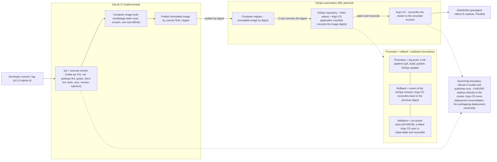

# Kubernetes and delivery design

**Scope separation:** application source and Helm packaging are developed here; cluster-wide prerequisites (Vault
issuer, cert-manager, trust-manager, Cilium Gateway/LB configuration, DNS, GitLab Agent access) are handled in a
separate cluster operations track.

**Status:** This document describes the **target design** for the Kubernetes deployment (Milestones 7A and 7B)
and the GitOps delivery pipeline (Milestone 8). None of these milestones are implemented yet. The Kubernetes
objects described below are **designed but not implemented** — the Helm chart, manifests, and Argo CD application
do not yet exist. The application code that will run in these pods (Milestones 0–5A) is **implemented and
locally tested** but has not been deployed to Kubernetes.

## Kubernetes objects planned

| Object | Function |
| --- | --- |
| StatefulSet | N replicas, stable names, `Parallel` startup, no PVC templates |
| `emptyDir` | Pod-lifetime writable SQLite directory |
| Headless Service | Direct peer addresses, named gossip port, publish not-ready pods |
| ClusterIP Service | User-facing HTTP routing to ready pods |
| Gateway / HTTPRoute | Browser HTTPS termination with Vault-issued cert |
| cert-manager Certificate | Managed browser TLS Secret for Gateway |
| cert-manager CSI volume | Unique short-lived mTLS certificate per pod |
| ConfigMap | Non-secret cluster metadata/epoch and incident history reference |
| ServiceAccount / Role / RoleBinding | Minimum metadata update permission only if app controls epochs |
| NetworkPolicy | Later restriction of peer traffic and ingress |

## Ownership boundaries

GossipGrid is one component in a larger delivery stack. Each system owns a distinct set of resources; no
resource is owned by more than one system. The GossipGrid Helm chart does **not** create foundational cluster
resources; those are pre-existing prerequisites owned by the cluster operations track.

| System | Owns | Does not own |
| --- | --- | --- |
| **Ansible** | Kubernetes cluster, nodes, network plugins (Cilium), base system packages, cluster DNS | GossipGrid workloads, Vault, cert-manager, VSO, Argo CD, GitLab CI |
| **Vault** | PKI (workload CA and browser CA roles, certificate issuance), application credential authority (KV v2 secret path for the GossipGrid admin password) | Kubernetes Secrets, GossipGrid workloads, cert-manager configuration |
| **Vault Secrets Operator (VSO)** | Synchronizes Vault KV v2 secrets to Kubernetes Secrets (the GossipGrid authentication Secret) | Vault configuration, GossipGrid workloads, cert-manager |
| **cert-manager** | Certificate issuance and rotation (workload mTLS via CSI, browser TLS via Certificate resource) | Vault roles, VSO, GossipGrid workloads, Argo CD |
| **Helm** | GossipGrid resource templates (StatefulSet, Services, NetworkPolicy, cert-manager Certificate/Issuers, ServiceAccount/Role/RoleBinding) | Cluster-wide prerequisites, Vault, VSO, Argo CD, GitLab CI |
| **Argo CD** | Application deployment reconciliation (watches the GitOps repository, syncs the cluster to the recorded desired state) | GitLab CI, Helm templates, Vault, VSO |
| **GitLab CI** | Build, test, publish (QA, container build, image publish by digest, GitOps revision commit) | Deployment to the cluster (that is Argo CD's job), Helm templates, Vault |

The GossipGrid Helm chart creates **only** the resources in the "Kubernetes objects planned" table above. It
does not install or configure Cilium, cert-manager, Vault, VSO, or the cluster DNS.

## Milestone 7A vs. 7B

**Milestone 7A (initial Kubernetes staging)** validates the Kubernetes plumbing — DNS, peer mTLS, Gateway,
VSO, cert-manager — plus existing gossip, anti-entropy, peer discovery, web authentication, and live password
rotation, with **lifecycle enforcement disabled** (`GOSSIPGRID_LIFECYCLE_ENABLED=false`, the default).
This means the staging phase has **reduced safety guarantees**: a pod replacement loses its local SQLite data
and is re-reconciled by anti-entropy (a best-effort test, **not** an authoritative-snapshot guarantee). In
7A there is no authoritative epoch fencing, no snapshot-source eligibility check, and no recovery lockout,
and pod replacement is **not** validated as authoritative initial snapshot synchronization, safe genesis, or
lifecycle readiness gating — those guarantees belong to 5B and 7B. The reduced guarantees are an intentional
tradeoff to validate the Kubernetes infrastructure before enabling the lifecycle layer.

**Milestone 7B (lifecycle-aware Kubernetes staging)** enables lifecycle enforcement
(`GOSSIPGRID_LIFECYCLE_ENABLED=true`) and exercises the full 5A/5B/5C protocol in-cluster: authoritative
metadata and epoch fencing, safe genesis and initial synchronization, recovery authorization and stale-state
rejection, and fail-closed, partition, and catastrophic-recovery tests. The lifecycle state machine, durable
fencing, and authorization/readiness decisions are in [lifecycle-recovery](diagrams/generated/lifecycle-recovery.svg);
the replacement-pod initialization and stale-epoch rejection flow is in
[lifecycle-recovery-sequence](diagrams/generated/lifecycle-recovery-sequence.svg).

## Failure-safe probes

- **Liveness:** server/event loop is alive. Peer outage must not trigger restart storms.
- **Readiness:** local storage usable, required TLS material available, and initial synchronization complete for this
  epoch. DNS peer Service still exposes unready peers, but web Service does not.
- **Startup:** accommodates time for CSI issuance and the initial snapshot without premature liveness restarts.
- During a total-loss lockout no ready web endpoints may exist; diagnostics available via direct pod port-forward and
  logs/events.

## Browser load balancing

Target is **Cilium Gateway API** with a LAN-reachable LoadBalancer IP. Verify the local Cilium version, Gateway
support, LB IPAM, and L2 announcements or an alternative advertisement mode. Do not assume Cilium deployment
automatically enables these capabilities. The Gateway serves Vault-issued HTTPS; the upstream application listener is
initially HTTP on `8080`.

A browser refresh can land on another ready replica. UI explicitly displays which replica responded, helping illustrate
load balancing and replication lag. Session affinity is intentionally not required for v1.

## Peer communication

`gossipgrid-<ordinal>.gossipgrid-headless.<namespace>.svc.<cluster-domain>` identifies each StatefulSet pod.
Never assume `cluster.local` if the cluster DNS domain differs. Headless DNS serves discovery; actual source
validity is established by the private status API and mutual TLS, not by DNS results alone.

## Browser credential provisioning (Milestone 6, deployed in 7A)

Milestone 6 (implemented) adds single-administrator password authentication for the public message API and the
browser UI. It is **deployed in Milestone 7A** with the following credential-provisioning configuration. The
code and the credential file format are implemented and tested locally; the Kubernetes objects below (Vault KV v2
secret, VSO, the mounted Secret volume, and the env-var wiring) are **designed but not implemented** and will be
added in 7A.

**Expected mounted credential format (the same file as local development).** The GossipGrid credential file is a
single JSON document (format version 1, algorithm `PBKDF2-HMAC-SHA-256`) with hex-encoded binary fields:
`format_version`, `algorithm`, `iterations`, `salt` (32 bytes), `verifier` (32 bytes, the PBKDF2 output),
`generation` (a counter incremented on every rotation), and `signing_key` (32 bytes, the shared HMAC-SHA256
session-signing key). See [security.md](security.md) for the full format and the rotation semantics. The
plaintext password is never stored in this file.

**Provisioning path (7A).**

1. **Vault KV v2** (secret path `gossipgrid/admin`) holds the versioned credential file (the JSON above). Vault is
   the credential authority; the file is provisioned from Vault, not hand-authored into the cluster.
2. **Vault Secrets Operator (VSO)** synchronizes that Vault secret to a **Kubernetes Secret** (e.g.
   `gossipgrid-auth`) in the GossipGrid namespace.
3. The Secret is **mounted read-only** into every GossipGrid pod as a **full Secret volume** (e.g. at
   `/credentials/admin`). The credential file is one file in that volume; **`subPath` is never used** — a
   `subPath` mount does not honor projected-Secret rotation updates and would pin the pod to the initial file
   version. A full volume allows the kubelet to atomically swap in the updated file on rotation.
4. The pod reads the file at the path named by the `GOSSIPGRID_AUTH_CREDENTIAL_FILE` environment variable
   (default `/credentials/admin` in 7A). The credential material is **never delivered through environment
   variables** — only the path is an env var; the file is the sole source of credential material.

**Configuration (Helm values → env vars, 7A).**

| Env var | Meaning | Default |
| --- | --- | --- |
| `GOSSIPGRID_AUTH_ENABLED` | Enable browser password authentication (enabled by default) | `true` |
| `GOSSIPGRID_AUTH_INSECURE_DEV_MODE` | Insecure, **local-development-only** opt-out (unauthenticated endpoints) | `false` |
| `GOSSIPGRID_AUTH_CREDENTIAL_FILE` | Path to the mounted credential file | `/credentials/admin` |
| `GOSSIPGRID_AUTH_RELOAD_INTERVAL` | Poll interval for credential reload | `2s` |
| `GOSSIPGRID_AUTH_MAX_STALE` | Bounded stale-credential window before 503 | `5m` |
| `GOSSIPGRID_AUTH_SESSION_TTL` | Absolute session lifetime | `24h` |
| `GOSSIPGRID_AUTH_SESSION_IDLE_TTL` | Session idle timeout (must be ≤ session TTL) | `30m` |
| `GOSSIPGRID_AUTH_COOKIE_SECURE` | Whether the session cookie is `Secure` | `true` |

Authentication is **enabled by default** (`GOSSIPGRID_AUTH_ENABLED=true`): the browser/API endpoints require a
session, and `/healthz` and `/readyz` remain unauthenticated. With it enabled and the credential file absent or
malformed, the endpoints **fail closed** (503) — there is no silent anonymous access. Setting
`GOSSIPGRID_AUTH_INSECURE_DEV_MODE=true` (or `GOSSIPGRID_AUTH_ENABLED=false`) is an **explicit, insecure opt-out**
intended only for the earliest 7A smoke tests before the Vault/VSO path is wired; it must never be used in a
network-reachable or production deployment.

**Compatibility notes (already satisfied by M6, to be exercised in 7A).**

- **Vault KV v2 + VSO:** the credential file is a single file in the Secret; VSO's update triggers a kubelet
  atomic swap. No per-key projection or multi-Secret aggregation is required.
- **K8s Secret volume mounts (no subPath):** the poll-based reloader relies on the kubelet's atomic full-volume
  swap to observe a complete old or new file — never a torn read.
- **Automatic mounted-Secret refresh:** the reloader polls every 2s (default) and atomically publishes a new
  immutable credential snapshot on a valid reload; a failed/malformed reload preserves the previous snapshot and
  degrades to 503 after the bounded `MAX_STALE` window.
- **5 StatefulSet replicas:** all replicas read the same mounted file, so they share the same `generation` and
  `signing_key`; a single login is valid on every replica (verified by the 5-replica test, see below).
- **Cilium Gateway TLS termination:** the Gateway terminates HTTPS for the browser; the `Secure` cookie flag
  (`GOSSIPGRID_AUTH_COOKIE_SECURE=true`) is correct because the browser only ever sees the app over HTTPS.
- **No pod restart for rotation:** VSO → kubelet atomic file swap + poll-based reload means rotation applies
  **without restarting any pod or process**. Propagation across replicas is eventual (each replica loads on its
  own poll cycle), but there is **no overlap window**: once a replica has loaded the new generation, it rejects
  old-generation sessions immediately; the `MAX_STALE` window (5m) bounds the "stuck in a bad state" → 503
  signal, not a session-overlap window.

**Local development (already implemented, no Kubernetes).** Provision a local credential file with the
`gossipgrid credential` CLI — `init` (create; interactive hidden prompts with confirmation, no password in
process arguments, 0600 atomic write), `rotate` (increment the generation; optionally a new signing key via
`--new-signing-key`), and `verify` (test a password against the file) — and point
`GOSSIPGRID_AUTH_CREDENTIAL_FILE` at it; the same code path reads the file. See [security.md](security.md) for
the exact commands and the local-HTTPS/testing guidance.

## Container and CI/CD

- Build using Go, CGO, and static musl/SQLite linkage in a builder image; final runtime `scratch`.
- Use a Makefile as the single command interface: `fmt`, `vet`, `test`, `test-race`, `build`, `image`, `qa`,
  `helm-lint`, `integration` as they become relevant.
- GitLab CI: QA -> integration -> image build/push -> Helm lint/template -> controlled Helm deploy (initially
  manual/protected).
- Tag with immutable commit SHA and record image digests; do not use `latest` as a deployment identity.
- Helm values: replica count, namespace, image, resources, ports, issuer references, CA bundles, sync timings, and
  intended reset policy. Keep secrets out of source.
- Implement manifests only after app behavior and local integration tests pass.

## GitOps delivery (Milestone 8 — designed, not implemented)

The delivery pipeline uses GitOps: GitLab CI builds and publishes, a GitOps repository records the desired
state, and Argo CD reconciles the cluster. CI does **not** deploy directly to the cluster. The full pipeline —
commit/tag, CI QA and security checks, immutable image publication by digest, GitOps revision update, Argo CD
reconciliation, and the promotion/rollback/validation boundary — is illustrated in
[gitops-delivery](diagrams/generated/gitops-delivery.svg) ([PNG](diagrams/generated/gitops-delivery.png)).

```text
GitLab CI (build + test + publish)
    |
    |  publishes immutable image by digest
    v
Container registry
    |
    |  records image digest in GitOps repository
    v
GitOps repository (Helm values / Argo CD application manifest)
    |
    |  Argo CD watches and reconciles
    v
Kubernetes cluster
```

- **GitLab CI** runs QA, builds the container, and pushes an immutable image tagged by commit SHA. The image
  digest is recorded.
- **The GitOps repository** (a separate repository from the application source) contains the Helm values and
  the Argo CD application manifest referencing the image digest. A GitLab CI job commits the new digest to
  this repository.
- **Argo CD** watches the GitOps repository and reconciles the cluster to the recorded desired state. Argo CD
  handles rollout, rollback, and failure recovery.
- **Release promotion** is a tag push: `v0.1.0-alpha.N` triggers a full pipeline (QA, build, publish, GitOps
  update). **Rollback** is a revert of the GitOps revision (Argo CD reconciles back to the previous digest).
  **Failure handling** is observable: a failed Argo CD sync is visible in the Argo CD UI and in the GitOps
  repository's commit history.

The full GitOps delivery pipeline — the ownership boundary between CI (build/publish only) and Argo CD
(deployment reconciliation), the promotion/rollback/validation boundary, and the StatefulSet rollout — is
shown below (the authoritative `gitops-delivery.mmd` source embedded natively).

<!-- DIAGRAM:gitops-delivery -->


## Tests to demonstrate

**Milestone 7A (lifecycle disabled, reduced safety guarantees):**

1. Five pods gossip to convergence under normal operation.
2. A pod replacement loses local SQLite and is re-reconciled by anti-entropy (a best-effort test; **not** an
   authoritative initial-snapshot, safe-genesis, or readiness-gating guarantee — those are 5B/7B).
3. A temporary partition causes missing/unreachable status, then heals via anti-entropy.
4. Reload pod mTLS credentials as cert-manager rotates them.
5. Gateway serves browser HTTPS with the trusted Vault CA certificate.
6. Live password-rotation demonstration without pod restarts (VSO → mounted Secret → credential reload;
   eventual, not instantaneous — the rotation window is measured, not assumed).

**Milestone 7B (lifecycle enabled, full safety guarantees):**

1. Scale 5 → 7; newly added pods synchronize before becoming ready (snapshot-source eligibility enforced;
   `SYNCING` pods are never eligible as bootstrap data sources).
2. All pods lose data; reset fails closed until authorized (5C operator procedure); incident remains visible
   afterward.
3. Stale-epoch pods are rejected as sync sources (epoch fencing + response envelope validation).
4. Fail-closed behavior when the ConfigMap is absent or unwatchable (5B).

**Milestone 8 (GitOps delivery):**

1. A pushed tag produces an immutable image by digest.
2. The GitOps revision is updated by digest; Argo CD reconciles the cluster to the recorded revision.
3. A failed Argo CD sync is observable and reversible; CI never deploys directly to the cluster.

## Cluster references

- [Kubernetes StatefulSets](https://kubernetes.io/docs/concepts/workloads/controllers/statefulset/)
- [Kubernetes headless Services and DNS](https://kubernetes.io/docs/concepts/services-networking/service/)
- [Kubernetes `emptyDir` volumes](https://kubernetes.io/docs/reference/storage/volumes/#emptydir)
- [cert-manager CSI driver](https://cert-manager.io/docs/usage/csi-driver/)
- [cert-manager Vault Issuer](https://cert-manager.io/docs/configuration/vault/)
- [Gateway API TLS guide](https://gateway-api.sigs.k8s.io/guides/user-guides/tls/)
- [Cilium L2 announcement documentation](https://docs.cilium.io/en/stable/network/l2-announcements/)
