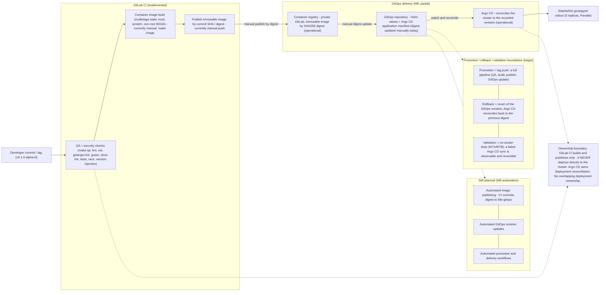

# Kubernetes and delivery design

**Scope separation:** application source and Helm packaging are developed here; cluster-wide prerequisites (Vault
issuer, cert-manager, trust-manager, Cilium Gateway/LB configuration, DNS, GitLab Agent access) are handled in a
separate cluster operations track.

**Status:** This document describes the **target design** for the Kubernetes deployment (Milestones 7A and 7B)
and the GitOps delivery pipeline (Milestone 8). Milestone 7A (initial Kubernetes staging) is **deployed and
initially smoke-tested in Kubernetes**: the Helm chart (`deploy/helm/gossipgrid/`), Argo CD Application, Vault
provisioning document (`deploy/vault/PROVISIONING.md`), and a 14-test staging runbook
(`deploy/STAGING-RUNBOOK.md`) are committed (`v0.1.0-alpha.6`) and validated by `make qa` (helm-lint,
deploy-checks). Five StatefulSet replicas are running and ready with zero restarts; peer mTLS, DNS discovery,
browser HTTPS access through an existing shared Cilium Gateway, Vault-managed credentials, and the Go FIPS
module are confirmed. The **remaining acceptance tests** (cross-replica convergence, recovery after pod
replacement, live password rotation, fault tolerance) are pending. `deploy/argocd/application.yaml` is a
reusable example; the actual staging Application is maintained in the separate `k8s-gitops` repository with
environment-specific Helm values. The GossipGrid Helm chart sets `gateway.enabled=false`; the cluster uses an
existing shared Cilium Gateway and GitOps-managed HTTPRoutes. Milestone 7B (lifecycle-aware staging) and Milestone 9
(resilience/security lab) are **designed but not implemented**. Milestone 8 (GitOps delivery automation) is
**partially implemented**: immutable image publishing and Argo CD digest-pinned reconciliation work; automated
delivery and promotion are not complete. The application code that runs in the pods (Milestones 0–5A and 6) is
**implemented and locally tested** and deployed in the staging cluster.

## Kubernetes objects (Milestone 7A — charted in the Helm chart)

The table below lists the Kubernetes objects the GossipGrid Helm chart creates. The first nine rows are
**deployed and verified** (Milestone 7A, `v0.1.0-alpha.6`); the ConfigMap and RBAC objects are **not charted**
(they belong to Milestones 5B/5C and are intentionally absent from the 7A chart because the 7A pods do not
call the Kubernetes API).

| Object | Function | Status |
| --- | --- | --- |
| StatefulSet | 5 replicas, stable names, `Parallel` startup, no PVC templates | ✅ Deployed and verified |
| `emptyDir` | Pod-lifetime writable SQLite directory | ✅ Deployed and verified |
| Headless Service | Direct peer addresses, named gossip port, publish not-ready pods | ✅ Deployed and verified |
| ClusterIP Service | User-facing HTTP routing to ready pods | ✅ Deployed and verified |
| CiliumNetworkPolicy | Gateway reserved ingress identity (allows shared Gateway to reach web port) | ✅ Deployed and verified |
| cert-manager CSI volume | Unique short-lived mTLS certificate per pod | ✅ Deployed and verified |
| ConfigMap | Non-secret cluster metadata/epoch and incident history reference | 🔜 5B (not charted) |
| ServiceAccount / Role / RoleBinding | Minimum metadata update permission only if app controls epochs | ✅ Deployed (SA only; RBAC in 5B) |
| NetworkPolicy | Restriction of peer traffic and ingress | ✅ Deployed and verified |

## Ownership boundaries

GossipGrid is one component in a larger delivery stack. Each system owns a distinct set of resources; no
resource is owned by more than one system. The GossipGrid Helm chart does **not** create foundational cluster
resources; those are pre-existing prerequisites owned by the cluster operations track.

| System | Owns | Does not own |
| --- | --- | --- |
| **Ansible** | Kubernetes cluster, nodes, network plugins (Cilium), base system packages, cluster DNS | GossipGrid workloads, Vault, cert-manager, VSO, Argo CD, GitLab CI |
| **Vault** | PKI (workload CA and browser CA roles, certificate issuance), application credential authority (KV v2 secret path for the GossipGrid admin password) | Kubernetes Secrets, GossipGrid workloads, cert-manager configuration |
| **Vault Secrets Operator (VSO)** | Synchronizes Vault KV v2 secrets to Kubernetes Secrets (the GossipGrid authentication Secret) | Vault configuration, GossipGrid workloads, cert-manager |
| **cert-manager** | Certificate issuance and rotation (workload mTLS via CSI, browser TLS via Certificate resource) | Vault roles, VSO, GossipGrid workloads, Argo CD |
| **Helm** | GossipGrid resource templates (StatefulSet, Services, NetworkPolicy, cert-manager Certificate/Issuers, ServiceAccount/Role/RoleBinding) | Cluster-wide prerequisites, Vault, VSO, Argo CD, GitLab CI |
| **Argo CD** | Application deployment reconciliation (watches the GitOps repository, syncs the cluster to the recorded desired state) | GitLab CI, Helm templates, Vault, VSO |
| **GitLab CI** | Build, test, publish (QA, container build, image publish by digest, GitOps revision commit) | Deployment to the cluster (that is Argo CD's job), Helm templates, Vault |

The GossipGrid Helm chart creates **only** the charted resources in the "Kubernetes objects" table above
(the StatefulSet, Services, Gateway, HTTPRoute, cert-manager Certificate, NetworkPolicy, PDB, and
ServiceAccount). It does **not** install or configure Cilium, cert-manager, Vault, VSO, or the cluster
DNS.

## Milestone 7A vs. 7B

**Milestone 7A (initial Kubernetes staging)** validates the Kubernetes plumbing — DNS, peer mTLS, the shared
Cilium Gateway, VSO, cert-manager — plus existing gossip, anti-entropy, peer discovery, and web authentication,
with **lifecycle enforcement disabled** (`GOSSIPGRID_LIFECYCLE_ENABLED=false`, the default). The initial smoke
tests are confirmed: five replicas running and ready with zero restarts, peer discovery, HTTPS access, browser
login, Vault credentials, peer mTLS, and the Go FIPS module. The **remaining acceptance tests** (cross-replica
convergence, recovery after pod replacement, live password rotation, fault tolerance) are pending.
This means the staging phase has **reduced safety guarantees**: a pod replacement loses its local SQLite data
and is re-reconciled by anti-entropy (a best-effort test, **not** an authoritative-snapshot guarantee). In
7A there is no authoritative epoch fencing, no snapshot-source eligibility check, and no recovery lockout,
and pod replacement is **not** validated as authoritative initial snapshot synchronization, safe genesis, or
lifecycle readiness gating — those guarantees belong to 5B and 7B. The reduced guarantees are an intentional
tradeoff to validate the Kubernetes infrastructure before enabling the lifecycle layer.

**Deployment topology note:** The cluster uses an existing shared Cilium Gateway and GitOps-managed HTTPRoutes;
the GossipGrid Helm chart sets `gateway.enabled=false`. The browser certificate is managed separately in the
`gateway-system` namespace. The chart uses a CiliumNetworkPolicy for the Gateway's reserved ingress identity
(`fromEntities: [ingress]`). The Argo CD Application for the staging deployment is maintained in the separate
`k8s-gitops` repository with environment-specific Helm values; `deploy/argocd/application.yaml` in this
repository is a reusable example.

**Milestone 7B (lifecycle-aware Kubernetes staging)** enables lifecycle enforcement
(`GOSSIPGRID_LIFECYCLE_ENABLED=true`) and exercises the full 5A/5B/5C protocol in-cluster: authoritative
metadata and epoch fencing, safe genesis and initial synchronization, recovery authorization and stale-state
rejection, and fail-closed, partition, and catastrophic-recovery tests. The lifecycle state machine, durable
fencing, and authorization/readiness decisions are in [lifecycle-recovery](diagrams/generated/lifecycle-recovery.svg);
the replacement-pod initialization and stale-epoch rejection flow is in
[lifecycle-recovery-sequence](diagrams/generated/lifecycle-recovery-sequence.svg).

## Failure-safe probes

- **Liveness:** server/event loop is alive. Peer outage must not trigger restart storms.
- **Readiness:** local storage usable, required TLS material available, and (when the **initial-sync barrier** is
  enabled) the replica's initial anti-entropy synchronization against all expected peers is complete. `/readyz`
  returns 200 only when **both** the lifecycle authorizes readiness (or lifecycle is disabled) **and** the initial
  sync barrier is complete (or disabled); 503 otherwise, with `reason: "initial_sync_pending"` while the barrier is
  pending. DNS peer Service still exposes unready peers, but web Service does not.
- **Startup:** accommodates time for CSI issuance and the initial snapshot without premature liveness restarts.
- During a total-loss lockout no ready web endpoints may exist; diagnostics available via direct pod port-forward and
  logs/events.

## Browser load balancing

The staging deployment uses an **existing shared Cilium Gateway** (the GossipGrid chart sets
`gateway.enabled=false`). HTTPRoutes are managed in the `k8s-gitops` repository. The browser certificate is
managed separately in the `gateway-system` namespace. The Gateway serves HTTPS (the internal CA-issued
certificate is confirmed in the cluster); the upstream application listener is plain HTTP on `8080`.

A browser refresh can land on another ready replica. UI explicitly displays which replica responded, helping illustrate
load balancing and replication lag. Session affinity is intentionally not required for v1.

## Peer communication

`gossipgrid-<ordinal>.gossipgrid-headless.<namespace>.svc.<cluster-domain>` identifies each StatefulSet pod.
Never assume `cluster.local` if the cluster DNS domain differs. Headless DNS serves discovery; actual source
validity is established by the private status API and mutual TLS, not by DNS results alone.

## Synchronization-aware Kubernetes readiness

A replacement GossipGrid pod starts with an **empty** SQLite database (`emptyDir`). It recovers its messages
through anti-entropy from its peers. Without any gate, the pod becomes Ready as soon as its listeners are up —
**before** its message store is fully reconciled. A StatefulSet rolling update can therefore mark a replacement
Ready while it is still mid-recovery, increasing the risk that a later failure loses messages that were never
fully replicated.

The **initial anti-entropy synchronization barrier** (Milestone 7A enhancement) closes that gap with an opt-in
readiness gate: a new replica stays **NotReady** until it completes its **initial** anti-entropy
synchronization against **all** expected remote peers in the configured StatefulSet membership.

**Configuration.**

| Helm value | Env var | Default | Staging |
| --- | --- | --- | --- |
| `initialSync.enabled` | `GOSSIPGRID_INITIAL_SYNC_BARRIER_ENABLED` | `false` | `true` |

The barrier **requires** `antiEntropy.enabled=true`. Enabling the barrier without anti-entropy is rejected at
application load time (there would be no synchronization to gate on, and the pod would remain NotReady
indefinitely); the Helm template also fails rendering on that incompatible combination.

**How a completed sync is established.** The barrier reuses the existing per-peer cursor and completion
semantics of the anti-entropy engine. A pass for a peer counts as **complete** only when the engine observes a
**successful, complete full inventory pass** for that peer: the pagination reaches `has_more=false` with no
unresolved conflict and no error, and the full-sweep cursor is committed. The barrier's
`RecordComplete` is called from the engine's `syncPeer` at exactly that accounting point.

- A **successful empty inventory** (the peer responds with zero message IDs, `has_more=false` on the first
  page) **does** count as a complete pass.
- A **partial sweep** (`has_more` still true, the per-cycle page budget exhausted) does **not** count. The
  cursor resumes on the next cycle; the pass is recorded only when the sweep eventually completes.
- A **failed page**, a **stale DNS snapshot**, or **merely discovering** a peer does **not** count.
- A peer **outside the configured expected membership** (e.g. a stale record from a scaled-down cluster)
  does **not** count. The barrier is defined by the configured StatefulSet membership
  (`statefulset-name-<i>` for `i` in `0..replicas-1`), **not** by the current DNS record count.
- Readiness is **not** gated on replicating a fixed number of messages; it is gated on the **completion of the
  inventory pass** for each expected peer (the message fetch/insert happens within that same pass).

**Bounded, no auto-Ready.** The barrier is bounded: it waits for a full pass per peer, and large inventories
may complete over multiple anti-entropy cycles (the per-cycle page budget is finite, so a single cycle need not
sweep the whole inventory). The barrier has **no timeout** and **never** auto-marks a pod Ready because a
deadline elapsed — a pod stuck in initial sync stays NotReady until the barrier is genuinely satisfied or the
operator intervenes.

**One-shot (no readiness cascade).** Once the barrier is satisfied for this process start, it is complete and
stays complete. A transient peer outage **after** the pod is Ready does **not** re-open the barrier. The
barrier gates **initial** synchronization only; ordinary ongoing anti-entropy continues to run independently
and does not affect readiness.

**Readiness is a single logical combination.** `/readyz` returns 200 **only** when **both** hold:
(1) the lifecycle authorizes readiness (vacuously true when lifecycle enforcement is disabled, as in 7A), and
(2) the initial-sync barrier is complete (vacuously true when the barrier is disabled). This is a **single
handler** computing a logical combination — not two independent readiness handlers that can disagree. The
barrier **never** overrides a metadata/epoch/lockout/recovery/stopped lifecycle failure: a RECOVERY_REQUIRED or
stopped pod stays 503 even if the barrier is complete, and the reported reason is the lifecycle reason, not
`initial_sync_pending`. While the barrier is pending, the reason is `initial_sync_pending`.

**`/readyz` response.** While pending, `/readyz` returns 503 with `ready: false`, `reason:
"initial_sync_pending"`, and progress: `initial_sync_completed` (number of expected peers with a verified full
pass), `initial_sync_expected` (total expected remote peers), and `initial_sync_missing` (the peers still
outstanding). It never exposes credentials, private keys, or message contents. The readiness handler reads only
concurrency-safe in-memory state (one tracker status read, one lifecycle authorization snapshot) — **no
synchronous network requests or SQLite inventory scans**. `/healthz` semantics are preserved unchanged (always
200, liveness only). The web diagnostics endpoint (`GET /api/diagnostics`) also reports the barrier state.

**Bootstrap deadlock prevention.** The barrier must never depend on a peer being **Ready** to make progress.
It depends only on a **successful inventory response**, which a NotReady peer with its **peer listener up**
still serves. Concretely:

- An unready replica still **resolves peer identities** (discovery runs independently of readiness).
- An unready replica still **accepts mTLS peer connections** and serves the `/internal/sync/ids` and
  `/internal/sync/messages` endpoints (the private peer listener is **not** gated on readiness).
- The headless peer Service keeps **`publishNotReadyAddresses: true`**, so the DNS records for unready peers
  exist and can be dialed. This is what makes the first round of exchanges possible during a simultaneous
  startup: every replica, even while NotReady, is reachable over the peer port.
- A **single-replica** deployment (or an empty expected membership) has no remote peers, so the barrier is
  vacuously satisfied and the pod becomes Ready on its own.

This is verified by the integration test
`TestIntegrationInitialSyncFiveReplicasSimultaneousStartupNoDeadlock` (all 5 replicas start simultaneously with
empty databases and all become Ready without a deadlock) and
`TestIntegrationInitialSyncReplacementRecoversBeforeReady` (an empty replacement recovers all messages and
becomes Ready only after the barrier completes).

**Diagnosing a pod stuck in initial sync.**

```bash
# Port-forward to the pod and inspect /readyz (the scratch container has no curl;
# the JSONPath below shows the configured env vars; for live /readyz, use
# `kubectl port-forward` + a client, or the web diagnostics endpoint).
kubectl -n gossipgrid port-forward pod/gossipgrid-4 18080:8080
# then: http://localhost:18080/readyz
# while pending: {"ready":false,"reason":"initial_sync_pending","initial_sync_completed":2,
#                 "initial_sync_expected":4,"initial_sync_missing":["gossipgrid-1","gossipgrid-3"]}
```

The `initial_sync_missing` list names the peers the replica has not yet completed a full pass for. Common causes:
a peer that is genuinely down (its inventory fetch keeps failing — the barrier waits indefinitely, by design),
a peer with a very large inventory (the pass is still in progress, completing over multiple cycles), or a
network/TLS problem preventing the inventory exchange. Because the barrier has no timeout, a pod whose expected
peer never becomes reachable will remain NotReady; the operator must either restore the peer or temporarily
disable the barrier (set `initialSync.enabled: false`) and re-sync.

**Relationship to readiness, anti-entropy, and lifecycle.** The barrier is a *startup gate* on top of the
existing anti-entropy engine and lifecycle authorization. It does not change anti-entropy's protocol, cursors,
or scheduling; it only *observes* the engine's completed-pass accounting and *consumes* it as a readiness
input. It does not change lifecycle state; it is one of the two conditions the readiness handler combines. When
lifecycle enforcement is enabled (Milestone 7B/5B), the barrier and lifecycle are both consulted; when lifecycle
is disabled (7A), only the barrier gates readiness.

**How to disable it.** Set `initialSync.enabled: false` (the default in `values.yaml`) or remove
`GOSSIPGRID_INITIAL_SYNC_BARRIER_ENABLED` from the pod spec. With it disabled, `/readyz` returns 200 once the
listeners are up (the original 7A behavior) and the barrier imposes no constraint. This is a **per-deployment**
choice; all five replicas receive identical values from a single values file, so the barrier is either on or
off for the whole cluster.

**GitOps override (required to enable or disable in our deployment).** An Argo CD Application that uses only
`helm.valuesObject` (with no `helm.valueFiles`) does **not** automatically apply `values-staging.yaml` — the
staging values file is referenced in this repository's example Application via `helm.valueFiles`, but the actual
staging Application in the `k8s-gitops` repository may use only `helm.valuesObject`. If the staging Application
uses only `helm.valuesObject`, the barrier is **not** enabled by default (the `values.yaml` default
`initialSync.enabled: false` applies). To enable the barrier in our deployment, add an explicit GitOps override
in the Application's `helm.values` (or `helm.valuesObject`):

```yaml
spec:
  source:
    helm:
      values: |
        initialSync:
          enabled: true
```

Conversely, to disable the barrier in a deployment where `values-staging.yaml` is loaded (either via
`helm.valueFiles` in the Application or as part of the chart's default values), set an explicit
`initialSync.enabled: false` override at the same location where the staging values are applied:

```yaml
spec:
  source:
    helm:
      values: |
        initialSync:
          enabled: false
```

Do not rely on removing the override to disable the barrier: if `values-staging.yaml` is in effect (loaded via
`valueFiles`), removing the override leaves the staging value (`initialSync.enabled: true`) in force.

> **Status:** the barrier is **implemented and locally tested** (unit + 5-node integration test, see
> [development-plan.md](development-plan.md)). It is **enabled in the staging values file**
> (`values-staging.yaml`), but that file is only applied to the running deployment when the Argo CD Application
> references it (via `helm.valueFiles`); an Application using only `helm.valuesObject` does not apply it
> automatically, so the barrier in our deployment requires an explicit `initialSync.enabled: true` GitOps
> override. The barrier has **not yet been deployed and verified in the staging cluster** — the published image
> digest is unchanged. A simultaneous loss of every replica can still lose messages (ephemeral `emptyDir`
> storage); the barrier is a best-effort rollout barrier, not an atomic-snapshot guarantee.

## Browser credential provisioning (Milestone 6, deployed and verified in 7A)

Milestone 6 (implemented) adds single-administrator password authentication for the public message API and the
browser UI. It is **deployed and verified in the staging cluster** (Milestone 7A) with the following
credential-provisioning configuration. The code and the credential file format are implemented and tested
locally; the Kubernetes objects below (Vault KV v2 secret, VSO, the mounted Secret volume, and the env-var
wiring) are **deployed in the staging cluster** — Vault-managed credentials load successfully and browser
login is confirmed.

**Expected mounted credential format (the same file as local development).** The GossipGrid credential file is a
single JSON document (format version 1, algorithm `PBKDF2-HMAC-SHA-256`) with hex-encoded binary fields:
`format_version`, `algorithm`, `iterations`, `salt` (32 bytes), `verifier` (32 bytes, the PBKDF2 output),
`generation` (a counter incremented on every rotation), and `signing_key` (32 bytes, the shared HMAC-SHA256
session-signing key). See [security.md](security.md) for the full format and the rotation semantics. The
plaintext password is never stored in this file.

**Provisioning path (7A).**

1. **Vault KV v2** (secret path `gossipgrid/admin`) holds the versioned credential file (the JSON above). Vault is
   the credential authority; the file is provisioned from Vault, not hand-authored into the cluster.
2. **Vault Secrets Operator (VSO)** synchronizes that Vault secret to a **Kubernetes Secret** (e.g.
   `gossipgrid-auth`) in the GossipGrid namespace.
3. The Secret is **mounted read-only** into every GossipGrid pod as a **full Secret volume** (e.g. at
   `/credentials/admin`). The credential file is one file in that volume; **`subPath` is never used** — a
   `subPath` mount does not honor projected-Secret rotation updates and would pin the pod to the initial file
   version. A full volume allows the kubelet to atomically swap in the updated file on rotation.
4. The pod reads the file at the path named by the `GOSSIPGRID_AUTH_CREDENTIAL_FILE` environment variable
   (default `/credentials/admin` in 7A). The credential material is **never delivered through environment
   variables** — only the path is an env var; the file is the sole source of credential material.

**Configuration (Helm values → env vars, 7A).**

| Env var | Meaning | Default |
| --- | --- | --- |
| `GOSSIPGRID_AUTH_ENABLED` | Enable browser password authentication (enabled by default) | `true` |
| `GOSSIPGRID_AUTH_INSECURE_DEV_MODE` | Insecure, **local-development-only** opt-out (unauthenticated endpoints) | `false` |
| `GOSSIPGRID_AUTH_CREDENTIAL_FILE` | Path to the mounted credential file | `/credentials/admin` |
| `GOSSIPGRID_AUTH_RELOAD_INTERVAL` | Poll interval for credential reload | `2s` |
| `GOSSIPGRID_AUTH_MAX_STALE` | Bounded stale-credential window before 503 | `5m` |
| `GOSSIPGRID_AUTH_SESSION_TTL` | Absolute session lifetime (Go default is `2h`; Helm chart overrides to `24h`) | `24h` |
| `GOSSIPGRID_AUTH_SESSION_IDLE_TTL` | Session idle timeout (must be ≤ session TTL) | `30m` |
| `GOSSIPGRID_AUTH_COOKIE_SECURE` | Whether the session cookie is `Secure` | `true` |

Authentication is **enabled by default** (`GOSSIPGRID_AUTH_ENABLED=true`): the browser/API endpoints require a
session, and `/healthz` and `/readyz` remain unauthenticated. With it enabled and the credential file absent or
malformed, the endpoints **fail closed** (503) — there is no silent anonymous access. Setting
`GOSSIPGRID_AUTH_INSECURE_DEV_MODE=true` (or `GOSSIPGRID_AUTH_ENABLED=false`) is an **explicit, insecure opt-out**
intended only for the earliest 7A smoke tests before the Vault/VSO path is wired; it must never be used in a
network-reachable or production deployment.

**Compatibility notes (already satisfied by M6, to be exercised in 7A).**

- **Vault KV v2 + VSO:** the credential file is a single file in the Secret; VSO's update triggers a kubelet
  atomic swap. No per-key projection or multi-Secret aggregation is required.
- **K8s Secret volume mounts (no subPath):** the poll-based reloader relies on the kubelet's atomic full-volume
  swap to observe a complete old or new file — never a torn read.
- **Automatic mounted-Secret refresh:** the reloader polls every 2s (default) and atomically publishes a new
  immutable credential snapshot on a valid reload; a failed/malformed reload preserves the previous snapshot and
  degrades to 503 after the bounded `MAX_STALE` window.
- **5 StatefulSet replicas:** all replicas read the same mounted file, so they share the same `generation` and
  `signing_key`; a single login is valid on every replica (verified by the 5-replica test, see below).
- **Cilium Gateway TLS termination:** the Gateway terminates HTTPS for the browser; the `Secure` cookie flag
  (`GOSSIPGRID_AUTH_COOKIE_SECURE=true`) is correct because the browser only ever sees the app over HTTPS.
- **No pod restart for rotation:** VSO → kubelet atomic file swap + poll-based reload means rotation applies
  **without restarting any pod or process**. Propagation across replicas is eventual (each replica loads on its
  own poll cycle), but there is **no overlap window**: once a replica has loaded the new generation, it rejects
  old-generation sessions immediately; the `MAX_STALE` window (5m) bounds the "stuck in a bad state" → 503
  signal, not a session-overlap window.

**Local development (already implemented, no Kubernetes).** Provision a local credential file with the
`gossipgrid credential` CLI — `init` (create; interactive hidden prompts with confirmation, no password in
process arguments, 0600 atomic write), `rotate` (increment the generation; optionally a new signing key via
`--new-signing-key`), and `verify` (test a password against the file) — and point
`GOSSIPGRID_AUTH_CREDENTIAL_FILE` at it; the same code path reads the file. See [security.md](security.md) for
the exact commands and the local-HTTPS/testing guidance.

**Message retention (Helm-exposed; staging enablement prepared).** Message retention is **disabled by
default** in the Helm chart (`messageRetention.enabled: false`). The chart exposes the existing application
environment variables through a `messageRetention` values section. No ConfigMap or Secret is created; the
settings are non-sensitive and are rendered directly as environment variables in the StatefulSet pod spec.

| Helm value | Default | Env var rendered | Notes |
| --- | --- | --- | --- |
| `messageRetention.enabled` | `false` | (none when false) | When `true`, the retention env vars below are emitted |
| `messageRetention.ttl` | `""` | `GOSSIPGRID_MESSAGE_RETENTION_TTL` | Go duration string (e.g. `168h`). Must be positive when enabled (min 1m) |
| `messageRetention.interval` | `""` (app default 1h) | `GOSSIPGRID_MESSAGE_RETENTION_INTERVAL` | Sweep period; 1s–24h. Omit to use the application default |
| `messageRetention.maxSweepRows` | `0` (app default 5000) | `GOSSIPGRID_MESSAGE_RETENTION_MAX_SWEEP_ROWS` | Rows per sweep; 0 = app default. Emitted only when > 0 |
| `messageRetention.maxSweepDuration` | `""` (app default 10s) | `GOSSIPGRID_MESSAGE_RETENTION_MAX_SWEEP_DURATION` | Wall-clock cap per sweep; 0 = app default. Emitted only when non-empty |

**Staging 7-day policy.** The staging values file (`values-staging.yaml`) enables retention with `ttl: "168h"`
and `interval: "1h"`, leaving the sweep budgets at application defaults (5000 rows / 10s). The GitOps
Application's `valuesObject` carries the same `messageRetention` block so Argo CD applies it to all five
replicas.

**Rolling update behaviour.** Enabling retention adds new environment variables to the StatefulSet pod spec.
Kubernetes detects the spec change and performs a StatefulSet rolling update: each pod is terminated and
replaced. Because `/data` uses `emptyDir`, each replacement pod starts with a fresh (empty) SQLite database.
The pod recovers its messages through anti-entropy from its peers.

**Initial anti-entropy synchronization barrier (Milestone 7A enhancement).**
The 7A chart addresses the recovery-latency concern above with an **opt-in initial-sync readiness barrier**
(enabled in `values-staging.yaml`, disabled by default in `values.yaml`). When enabled
(`GOSSIPGRID_INITIAL_SYNC_BARRIER_ENABLED=true`), a replacement pod remains **NotReady** (HTTP 503 from
`/readyz`) until it has completed its **initial** anti-entropy synchronization against **all** expected remote
peers in the configured StatefulSet membership. Kubernetes therefore waits for each replacement to finish this
recovery before marking it Ready, reducing the risk of message loss from an incompletely recovered predecessor
during a rolling update. The barrier is **one-shot** and **in-memory**: it begins pending on every process start
and is satisfied when a successful, complete full inventory pass has been observed for every expected remote
peer (an empty inventory that responds successfully counts as a complete pass; a partial sweep, a failed page,
or a peer that is still merely being discovered does **not** count). Once satisfied, a transient peer outage
does **not** re-open it (no readiness cascade). The barrier imposes **no timeout** — a pod is never auto-marked
Ready because a deadline elapsed. See [Synchronization-aware Kubernetes readiness](#synchronization-aware-kubernetes-readiness)
below for the full semantics, what it guarantees and does not, and how to disable it.

> **What it is and is not.** The completed pass is a **useful rollout barrier**, not a **mathematically atomic
> cluster snapshot**: messages written to a peer after that peer's last full sweep is observed will not be in the
> replacement's local store until the next anti-entropy cycle runs. This remains a **best-effort, ephemeral-storage
> architecture** (`emptyDir`): a simultaneous loss of every replica can still lose messages. The barrier improves
> the *probability* of recovery during a rolling update; it does not provide a recovery guarantee.

**Verification (on `ansible.lan`).** After the Argo CD sync completes:

```bash
# Argo CD application state (expect Synced/Healthy).
argocd app get gossipgrid --server https://argocd.k8s.lan:443 --insecure --grpc-web

# Five healthy StatefulSet replicas.
kubectl -n gossipgrid get statefulset gossipgrid
kubectl -n gossipgrid get pods -l app.kubernetes.io/component=peer

# Exact published image digest unchanged.
kubectl -n gossipgrid get pods -l app.kubernetes.io/component=peer -o jsonpath='{.items[*].spec.containers[0].image}'

# Retention environment variables configured on the pod spec.
# GossipGrid runs in a `scratch` container with no shell utilities, so
# `kubectl exec -- env` and `kubectl exec -- curl` cannot be used. Inspect
# the configured environment variables via JSONPath on the pod spec instead.
kubectl -n gossipgrid get pod gossipgrid-0 -o jsonpath='{.spec.containers[0].env[?(@.name=="GOSSIPGRID_MESSAGE_RETENTION_TTL")].value}'
echo
kubectl -n gossipgrid get pod gossipgrid-0 -o jsonpath='{.spec.containers[0].env[?(@.name=="GOSSIPGRID_MESSAGE_RETENTION_INTERVAL")].value}'
echo

# Successful cleaner startup (expect an initial sweep log line shortly after start).
kubectl -n gossipgrid logs gossipgrid-0 | grep -i 'retention'

# SQLite maintenance logs without unexpected failures (expect DEBUG-level
# maintenance cycle lines, no WARN/ERROR for retention).
kubectl -n gossipgrid logs gossipgrid-0 | grep -iE 'retention.*(fail|error)' || echo "No retention failures"

# Message creation and replication still functioning (authenticated request).
# The scratch container has no shell or curl; use the existing authenticated
# browser interface at https://gossipgrid.k8s.lan to create a test message
# (body: "retention-verify") and confirm it appears in the message list.
# The browser UI displays which replica responded, illustrating load
# balancing and replication lag.

# No unusual restarts (RESTARTS column should be low/stable).
kubectl -n gossipgrid get pods -l app.kubernetes.io/component=peer
```

**Testing the 7-day TTL.** A seven-day TTL cannot be fully expiration-tested immediately with newly created
messages. The existing unit and integration tests validate the expiration logic (threshold computation,
`DeleteExpired` batching, maintenance). A destructive end-to-end test (create a message, wait for
expiration, verify deletion) requires a very short TTL (e.g. 1m) in an isolated single-replica environment —
**never** the five-replica staging deployment.

**Disabling retention through GitOps.** Because `values-staging.yaml` sets `messageRetention.enabled: true`
with `ttl: "168h"`, simply removing a GitOps override does **not** disable retention — the staging values
file still applies the enabled policy. To disable retention, **explicitly set** `messageRetention.enabled:
false` in the GitOps Application's `helm.values` (or in a `valuesObject` override) to override the staging
value. For example, in the Argo CD Application manifest:

```yaml
spec:
  source:
    helm:
      releaseName: gossipgrid
      valueFiles:
        - values-staging.yaml
      values: |
        messageRetention:
          enabled: false
```

The explicit `enabled: false` in the GitOps Application's `values` field takes precedence over the
`values-staging.yaml` value (Helm applies `--set`-equivalent `values` after `valueFiles`). Argo CD will
reconcile the StatefulSet, removing the retention env vars and triggering another rolling update. After
the update, no cleaner runs and messages are retained indefinitely (the application default when the TTL
variable is unset). Do not simply remove the override — that would leave the staging `values-staging.yaml`
value in effect and retention would remain enabled.

**SQLite maintenance observability and limitations.** When retention is enabled, each sweep runs bounded
maintenance: `PRAGMA incremental_vacuum(100)` (reclaims up to 100 freelist pages) and
`PRAGMA wal_checkpoint(PASSIVE)` (non-blocking checkpoint). `journal_size_limit` is set to 64 MiB.
New databases are created with `auto_vacuum=INCREMENTAL`; existing databases (created before this feature)
are not silently converted. Observability is via structured log lines at INFO (deletions) and DEBUG
(maintenance stats: pages reclaimed, freelist counts, database/WAL sizes, checkpoint status). A failed
checkpoint or reclamation is logged as a WARNING but does not stop the cleaner (retried on the next sweep).
The `TotalDeleted()` and `TotalPagesReclaimed()` counters are available for diagnostics.

## Container and CI/CD

- Build using Go, CGO, and static musl/SQLite linkage in a builder image; final runtime `scratch`.
- Use a Makefile as the single command interface: `fmt`, `vet`, `test`, `test-race`, `build`, `image`, `qa`,
  `helm-lint`, `integration` as they become relevant.
- GitLab CI: QA -> integration -> image build/push -> Helm lint/template -> controlled Helm deploy (initially
  manual/protected).
- Tag with immutable commit SHA and record image digests; do not use `latest` as a deployment identity.
- Helm values: replica count, namespace, image, resources, ports, issuer references, CA bundles, sync timings, and
  intended reset policy. Keep secrets out of source.
- Implement manifests only after app behavior and local integration tests pass.

## GitOps delivery (Milestone 8 — partial: immutable image + Argo CD work; automation incomplete)

The delivery pipeline uses GitOps: GitLab CI builds and publishes, the `k8s-gitops` repository records the
desired state, and Argo CD reconciles the cluster. CI does **not** deploy directly to the cluster.
In the staging cluster, an immutable image from the private GitLab registry is deployed through Argo CD with
digest-pinned reconciliation. **Current state (partial):** the image was built manually with `make image` and
pushed to the private GitLab Container Registry, identified by an immutable SHA256 digest. The GitOps
Application in `k8s-gitops` was manually updated to reference that digest, and Argo CD reconciled the
Kubernetes deployment. What remains: automated image publishing, automated GitOps revision updates, and the
promotion/rollback procedure. The full pipeline — CI QA and security checks, immutable image publication by
digest, GitOps revision update, Argo CD reconciliation, and the promotion/rollback/validation boundary — is
illustrated in
[gitops-delivery](diagrams/generated/gitops-delivery.svg) ([PNG](diagrams/generated/gitops-delivery.png)).

```text
GitLab CI (QA + security checks)
    |
    |  (image build/publish is currently manual: make image + docker push)
    v
Container registry (private GitLab) - immutable image by SHA256 digest
    |
    |  (digest recorded manually in the GitOps repository today)
    v
GitOps repository (Helm values / Argo CD application manifest)
    |
    |  Argo CD watches and reconciles (operational)
    v
Kubernetes cluster
```

- **GitLab CI** runs QA and security checks. Container image build and publish are currently **manual**
  (`make image` followed by a push to the private GitLab Container Registry); automated CI-driven publishing
  is not yet implemented.
- **The GitOps repository** (a separate repository from the application source) contains the Helm values and
  the Argo CD application manifest referencing the image digest. The digest reference is currently updated
  **manually**; a CI job that commits the new digest automatically is not yet implemented.
- **Argo CD** watches the GitOps repository and reconciles the cluster to the recorded desired state. Argo CD
  handles rollout, rollback, and failure recovery. This part is **operational** in the staging cluster.
- **Release promotion** (target): a tag push triggers a full pipeline (QA, build, publish, GitOps update).
  **Rollback** (target): a revert of the GitOps revision; Argo CD reconciles back to the previous digest.
  **Failure handling**: a failed Argo CD sync is observable and reversible in the Argo CD UI and in the
  GitOps repository's commit history.

The full GitOps delivery pipeline — the ownership boundary between CI (build/publish only) and Argo CD
(deployment reconciliation), the promotion/rollback/validation boundary, and the StatefulSet rollout — is
shown below (the authoritative `gitops-delivery.mmd` source embedded natively).

<!-- DIAGRAM:gitops-delivery -->


## Tests to demonstrate

**Milestone 7A (lifecycle disabled, reduced safety guarantees) — initial smoke tests confirmed, full acceptance
tests pending:**

1. Five pods running and ready with zero restarts, distributed across two worker nodes. ✅
2. Kubernetes DNS peer discovery showing four remote peers plus the local replica. ✅
3. HTTPS access at `gossipgrid.k8s.lan` through the shared Cilium Gateway. ✅
4. Working browser login and authenticated dashboard. ✅
5. Vault-managed authentication credentials loaded successfully. ✅
6. Peer mTLS enabled with per-pod certificate configuration. ✅
7. Go FIPS module v1.0.0 enabled in the running application. ✅
8. An immutable container image deployed from a private GitLab registry through Argo CD. ✅
9. Five pods gossip to convergence under normal operation. 🔜 Pending
10. A pod replacement loses local SQLite and is re-reconciled by anti-entropy (a best-effort test; **not** an
    authoritative initial-snapshot, safe-genesis, or readiness-gating guarantee — those are 5B/7B). 🔜 Pending
11. A temporary partition causes missing/unreachable status, then heals via anti-entropy. 🔜 Pending
12. Reload pod mTLS credentials as cert-manager rotates them. 🔜 Pending
13. Live password-rotation demonstration without pod restarts (VSO → mounted Secret → credential reload;
    eventual, not instantaneous — the rotation window is measured, not assumed). 🔜 Pending

**Milestone 7B (lifecycle enabled, full safety guarantees):**

1. Scale 5 → 7; newly added pods synchronize before becoming ready (snapshot-source eligibility enforced;
   `SYNCING` pods are never eligible as bootstrap data sources).
2. All pods lose data; reset fails closed until authorized (5C operator procedure); incident remains visible
   afterward.
3. Stale-epoch pods are rejected as sync sources (epoch fencing + response envelope validation).
4. Fail-closed behavior when the ConfigMap is absent or unwatchable (5B).

**Milestone 8 (GitOps delivery):**

1. An immutable image is built with `make image` and published to the private GitLab Container Registry by
   SHA256 digest (✅ done in staging — manual, not tag-triggered).
2. The GitOps Application references the published digest; Argo CD reconciles the cluster to the recorded
   revision (✅ done in staging — manual digest update, not automated).
3. Automated image publishing (CI commits the digest to k8s-gitops) (🔜 pending).
4. A failed Argo CD sync is observable and reversible; CI never deploys directly to the cluster.

## Cluster references

- [Kubernetes StatefulSets](https://kubernetes.io/docs/concepts/workloads/controllers/statefulset/)
- [Kubernetes headless Services and DNS](https://kubernetes.io/docs/concepts/services-networking/service/)
- [Kubernetes `emptyDir` volumes](https://kubernetes.io/docs/reference/storage/volumes/#emptydir)
- [cert-manager CSI driver](https://cert-manager.io/docs/usage/csi-driver/)
- [cert-manager Vault Issuer](https://cert-manager.io/docs/configuration/vault/)
- [Gateway API TLS guide](https://gateway-api.sigs.k8s.io/guides/user-guides/tls/)
- [Cilium L2 announcement documentation](https://docs.cilium.io/en/stable/network/l2-announcements/)
