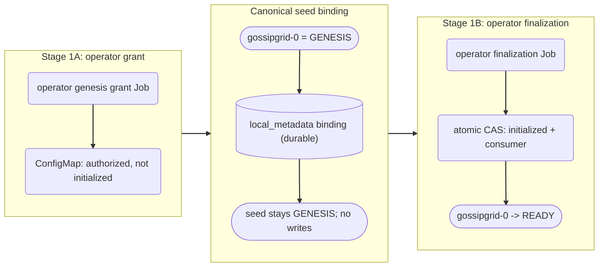

# Lifecycle metadata authority, genesis, and bootstrap (Milestone 5B — corrected design)

**Status:** Corrected target design. The original 5B plan was reviewed and its overall
direction accepted, but several safety assumptions were found to be wrong and are corrected
here. This document is the authoritative statement for the metadata authority, the one-time
genesis contract, the Kubernetes RBAC, the bootstrap replication admission, the
transient-versus-catastrophic failure model, the `EverAcceptedMessages` durable marker, the
7A→7B migration, and how lifecycle promotion composes with the existing initial-sync
readiness barrier. Milestone 5B is **partially implemented**: Stage 0 (read-only Kubernetes
ConfigMap `MetadataSource` provider) is implemented in `internal/lifecycle/k8smetadata`
(see [Stage 0 — read-only ConfigMap metadata provider](#stage-0--read-only-configmap-metadata-provider));
Stages 1A (Kubernetes genesis grant) and 1B (operator-authorized genesis finalization) are implemented;
Stage 2 (bootstrap replication admission, `FetchBootstrapBaseline` transport-and-commit mechanism)
is implemented, committed (`209cec1`), and locally tested (not yet cluster-verified)
(see [Bootstrap replication admission](#3-bootstrap-replication-admission)).
Stage 3A (durable binding provenance, `AuthorizeJoin` with final authorization guard,
trusted source-observation boundary, context-aware binding, and seed-restart privilege
isolation) is implemented and locally tested
(see [Stage 3A — authorized joining and durable binding foundation](#stage-3a--authorized-joining-and-durable-binding-foundation));
Stage 3B (deterministic bootstrap-source discovery and selection: the `BootstrapSourceSelector`
that selects an eligible, authenticated bootstrap-source candidate from the current discovery
membership, reusing the existing discovery manager and the production
`peertls.BootstrapSourceObserver`, with bounded execution and typed selection outcomes) is
implemented and locally tested
(see [Stage 3B — deterministic bootstrap-source discovery and selection](#stage-3b--deterministic-bootstrap-source-discovery-and-selection));
Stages 3C–3D (sweep scheduling, synchronization-completion `READY` promotion) are designed
but not implemented.

This document supersedes the `Milestone 5B` and `Milestone 5C` sections of
[architecture.md](architecture.md) where the two disagree. For a learning-oriented walkthrough of
the distributed-authority and epoch-fencing concepts that underpin this design, see the
[concept library](concepts/README.md).

## Scope of this task

Part A (correct the architecture) is documented here. Part B (implement Stage 0) is the
**read-only** ConfigMap metadata provider only. Genesis, seed binding, synchronization
orchestration, first-write metadata updates, 5C recovery, and 7B deployment are **not**
implemented in this task. The provider is built but kept inactive in the running
application: lifecycle protection remains disabled and the deployed Helm configuration is
unchanged.

## Corrected design decisions (accepted)

- **Polling, using the existing metadata worker.** The `lifecycle.Controller` already runs a
  metadata worker on a bounded interval. The K8s provider plugs into that worker as a
  `MetadataSource`. No new polling loop, no watch, no informer.
- **Operator-triggered genesis Job.** Genesis is initiated by an explicit, operator-run
  Kubernetes Job. There is no Helm hook that runs during routine synchronization and no
  controller that auto-launches genesis.
- **Deterministic seed `gossipgrid-0`.** In a StatefulSet the ordinal `0` is the canonical
  seed. Genesis designates `gossipgrid-0` as the first authoritative replica.
- **ConfigMap `gossipgrid-cluster-metadata`.** A single named ConfigMap in the application
  namespace holds the versioned metadata document.
- **Strict metadata schema versioning.** The document carries an explicit `schemaVersion`.
  The provider rejects any version it does not understand.
- **Separate future `values-7b.yaml`.** A distinct Helm values file (not a modification of
  the 7A staging values) will enable the 7B lifecycle configuration. Not created in Stage 0.
- **Existing anti-entropy transport and readiness infrastructure.** Bootstrap reuses the
  existing anti-entropy inventory/fetch endpoints and the existing initial-sync readiness
  barrier. No second synchronization engine.
- **Conservative data-loss protection flag (replaces the first-write CAS).** The
  `dataLossProtected` flag is armed during genesis finalization, before public writes are
  enabled. The original first-write `EverAcceptedMessages` CAS is unsafe (it requires
  `update` by the application pods or a Job on the first message) and is replaced by this
  flag, which is written only by the operator's finalization Job. Not implemented in Stage 0
  (see [Data-loss protection](#5-data-loss-protection-and-the-first-write-marker)).

---

## 1. One-time genesis authorization

### The flaw in the original plan

The original plan permitted `gossipgrid-0` to enter `GENESIS` when the metadata reports
`Initialized=true` and its local SQLite database is empty. This is insufficient: after a
**catastrophic data loss** in which every pod's `emptyDir` volume is lost, a *replacement*
`gossipgrid-0` would satisfy the exact same conditions (metadata says initialized, local
SQLite is empty) and could re-enter `GENESIS`, silently establishing an **empty** cluster as
authoritative and discarding the incident. An empty database is not evidence that the cluster
was never initialized.

### Correction: an explicit, one-time genesis authorization in authoritative metadata

Genesis requires an **explicit, one-time authorization token** in the authoritative
metadata, distinct from `Initialized`. The metadata document (see
[Metadata schema](#metadata-schema)) carries:

- `Initialized` — the cluster has been initialized (a completed epoch exists).
- `GenesisAuthorized` — a one-time authorization to establish the **first** epoch has been
  granted. `true` only before genesis has been consumed; `false` once consumed.
- `GenesisConsumer` — the identity of the pod that consumed the authorization (set on
  consumption). Empty until consumed.

The rules:

1. **No automatic genesis.** A replica enters `GENESIS` **only** when (a) the authoritative
   metadata reports `GenesisAuthorized=true`, (b) the local database has no binding and is
   empty, (c) the replica is the canonical seed `gossipgrid-0`, and (d) **no other replica in
   the expected membership has already bound to the current epoch** (the seed observes, via
   the peer status endpoints, that no peer reports a matching, bound, `READY`/`DEGRADED`
   epoch). An empty SQLite database, DNS failure, missing peers, or `Initialized=true`
   alone are **never** sufficient. The fourth condition closes the "replacement seed after
   data loss" race: if a surviving peer has already bound and is serving, the replacement
   seed must **not** enter `GENESIS` — it must join that peer.
2. **Genesis is one-time and consumed by an operator action, not by the seed.** The
   application ServiceAccount is **read-only** (see [RBAC](#2-corrected-kubernetes-rbac)); the
   seed has **no** `update` permission and therefore **cannot** write the ConfigMap. The
   authorization is finalized by a **separate, operator-triggered finalization Job** (see
   [Finalization](#finalization-operator-authorized--the-corrected-ordering)) that performs the atomic
   `resourceVersion` compare-and-swap (CAS): `GenesisAuthorized=false`,
   `GenesisConsumer=gossipgrid-0`. Until that Job runs, the metadata still reports
   `GenesisAuthorized=true`; rule 1's fourth condition is what makes that safe.
3. **Consumption is the safety boundary.** The moment the finalization Job writes
   `GenesisAuthorized=false`, the one-time authorization is gone. A replacement pod observes
   `GenesisAuthorized=false` and therefore cannot claim genesis; it follows the normal
   join/sync or recovery path instead.

### Granting the authorization

`GenesisAuthorized=true` is granted **only** by the operator-triggered genesis Job on a
**fresh, empty** cluster (no prior epoch, no `local_metadata` binding anywhere). The Job
verifies the preconditions (ConfigMap absent or `Initialized=false`, no surviving replicas
holding a binding) **before** creating the ConfigMap with `GenesisAuthorized=true` and
`Initialized=false`. The Job does not run on a cluster that is already initialized, and it
is never run by a Helm hook during routine synchronization.

### Finalization (operator-authorized) — the corrected ordering

The one-time authorization is finalized by a **dedicated, operator-triggered Job** —
*not* by the seed pod. This is the correction to the original design, which (incorrectly)
required the seed to `update` the ConfigMap; the application ServiceAccount has only `get`
on the named ConfigMap and **cannot** perform an `update`. The finalization Job:

1. Runs only on an explicit operator invocation (a `kubectl create -f finalize-job.yaml` or
   an operator runbook step). It is **never** a Helm hook and is **never** auto-launched.
2. Verifies the preconditions **before** writing: the metadata reports
   `GenesisAuthorized=true` **and** the operator has confirmed that the canonical seed
   `gossipgrid-0` has **bound** to the current epoch. The seed is verified as bound
   **without requiring it to be `READY`** (see the ordering note below: the seed cannot
   reach `READY` while `Initialized=false`, which is the metadata state the finalization
   Job expects to find). The verification is via the peer-status and lifecycle
   diagnostics endpoints (the seed's local binding is reported), not via `/readyz`.
3. Performs the **atomic** CAS on the named ConfigMap, all in a single update:
   `Initialized=true`, `GenesisAuthorized=false`, `GenesisConsumer=gossipgrid-0`,
   **and** `dataLossProtected=true` (the data-loss protection flag is armed in the
   **same** CAS — see [Data-loss protection](#5-data-loss-protection-and-the-first-write-marker)).
   This is the **single** metadata write that moves the cluster from "genesis
   authorized, not yet finalized" to "initialized, protected cluster" (the coherent
   schema-v1 state combinations validated by `ClusterMetadata.Validate`).
4. Is **crash-safe and retry-safe**: a re-run observes `GenesisAuthorized=false` (the
   authorization already consumed) and exits (finalization is idempotent). A CAS conflict
   (another writer advanced `resourceVersion`) causes the Job to re-read, re-check the
   preconditions, and retry; if the preconditions no longer hold, it fails closed and the
   operator intervenes.
5. Holds **only** `get` + `update` on the named ConfigMap (the `update` is scoped to the
   named object via `resourceNames`, which **is** honored for `update`). It has no `create`,
   `delete`, or other permissions.

**The ordering of finalization relative to seed state and public writes is the safety
boundary.** The corrected ordering is:

1. The seed **binds** under explicit genesis authorization: it observes
   `GenesisAuthorized=true` ∧ `Initialized=false` ∧ empty, unbound local DB ∧ it is
   `gossipgrid-0` ∧ no other expected identity has bound (rule 1, section 1), and it
   writes the local `local_metadata` binding.
2. The seed **remains in `GENESIS`** while initialization is pending. The lifecycle
   state machine's `SetReady` requires `Initialized=true` (the 5A authorization policy
   rejects promotion while the authoritative metadata reports `Initialized=false`); the
   seed **cannot** transition to `READY` while the metadata is still
   `GenesisAuthorized=true` / `Initialized=false`. There is **no** "seed is `READY`
   while `Initialized=false`" window in the corrected design — that was the flaw the
   original plan contained.
3. The operator **verifies the seed's successful binding without requiring `READY`**:
   the peer-status endpoint reports the seed's local binding (matching `ClusterID` and
   `EpochID`), and the seed's lifecycle state is `GENESIS` (or `SYNCING` if it is
   re-evaluating the authorization). `/readyz` is **not** used as the verification
   signal (it would report 503, which is expected and not informative).
4. The **finalization Job** (operator-invoked) performs the **atomic** CAS:
   `Initialized=true`, `GenesisAuthorized=false`, `GenesisConsumer=gossipgrid-0`,
   `dataLossProtected=true`. **No public writes** are accepted before this CAS
   completes (the public-write gate is closed; the seed is in `GENESIS`, and the
   admission policy — even if it were to consider promotion — would reject it because
   `Initialized=false`).
5. **Only after** observing the finalized metadata (`Initialized=true`,
   `GenesisAuthorized=false`, `GenesisConsumer` set, `dataLossProtected=true`), the seed
   **transitions to `READY`** (the 5A `SetReady` gate is now satisfied) and **opens
   public writes** (the data-loss protection is armed).

**No public write is accepted before finalization.** The public-write gate (the
`CheckWrite` admission) is closed in every pre-finalization state: `STARTING`,
`DISCOVERING`, `GENESIS`, `SYNCING`, and `DEGRADED` all fail the ready-state check
(`IsReady()` is false), and `READY` is unreachable while `Initialized=false` (the
5A `SetReady` gate rejects it). The only state in which `CheckWrite` is allowed is
`READY` or `DEGRADED` with a fresh, valid, matching authoritative observation —
which requires `Initialized=true`.

### Crash and retry semantics at every step

- **Job grants authorization, crashes before the seed reads it.** The ConfigMap durably
  records `GenesisAuthorized=true`. This is idempotent: a re-run of the Job observes
  `Initialized=false` and `GenesisAuthorized` already `true` and exits (a grant is idempotent
  — re-granting the same authorization is a no-op). The seed can complete binding whenever it
  next reads the metadata. **No data is at risk** because the cluster was empty.
- **Seed reads `GenesisAuthorized=true`, starts binding, crashes before completing the
  binding write.** The seed's local SQLite is still empty and unbound. On restart it
  re-reads the metadata (`GenesisAuthorized` still `true`), re-attempts the binding
  (an idempotent `Bind` for the same values), and stays in `GENESIS`. Because the
  database was empty and no other pod could bind (rule 1's fourth condition: a
  replacement seed would observe no bound peer and re-attempt; a *surviving* peer that
  already bound would cause the replacement to join instead), the retry is safe and
  idempotent. **The seed never reaches `READY` in this window** (the 5A `SetReady` gate
  is unsatisfied while `Initialized=false`).
- **Seed completes the binding write, then the operator has not yet finalized.** This is
  the non-trivial window the original design handled by requiring the seed to write the
  ConfigMap (which the seed **cannot** do — it lacks `update`). The corrected handling:
  the seed **stays in `GENESIS`** (lifecycle) and **public writes remain closed** (the
  5A `CheckWrite` admission rejects it because it is not in a ready state; even if it
  were `DEGRADED` it would still require `Initialized=true`, which is not the case).
  A replacement `gossipgrid-0` with a fresh empty `emptyDir` **cannot** enter `GENESIS`
  because rule 1's fourth condition holds: the original `gossipgrid-0` is **bound** (a
  matching, bound peer is observable via the peer-status endpoints) so the replacement
  observes a bound peer and joins it (or, if the original is also gone, the operator
  must run the finalization Job or the cluster is in a recoverable state via 5C).
  **No automatic genesis after pod replacement.** The seed is **not** `READY` in this
  window; the 5A `SetReady` gate is unsatisfied while `Initialized=false`.
- **The operator's finalization CAS conflicts** (another writer advanced `resourceVersion`).
  The Job re-reads, re-checks the preconditions, and retries the CAS. If the preconditions no
  longer hold, it fails closed and the operator intervenes. The seed **stays in `GENESIS`**
  (the 5A `SetReady` gate is unsatisfied while `Initialized=false`), so the conflict does
  not expose a "seed is `READY` but the authorization is unconsumed" window.
- **Crash after finalization, before the seed reads the new metadata.** The ConfigMap
  durably records `Initialized=true`, `GenesisAuthorized=false`, `GenesisConsumer` set,
  and `dataLossProtected=true`. The seed re-reads on its next metadata poll and (now that
  the 5A `SetReady` gate is satisfied) transitions to `READY` and opens public writes.
  **No data is at risk** because the cluster was empty at finalization time.
- **Do not infer the absence of bound peers solely from failed network requests.**
  A peer-status request that fails (network, timeout, DNS) is **not** evidence that
  the peer is absent or unbound. The seed must treat an unreachable peer as
  **unverified** (rule 1's fourth condition is satisfied only when the peer is
  affirmatively observed as unbound; an unreachable peer is neither). A failed
  request must not be used to conclude "no other expected identity has bound"
  (that is a fail-open inference and is explicitly forbidden by the design).
  Instead, the seed waits for the peer to be reachable or for the operator to
  confirm the state (via the peer-status endpoints on a reachable peer, or via
  the 5C recovery procedure if all peers are unreachable).

### Invariants

- A cluster is **never** established as authoritative by the presence of an empty database.
- The one-time `GenesisAuthorized` token is granted by the operator's grant Job, consumed by
  the operator's finalization Job, and can never be written by any application pod (the app
  SA is read-only). Only an operator reset (5C) on a **fresh** cluster re-grants it.
- `GENESIS` ⇔ `GenesisAuthorized=true` ∧ `Initialized=false` ∧ local DB empty ∧ local DB
  unbound ∧ replica is `gossipgrid-0` ∧ **no other expected identity has bound to the
  current epoch**.
- **The seed cannot reach `READY` while `Initialized=false`.** The 5A `SetReady` gate
  rejects promotion when the authoritative metadata reports `Initialized=false`; the seed
  stays in `GENESIS` until the operator's finalization Job atomically sets
  `Initialized=true` (in the same CAS that consumes the authorization and arms
  `dataLossProtected`). This is the corrected ordering that resolves the flaw in the
  original plan (which claimed the seed could be `READY` while `Initialized=false`).
- A replacement `gossipgrid-0` after data loss either (a) observes a surviving bound peer and
  joins it, or (b) observes no bound peer but `Initialized=true` (the epoch was established)
  and therefore fails closed to `RECOVERY_REQUIRED` / join; it **never** re-enters `GENESIS`
  on a fresh empty `emptyDir` alone.
- **No public write is accepted before the operator's finalization CAS completes.** The
  public-write gate is armed by the finalization Job (the same CAS that arms
  `dataLossProtected`), not by the seed. Before the CAS, the seed is in `GENESIS` (or
  `SYNCING`), not `READY`, and the 5A `CheckWrite` admission rejects it.

### Visual example

The diagram below illustrates the *operator-controlled* genesis boundary: the *authoritative*
metadata (the ConfigMap), the *operator authorization* (the one-time grant), the *one-time
genesis* (the seed's binding), the *durable binding* (the local `local_metadata` row), and the
*finalization* (the operator's atomic CAS that consumes the authorization and arms
`dataLossProtected`). The *Stage 1A/1B contracts* (the grant Job and the finalization Job) are
*implemented*; the *automatic genesis* is *absent by design*.

[View full-size SVG](diagrams/generated/concept-operator-genesis.svg) · [View PNG](diagrams/generated/concept-operator-genesis.png)

<!-- DIAGRAM:concept-operator-genesis -->


Reading the diagram. The GRANT panel shows the Stage 1A operator grant (implemented): the
operator runs the genesis grant Job; the Job verifies the preconditions (the ConfigMap is
absent or `Initialized=false`) and creates the ConfigMap `gossipgrid-cluster-metadata` with
`clusterId`, `epochId`, `generation 1`, `initialized false`, and `genesisAuthorized true`.
The BIND panel shows the seed binding (implemented): `gossipgrid-0` (the canonical seed)
observes the genesis authorization conditions (`GenesisAuthorized=true`, `Initialized=false`,
empty unbound database, it is `gossipgrid-0`, no other identity has bound) and writes the
durable `local_metadata` binding row (the epoch-bound state); it remains in `GENESIS` (the
`SetReady` gate rejects promotion while `Initialized=false`; no public writes are accepted).
The FINALIZE panel shows the Stage 1B operator finalization (implemented): the operator runs
the finalization Job; the Job uses peer-status evidence to confirm the seed is bound
(`/readyz` is not used — it reports 503); the Job performs the atomic CAS on the named
ConfigMap (`resourceVersion` compare-and-swap): `Initialized=true`, `GenesisAuthorized=false`,
`GenesisConsumer=gossipgrid-0`, `dataLossProtected=true`; the seed transitions to `READY`
(public writes are opened). There is no automatic genesis: the application ServiceAccount is
read-only (get on the named ConfigMap only); the one-time `GenesisAuthorized` token is granted
by the operator's grant Job, consumed by the operator's finalization Job, and can never be
written by any application pod. A replacement `gossipgrid-0` after data loss observes
`GenesisAuthorized=false` and therefore cannot claim genesis — it joins the surviving bound
peer (if one exists) or fails closed to `RECOVERY_REQUIRED`.

The rendered diagram is available as
[concept-operator-genesis.svg](diagrams/generated/concept-operator-genesis.svg) and
[concept-operator-genesis.png](diagrams/generated/concept-operator-genesis.png).

---

## 2. Corrected Kubernetes RBAC

### The flaw in the RBAC proposal

Kubernetes **cannot** restrict top-level `create` operations using `resourceNames`. The
`resourceNames` field only applies to `get`, `list`, `watch`, `update`, and `patch` of
**existing** objects; it has no effect on `create`. The original plan proposed
`create` on the named ConfigMap via `resourceNames`, which would not work.

### Correction

Genesis is performed by an **operator-triggered Job** (not a Helm hook). The Job's
ServiceAccount needs to **create** the named ConfigMap the first time. Because `create`
cannot be restricted to a name, the Job's RBAC grants:

- `create` on `configmaps` **in the application namespace** (namespace-scoped, not
  cluster-scoped). `create` on a namespace's `configmaps` is bounded to that namespace, so
  the Job cannot create ConfigMaps elsewhere. To keep the blast radius small, the Job's
  ServiceAccount has **only** `create` (plus `get` to check preconditions) on `configmaps`
  in that namespace — no `update`, `patch`, `delete`, or other resources.
- `get` on the named ConfigMap `gossipgrid-cluster-metadata` (with `resourceNames`) so the
  Job can re-check preconditions idempotently.

The Job does **not** need `update` because creation is the only write it performs, and the
one-time token is written **into the created object**, not patched afterward.

**The normal application ServiceAccount** (used by the StatefulSet pods) starts with
**read-only** access:

- `get` on the named ConfigMap `gossipgrid-cluster-metadata` (with `resourceNames`).

That is the **only** Kubernetes API permission the running application pods need in Stage 0
and in 7B for the read-only metadata path. It does **not** get `create`, `update`, `patch`,
or `delete` in the default 7B configuration.

### The `EverAcceptedMessages` write-path caveat (deferred, not implemented in Stage 0)

If the durable first-write marker (`EverAcceptedMessages=true`) is later written by the
application pods (rather than by a dedicated Job), the application ServiceAccount would need
`update` on the **named** ConfigMap. Two security implications must be documented:

1. **`resourceNames` on `update` is honored** (unlike `create`), so `update` on
   `resourceNames: [gossipgrid-cluster-metadata]` is correctly scoped to that one object.
2. **RBAC cannot restrict an UPDATE to an individual JSON field.** The `update` verb lets the
   pod rewrite **any** field of the ConfigMap's data — including `ClusterID`, `EpochID`,
   `Initialized`, and `GenesisAuthorized` — not just `EverAcceptedMessages`. Granting
   `update` to the application pods therefore hands them the ability to corrupt or forge
   the authoritative metadata (e.g., set `GenesisAuthorized=true` to re-trigger genesis, or
   change `EpochID` to fence out peers). **This is a significant trust expansion.**

The preferred design is to **keep the application ServiceAccount read-only** and have the
`EverAcceptedMessages` marker written by a **dedicated, tightly-scoped Job** (or a future 5C
recovery component) that has `update` on the named ConfigMap but whose code path only ever
writes the marker. This isolates the write capability from the long-running application pods.
This write path is **not** implemented in Stage 0.

---

## 3. Bootstrap replication admission

### The flaw in the existing 5A admission

The existing `lifecycle.Admission.CheckReplicationOutbound` and
`CheckReplicationInbound` require the **full** fail-closed authorization: a **ready** state
(`READY` or `DEGRADED`) plus a fresh, valid, matching authoritative observation plus a
matching durable binding. This **excludes `SYNCING` replicas**, which are precisely the
replicas that need to fetch an initial baseline. As written, a `SYNCING` replica cannot
perform outbound replication to obtain its baseline.

### Correction: a narrowly scoped bootstrap authorization

Introduce a **separate** admission check for bootstrap, `CheckBootstrapFetch` (a new,
narrowly scoped method alongside `CheckReplicationOutbound`/`CheckReplicationInbound`), that
authorizes **only** an epoch-bound `SYNCING` replica to **fetch** an initial baseline from an
eligible `READY` source. It is **not** a general relaxation of the replication admission.

It is permitted only when **all** of the following hold:

1. The local lifecycle state is exactly `SYNCING` (not `READY`, `DEGRADED`, `RECOVERY_REQUIRED`,
   or `DISCOVERING`).
2. The local durable binding exists and matches the authoritative metadata's `ClusterID` and
   `EpochID` (the replica is **epoch-bound**).
3. The authoritative metadata is **fresh** (not stale, not `invalid`) and `Initialized=true`.
4. The request targets the **inventory and message-fetch** endpoints only
   (`GET /internal/sync/ids`, `POST /internal/sync/messages`) — the data-serving side of
   anti-entropy — **not** the public write path, the gossip fanout path, or the inbound
   message-exchange path (`POST /internal/messages`).
5. The **source** peer is `READY` (or `DEGRADED`) with a matching epoch and a valid
   lifecycle response envelope (the existing envelope validation). A `SYNCING` source is
   never eligible.

It is **not** permitted when:

- The local state is not `SYNCING` (a `SYNCING` check must not authorize a `READY` or
  `RECOVERY_REQUIRED` replica's ordinary writes).
- The local binding is missing or mismatches the epoch (no unbound bootstrap).
- The metadata is stale or `invalid` (a temporary metadata loss fails closed, as
  [transient versus catastrophic](#4-transient-versus-catastrophic-metadata-failure) describes).
- The target is a public write, a gossip fanout, or an inbound message-exchange (bootstrap
  is read/fetch-only).
- The source is `SYNCING` or a legacy peer without the lifecycle envelope.

**mTLS identity validation is preserved** (the peer listener is unchanged; bootstrap uses the
same authenticated peer transport). **Epoch fencing is preserved** (the request carries the
epoch context headers; the source rejects a 409 on mismatch). Bootstrap therefore adds a
narrow, read-only authorization on top of the existing fencing, not a bypass.

This is a **design commitment** that has been **implemented** in Stage 2 (2026-11-24): the
`lifecycle.Admission` guard has dedicated `CheckBootstrapFetch` (requester-side) and
`CheckBootstrapSourceInbound` (serving-side) methods, the `X-GossipGrid-Request-Purpose` header
routes the serving-side check, and `CommitUnderBootstrapAuthorization` revalidates the
dedicated bootstrap authorization at the local write boundary. The implementation is wired
into production (`cmd/gossipgrid/main.go`) but is **only active** when lifecycle protection
is enabled. See [gossip-and-bootstrap.md](gossip-and-bootstrap.md#milestone-5b-stage-2--bootstrap-replication-admission-implemented-2026-11-24-committed-209cec1)
for the full admission contract and the 5 contention-boundary tests.

---

## 4. Transient versus catastrophic metadata failure

### The flaw in the failure-model claim

The architecture text claimed that a metadata outage leads to `RECOVERY_REQUIRED` and that the
replica "cannot return without operator recovery," implying a single, irreversible
data-loss incident. The **actual** 5A controller, however, distinguishes: a metadata read
**error** (unavailable or malformed) sets `authorityState` to `invalid` and fails closed for
admission, but it does **not** force `RECOVERY_REQUIRED` on its own; `RECOVERY_REQUIRED` is
entered only on a **binding/metadata mismatch** (a proven epoch or binding conflict). The
two must not be conflated.

### Corrected classification

A metadata problem is classified by **evidence**, not by the mere fact that a read failed:

| Condition | Classification | Required behavior |
| --- | --- | --- |
| A peer is temporarily unavailable, or the Kubernetes API is briefly unreachable | **Transient metadata unavailability** | Authority becomes `invalid`; admission fails closed (503). The replica does **not** enter `RECOVERY_REQUIRED` and does **not** record a data-loss incident. The metadata worker retries on the next interval; when the read succeeds again, authority returns to `fresh` and the replica resumes. **No operator action, no reset.** |
| No eligible `READY`/`DEGRADED` synchronization source is currently reachable (peers down, or DNS stale) | **Transient absence of eligible sources** | The replica stays in `SYNCING` or `DISCOVERING` (or `DEGRADED` if it was `READY`). It waits; anti-entropy retries. **Not** a data-loss event. If a source later appears, it syncs. |
| The authoritative ConfigMap is **corrupted** (malformed JSON, wrong types, or an unsupported `schemaVersion`) | **Corrupted authoritative metadata** | The provider returns a distinct error (`ErrMetadataMalformed` / `ErrMetadataUnsupportedVersion`). The controller marks authority `invalid` and fails closed. This is a **configuration/administrative incident**, not a data-loss incident. The operator repairs the ConfigMap; the replica recovers when the read succeeds. **No automatic reset.** |
| The local durable binding **does not match** the authoritative metadata (different `ClusterID` or `EpochID`) | **Proven epoch or binding mismatch** | A condition that transitions to `RECOVERY_REQUIRED` (a lockout, not a data-loss event). The local database is **preserved**; the binding row is intact. The replica stays `RECOVERY_REQUIRED` until an operator recovery procedure (5C) or a matching epoch is restored. **The epoch is never silently reset.** |
| A designated seed's outstanding genesis authorization is **revoked** (fresh, same-epoch record with `Initialized=false`, `GenesisAuthorized=false`, `GenesisConsumer=""`, `DataLossProtected=false`) | **Genesis authorization revocation** | A condition that transitions to `RECOVERY_REQUIRED` (a lockout, not a data-loss event). The operator revoked the one-time authorization before the seed bound. The local database is **preserved**; the binding row is intact. The seed stays `RECOVERY_REQUIRED` until the operator restores a valid authorization or resets the epoch. **The epoch is never silently reset.** |
| Every expected identity **conclusively** reports that all eligible data sources are gone, **and** the control-plane metadata permits a reset | **Confirmed catastrophic loss** | Handled by **5C** (operator-authorized reset), not by 5B. A 5B replica **never** attempts an automatic reset; it fails closed and waits for 5C. |

### Reconciling the architecture claim with the actual controller

- **The controller does not silently reset an epoch.** `reevaluateState` transitions to
  `RECOVERY_REQUIRED` on a binding/metadata mismatch (different `ClusterID` or `EpochID`)
  or on a confirmed genesis-authorization revocation (a fresh, same-epoch record with
  `GenesisAuthorized=false` on an unbound or un-finalized seed), and it transitions **back**
  to `DISCOVERING` when a matching epoch is restored (the "metadata restored with matching
  epoch; re-evaluation" path). There is no code path that overwrites the binding or invents
  a new epoch.
- **A transient API outage is not `RECOVERY_REQUIRED`.** `handleMetadataError` sets
  `authorityState=invalid` (admission fails closed) but does not call `SetRecoveryRequired`.
  The architecture's phrasing "stays in DISCOVERING or transitions to RECOVERY_REQUIRED" is
  corrected to: a transient outage keeps the replica in its **current** state with
  `authorityState=invalid` (fails closed for admission, but the state machine is unchanged);
  only a **proven mismatch** moves it to `RECOVERY_REQUIRED`.
- **Recovery from `RECOVERY_REQUIRED` on a matching epoch is automatic and safe** (it is
  "re-evaluation" when the metadata comes back matching the binding), whereas recovery from
  a **true mismatch** (a genuinely different epoch) requires 5C operator action. These two
  are distinct and must not be conflated.

---

## 5. Data-loss protection and the first-write marker

### Reconsidering the first-write CAS

The original design required the writer to durably `update` the authoritative metadata to
`EverAcceptedMessages=true` (an atomic `resourceVersion` CAS) **before** the first public
message is acknowledged. This was proposed to prevent a crash after the first insert from
producing a previously-used cluster that looks empty and re-enters genesis.

**Evaluation:** the CAS-on-first-message design is **unsafe and unnecessary** for the
reasons below. It is **replaced** by a conservative data-loss protection flag armed during
genesis finalization.

### Why the first-write CAS is unsafe

1. **It requires `update` on the named ConfigMap by the application pods.** As noted in
   [RBAC](#2-corrected-kubernetes-rbac), the application ServiceAccount is **read-only**;
   granting it `update` is a significant trust expansion (it could rewrite **any** field of
   the metadata, including `GenesisAuthorized` and `EpochID`). To avoid that, the design
   would need a **dedicated Job on the first message** — a Job that must be launched, wait
   for the first `POST /api/messages`, and race with the client's timeout. This is complex,
   fragile, and introduces a new write path into the hot request path.
2. **A dedicated Job on the first message is a liveness and timing problem.** The Job must
   be triggered by the first write, block the request until it completes, and handle
   CAS/API failures. A persistently unavailable Kubernetes API would leave the first write
   un-acknowledged indefinitely (the client sees a 503 forever), which is a poor
   user-experience for the single most common operation in the cluster.
3. **The safety goal is already achieved by the genesis authorization itself.** The
   one-time `GenesisAuthorized` token (see [Genesis](#1-one-time-genesis-authorization))
   is consumed exactly once by the operator's finalization Job. Once consumed, **no** pod —
   including a replacement `gossipgrid-0` after data loss — can re-enter `GENESIS`. The
   first-write marker was an *additional* belt-and-suspenders; it is not the primary
   safety mechanism.

### The corrected design: a conservative data-loss protection flag

Instead of a first-write CAS, the metadata carries a **`dataLossProtected`** flag (a
boolean, required in schema v1) that is **armed during genesis finalization**, before public
writes are enabled. The flag is set by the **operator's finalization Job** (the same Job
that sets `GenesisAuthorized=false`), not by the application pods.

Semantics:

- **`dataLossProtected=true`** — the cluster has been initialized and the operator has
  confirmed that the seed completed genesis. The data-loss protection is **armed**: a
  replacement pod with a fresh empty `emptyDir` **cannot** re-enter `GENESIS` (the
  `GenesisAuthorized` token is consumed *and* the protection is armed). Public writes are
  now enabled.
- **`dataLossProtected=false`** — the cluster is not yet protected (genesis has not been
  finalized, or the cluster is pre-initialization). This is the default for a fresh,
  un-granted cluster.

**Arming is the safety boundary.** The operator's finalization Job sets
`dataLossProtected=true` atomically (in the same CAS that sets `GenesisAuthorized=false`
and `Initialized=true` and records `GenesisConsumer`). The seed opens public writes
**only after** it reads `dataLossProtected=true` (and the `GenesisAuthorized` token is
consumed and `Initialized=true`). Before that, the seed is **`GENESIS`** (lifecycle) —
*not* `READY` (the 5A `SetReady` gate rejects promotion while `Initialized=false`) — and
public writes are closed.

### Crash and retry semantics

- **Seed completes the binding write, operator has not yet finalized.** The seed is
  **`GENESIS`** (lifecycle) — *not* `READY` (the 5A `SetReady` gate is unsatisfied while
  `Initialized=false`) — and public writes are closed (`dataLossProtected=false`). A
  replacement `gossipgrid-0` cannot re-enter `GENESIS` (the `GenesisAuthorized` token is
  still `true` but rule 1's fourth condition — "no other expected identity has bound" —
  holds: the original seed is **bound** with a matching epoch, observable via the
  peer-status endpoints; the replacement observes a bound peer and joins it). **No data
  is at risk** because the cluster was empty.
- **Operator finalizes (CAS succeeds).** `dataLossProtected=true`, `GenesisAuthorized=false`,
  `Initialized=true`, `GenesisConsumer` set. The seed reads the new metadata; the 5A
  `SetReady` gate is now satisfied, so the seed transitions to `READY` and opens public
  writes. A replacement pod now observes `GenesisAuthorized=false` and
  `dataLossProtected=true` and therefore cannot claim genesis; it joins/syncs or goes to
  `RECOVERY_REQUIRED`.
- **Operator's finalization CAS conflicts.** The Job re-reads, re-checks the preconditions,
  and retries. The seed's public-write gate remains closed until it observes
  `dataLossProtected=true` (and `Initialized=true`). The seed **stays in `GENESIS`**
  (the 5A `SetReady` gate is unsatisfied while `Initialized=false`), so the conflict does
  not expose a "seed is `READY` but the authorization is unconsumed" window.
- **Crash after finalization, before the seed reads the new metadata.** The ConfigMap
  durably records `dataLossProtected=true`, `Initialized=true`, `GenesisAuthorized=false`,
  and `GenesisConsumer` set. The seed re-reads on its next metadata poll; the 5A `SetReady`
  gate is now satisfied, so the seed transitions to `READY` and opens public writes.
  **No data is at risk** because the cluster was empty at finalization time.

### Recovery policy: fail-closed

The recovery policy is **fail-closed**: a replica with an empty `emptyDir` and
`dataLossProtected=true` (or `GenesisAuthorized=false`) **never** re-enters `GENESIS`
automatically. It must join an existing epoch (if a bound, `READY` peer exists). The
deterministic bootstrap-source selection (Stage 3B) provides the mechanism by which the
replica discovers and selects an eligible source from the current discovery membership;
a no-source result (an unavailable, unready, stale, mismatched, or unreachable peer) does
**not** by itself transition the replica to `RECOVERY_REQUIRED` — it leaves the replica in
its current state (`DISCOVERING` or `SYNCING`) and waits for membership or authority to
recover. `RECOVERY_REQUIRED` is driven by the controller's own authorization evaluation
(a conflicting durable binding or an epoch mismatch), not by the absence of an eligible
source. Only an operator reset (5C) on a **confirmed** catastrophic loss, with an explicit
operator action, can re-arm the cluster.

### Trust implications

The `dataLossProtected` flag is written **only** by the operator's finalization Job (which
holds `get` + `update` on the named ConfigMap, scoped via `resourceNames`). The application
ServiceAccount remains **read-only** (no `update`). This is the preferred design: the write
capability is isolated from the long-running application pods. The flag write path is
**not** implemented in Stage 0; it belongs to 5B/5C.

### Schema addition

The `dataLossProtected` field is **required** in schema v1 (a boolean). It is present and
well-typed in every valid document. The provider validates its presence (a missing
`dataLossProtected` is malformed). The field is **additive** to the existing
`EverAcceptedMessages` flag (which is retained for diagnostic purposes: it reports whether
messages are *known* to have been accepted, as a display/audit signal, but is **not** the
safety mechanism).

---

## 6. Migration from the current staging (7A → 7B)

The existing five-replica cluster runs with **lifecycle protection disabled**
(`GOSSIPGRID_LIFECYCLE_ENABLED=false`) and **contains messages**. Enabling the lifecycle
layer (7B) must not silently discard those messages.

### Pre-migration state

- 7A peers are **legacy** for the lifecycle protocol: they never set the
  `X-GossipGrid-Lifecycle-Active` response envelope and do not carry epoch headers.
- Their SQLite databases have **no** `local_metadata` binding row (the binding table was not
  written because lifecycle was disabled).
- Their `emptyDir` volumes are **ephemeral**: a pod replacement (including a rolling update
  or a scale-down) **destroys** the `emptyDir` data. This is the central constraint on any
  migration that must preserve existing messages.

### Why the original migration plan is unsafe

The original plan proposed "scale down to one, update it, bind it, verify it is `READY`, then
update the rest." This is **unsafe** for ephemeral SQLite for two reasons:

1. **Scaling down destroys `emptyDir` data.** A StatefulSet scale-down (e.g., to one
   replica) terminates the other pods and **deletes their `emptyDir` volumes**. Any messages
   in those pods' SQLite databases are **lost**. The "final" pod's `emptyDir` survives only
   because it is not scaled down — but the other four pods' data is gone.
2. **A rolling update also replaces pods and their `emptyDir` volumes.** Even if the operator
   "updates" a pod rather than scaling it, a StatefulSet rolling update **recreates** the
   pod with a fresh `emptyDir` (the old pod's `emptyDir` is deleted when the pod is
   terminated). So a rolling update does not preserve the existing `emptyDir` data either.

Additionally, a **lifecycle-enabled** peer requires **epoch headers** on inbound replication
(see [Bootstrap admission](#3-bootstrap-replication-admission)). A **legacy** 7A peer (lifecycle
disabled) does not set the `X-GossipGrid-Lifecycle-Active` response envelope and does not carry
epoch headers, so a lifecycle-enabled 7B peer **refuses** to fetch from it (it is not an
eligible synchronization source). A 7B pod that has no eligible 7B source **cannot** bootstrap
from a 7A peer. The original plan's "temporary mixed-version operation" (step 5) assumed a 7A
peer could still gossip to a 7B peer's inbound endpoint — but the 7B peer's inbound endpoint
**requires** epoch headers (a 7A peer does not send them), so the 7B peer would reject the
7A peer's replication. The mixed-version window is therefore **not** a safe, transparent
bridge.

### Corrected migration strategy: controlled export/import with a verified authoritative source

The migration must **preserve existing messages** and **establish a verified authoritative
source before allowing destructive replacements**. The strategy is a **controlled,
operator-orchestrated export/import**, not a live rolling migration.

**Critical constraints that shape the strategy:**

- **7A has no authoritative epoch binding.** The 7A pods' SQLite databases have **no**
  `local_metadata` binding row (lifecycle was disabled). The 7A cluster has **no**
  authoritative epoch identity in the control plane. The operator must **explicitly
  establish** the 7B identity (a new `ClusterID` + `EpochID`) in the authoritative
  ConfigMap; there is no "existing" binding to carry forward.
- **All existing messages must be preserved, not just those on one incompletely
  synchronized peer.** A single 7A peer's SQLite database is **not** a complete copy of
  the cluster's message set (gossip and anti-entropy converge eventually, but a peer
  that has not completed its last anti-entropy pass may be missing messages). The export
  must aggregate from **all** 7A peers (or from a verified quorum) to ensure the full
  message set is captured.
- **The 7A environment must remain intact until 7B data is verified.** The 7A pods are
  **not** scaled down, rolled, or replaced during the migration. Their `emptyDir`
  volumes survive. The 7A pods are only drained **after** the 7B cluster is verified
  (step 8 below).
- **Both environments need a concrete coexistence plan without StatefulSet, Service,
  or DNS collisions.** The 7A and 7B clusters must coexist in the same Kubernetes
  cluster during the migration window. The 7B deployment must use a **different**
  StatefulSet name, Service names, and DNS namespace (or a different namespace) so
  that the 7A and 7B pods do not collide on DNS names, Service names, or headless
  Service endpoints. The 7B pods discover each other via their **own** headless
  Service (a different name from the 7A headless Service), and the 7A pods are
  **not** discovered by the 7B pods (they are not eligible 7B synchronization
  sources — see the [Bootstrap admission](#3-bootstrap-replication-admission) section).
- **The final 7B replicas must still use `emptyDir`.** GossipGrid's intentionally
  ephemeral SQLite architecture must be preserved. The 7B pods' SQLite databases are
  on `emptyDir` (not a `PersistentVolume`). The **temporary** durable export
  storage (a `Secret`, a `PersistentVolume` mounted as a temporary volume, or an
  S3/object-store bucket) is used **only** for the migration and recovery, not as
  the 7B pods' data volume.
- **Importing through the ordinary public API may be blocked by lifecycle
  admission.** The 7B pods have lifecycle enabled; the public `POST /api/messages`
  endpoint is gated by the 5A `CheckWrite` admission (which requires `READY` or
  `DEGRADED` state with a fresh, valid, matching authoritative observation). A 7B
  pod that is `SYNCING` or unbound cannot accept public writes. The import must
  therefore use an **explicitly authorized and testable import procedure** (a
  dedicated, tightly-scoped import Job that bypasses the public API and writes
  directly to the SQLite store, or a maintenance-mode override that temporarily
  relaxes the admission for the import window). The import procedure must be
  **deterministic** and **verifiable** (a message-count assertion).
- **Recovery through authorized surviving peers must still work after
  migration.** The 7B cluster's recovery path (a 5C operator-authorized reset on
  a confirmed catastrophic loss) must remain functional after the migration.
  The 7B pods' `emptyDir` volumes are ephemeral; if a 7B pod is replaced, its
  data is lost, and the pod must rejoin from a surviving 7B peer (via the
  anti-entropy transport) or from the operator's recovery procedure. The
  migration does not change this; it only establishes the 7B identity and
  imports the 7A messages.

**The migration steps (operator-orchestrated, in order):**

1. **Quiesce writes (operator action).** The operator sets a write-maintenance flag (a
   configuration change or a maintenance mode) so that no new public writes are accepted
   during the migration. The existing messages are **frozen** in the 7A pods' `emptyDir`
   volumes. (This is a **runbook** step; the write-maintenance flag is a 7B/5C
   feature.)
2. **Export the existing messages from all 7A peers (operator action).** The operator runs
   a **dedicated, tightly-scoped export Job** (a 7B artifact) that reads the message
   inventory and message bodies from **all** 7A peers (via the existing anti-entropy
   inventory and message-fetch endpoints, or a direct SQLite export) and writes them to a
   **temporary durable location** (a Kubernetes `Secret`, a `PersistentVolume` mounted as
   a temporary volume, or an S3/object-store bucket). The export is **idempotent** and
   **verified** (a checksum or message-count assertion against the **union** of all 7A
   peers' message sets, not a single peer's). The export Job holds **only** `get` on the
   7A peer endpoints (read-only) and write access to the temporary durable location. It
   does **not** modify the 7A pods.
3. **Provision the authoritative ConfigMap (operator action).** Create
   `gossipgrid-cluster-metadata` with the **7B** cluster's `ClusterID` and `EpochID`
   (a **new** identity — 7A has no authoritative binding to carry forward; the operator
   chooses the `ClusterID` + `EpochID` values that the 7B pods will bind to),
   `Initialized=true`, `GenesisAuthorized=false`, `dataLossProtected=true` (the 7B cluster
   is being established as a protected cluster; the 7A messages will be imported as the
   7B cluster's baseline), `EverAcceptedMessages=true` (diagnostic; the 7A cluster had
   messages, so the 7B cluster is expected to have accepted messages). The `genesisConsumer`
   is set to a designated 7B pod identity (or empty, if the 7B cluster is being
   established as a "migrated" cluster rather than a "fresh" cluster — the operator
   decides; both are coherent schema-v1 states).
4. **Deploy the 7B pods with `emptyDir` (operator action).** The 7B pods are deployed with
   `emptyDir` for the SQLite database (the intentionally ephemeral architecture is
   preserved). The 7B StatefulSet uses a **different** name, Service names, and DNS
   namespace (or a different namespace) from the 7A deployment to avoid collisions. The
   7B pods are **unbound** (no `local_metadata` binding row) and **empty** (the `emptyDir`
   volume is fresh) when they first start.
5. **Bind the 7B pods to the authoritative epoch (operator action).** The operator
   explicitly binds each 7B pod's database to the authoritative `ClusterID` + `EpochID`
   (a 7B procedure; the `Bind` operation rejects a nonempty database without a binding,
   but the 7B pods' `emptyDir` volume is **empty** at this point, so `Bind` succeeds).
   After binding, the 7B pods are **epoch-bound** and can transition to `SYNCING` (lifecycle)
   and then to `READY` (via the 5A `SetReady` gate, which is satisfied because
   `Initialized=true` in the authoritative metadata).
6. **Import the exported messages into the 7B pods via the authorized import procedure
   (operator action).** The operator runs a **dedicated, tightly-scoped import Job** (a
   7B artifact) that reads the messages from the temporary durable location (step 2) and
   inserts them into the 7B pods' databases. The import **bypasses the public API**
   (the 7B pods' lifecycle admission would block a `SYNCING` or unbound pod's public
   writes) and writes **directly** to the SQLite store (or uses a maintenance-mode override
   that temporarily relaxes the admission for the import window). The import is
   **idempotent** (duplicate message IDs are suppressed by the store's existing
   deduplication) and **verified** (a message-count assertion against the exported union
   set). The import Job holds write access to the 7B pods' SQLite stores (via a direct
   SQLite import or a tightly-scoped, operator-authorized maintenance endpoint) and read
   access to the temporary durable location.
7. **Verify the 7B cluster (operator action).** The operator verifies that:
   - All 7B pods are `READY` (lifecycle) and `Ready` (readiness).
   - The message count in each 7B pod matches the **exported union** count (the
     anti-entropy engine converges the 7B pods; the operator confirms convergence via
     the existing anti-entropy diagnostics).
   - The `X-GossipGrid-Lifecycle-Active` response envelope is present on all 7B pods (they
     are lifecycle-enabled and set the envelope).
8. **Drain and replace the 7A pods (operator action).** Only **after** the 7B cluster is
   verified (step 7), the operator **drains** the 7A pods (terminates them; their `emptyDir`
   data is discarded — but it has already been exported and imported, so **no data is
   lost**). The 7B pods now serve exclusively. The 7A pods are **not** rolled forward; they
   are **replaced** by the 7B pods.
9. **Rollback (if the 7B cluster fails verification).** If the 7B cluster cannot be verified
   (e.g., the import fails, the 7B pods do not converge), the operator **rolls back** to the
   7A pods (redeploys the 7A image; the 7A pods' `emptyDir` data is **still present** because
   the 7A pods were not drained in step 8 — the 7A pods are only drained **after** the 7B
   cluster is verified). The ConfigMap and the temporary durable export location remain in
   the cluster (they are not removed by a rollback). Re-enabling 7B later re-reads the same
   ConfigMap and re-imports from the temporary durable location.

### Why this strategy is safe for ephemeral SQLite

- **The 7A pods' `emptyDir` data is preserved until it is explicitly drained (step 8).** The
  7A pods are **not** scaled down, rolled, or replaced during steps 1–7. Their `emptyDir`
  volumes survive. The operator only drains them **after** the 7B cluster is verified, so
  **no data is lost** (it has been exported and imported).
- **The 7B pods use `emptyDir` (the intentionally ephemeral architecture is preserved).**
  The temporary durable export storage (step 2) is used **only** for the migration and
  recovery, not as the 7B pods' data volume. A 7B pod replacement (rolling update,
  scale-down) destroys the 7B pod's `emptyDir` data, and the pod must rejoin from a
  surviving 7B peer (via the anti-entropy transport) or from the operator's recovery
  procedure (5C) — the same recovery path that applies to any 7B pod, regardless of
  whether the migration was performed.
- **The 7B pods are unbound and empty when they first start (step 5), so `Bind` succeeds.**
  The `ErrBindingNonempty` rejection (a nonempty database without a binding) does not apply
  because the 7B pods' `emptyDir` volume is **empty** at first start. The operator explicitly
  binds them to the authoritative epoch.
- **The 7A peers are not used as 7B synchronization sources (steps 6, 7).** The 7B pods
  bootstrap from **each other** (the first bound, `READY` 7B pod becomes the eligible
  bootstrap source for the others, via the `CheckBootstrapFetch` admission). The 7A peers
  are **not** required for the 7B pods to converge; they are only the **source of the
  exported messages** (step 2). The 7B pods' inbound endpoints **reject** 7A peers'
  replication (no epoch headers), so there is no risk of a 7B pod fetching from a 7A peer
  and corrupting its epoch.
- **The 7A and 7B clusters coexist without DNS/Service/StatefulSet collisions.** The 7B
  deployment uses a different StatefulSet name, Service names, and DNS namespace (or a
  different namespace) from the 7A deployment. The 7B pods discover each other via their
  own headless Service; the 7A pods are **not** discovered by the 7B pods (they are not
  eligible 7B synchronization sources). The coexistence window is bounded (from step 4
  to step 8) and is a **runbook** concern (the operator verifies the 7B cluster is
  healthy before draining the 7A pods).
- **The export aggregates from all 7A peers (step 2), not a single peer.** A single 7A
  peer's SQLite database is **not** a complete copy of the cluster's message set
  (gossip and anti-entropy converge eventually, but a peer that has not completed its
  last anti-entropy pass may be missing messages). The export must capture the **union**
  of all 7A peers' message sets to ensure the full message set is preserved.
- **The import bypasses the public API (step 6) because the 7B pods' lifecycle admission
  would block it.** The 7B pods have lifecycle enabled; the public `POST /api/messages`
  endpoint is gated by the 5A `CheckWrite` admission (which requires `READY` or `DEGRADED`
  state with a fresh, valid, matching authoritative observation). A 7B pod that is
  `SYNCING` or unbound cannot accept public writes. The import Job writes directly to the
  SQLite store (or uses a maintenance-mode override) and is **deterministic** and
  **verifiable** (a message-count assertion).
- **Recovery through authorized surviving peers still works after migration.** The 7B
  cluster's recovery path (a 5C operator-authorized reset on a confirmed catastrophic loss)
  is unchanged by the migration. A 7B pod replacement loses its `emptyDir` data and must
  rejoin from a surviving 7B peer (via the anti-entropy transport) or from the operator's
  recovery procedure — the same path that applies to any 7B pod.
- **The export/import is operator-orchestrated and verified (steps 2, 6, 7).** The operator
  confirms the message count and convergence before draining the 7A pods. The migration is
  **not** automatic; it is a **runbook** procedure with explicit operator actions and
  verification gates.

### How correctness will be demonstrated in integration tests

The migration correctness is demonstrated by a **7B integration test** (not executed in this
task; it is a 7B deliverable) that:

1. **Spins up a 7A cluster** (lifecycle disabled) with a known set of messages (the test
   writes N messages via the public API and confirms convergence across the 7A pods).
2. **Runs the export Job** (a test-fake of the export Job) and asserts the exported message
   count equals N and the checksum matches the **union** of all 7A peers' message sets.
3. **Provisions the ConfigMap** (the test creates a fake ConfigMap with the **7B**
   `ClusterID`/`EpochID`, `Initialized=true`, `dataLossProtected=true`).
4. **Spins up a 7B cluster** (lifecycle enabled) with `emptyDir` (the test uses a
   temporary directory as the `emptyDir` volume) and **explicitly binds** each 7B pod to
   the authoritative epoch (the test calls `Bind` directly).
5. **Runs the import Job** (a test-fake of the import Job, using the **authorized import
   procedure** — a direct SQLite write, not the public API) and asserts the imported
   message count equals N and the 7B pods converge (the anti-entropy engine synchronizes
   the 7B pods; the test confirms each pod has N messages).
6. **Verifies the 7B cluster** (the test asserts all 7B pods are `READY` and `Ready`, and the
   `X-GossipGrid-Lifecycle-Active` envelope is present).
7. **Drains the 7A pods** (the test terminates the 7A pods) and asserts the 7B cluster
   **still** has N messages (the data was preserved).
8. **Tests recovery after a 7B pod replacement** (the test terminates one 7B pod, replaces
   it with a fresh `emptyDir`, and asserts the pod rejoins from a surviving 7B peer via the
   anti-entropy transport; the 7B cluster still has N messages).

The test is a **deterministic, in-process** simulation of the runbook (it does not require a
real Kubernetes cluster or a real `emptyDir` volume; it uses a temporary directory as the
`emptyDir` volume and fakes the export/import Jobs). It is run under `go test` and
`go test -race` as part of `make qa` in 7B.

This is a **design** and **runbook** commitment for 7B. It is **not** executed in this task
(no live migration or deployment). The 7B milestone must implement the export/import Jobs,
the **coexistence Helm configuration** (a `values-7b.yaml` that deploys the 7B pods with
`emptyDir` and a **different** StatefulSet/Service/DNS name from the 7A deployment), and
the integration test described above. The 7B pods' data volume remains `emptyDir`
(the intentionally ephemeral architecture is preserved); the temporary durable export
storage is a **migration-only** artifact, not a permanent change to the 7B deployment.

---

## 7. Lifecycle promotion and the initial-sync readiness barrier

The two readiness gates must compose **without deadlocks**:

- **The initial-sync barrier** (7A enhancement) is a **startup gate** that holds a new
  replica `NotReady` until it completes its **initial** anti-entropy pass against all
  expected peers. It **observes** the anti-entropy engine's completed-pass accounting; it
  does not change lifecycle state.
- **Lifecycle promotion** (5B) is the **authorization gate**: a `SYNCING` replica transitions
  to `READY` when it has an authorized epoch and has ingested its baseline.

They compose as a **single logical AND in `/readyz`** (the existing behavior): a pod is
`Ready` only when **both** (1) the lifecycle authorizes readiness (a `SYNCING`→`READY`
promotion has occurred and the authorization snapshot is authorized) **and** (2) the
initial-sync barrier is complete.

**No deadlock** because:

- The barrier depends only on a **successful inventory response**, which a `NotReady` peer
  with its peer listener up still serves. So a `SYNCING` replica can make progress on its
  initial sync **while** other peers are still `NotReady`.
- The barrier is **one-shot**: once complete, it stays complete; it never re-opens on a
  transient outage. It is not re-coupled to lifecycle state.
- Lifecycle promotion to `READY` is **independent of the barrier**: the barrier is a
  *readiness* input, not a *lifecycle* precondition. A pod can be promoted to `READY`
  (lifecycle) while the barrier is still counting, and vice versa. `/readyz` simply reports
  503 until both are satisfied.
- The barrier **never overrides** a lifecycle failure: a `RECOVERY_REQUIRED` or stopped pod
  stays 503 even if the barrier is complete, and the reported reason is the lifecycle
  reason, not `initial_sync_pending`.
- A **single-replica** deployment (or empty expected membership) has no remote peers, so the
  barrier is vacuously satisfied; the only gate is lifecycle promotion (which, on a genesis
  seed, is the empty-epoch READY path).

---

## Metadata schema

The ConfigMap data carries a single JSON document, `data["metadata"]`, with a strict schema
version. **Schema version 1:**

```json
{
  "schemaVersion": 1,
  "clusterId": "0190e8a2-6b0c-7000-8000-000000000000",
  "epochId": "0190e8a3-1c2d-7000-9000-111111111111",
  "generation": 1,
  "initialized": true,
  "genesisAuthorized": false,
  "genesisConsumer": "gossipgrid-0",
  "everAcceptedMessages": true,
  "dataLossProtected": true,
  "lastReset": {
    "epochId": "0190e8a3-1c2d-7000-9000-111111111111",
    "cause": "operator",
    "acknowledged": false,
    "timestamp": "2026-11-23T00:00:00Z"
  }
}
```

Field validation (the provider rejects the document if any fails):

- `schemaVersion` (int): must be a **supported** version (1 in Stage 0). Unsupported versions
  are rejected with a distinct error.
- `clusterId` (string): nonempty, ≤ 64 bytes, matches the epoch-header bound.
- `epochId` (string): nonempty, ≤ 64 bytes.
- `generation` (int): ≥ 1, positive.
- `initialized` (bool): required.
- `genesisAuthorized` (bool): required.
- `genesisConsumer` (string): required; may be empty (not yet consumed).
- `everAcceptedMessages` (bool): required (diagnostic; not the safety mechanism).
- `dataLossProtected` (bool): required. The conservative data-loss protection flag, armed
  during genesis finalization (see [Data-loss protection](#5-data-loss-protection-and-the-first-write-marker)).
  `true` once the operator has finalized genesis and confirmed the seed completed;
  `false` for a fresh, un-granted cluster or a pre-finalization cluster.
- `lastReset` (object, optional): present only after a reset. When present,
  `epochId`/`cause`/`acknowledged`/`timestamp` must be well-typed, and `epochId` must match
  the current `epochId`. A missing `lastReset` on a non-reset cluster is valid.

The `ClusterMetadata.Revision` field is populated from the Kubernetes
`resourceVersion` of the ConfigMap (not from the JSON document), so a future
`resourceVersion`-based CAS (5B/5C) can be performed against the exact observed revision.

---

## Stage 0 — read-only ConfigMap metadata provider

### Location and interface

`internal/lifecycle/k8smetadata` implements the existing
`lifecycle.MetadataSource` interface:

```go
func (p *Provider) Read(ctx context.Context) (lifecycle.ClusterMetadata, error)
```

The provider is **read-only**: it only `Get`s the explicitly configured named ConfigMap and
parses its `data["metadata"]` document. It has **no** write methods.

### Injectable Kubernetes API client

The provider takes an **injectable** client interface (a narrow
`ConfigMapGetter`) so unit tests can supply a fake without the real Kubernetes client
libraries. The production wiring (in a future 7B, not this task) constructs the provider
from an official `client-go` `ConfigMap` client. The interface is defined in the package so
the dependency on the official Kubernetes client is **optional** (it is only needed at the
wiring site, not in the provider package).

### Behavior (matches the `MetadataSource` contract and Part A)

- Reads **only** the configured named ConfigMap in the configured namespace.
- **Distinguishes** error classes with distinct, inspectable errors:
  - **Missing object** (ConfigMap does not exist) → `lifecycle.ErrMetadataUnavailable`.
  - **API unavailable** (network/timeout/5xx) → `lifecycle.ErrMetadataUnavailable` (wrapping
    the underlying error).
  - **Permission denied** (403) → a distinct `ErrMetadataPermissionDenied`.
  - **Malformed metadata** (bad JSON, wrong field types, failed schema validation) →
    `lifecycle.ErrMetadataMalformed`.
  - **Unsupported schema version** → a distinct `ErrMetadataUnsupportedVersion`.
- Returns the Kubernetes `resourceVersion` in `ClusterMetadata.Revision`.
- Respects **context cancellation** and request deadlines (the `Get` uses the caller's
  context).
- **Rejects unsupported schema versions** before any field validation.
- **Backward compatible:** it satisfies the existing `lifecycle.MetadataSource` interface
  unchanged; the existing `FakeMetadataSource` and the controller are untouched.

### Inactive in the running application

The provider is **not** wired into `cmd/gossipgrid/main.go` in Stage 0. The running
application still uses the no-op `NewFakeMetadataSourceUnavailable` when lifecycle is
enabled, and lifecycle remains **disabled** (the default). Enabling the K8s provider and
lifecycle protection, plus the Helm changes, belong to **7B**. Stage 0 delivers a
**tested, dependency-light, inactive** provider and its documentation.

### Dependencies introduced

- The provider package itself has **no** new dependency: it depends only on the standard
  library and the in-repo `lifecycle` package.
- The **official Kubernetes Go client libraries** (`k8s.io/client-go`, `k8s.io/api`,
  `k8s.io/apimachinery`) are a **heavy** dependency (transitively large). They are **not**
  added in Stage 0 because the provider is not yet wired into the application. They are
  deferred to 7B, where the wiring site will `go get` them and the image build will
  incorporate them. This keeps Stage 0's `go.mod` (and the FIPS build and image) unchanged.

  This decision is recorded because the user asked to **evaluate the dependency impact**:
  adding `client-go` to a FIPS-enabled, static-linked Go application materially increases the
  binary size and the transitive dependency graph. It is therefore deferred to the
  milestone that actually ships the provider in a running pod (7B), not to the
  design/Stage 0 milestone.

### Tests

`internal/lifecycle/k8smetadata` unit tests cover, using an injected fake `ConfigMapGetter`:

- **Valid metadata** → returns the parsed document, with `Revision` set to the
  `resourceVersion`.
- **Absent ConfigMap** (not-found) → `lifecycle.ErrMetadataUnavailable`.
- **Malformed JSON** → `lifecycle.ErrMetadataMalformed`.
- **Malformed field types / failed validation** → `lifecycle.ErrMetadataMalformed`.
- **Unsupported schema version** → `ErrMetadataUnsupportedVersion`.
- **Kubernetes API error** (5xx/timeout) → `lifecycle.ErrMetadataUnavailable` (wrapping).
- **Permission denied** (403) → `ErrMetadataPermissionDenied`.
- **Context cancellation** → returns a `context` error promptly.
- **resourceVersion handling** → `Revision` equals the observed `resourceVersion` and is
  empty/absent-safe when the object has no `resourceVersion`.

These tests are deterministic and run under `go test` and `go test -race` as part of `make
qa`.

## Stage 3A — authorized joining and durable binding foundation

**Status:** Implemented and locally tested. The stage is uncommitted at the time of writing
(pending operator review). It is **not** cluster-verified.

### What Stage 3A implements

Stage 3A is the foundation for ordinary replica joining (a fresh or replacement pod that
joins an already-initialized cluster epoch). It implements four things:

1. **Durable binding provenance.** Every `local_metadata` binding row now carries a
   `provenance` column that records *how* the binding was created. The three values are:
   - `genesis` (0) — the binding was created by `AuthorizeGenesis` (the one-time,
     operator-authorized first-epoch establishment by the designated seed).
   - `join` (1) — the binding was created by `AuthorizeJoin` (an ordinary replica joining
     an already-initialized epoch).
   - `legacy` (2) — the binding pre-dates the provenance column (pre-Stage 3A). The
     compatibility policy maps the zero-value (0) to `genesis` because the only production
     code path that created bindings before Stage 3A was `AuthorizeGenesis`.

   The provenance is persisted atomically with the binding (same SQLite row, same
   transaction), is immutable (a re-bind with the same cluster/epoch returns the existing
   binding unchanged, preserving its provenance), and is validated on read (an out-of-range
   value returns `ErrBindingMalformed`, failing closed). The admission predicates
   (`AuthorizationSnapshot.authorized` and `bootstrapAuthorized`) each carry a positive
   provenance allowlist (only `genesis` or `join`): an explicitly-unknown (`legacy`) or
   out-of-range provenance denies both ordinary participation and bootstrap fetch,
   independent of the state or metadata checks — the state restriction alone is not
   sufficient to fail closed an unrecognized provenance.

2. **`AuthorizeJoin` controller operation with final authorization guard.** A narrow,
   explicitly invoked operation for beginning an ordinary replica join. It is distinct
   from `AuthorizeGenesis`:
   - `AuthorizeGenesis` is for the one-time, operator-authorized first-epoch establishment
     (the designated seed only, `GENESIS` state, genesis provenance).
   - `AuthorizeJoin` is for ordinary replicas joining an already-initialized epoch (any
     replica, `SYNCING` state, join provenance). A replacement canonical seed follows the
     ordinary joining contract once the epoch has been initialized; its ordinal does not
     confer genesis privileges.

   The operation is fail-closed: it is permitted only when the lifecycle is enabled, the
   metadata is fresh and reports an initialized epoch, the complete finalized-genesis
   invariant is satisfied (for a genesis-managed configuration), the replica is in a
   pre-join state (`STARTING` or `DISCOVERING`), the local database is empty or has a
   matching join/legacy binding, and a trusted source observation (see below) validates
   against the authoritative metadata.

   **Final authorization guard.** After the SQLite `Bind` commits and *before* the
   controller transitions to `SYNCING`, a second validation pass
   (`authorizeJoinFinalGuard`) is evaluated while holding both `c.mu.Lock` and
   `m.mu.Lock` (the established write-lock order) with no I/O inside the critical
   section. It re-checks:
   - the caller's context is live (checked under the held lock pair, so a
     cancellation that linearizes before the guard is observed and the
     operation is rejected),
   - the lifecycle is still enabled,
   - the controller is not stopped,
   - the controller's context is still live (non-blocking check),
   - the current accepted metadata is present, fresh, valid, and reports the
     same epoch,
   - the finalized-genesis invariant still holds,
   - the current metadata matches the pinned join target,
   - the current metadata matches the actual durable binding,
   - the binding's provenance is `join` (genesis and legacy/unknown are
     rejected),
   - the source observation is valid, within its bounded lifetime, and
     consistent with the current metadata — via the same single
     controller-side validator used in the pre-binding guard, passing the
     original pinned target and expected identity from `AuthorizeJoin` (the
     final guard enforces the original request parameters, not an identity
     compared against itself),
   - the lifecycle state permits the transition into `SYNCING`.

   **Committed bindings are never rolled back.** The SQLite transaction is the
   linearization point: once it commits, the binding is durable and is never
   deleted or modified on a guard rejection. If any guard check fails, the
   operation returns an error and the durable binding is **preserved**. A
   subsequent `AuthorizeJoin` call with a restored authorization will find
   the matching join-provenance binding and succeed idempotently.
   Additionally, a **post-Bind authoritative re-read** (a direct
   `c.source.Read(ctx)` call, not the pre-guard snapshot) is performed
   between the Bind and the final guard: the re-read observation is validated
   (valid, complete, matching cluster/epoch, genesis invariant) to confirm
   the authorization was not revoked between the pre-guard snapshot and the
   Bind. The re-read does not overwrite newer controller-accepted metadata;
   it is used only to confirm the authorization.

3. **Trusted source-evidence boundary (authenticated observer).** `AuthorizeJoin` requires
   a `BootstrapSourceObserver` — an interface through which a production or test
   implementation performs an authenticated peer observation and returns a
   `SourceObservationResult`. The production implementation
   (`peertls.SourceObserver`) performs a real mTLS peer-status request with:
   - TLS 1.3 mutual authentication (peer identity established by the mTLS certificate),
   - response-envelope validation (cluster/epoch match, peer readiness),
   - same-epoch requirement (the observed peer must report the target epoch),
   - self-observation rejection (a node cannot validate itself as its own source),
   - result freshness (stale results are rejected).

   The result carries the observed peer's identity, its reported lifecycle state, and its
   self-reported cluster/epoch (from the authenticated peer-status response), which the
   controller validates against the authoritative metadata. The evidence is NOT a trusted
   boolean: it must be obtained through an authenticated, same-epoch peer observation. The
   controller validates the result's structure and metadata consistency but does not
   itself perform peer network calls.

4. **Seed-restart privilege isolation.** The critical regression: a replacement
   `gossipgrid-0` (same ordinal as the original seed) that has a **join-provenance**
   binding must **never** be promoted to `READY` through the genesis-restart reconciliation
   path. This is enforced in three places:
   - `reconcileSeedRestartLocked`: early return when the binding provenance is `join`.
   - `validateGenesisPromotion`: rejection when the binding provenance is `join`.
   - `promoteFromGenesisLocked`: rejection when the binding provenance is `join`.

   The original seed (genesis-provenance binding) restarts to `READY` through the
   genesis-restart path as before. A replacement seed with a join binding remains
   `STARTING` (unready) after restart and must go through `AuthorizeJoin` to reach
   `SYNCING`. The atomic `SetReady` guard additionally validates the binding
   (`Binding.Validate`), the complete finalized-genesis invariant when a seed is
   designated, and a positive provenance allowlist: an explicitly-unknown or
   out-of-range provenance is rejected in ALL states (including `DEGRADED`
   recovery), while a join-origin `SYNCING` replica cannot achieve initial `READY`
   promotion during Stage 3A but a valid `DEGRADED` recovery remains allowed.

5. **Context-aware binding operations.** The store `Bind` method accepts a `context.Context`
   and uses `WithContext` for the SQLite transaction. A cancelled or stopped context
   aborts the bind transaction, preventing a partial or orphaned binding row from being
   committed. This is the store-level enforcement that complements the controller-level
   final guard.

### Migration policy

Pre-Stage 3A databases (created before the `provenance` column existed) are migrated
automatically by GORM's `AutoMigrate` when the store is first opened. The migration adds
the `provenance INTEGER NOT NULL DEFAULT 0` column; existing rows (all of which were
created by `AuthorizeGenesis`) receive the zero-value, which is interpreted as `genesis`
provenance. This is safe because the only production code path that created bindings
before Stage 3A was `AuthorizeGenesis`.

**Explicit unknown provenance values fail closed.** If a `local_metadata` row carries a
provenance value that is not 0, 1, or 2 (for example, 3 or 42), `GetBinding` returns
`ErrBindingMalformed` and the node fails closed. The node does not interpret the value as
any known provenance; it refuses to operate. This is verified by
`TestBindingMigration_ExplicitUnknownProvenanceFailsClosed`.

The migration is verified by `TestBindingMigration_PreStage3ASchema` (a pre-Stage 3A
schema with only `id`, `cluster_id`, `epoch_id`, `generation`, `created_at` columns is
migrated to include `provenance` with the correct default) and
`TestBindingMigration_MessageTablePreserved` (the existing `message` table is preserved
through the migration).

### Restart behavior

- **Genesis-provenance binding restart:** the original seed (genesis binding) restarts and
  the genesis-restart reconciliation path promotes it to `READY` (via
  `reconcileSeedRestartLocked` → `promoteFromGenesisLocked`). The binding is preserved and
  idempotently re-validated.

- **Join-provenance binding restart:** a replica with a join binding restarts and
  remains unready. The genesis-restart path is blocked by the provenance gate (and
  `SetReady` requires genesis provenance for non-DEGRADED states). The node must go
  through `AuthorizeJoin` (re-observing an eligible source) to reach `SYNCING`.
  This is verified by `TestOrdinaryJoin_RealTLS_JoinObservation` (an ordinary,
  non-seed replica joining via the production `BootstrapSourceObserver` over real
  mTLS, verifying join provenance preservation across a restart, not-READY state,
  not-bootstrap-source) and by the distinct `TestReplacementSeed_JoinBinding_RestartRemainsUnready`
  (the ACTUAL canonical replacement-seed restart regression: a replacement
  `gossipgrid-0` with NodeID=SeedIdentity=`gossipgrid-0` and a join binding, the
  original controller stopped and its store closed, the SAME database reopened, a
  genuinely NEW Controller and Machine started through the real metadata
  reconciliation path — not `SetAcceptedMetadataForTest`, not a forced state, not the
  stopped controller — must NOT enter GENESIS/READY/DEGRADED, the reopened binding
  remains join-provenance, and a resume through `AuthorizeJoin` with the production
  observer reaches SYNCING with all admission restrictions and premature-READY
  rejection repeated).

- **Join binding idempotent resume:** if a node with a join binding restarts and the
  metadata still reports the same epoch, `AuthorizeJoin` performs an idempotent
  `Bind` (same values → no change) and transitions to `SYNCING`.

### What Stage 3A does NOT implement

- Automatic source discovery or selection (Stage 3B).
- Periodic bootstrap sweep scheduling (Stage 3C).
- Synchronization-completion `READY` promotion from `SYNCING` (Stage 3D).
- Production orchestration worker.
- M5C operator recovery.
- K8s metadata-schema or RBAC changes.
- Helm chart or CI changes.

### Stage 3A tests

- `internal/lifecycle/join_test.go`: controller-level tests for `AuthorizeJoin`
  (authorization-contract tests for valid join, missing/stale/uninitialized metadata,
  incomplete finalization, conflicting binding, nonempty unbound database, cancellation,
  stop, wrong-epoch source evidence, non-eligible source, observer error, idempotent
  resume, genesis binding on non-seed, duplicate concurrent joins, metadata change after
  bind — plus post-commit race tests using a `postCommitBlockingBindingStore` that
  commits the binding, signals via a channel, then blocks until the test changes state
  and releases: stop race, context cancel race, metadata change race, state change race,
  authority invalidation race, genesis invariant race — plus pre-bind rejection tests:
  pre-bind context cancel, pre-bind conflicting epoch, pre-bind genesis provenance
  rejects — plus restart/privilege-isolation tests).
- `internal/store/binding_provenance_test.go`: real-SQLite tests for the provenance
  column (join and genesis provenance survive restart, join not relabeled,
  conflicting epoch cannot replace, malformed provenance fails closed, same-epoch binding
  idempotent, concurrent bind no conflicting success).
- `internal/store/binding_test.go`: 2 concurrent bind tests (competing epochs — one
  winner, one `ErrBindingMismatch`; competing provenance — both succeed, DB preserves
  winner's provenance).
- `internal/store/binding_migration_test.go`: 3 migration tests (pre-Stage 3A schema
  migrated correctly using the exact historical schema from cb213bf — no `provenance`
  column, populated binding and messages preserved; explicit unknown/legacy provenance
  inserted via raw SQLite fails closed for Bind but is readable for diagnosis;
  out-of-range provenance (e.g. 99) returns `ErrBindingMalformed`).
- `internal/peertls/source_observer_test.go`: 7 real-mTLS tests for the production
  `BootstrapSourceObserver` (valid observation, wrong identity rejects, unready peer
  rejects, self-observation rejects, stale result invalid, body/header epoch mismatch
  rejects, body PodID mismatch with authenticated identity rejects) plus a table-driven
  test for `validateStrictSourceEnvelope` (13 subtests: missing/duplicate headers, wrong
  epoch in headers vs expected target, empty header values, missing/wrong
  lifecycle-active header, incomplete expected target).
- `cmd/gossipgrid/lifecycle_integration_test.go`: 3 real-mTLS integration tests.
  `TestOrdinaryJoin_RealTLS_JoinObservation` — real mTLS peer server (TLS 1.3, mTLS
  handshake), real SQLite store, production `BootstrapSourceObserver` (no static
  epoch provider, no fake observer), verifying that a canonical seed (gossipgrid-0,
  genesis binding, forced READY) serves as the bootstrap source for an ordinary
  replica (gossipgrid-1, empty unbound DB) that joins via `AuthorizeJoin`; the join
  binding is join-provenance with matching cluster/epoch; the replica transitions
  to SYNCING; after restart the durable binding is preserved (provenance remains
  join, cluster/epoch unchanged); the replica is not READY and not a bootstrap
  source after restart. `TestReplacementSeed_JoinBinding_RestartRemainsUnready` —
  the ACTUAL canonical replacement-seed restart regression: a replacement
  gossipgrid-0 with NodeID=SeedIdentity=gossipgrid-0 and a join binding (a join
  created via `AuthorizeJoin` through the production mTLS observer of source
  gossipgrid-1 with fully finalized authoritative metadata whose GenesisConsumer is
  gossipgrid-0); the original replacement controller and services are stopped, the
  SQLite store is closed, the SAME database path is reopened, a genuinely NEW
  Controller and Machine are constructed (NodeID=SeedIdentity=gossipgrid-0, a
  deterministic authoritative metadata source), and `Start` is called on the NEW
  controller — the real metadata reconciliation path executes (not
  `SetAcceptedMetadataForTest`, not a forced state, not the stopped controller);
  the NEW controller must NOT enter GENESIS/READY/DEGRADED; the reopened binding
  remains join-provenance; resuming via `AuthorizeJoin` with the production observer
  reaches SYNCING with all admission restrictions and premature-READY rejection
  repeated; two distinct controller instances exist in the scenario.
  `TestOriginalSeed_GenesisBinding_RestartPromotesReady` — the original genesis-seed
  comparison: a real-SQLite regression that establishes genesis provenance through
  the legitimate genesis authorization path (`AuthorizeGenesis` with a pending-grant
  metadata), stops and closes the store, reopens the SAME database, starts a NEW
  controller (canonical seed identity, finalized authoritative metadata), and
  verifies ACTUAL READY restoration through production reconciliation (reading
  provenance alone is insufficient; the binding must be valid, the finalization
  invariant must hold, and the state must permit promotion).

All tests are deterministic and run under `go test` and `go test -race` as part of `make qa`.

## Stage 3B — deterministic bootstrap-source discovery and selection

**Status:** Implemented and locally tested. The stage is uncommitted at the time of writing
(pending operator review). It is **not** cluster-verified.

### What Stage 3B implements

Stage 3B provides the **deterministic, authenticated mechanism that selects an eligible
bootstrap-source candidate from the current discovery membership**. It is the production
mechanism by which an unbound replica preparing to call `AuthorizeJoin` (the pre-join
case), a replica with an incomplete, matching join binding resuming joining, and an
authorized `SYNCING` replica seeking a bootstrap source, obtain a candidate to observe.

The `BootstrapSourceSelector` (`internal/lifecycle/bootstrap_source_selector.go`):

- **Reuses the existing discovery manager** — it does NOT create a new DNS resolver,
  membership manager, or refresh loop. It reads the discovery snapshot through a narrow,
  read-only adapter (`DiscoverySnapshotFunc` → `DiscoverySnapshotView`), mirroring the
  existing `antientropy.PeerSourceSnapshot` pattern to avoid an import cycle. A nil
  discovery manager produces an empty, usable view (the selector's own validation decides
  the outcome) rather than panicking.
- **Builds the candidate list from one coherent, immutable snapshot** — it rejects stale
  DNS membership, preserves static mode, treats discovery-disabled as waiting/unavailable,
  filters to valid expected replica identities, excludes the local replica, excludes
  unexpected ordinals, validates and normalizes dial addresses (DNS-name normalization:
  lowercase, trailing dot stripped; IPv6 bracket preservation; port range 1–65535;
  whitespace rejection), derives the expected certificate DNS identity via the configured
  suffix, and deduplicates equivalent identity/address pairs using the normalized address.
  The same normalization is used for both construction and membership revalidation.
- **Selects deterministically** — candidates are ordered by canonical replica identity
  (lexicographic) with a normalized-address tie-breaker. They are observed sequentially; the
  first candidate passing the complete authenticated source-observation contract is
  selected. Both `READY` and `DEGRADED` sources are eligible (no `READY` preference). No
  further observations are performed after a valid selection.
- **Reuses the production observer** — it uses `lifecycle.BootstrapSourceObserver` /
  `peertls.NewBootstrapSourceObserver` (no second transport). A nominally successful
  observation returned after its individual deadline is rejected (a late result is not
  eligible); the next candidate is attempted when the budgets permit.
- **Pins the authoritative target from the controller** — the target (cluster/epoch) is
  never derived from a peer response. The authorization target is read from a coherent
  `AuthorizationSnapshot`; for pre-join selection, a 3-way binding distinction is applied
  (absent vs. present vs. read-failed): a binding-read error is a distinct, fail-closed
  condition that is NOT conflated with an absent binding. The binding-read error is
  captured in the `AuthorizationSnapshot` during the existing read-through inside
  `Controller.authorization()` under the established lock order (the `BindingReadError`
  field), so no supplementary, incoherent second read is performed. After the network
  observation, the membership is revalidated first, then the ORIGINAL pinned authorization
  target is revalidated (a changed or unavailable authorization is a terminal
  `OutcomeAuthorizationChanged`; a membership change is a terminal
  `OutcomeMembershipChanged`; a binding-read error during final revalidation is a local
  authorization failure and returns `OutcomeAuthorizationUnavailable`). The caller context
  and selector-owned deadline are checked immediately after revalidation returns and
  before classifying its result (cancellation and budget expiration take precedence over
  membership-changed and authorization-changed outcomes). A final recheck verifies the
  caller context, selector-owned deadline, and the observation's bounded lifetime as close
  as practical to the successful return.
- **Runs with bounded execution** — a finite, positive `SelectionBudget` is applied as a
  derived context deadline; a bounded `ObservationBudget` is applied per candidate. The
  caller context is checked before and after every observation and before every terminal
  return; the selector-owned deadline is checked after the caller context (a simultaneous
  caller cancellation is reported as `OutcomeCancelled`, not `OutcomeBudgetExhausted`).
  There is no backoff, no worker pool, no parallel fanout. The selection is context-aware
  and leaks no goroutines.
- **Reuses the shared observation validator** — the selector's observation validation
  delegates to the shared `validateSourceObservation` function (the same strict,
  fail-closed contract used by the controller's join path), then applies the
  selector-specific PodID agreement check. The shared validator checks: observation
  validity (bounded lifetime, not future-dated), eligible lifecycle state,
  `BootstrapSourceEligible` and readiness, cluster/epoch agreement, peer identity
  non-empty, local self-exclusion, pinned target agreement, and authenticated peer
  identity agreement.
- **Returns structured, typed outcomes** — `OutcomeSelected`, `OutcomeNoEligibleSource`,
  `OutcomeDiscoveryUnavailable`, `OutcomeDiscoveryStale`, `OutcomeNoInitialRefresh`,
  `OutcomeNoCandidates`, `OutcomeAuthorizationUnavailable`, `OutcomeAuthorizationChanged`,
  `OutcomeMembershipChanged`, `OutcomeBudgetExhausted`, and `OutcomeCancelled`. A no-source
  result does NOT transition the replica to `RECOVERY_REQUIRED`, trigger genesis, modify
  the binding/lifecycle/metadata, or promote the replica.
- **Preserves Stage 3A / Stage 2 authorization** — selection is advisory only; it does not
  perform the joining operation, create a binding, transfer messages, or promote the
  replica. The selected candidate must pass the complete `AuthorizeJoin` authorization
  sequence (or the Stage 2 bootstrap-fetch authorization for a `SYNCING` replica) before
  any operation is performed.

### A no-source result is not `RECOVERY_REQUIRED`

A no-source outcome (an unavailable, unready, stale, mismatched, or unreachable peer) is
**not** evidence that the peer's retained records are permanently lost. The local
lifecycle state remains governed by the existing controller: a `DISCOVERING` or `SYNCING`
replica with no eligible source stays in its current state and waits for membership or
authority to recover. `RECOVERY_REQUIRED` is driven by the controller's own authorization
evaluation (a conflicting durable binding, a proven epoch mismatch, or a confirmed
genesis-authorization revocation), not by the absence of an eligible source. The
selector's no-source result is a typed, structured outcome that the
future Stage 3C orchestration layer can act on without parsing error-string strings.

### Stage 3B tests

- `internal/lifecycle/bootstrap_source_selector_test.go`: ~40 unit tests for candidate
  construction and determinism (fresh DNS, static, stale, no-initial-refresh, disabled,
  empty, unexpected, invalid, local exclusion, duplicates, stable ordering,
  normalization), eligibility and fallback (first eligible, first unavailable/second
  eligible, ineligible state, mismatched epoch, READY/DEGRADED, all rejected, expired
  observation), authorization and membership changes (authority invalidated during
  observation, epoch change, controller stopped, caller cancelled, local state change,
  DNS stale, candidate removed, membership changed after observation, binding-read
  error), bounded execution (observation timeout, budget exhaustion,
  candidate-attempt budget, caller deadline shorter than budget, cancellation
  before/during observation, internal deadline exhaustion), and that selection alone
  does not create a binding or alter lifecycle state. Includes focused
  trusted-observer result validation tests (epoch mismatch, target mismatch, identity
  mismatch, PodID mismatch, future timestamp, readiness inconsistency, valid
  observation) for the shared `validateSourceObservation` function.
- `internal/peertls/selector_integration_test.go`:
  `TestSelectorIntegration_RealMTLS` — a real-mTLS integration test using a real
  SQLite-backed binding store (`store.New`): an unbound requester in `DISCOVERING`
  with fresh, finalized metadata receives a discovery snapshot containing an
  ineligible candidate (`gossipgrid-0`, `DEGRADED`, not eligible) and an eligible
  candidate (`gossipgrid-2`, `READY`, eligible); the selector rejects the first
  candidate for ineligibility (not a certificate-identity mismatch) through the
  production observer (a real mTLS handshake); the selection alone leaves the replica
  unbound and in `DISCOVERING` (the real store reports no binding); `AuthorizeJoin`
  then succeeds via the normal observation path and the requester reaches `SYNCING`
  (with ordinary replication and public writes denied, bootstrap fetch permitted,
  premature `SetReady` denied, and a durable join binding in the real store); the
  selector can then select a bootstrap source for that `SYNCING` requester; and a
  fully-unsuccessful selection (all candidates ineligible) leaves the durable
  binding and `SYNCING` state unchanged.
  `TestSelectorIntegration_UnsuccessfulUnbound` — a fully-unsuccessful selection
  (all candidates ineligible) for a new, unbound replica leaves it unbound and in
  `DISCOVERING`.
  `TestSelectorIntegration_IdentityMismatch` — a real TLS handshake with a
  certificate-identity mismatch (the peer presents a certificate for a different
  identity than expected) is a distinct negative case from an
  ineligible-but-authenticated peer.

All tests are deterministic and run under `go test` and `go test -race` as part of `make qa`.
