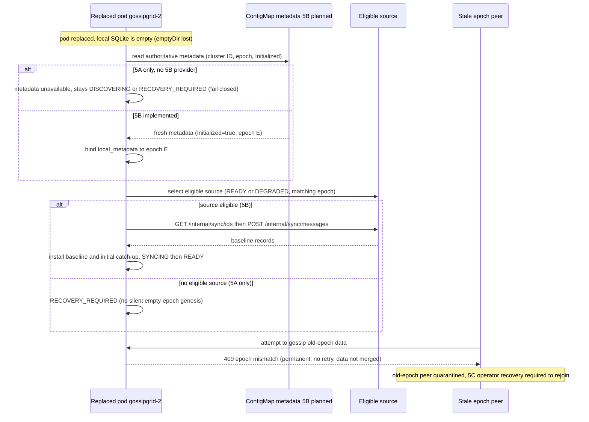

# Data loss, recovery, and cluster epochs

**Status:** This document describes the recovery model and the cluster epoch protocol. Milestone 5A
(2026-11-21, `v0.1.0-alpha.5`) is **implemented and locally tested** (the lifecycle state machine, durable
epoch binding, epoch fencing, and fail-closed admission). Milestone 5B (Kubernetes metadata provider, initial
snapshot transfer, automatic genesis) and Milestone 5C (operator recovery/reset authorization, catastrophic
data-loss handling) are **designed but not implemented**. The recovery protocol described below is the **target
design** that 5B and 5C will implement.

## Why this matters

Each pod stores SQLite in `emptyDir`, so replacing a pod discards its messages. The application intentionally tests
self-healing from surviving peers. **No design without durable copies can restore data after every copy is lost.**
Recovery of *availability* is not recovery of *lost data*.

Milestone 5A (implemented 2026-11-21) adds the lifecycle state machine, durable epoch binding, epoch fencing, and
fail-closed admission that underpin the recovery model described below. The Kubernetes metadata provider (5B),
initial snapshot transfer (5B), automatic genesis (5B), and operator recovery/reset (5C) are designed but not
yet implemented.

## Lifecycle state machine (Milestone 5A, implemented)

The lifecycle controller's state machine — the transitions, the fail-closed boundaries, and the readiness
implication of each state — is shown below (the authoritative `lifecycle-recovery.mmd` source embedded
natively). The [SVG](diagrams/generated/lifecycle-recovery.svg) and
[PNG](diagrams/generated/lifecycle-recovery.png) links are fallbacks.

<!-- DIAGRAM:lifecycle-recovery -->

## Failure cases

| Situation | Required behavior |
| --- | --- |
| One pod replaced, at least one synced source survives | Join current epoch; synchronize; become ready |
| Gossip missed during temporary outage | Reconcile on reconnection |
| No synced peer currently reachable | Stay unready/waiting; diagnose; do not assume loss |
| All expected replicas report empty data in current epoch | Candidate catastrophic loss; perform strict safety checks before reset |
| Any expected replica unreachable or epoch uncertain | No automatic epoch reset; operator intervention or wait |
| New install with no prior epoch | Authorized first genesis; no data-loss alarm |
| Current epoch is known to have messages, but sources lost | Preserve the loss incident even if service resumes empty |

## Cluster metadata (not message storage)

A narrowly scoped Kubernetes record (provisionally a ConfigMap) tracks a globally unique cluster ID, an unpredictable
epoch ID (plus display generation number), the fact that the cluster was initialized, whether messages were ever
accepted in that epoch, and the last reset incident with acknowledgment status. **Do not use just a predictable
integer epoch as an authority token.** Atomic Kubernetes resourceVersion updates gate any transition to a new epoch and
prevent competing reset attempts.

This means GossipGrid uses Kubernetes API access for the *metadata/reset control path*, while regular peer discovery
remains DNS-based. The service account must be restricted to a named ConfigMap and the minimum necessary get/update
permissions; initial provisioning can be handled by Helm or a controlled job.

## Conservative automatic recovery policy

1. Query the authoritative cluster metadata and its expected member roster/epoch.
2. Probe every expected member with verified mTLS identity; distinguish empty, missing, initializing, ready, and
   unreachable.
3. Prefer any valid synchronized source with the current epoch, regardless of whether it is currently discoverable by
   DNS; reconcile instead of resetting.
4. If a member is unreachable, mismatched, or ambiguously initialized, **fail closed**. Do not claim all data is lost.
5. Only if every expected identity responds conclusively that all eligible data sources are gone, and the
   control-plane metadata allows a reset, attempt a conditional atomic epoch change. Recheck preconditions immediately
   before the update.
6. Establish a new empty epoch and allow healthy replicas to initialize under it; persist an unacknowledged incident
   marked `TOTAL_DATA_LOSS` or `POSSIBLE_DATA_LOSS` according to evidence.
7. Old-epoch replicas must never silently join or inject messages into the new epoch. An old-epoch return requires
   quarantine and explicit operator inspection.

**Safety note:** Even unanimous observations of currently empty ephemeral stores cannot mathematically prove that no
old copies exist outside the observed membership, or that no messages were in flight. Therefore automatic reset is
**a lab-only, opt-in policy** with a prominently disclosed risk; the default safe policy should be to **halt for
operator authorization**. We can implement the automation after testing the stricter manual path. This is a deliberate
improvement over treating `all currently reachable pods are empty` as a sufficient proof of total loss.

## Milestone 5C — Controlled recovery (designed, not implemented)

Milestone 5C adds the operator recovery/reset procedure that returns a `RECOVERY_REQUIRED` replica to `READY`.
It is **explicit and operator-authorized**: there is **no automatic destructive reset by default**.

- **Explicit operator recovery authorization.** A `RECOVERY_REQUIRED` replica returns to `READY` only after an
  explicit operator action. The exact mechanism (a dedicated API endpoint vs. a controlled Kubernetes job) is to
  be finalized in the 5C implementation. The RBAC scope is tightly restricted (get + update on the named
  ConfigMap only; no write access to arbitrary cluster resources).
- **Catastrophic data-loss handling.** A reset is attempted only when every expected identity responds
  conclusively that all eligible data sources are gone **and** the control-plane metadata permits a reset. The
  preconditions are rechecked immediately before the atomic `resourceVersion` update. If any identity is
  unreachable or ambiguously initialized, the procedure **fails closed** and does not claim all data is lost.
- **Epoch transitions and stale-data fencing.** A reset establishes a new epoch. Old-epoch replicas are
  quarantined and never silently rejoin or inject messages into the new epoch. An old-epoch return requires
  explicit operator inspection. The epoch fencing protocol (M5A) prevents an old-epoch replica from reintroducing
  its data: a 409 epoch mismatch is permanent (no retry) and the data is not merged.
- **Incident and recovery audit information.** A completed reset does not hide history: a persistent, dismissible
  incident banner reports the previous/current epoch, detection time, mode (manual/automatic), and an explicit
  message-loss warning. The ConfigMap records the reset cause and acknowledgment state. The incident remains
  visible in metadata and in structured logs after the service resumes.
- **No automatic destructive reset by default.** The default safe policy is to **halt for operator
  authorization**. An optional, explicitly configured automatic reset (a lab-only, opt-in policy with a
  prominently disclosed risk) is a later 5C enhancement, not the default.

## UX and operations

- A completed reset does not hide history: a persistent, dismissible incident banner reports previous/current epoch,
  detection time, mode (manual/automatic), and an explicit message-loss warning.
- Status API and structured logs include epoch, readiness reason, reset cause, and acknowledgment state.
- Diagnostics should remain available via direct port-forward when the public Service has no ready endpoints.
- A safe test will deliberately delete all pods with ephemeral volumes, validate fail-closed behavior, then perform a
  manual reset and confirm the incident persists in metadata.
- Later opt-in experiment: strict automatic reset gate with explicit operator-configured threshold, conditional
  control-plane update, and tests for partitions, racing resets, stale pods, and uncommitted messages.

## Epoch change behavior (Milestone 5A)

When the authoritative metadata changes to a different cluster or epoch than the local database binding:

1. The controller's `reevaluateState` detects the mismatch.
2. The state machine transitions to `RECOVERY_REQUIRED` (if not already there).
3. All writes and replication are rejected (503 for unready, 409 for epoch mismatch).
4. The local database and its messages are **preserved** — no data is deleted.
5. The binding row in `local_metadata` is **intact** — it still records the original cluster/epoch.
6. The replica cannot return to `READY` without an operator-performed recovery procedure (reserved for future
   milestones).

This is a **lockout**, not a data-loss event. The replica is safe: it will not merge data from a different epoch
or inject old-epoch messages into a new one.

## Legacy database handling

A database that predates the lifecycle feature (no `local_metadata` row) is handled gracefully:

- `GetBinding()` returns nil (no error) when no binding row exists.
- The replica operates in `DISCOVERING` (if metadata is available) or fails closed.
- No binding is automatically created; the operator must explicitly bind the database to a cluster epoch
  (reserved for future milestones).
- All existing Milestone 4 behavior is preserved when lifecycle protection is disabled (the default).

## Lifecycle recovery sequence (Milestone 5B/5C, designed)

The end-to-end recovery sequence — a replaced pod reading authoritative metadata, selecting an eligible source,
ingesting a baseline, and fencing out an old-epoch peer — is shown below (the authoritative
`lifecycle-recovery-sequence.mmd` source embedded natively). The [SVG](diagrams/generated/lifecycle-recovery-sequence.svg)
and [PNG](diagrams/generated/lifecycle-recovery-sequence.png) links are fallbacks.

<!-- DIAGRAM:lifecycle-recovery-sequence -->

## Why mTLS alone is not sufficient for epoch membership

mTLS proves that a peer is an authorized workload within the trust domain. It does **not** prove:

- That the peer's local database belongs to the same cluster epoch.
- That the peer has not been replaced with a new pod carrying old-epoch data from an `emptyDir` volume.
- That the cluster metadata has not changed to a new epoch since the peer last synchronized.

Epoch fencing (Milestone 5A) adds a second layer: even if a peer is mTLS-authorized, its data is not merged unless
its epoch context matches the local binding. This is a **fencing** mechanism, not an authentication mechanism —
mTLS remains the sole basis for peer identity.

In addition, a lifecycle-enabled **client** validates the peer's **response envelope**
(`X-GossipGrid-Lifecycle-Active: true` + matching cluster/epoch). A legacy peer (lifecycle disabled) that returns a
successful response without the envelope is rejected as a synchronization source. This prevents a lifecycle-enabled
replica from ingesting data from a peer that does not run the epoch-fencing protocol, even if the peer's mTLS
certificate is valid. The outbound epoch context is sourced from the controller's current authorization decision
(via the `EpochProvider`), not a one-time startup copy: a revoked node blocks its outbound requests rather than
using a stale epoch.

## Why an epoch ID is not an authorization secret

The epoch ID (a UUID or similar unique identifier) is **metadata**, not a credential. It is:

- Visible in peer status responses and HTTP headers.
- Not signed, not encrypted, not hashed.
- Not a bearer token: possessing an epoch ID does not grant access to any resource.

Authorization is established by mTLS (client certificate) + identity policy (SAN, EKU, StatefulSet name). The epoch
ID only determines whether the data from an authenticated peer is eligible for merging.

## Limitations

The metadata resource is not a backup of messages. It is a coordination and audit mechanism. Its own deletion or
restoration from an out-of-date snapshot is an administrative incident, not a signal to create a new cluster. Cluster
disaster recovery and safe split-brain prevention would require stronger assumptions and/or durable storage than this
testbed intentionally provides.

**Milestone 5A limitations (by design; 5B and 5C add the missing pieces):**

- **Corrected failure-model boundary (2026-11-23).** A transient metadata/peer unavailability marks authority
  `invalid` and fails closed (503) but does **not** enter `RECOVERY_REQUIRED` and records **no** data-loss
  incident. `RECOVERY_REQUIRED` is entered **only** on a proven local-binding/metadata mismatch (a lockout, not
  a data-loss event), and a matching epoch restored later returns the replica to `DISCOVERING` automatically.
  The epoch is never silently reset. Confirmed catastrophic loss is handled **only** by 5C. See
  [lifecycle-metadata-and-genesis.md](lifecycle-metadata-and-genesis.md#4-transient-versus-catastrophic-metadata-failure).
- No production Kubernetes metadata provider: the controller uses a no-op source that always reports metadata
  unavailable. In production, replicas with lifecycle enabled will stay unready until the 5B provider is deployed.
  *(5B adds the ConfigMap-backed provider — implemented read-only and inactive in Stage 0.)*
- No automatic genesis: a fresh replica with no binding cannot automatically initialize an empty epoch.
  *(5B adds control-plane-coordinated genesis.)*
- No automatic epoch reset: a `RECOVERY_REQUIRED` replica cannot automatically return to `READY`; operator
  intervention is required. *(5C adds the explicit operator recovery procedure.)*
- No snapshot transfer: the initial data baseline (the path from `SYNCING` to `READY`) is not yet implemented;
  `SetReady` is provided for test purposes and future 5B implementation. *(5B adds initial snapshot transfer.)*
- 5A alone does **not** make GossipGrid safe for catastrophic cluster recovery. It provides the fencing and
  admission framework; the full recovery protocol requires the 5B metadata provider, snapshot transfer, and
  the 5C operator recovery procedures.
