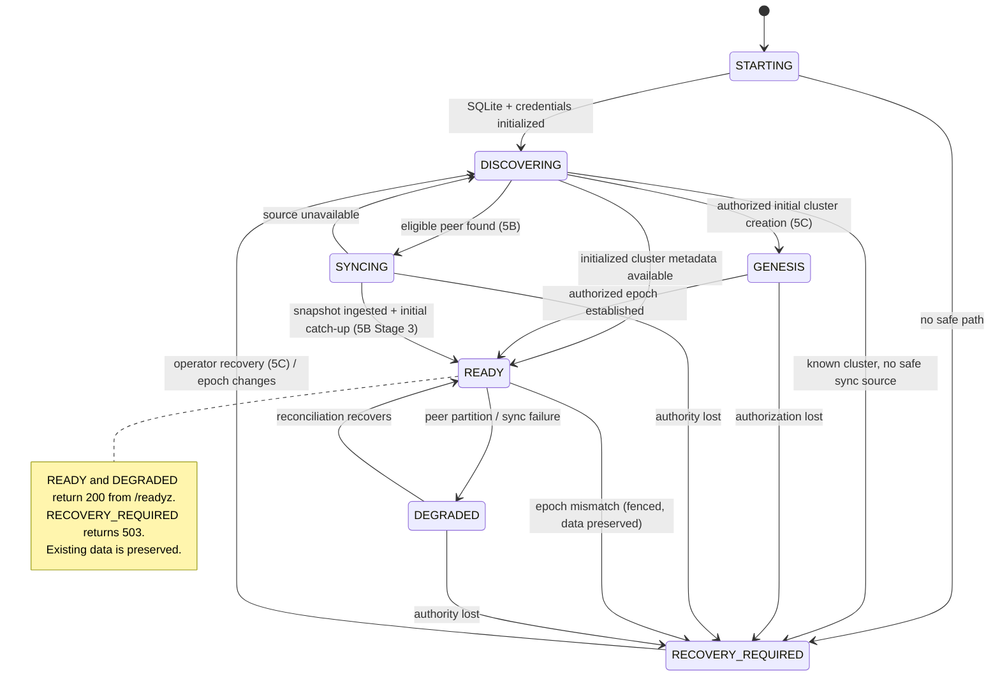
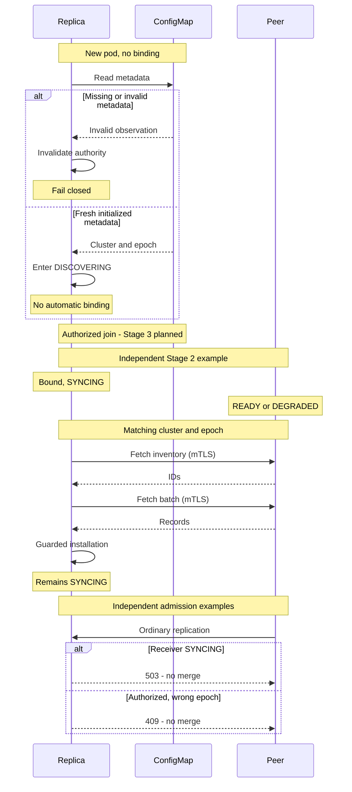

# Data loss, recovery, and cluster epochs

For a learning-oriented walkthrough of the epoch-fencing and recovery concepts that underpin this
document, see the [concept library](concepts/README.md).

**Status:** This document describes the recovery model and the cluster epoch protocol. Milestone 5A
(2026-11-21, `v0.1.0-alpha.5`) is **implemented and locally tested** (the lifecycle state machine, durable
epoch binding, epoch fencing, and fail-closed admission). Milestone 5B is **partially implemented**: Stages 0
(read-only Kubernetes metadata provider), 1A (Kubernetes genesis grant), 1B (operator-authorized genesis
finalization), and 2 (bootstrap replication admission,
`FetchBootstrapBaseline` transport-and-commit) are implemented, committed, and locally tested (not yet
cluster-verified); Stage 3 (source discovery/selection, sweep scheduling, automatic `READY` promotion) is
designed but not implemented.
Milestone 5C (operator recovery/reset authorization, catastrophic data-loss handling) is **designed but not
implemented**. The recovery protocol described below is the **target design** that 5B Stage 3 and 5C will
implement.

## Why this matters

Each pod stores SQLite in `emptyDir`, so replacing a pod discards its messages. The application intentionally tests
self-healing from surviving peers. **No design without durable copies can restore data after every copy is lost.**
Recovery of *availability* is not recovery of *lost data*.

Milestone 5A (implemented 2026-11-21) adds the lifecycle state machine, durable epoch binding, epoch fencing, and
fail-closed admission that underpin the recovery model described below. The Kubernetes metadata provider (5B
Stage 0) is implemented and inactive; the bootstrap replication admission (5B Stage 2) is implemented, committed,
and locally tested; initial snapshot transfer orchestration (5B Stage 3) and operator recovery/reset (5C) are
designed but not yet implemented. A replaced pod does **not** automatically bind its local metadata or
reconstruct from a peer: with no durable binding, fresh initialized metadata only moves the replica to
`DISCOVERING` (no binding is created), and a metadata read failure invalidates authority and fails closed without
necessarily changing the lifecycle state.

## Lifecycle state machine (Milestone 5A, implemented)

The lifecycle controller's state machine — the transitions, the fail-closed boundaries, and the readiness
implication of each state — is shown below (the authoritative `lifecycle-recovery.mmd` source embedded
natively).

[View full-size SVG](diagrams/generated/lifecycle-recovery.svg) · [View PNG](diagrams/generated/lifecycle-recovery.png)

<!-- DIAGRAM:lifecycle-recovery -->

## Failure cases

| Situation | Required behavior |
| --- | --- |
| One pod replaced, at least one synced source survives | Join current epoch; synchronize; become ready |
| Gossip missed during temporary outage | Reconcile on reconnection |
| No synced peer currently reachable | Stay unready/waiting; diagnose; do not assume loss |
| All expected replicas report empty data in current epoch | Candidate catastrophic loss; perform strict safety checks before reset |
| Any expected replica unreachable or epoch uncertain | No automatic epoch reset; operator intervention or wait |
| New install with no prior epoch | Authorized first genesis; no data-loss alarm |
| Current epoch is known to have messages, but sources lost | Preserve the loss incident even if service resumes empty |

## Cluster metadata (not message storage)

A narrowly scoped Kubernetes record (provisionally a ConfigMap) tracks a globally unique cluster ID, an unpredictable
epoch ID (plus display generation number), the fact that the cluster was initialized, whether messages were ever
accepted in that epoch, and the last reset incident with acknowledgment status. **Do not use just a predictable
integer epoch as an authority token.** Atomic Kubernetes resourceVersion updates gate any transition to a new epoch and
prevent competing reset attempts.

This means GossipGrid uses Kubernetes API access for the *metadata/reset control path*, while regular peer discovery
remains DNS-based. The service account must be restricted to a named ConfigMap and the minimum necessary get/update
permissions; initial provisioning can be handled by Helm or a controlled job.

## Conservative automatic recovery policy

1. Query the authoritative cluster metadata and its expected member roster/epoch.
2. Probe every expected member with verified mTLS identity; distinguish empty, missing, initializing, ready, and
   unreachable.
3. Prefer any valid synchronized source with the current epoch, regardless of whether it is currently discoverable by
   DNS; reconcile instead of resetting.
4. If a member is unreachable, mismatched, or ambiguously initialized, **fail closed**. Do not claim all data is lost.
5. Only if every expected identity responds conclusively that all eligible data sources are gone, and the
   control-plane metadata allows a reset, attempt a conditional atomic epoch change. Recheck preconditions immediately
   before the update.
6. Establish a new empty epoch and allow healthy replicas to initialize under it; persist an unacknowledged incident
   marked `TOTAL_DATA_LOSS` or `POSSIBLE_DATA_LOSS` according to evidence.
7. Old-epoch replicas must never silently join or inject messages into the new epoch. An old-epoch return requires
   quarantine and explicit operator inspection.

**Safety note:** Even unanimous observations of currently empty ephemeral stores cannot mathematically prove that no
old copies exist outside the observed membership, or that no messages were in flight. Therefore automatic reset is
**a lab-only, opt-in policy** with a prominently disclosed risk; the default safe policy should be to **halt for
operator authorization**. We can implement the automation after testing the stricter manual path. This is a deliberate
improvement over treating `all currently reachable pods are empty` as a sufficient proof of total loss.

## Milestone 5C — Controlled recovery (designed, not implemented)

Milestone 5C adds the operator recovery/reset procedure that returns a `RECOVERY_REQUIRED` replica to `READY`.
It is **explicit and operator-authorized**: there is **no automatic destructive reset by default**.

- **Explicit operator recovery authorization.** A `RECOVERY_REQUIRED` replica returns to `READY` only after an
  explicit operator action. The exact mechanism (a dedicated API endpoint vs. a controlled Kubernetes job) is to
  be finalized in the 5C implementation. The RBAC scope is tightly restricted (get + update on the named
  ConfigMap only; no write access to arbitrary cluster resources).
- **Catastrophic data-loss handling.** A reset is attempted only when every expected identity responds
  conclusively that all eligible data sources are gone **and** the control-plane metadata permits a reset. The
  preconditions are rechecked immediately before the atomic `resourceVersion` update. If any identity is
  unreachable or ambiguously initialized, the procedure **fails closed** and does not claim all data is lost.
- **Epoch transitions and stale-data fencing.** A reset establishes a new epoch. Old-epoch replicas are
  quarantined and never silently rejoin or inject messages into the new epoch. An old-epoch return requires
  explicit operator inspection. The epoch fencing protocol (M5A) prevents an old-epoch replica from reintroducing
  its data: a 409 epoch mismatch is permanent (no retry) and the data is not merged.
- **Incident and recovery audit information.** A completed reset does not hide history: a persistent, dismissible
  incident banner reports the previous/current epoch, detection time, mode (manual/automatic), and an explicit
  message-loss warning. The ConfigMap records the reset cause and acknowledgment state. The incident remains
  visible in metadata and in structured logs after the service resumes.
- **No automatic destructive reset by default.** The default safe policy is to **halt for operator
  authorization**. An optional, explicitly configured automatic reset (a lab-only, opt-in policy with a
  prominently disclosed risk) is a later 5C enhancement, not the default.

## UX and operations

- A completed reset does not hide history: a persistent, dismissible incident banner reports previous/current epoch,
  detection time, mode (manual/automatic), and an explicit message-loss warning.
- Status API and structured logs include epoch, readiness reason, reset cause, and acknowledgment state.
- Diagnostics should remain available via direct port-forward when the public Service has no ready endpoints.
- A safe test will deliberately delete all pods with ephemeral volumes, validate fail-closed behavior, then perform a
  manual reset and confirm the incident persists in metadata.
- Later opt-in experiment: strict automatic reset gate with explicit operator-configured threshold, conditional
  control-plane update, and tests for partitions, racing resets, stale pods, and uncommitted messages.

## Epoch change behavior (Milestone 5A)

When the authoritative metadata changes to a different cluster or epoch than the local database binding:

1. The controller's `reevaluateState` detects the mismatch.
2. The state machine transitions to `RECOVERY_REQUIRED` (if not already there).
3. All writes and replication are rejected (503 for unready, 409 for epoch mismatch).
4. The local database and its messages are **preserved** — no data is deleted.
5. The binding row in `local_metadata` is **intact** — it still records the original cluster/epoch.
6. The replica cannot return to `READY` without an operator-performed recovery procedure (reserved for future
   milestones).

This is a **lockout**, not a data-loss event. The replica is safe: it will not merge data from a different epoch
or inject old-epoch messages into a new one.

## Legacy database handling

A database that predates the lifecycle feature (no `local_metadata` row) is handled gracefully:

- `GetBinding()` returns nil (no error) when no binding row exists.
- The replica operates in `DISCOVERING` (if metadata is available) or fails closed.
- No binding is automatically created; the operator must explicitly bind the database to a cluster epoch
  (reserved for future milestones).
- All existing Milestone 4 behavior is preserved when lifecycle protection is disabled (the default).

## Lifecycle recovery sequence (Milestone 5B/5C, designed)

The recovery sequence — a replaced pod reading authoritative metadata, the independent Stage 2 baseline
retrieval example, and the two admission outcomes — is shown below (the authoritative
`lifecycle-recovery-sequence.mmd` source embedded natively). It is **not** a single implemented end-to-end
reconstruction workflow: the three parts are independent examples.

- **New pod, no binding (implemented).** A metadata read failure (missing or invalid) invalidates the
  authoritative observation and fails closed; it does **not** necessarily change the lifecycle machine state.
  `RECOVERY_REQUIRED` is an authorization lockout that can result from a confirmed local-binding/metadata
  mismatch or a confirmed same-epoch genesis authorization revocation. Neither condition establishes
  authoritative-data loss; the local database and durable binding are preserved. With fresh initialized
  metadata and no durable binding, the replica enters `DISCOVERING` — no binding is created, no source is
  selected, no READY promotion. A matching authoritative observation can permit re-evaluation to
  `DISCOVERING`; an unchanged, revoked genesis-authorization observation does not. The authorized join and
  reconstruction orchestration is **Stage 3 (planned)**.
- **Independent Stage 2 example (implemented, explicit prerequisites).** This assumes a caller-supplied
  eligible source and all required authorization prerequisites: the requester is already durably bound and
  `SYNCING`, the source is `READY` or `DEGRADED`, and the cluster and epoch match. The two private bootstrap
  retrieval endpoints are the inventory endpoint `GET /internal/sync/ids` and the bounded message-fetch
  endpoint `POST /internal/sync/messages`. The guarded installation leaves the replica in `SYNCING` (no
  automatic source selection, no automatic binding, no automatic READY promotion).
- **Independent admission examples (implemented; not a temporal transition).** For well-formed epoch
  headers, a `SYNCING` (unready) receiver rejects ordinary replication with **503** and an
  otherwise-authorized receiver with a mismatched epoch rejects with **409** (the epoch-fencing mechanism,
  M5A). Both preserve the no-merge guarantee: the peer's data is not merged into the receiver.

Operator-controlled M5C recovery remains **planned**.

[View full-size SVG](diagrams/generated/lifecycle-recovery-sequence.svg) · [View PNG](diagrams/generated/lifecycle-recovery-sequence.png)

<!-- DIAGRAM:lifecycle-recovery-sequence -->

## Why mTLS alone is not sufficient for epoch membership

mTLS proves that a peer is an authorized workload within the trust domain. It does **not** prove:

- That the peer's local database belongs to the same cluster epoch.
- That the peer has not been replaced with a new pod carrying old-epoch data from an `emptyDir` volume.
- That the cluster metadata has not changed to a new epoch since the peer last synchronized.

Epoch fencing (Milestone 5A) adds a second layer: even if a peer is mTLS-authorized, its data is not merged unless
its epoch context matches the local binding. This is a **fencing** mechanism, not an authentication mechanism —
mTLS remains the sole basis for peer identity.

In addition, a lifecycle-enabled **client** validates the peer's **response envelope**
(`X-GossipGrid-Lifecycle-Active: true` + matching cluster/epoch). A legacy peer (lifecycle disabled) that returns a
successful response without the envelope is rejected as a synchronization source. This prevents a lifecycle-enabled
replica from ingesting data from a peer that does not run the epoch-fencing protocol, even if the peer's mTLS
certificate is valid. The outbound epoch context is sourced from the controller's current authorization decision
(via the `EpochProvider`), not a one-time startup copy: a revoked node blocks its outbound requests rather than
using a stale epoch.

## Why an epoch ID is not an authorization secret

The epoch ID (a UUID or similar unique identifier) is **metadata**, not a credential. It is:

- Visible in peer status responses and HTTP headers.
- Not signed, not encrypted, not hashed.
- Not a bearer token: possessing an epoch ID does not grant access to any resource.

Authorization is established by mTLS (client certificate) + identity policy (SAN, EKU, StatefulSet name). The epoch
ID only determines whether the data from an authenticated peer is eligible for merging.

## Limitations

The metadata resource is not a backup of messages. It is a coordination and audit mechanism. Its own deletion or
restoration from an out-of-date snapshot is an administrative incident, not a signal to create a new cluster. Cluster
disaster recovery and safe split-brain prevention would require stronger assumptions and/or durable storage than this
testbed intentionally provides.

**Milestone 5A limitations (by design; 5B and 5C add the missing pieces):**

- **Corrected failure-model boundary (2026-11-23).** A transient metadata/peer unavailability marks authority
  `invalid` and fails closed (503) but does **not** enter `RECOVERY_REQUIRED` and records **no** data-loss
  incident. `RECOVERY_REQUIRED` is an authorization lockout that can result from a confirmed local-binding/
  metadata mismatch or a confirmed same-epoch genesis authorization revocation. Neither condition establishes
  authoritative-data loss; the local database and durable binding are preserved. A matching authoritative
  observation restored later returns the replica to `DISCOVERING` automatically, **unless** the restored
  observation is a confirmed same-epoch genesis revocation: while that unchanged, revoked genesis-authorization
  observation persists, the seed remains locked out in `RECOVERY_REQUIRED` (no automatic reinstatement; the
  operator must perform an authorized recovery — the implementation recognizes both the establishment of a new
  epoch and the legitimate restoration of the pending grant). The epoch is never silently reset. Confirmed
  catastrophic loss is handled **only** by 5C. See
  [lifecycle-metadata-and-genesis.md](lifecycle-metadata-and-genesis.md#4-transient-versus-catastrophic-metadata-failure).
- The production Kubernetes metadata provider is implemented and wired into the application. It is opt-in and
  requires both lifecycle enforcement and Kubernetes metadata configuration to be enabled
  (`GOSSIPGRID_LIFECYCLE_ENABLED=true` and `GOSSIPGRID_LIFECYCLE_METADATA_KUBERNETES=true`); the default
  configuration does not activate it, in which case the controller uses a no-op source that always reports
  metadata unavailable. When lifecycle enforcement is enabled without an authoritative metadata source,
  admission fails closed. The provider is not yet cluster-verified.
- No automatic genesis: a fresh replica with no binding cannot automatically initialize an empty epoch.
  *(5B Stages 1A and 1B already implement operator-controlled genesis authorization and finalization.
  Stage 3 adds reconstruction orchestration and controlled READY promotion; 5C adds operator recovery.)*
- No automatic epoch reset: a `RECOVERY_REQUIRED` replica cannot automatically return to `READY`; operator
  intervention is required. *(5C adds the explicit operator recovery procedure.)*
- No snapshot transfer orchestration: the initial data baseline (the path from `SYNCING` to `READY`) is not yet
  implemented as a scheduled sweep; `SetReady` is provided for test purposes. The transport-and-commit mechanism
  (`FetchBootstrapBaseline`) is implemented, committed, and locally tested in 5B Stage 2. *(5B Stage 3 adds
  source discovery, sweep scheduling, and automatic `READY` promotion.)*
- 5A alone does **not** make GossipGrid safe for catastrophic cluster recovery. It provides the fencing and
  admission framework; the full recovery protocol requires the 5B metadata provider (wired into the running
  application), snapshot transfer orchestration, and the 5C operator recovery procedures.

## Planned controlled GitOps/Kubernetes rollback experiment (Milestone 9)

> **Status: Planned, not performed.** This section documents a designed rollback experiment for the
> Milestone 9 resilience/security lab. The test has **not** been executed; it is a specification for a
> future controlled experiment. Do not read this section as evidence that the test was run.

The experiment validates that a **controlled, operator-orchestrated rollback** of a GossipGrid deployment
in the staging cluster (from a 7B image with lifecycle enforcement enabled back to a 7A image with
lifecycle disabled) is safe and reversible, and that the cluster's message state and control-plane
metadata are not corrupted by the rollback.

### Preconditions

- A 7B staging cluster (lifecycle enforcement enabled, `GOSSIPGRID_LIFECYCLE_ENABLED=true`) with all five
  replicas `READY`, a known authoritative `ClusterID`/`EpochID` in the ConfigMap
  `gossipgrid-cluster-metadata`, and a known message count (recorded before the experiment).
- A 7A image (lifecycle disabled) published to the private GitLab registry and referenced by digest in
  the k8s-gitops repository (the Argo CD Application can roll back to it).
- The Argo CD Application in the k8s-gitops repository is in `Healthy`/`Synced` state.
- No in-flight writes (quiesce the public API for the duration of the experiment).

### Procedure

1. **Record the 7B baseline.** Note the current `ClusterID`, `EpochID`, `generation`, `initialized`,
   `dataLossProtected`, `everAcceptedMessages` from the ConfigMap. Note the message count from each
   replica's `GET /api/diagnostics`. Screenshot the Argo CD Application history.
2. **Roll back the image.** In the k8s-gitops repository, update the Argo CD Application's image digest
   (or the Helm `values-7b.yaml` image tag) to the 7A image digest. Commit and push. Argo CD reconciles
   the cluster to the 7A image. The StatefulSet performs a rolling update.
3. **Observe the 7A transition.** As each 7B pod is replaced by a 7A pod:
   - The new 7A pod starts with lifecycle disabled (`GOSSIPGRID_LIFECYCLE_ENABLED=false`).
   - The 7A pod's `GET /internal/status` response has **no** lifecycle envelope headers (lifecycle
     disabled → `setResponseEpochEnvelope` is not called).
   - A 7B peer (still `READY`, lifecycle enabled) that attempts to sync from the new 7A pod **rejects**
     the 7A pod as a synchronization source (the lifecycle-enabled client validates the response envelope;
     a legacy peer without the envelope is rejected). This is the **expected** M5A behavior: a
     lifecycle-enabled replica does not ingest data from a peer that does not run the epoch-fencing
     protocol.
   - The 7A pod does **not** attempt to read or modify the ConfigMap (the 7A build has no
     `MetadataSource` wired; the lifecycle controller is not started).
4. **Verify the 7A cluster is functional.** After all five pods are 7A:
   - All five replicas are `READY` (lifecycle disabled → no lifecycle state; the readiness probe returns
     200).
   - The public API accepts writes (no lifecycle gating).
   - The message count from `GET /api/diagnostics` on each 7A pod is **zero** (the `emptyDir` was lost
     during the pod replacement; the 7A image does not import the 7B message set).
   - The ConfigMap `gossipgrid-cluster-metadata` is **unchanged** (the 7A pods do not read or write it).
5. **Roll forward to 7B (recovery).** Update the Argo CD Application to the 7B image digest. Argo CD
   reconciles. Each 7B pod:
   - Starts with lifecycle enabled, reads the ConfigMap (the authoritative metadata is unchanged from
     step 1), binds its `local_metadata` to the recorded `ClusterID`/`EpochID`.
   - Enters `SYNCING` (no local data, the `emptyDir` was lost) and attempts to bootstrap from an eligible
     peer. **No eligible 7B source exists yet** (all peers are 7A or just-restarted 7B pods with empty
     `emptyDir`), so the pod stays in `SYNCING` or transitions to `RECOVERY_REQUIRED`.
   - **This is the expected behavior for this experiment**: the rollback to 7A and the return to 7B does
     **not** restore the 7B message set (the data was in `emptyDir` and was lost). The cluster is
     **available** (replicas can accept new writes) but the **pre-rollback message set is lost**. This is
     the intended, documented behavior of the ephemeral-storage architecture.
6. **Record the outcome.** Document:
   - The ConfigMap state (should be unchanged from step 1).
   - The message count on each 7B pod (expected: zero, or the count of messages written during the 7A
     window if writes were not fully quiesced).
   - The Argo CD Application history (rollback + forward).
   - Any `RECOVERY_REQUIRED` replicas and the operator action required to return them to `READY`
     (in this case: no data to recover; the operator can authorize a new epoch reset via 5C, or simply
     accept the empty cluster and continue).

### Expected results (the test is a pass if all of the following hold)

- The rollback to 7A is **safe**: no crash, no corruption of the ConfigMap, no data written to the
  ConfigMap by the 7A pods.
- The 7A cluster is **functional**: all replicas ready, public API accepting writes.
- The lifecycle-enabled 7B peers (during the rolling update) **reject** the 7A pods as synchronization
  sources (the M5A envelope validation works as designed).
- The roll-forward to 7B does **not** restore the pre-rollback message set (the `emptyDir` data is
  lost; this is the documented ephemeral-storage limitation).
- The ConfigMap is **unchanged** throughout (the 7A pods do not interact with it; the 7B pods read it
  but do not modify it during the bootstrap attempt).
- The Argo CD Application is in `Healthy`/`Synced` state after the forward.

### What this experiment does NOT test

- **Catastrophic data-loss recovery** (the 5C operator reset procedure). The experiment demonstrates
  that the rollback is safe and reversible, but the pre-rollback data is lost (the `emptyDir`
  architecture). The 5C procedure (operator-authorized epoch reset, incident audit) is a separate
  experiment in M9.
- **Bootstrap from surviving 7B peers.** In this experiment, all pods are replaced during the rolling
  update, so no 7B peer survives to serve a bootstrap baseline. A variant of this experiment (roll
  back only 2 of 5 pods, leaving 3 7B pods `READY`) would test the bootstrap path: the 2 replaced
  pods would enter `SYNCING` and bootstrap from the 3 surviving 7B peers. This variant is a
  **separate** M9 experiment.
- **The 7A→7B migration procedure** (the operator-orchestrated export/import described in
  [lifecycle-metadata-and-genesis.md](lifecycle-metadata-and-genesis.md#6-migration-from-the-current-staging-7a--7b)).
  This rollback experiment is a **simpler** scenario (no export/import, just an image rollback); the
  full migration is a separate M9 experiment.

### Relationship to Milestone 9

This experiment is one of several planned M9 experiments:

- **Pod loss and recovery** (delete 1 of 5 pods; verify the remaining 4 converge; verify the replaced
  pod joins via bootstrap or stays unready).
- **Partition and reconnection** (network-impair one pod; verify the others remain responsive; reconnect
  and verify convergence).
- **Full-pod-loss and fail-closed** (delete all 5 pods; verify no replica claims genesis; verify the
  ConfigMap is intact; perform a 5C operator reset).
- **GitOps rollback** (this experiment: roll back the image via Argo CD; verify the rollback is safe
  and the ConfigMap is unchanged).
- **Live certificate rotation** (rotate the workload CA; verify new connections use the new certs
  without pod restarts).
- **Metrics and FIPS profile verification** (collect gossip/anti-entropy metrics; verify the FIPS
  module is enabled at runtime).

All M9 experiments are **planned, not performed** as of this document. They will be executed when
Milestone 9 is scheduled and the 7B staging cluster is available.
