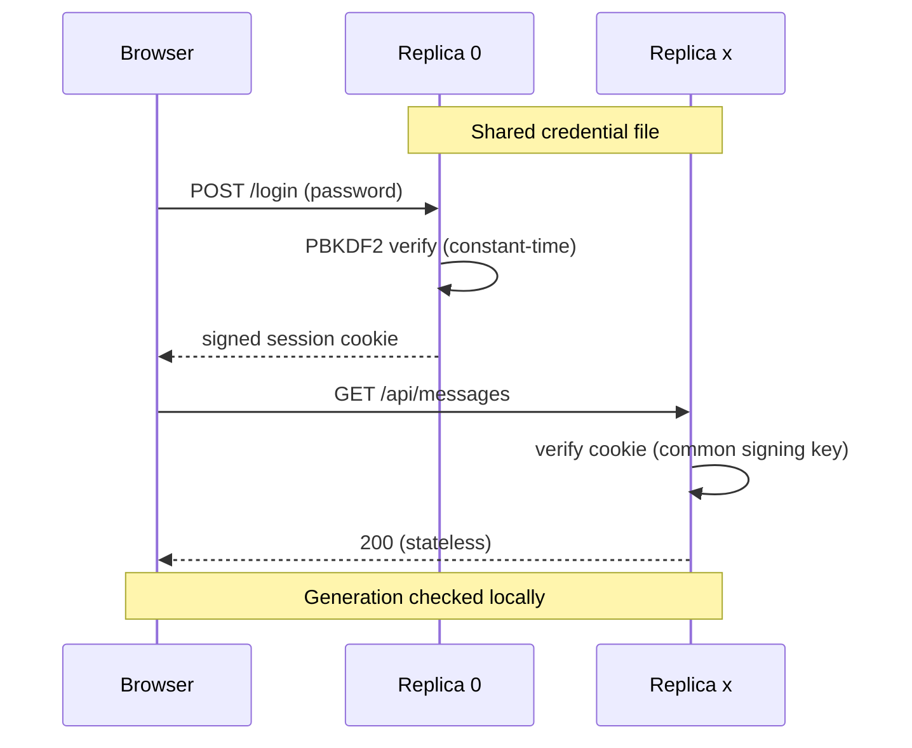
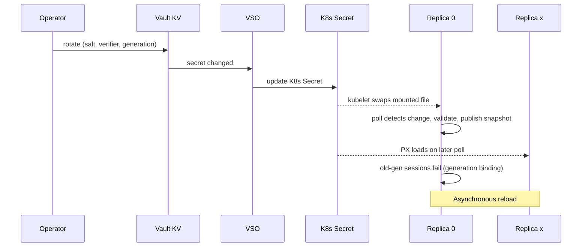

# Security architecture

This document describes the peer mTLS security architecture (implemented in Milestone 3B), the lifecycle and
epoch fencing architecture (implemented in Milestone 5A), and the broader target design for the rest of the
system (Milestones 5B, 5C, 6, 7A, 7B, 8, and 9). It is not an assertion of deployed security or formal
certification. For a learning-oriented walkthrough of the distributed-authority and epoch-fencing
concepts that underpin the security architecture, see the [concept library](concepts/README.md).

**Status classification:** Peer mTLS (3B), message exchange (4A), gossip (4B), anti-entropy (4C),
lifecycle/epoch fencing (5A), and browser authentication (M6) are **implemented and locally tested**.
Milestone 7A (Kubernetes staging — Helm chart, Argo CD, Vault
provisioning, staging runbook) is **deployed and initially smoke-tested**: five replicas running, peer mTLS
with per-pod certificates confirmed, browser HTTPS access through the shared Cilium Gateway confirmed,
Vault-managed credentials loaded, the Go FIPS module enabled in the running application, Kubernetes
NetworkPolicy and CiliumNetworkPolicy protections deployed, and non-root container configuration in place.
The **remaining acceptance tests** (cross-replica convergence, recovery after pod replacement, live
password rotation, fault tolerance) are pending. The M5A lifecycle functionality is implemented in code but
**intentionally disabled** in the current M7A Kubernetes staging deployment
(`GOSSIPGRID_LIFECYCLE_ENABLED=false`) because the required 5B implementation is incomplete. Milestone 5B is
**partially implemented**: Stages 0 (read-only Kubernetes metadata provider), 1A (Kubernetes genesis grant),
1B (operator-authorized genesis finalization), and 2 (bootstrap replication admission) are implemented,
committed, and locally tested (not yet cluster-verified); Stage 3 (orchestration, automatic `READY` promotion) is
designed but not implemented. The operator recovery procedure (5C) is **designed but not implemented**.

## Threat model and trust boundaries

- Browser-to-Gateway HTTP requests are terminated using a server certificate chained to a CA trusted by the user's
  desktops.
- Internal peer-to-peer gossip/synchronization uses independent HTTPS **mutual TLS** with a dedicated workload CA trust
  hierarchy.
- Internal peer endpoints are not exposed through the public Gateway.
- Both certificate chain trust **and intended peer workload identity** are verified. Merely having a certificate issued
  by the workload CA is not sufficient.
- No `InsecureSkipVerify`, disabling hostname verification, or wildcard authorization shortcuts.
- Admin-only metadata reset uses tightly scoped Kubernetes RBAC, no write access to arbitrary cluster resources.
- User-submitted message bodies are untrusted and encoded in HTML; JSON/API payload sizes bounded; logging avoids
  secrets.

## Two PKI trust domains

**Browser HTTPS:** Vault PKI role/issuer signs the certificate for a deliberate internal DNS hostname; the
certificate is managed in the `gateway-system` namespace (separately from the GossipGrid chart). Browsers
trust the appropriate CA chain already installed in their trusted store. Browser HTTPS ends at the shared
Cilium Gateway; Gateway-to-app traffic is internal HTTP. Backend TLS is a separate exercise.

**Workload mTLS:** A separate Vault PKI issuer/CA signs per-pod certificates requested by cert-manager CSI.
Certificates and private keys are mounted for each pod, renewed automatically, and hot-reloaded by Go (implemented in
Milestone 3B — see the section below). A workload CA bundle is distributed/rotated via trust-manager or a narrowly
managed mount, allowing overlap during CA transitions.

**Certificate identity and file layout (Milestone 3B).** Each pod's certificate DNS identity is
`<pod>.<GOSSIPGRID_PEER_IDENTITY_SUFFIX>` (e.g. `gossipgrid-0.gossipgrid-headless.default.svc.cluster.local`). The
suffix is operator-configured (the cluster DNS domain is not hard-coded). The same certificate serves both the server
and client roles, so it carries both `serverAuth` and `clientAuth` Extended Key Usages. The expected file layout per
pod is:

| File | Env var | Content |
| --- | --- | --- |
| `/certs/tls.crt` | `GOSSIPGRID_PEER_CERT_FILE` | Leaf certificate followed by its issuer chain (PEM) |
| `/certs/tls.key` | `GOSSIPGRID_PEER_KEY_FILE` | Private key (PKCS8 PEM; EC, RSA PEM also accepted) |
| `/certs/ca-bundle.pem` | `GOSSIPGRID_PEER_TRUST_BUNDLE_FILE` | One or more workload CA certificates (PEM) |

**Security limitations.** The peer listener is not yet exposed through the Kubernetes Gateway (that is a later
milestone). The hot-reload is poll-based (not filesystem-event based); a brief window between a leaf-certificate
update and its key update is handled by retrying the reload rather than failing. No application-level FIPS 140-3
certification or production-readiness is claimed.

Peer gossip (Milestone 4B), anti-entropy synchronization (Milestone 4C), and readiness gating (Milestone 5A) are now
implemented and opt-in. When enabled, `/internal/status` reports the replica's lifecycle state, epoch, binding, and
readiness reason in addition to identity and version.

Vault itself and issuer resources are cluster prerequisites and must not be embedded in the application or its Docker
image. Select ECDSA P-256 / SHA-256 initially, subject to compatibility verification with the actual Go FIPS build and
Vault roles.

## Implemented peer mTLS (Milestone 3B)

The `internal/peertls` package implements the workload mTLS transport. Key properties, verified by 20 negative/positive
unit tests plus a two-node integration test (all run under the FIPS build and the race detector):

- **TLS 1.3 only.** Both the peer listener and the peer client set `MinVersion`/`MaxVersion` to `VersionTLS13`. A
  TLS 1.2 client is rejected at the handshake.
- **Dedicated workload CA trust.** The server uses `ClientCAs` (the workload trust bundle) to verify client
  certificates; the client uses `RootCAs` (the same bundle) to verify the server. The system root store is never used,
  so a certificate merely chaining to a public CA is not trusted.
- **Mutual TLS + identity authorization.** `ClientAuth: RequireAndVerifyClientCert` requires a client certificate; the
  additional `VerifyPeerCertificate` hooks enforce the GossipGrid identity policy (below) beyond the standard chain and
  hostname checks.
- **Identity authorization rules.** A peer certificate is authorized only when: it has **exactly one DNS SAN**; the
  SAN is `<statefulset-name>-<ordinal>.<identity-suffix>` with an exact match on the configured
  `GOSSIPGRID_PEER_IDENTITY_SUFFIX` and the configured StatefulSet name; the ordinal is a non-negative integer; and the
  required EKU is present (`clientAuth` for a client, `serverAuth` for a server). Wildcard SANs, IP/URI SANs,
  multiple-SAN certificates, a different StatefulSet name, and the Common Name are all rejected. This means a
  certificate from a different StatefulSet — even one signed by the same trusted workload CA — is not authorized.
- **Dial address vs expected identity.** The peer client takes the network dial address and the expected GossipGrid
  peer identity as distinct inputs, so a client can dial `127.0.0.1:8443` while verifying a certificate for an
  in-cluster FQDN. This underpins local multi-process testing and is what prevents identity checks from being bypassed
  by dialing an IP or by supplying an untrusted identity in an HTTP header.
- **Certificate hot-reload.** Credential files are polled at `GOSSIPGRID_PEER_TLS_RELOAD_INTERVAL` (default 2s). A
  successful reload publishes an immutable credential snapshot atomically. The server uses `GetConfigForClient` to
  return a fresh per-connection TLS config from the latest snapshot on each new handshake, so **new** handshakes use
  the latest credentials without a restart and without any in-place mutation of a captured config. A failed reload
  preserves the previous valid snapshot — partially loaded or malformed material never replaces valid credentials. The
  trust bundle may hold multiple CAs during a CA transition. Existing connections are not torn down during normal
  leaf-certificate rotation.
- **Diagnostics without secrets.** `Diagnostics` reports the leaf certificate SHA-256 fingerprint, pod ID, load time,
  and reload count — never the private key or the PEM content.
- **Complete credential validation at load time.** Before a credential snapshot is published, the loader verifies:
  (a) the private key matches the leaf certificate's public key; (b) the local certificate chain verifies against the
  configured workload CA trust bundle; (c) the certificate is within its validity period; (d) the identity is
  authorized (exactly one DNS SAN, correct suffix, StatefulSet name prefix, ordinal in range [0, ExpectedReplicas-1]);
  (e) both `serverAuth` and `clientAuth` EKUs are present; (f) the local certificate's pod identity matches the
  configured `GOSSIPGRID_NODE_ID`. A mismatched key/cert pair or a local cert signed by an untrusted CA fails startup.
- **Private endpoint isolation.** `GET /internal/status` and (when enabled) `POST /internal/messages` are served only
  on the peer listener (TLS 1.3, mTLS) and require a successful client-certificate handshake; they are not registered
  on the public HTTP router (verified by negative tests). The production `ListenAndServe` entry point serves HTTPS
  only — plaintext HTTP is rejected.
- **FIPS.** The mTLS handshake (ECDSA P-256, SHA-256, TLS 1.3) is exercised by tests run under the FIPS-enabled build
  (`GOFIPS140=v1.0.0`, the default for `make test`/`make test-race`).
- **Negative tests (27 scenarios):** the 20 scenarios above, plus: production listener serves HTTPS (not plaintext);
  manager lifecycle (failed Start, repeated Start, concurrent Shutdown); key/cert mismatch; local cert not signed by
  configured CA; certificate with IP SAN; out-of-range ordinal; NodeID mismatch.

## Authenticated peer message exchange (Milestone 4A)

When `GOSSIPGRID_PEER_MESSAGE_EXCHANGE_ENABLED=true` (and peer mTLS is enabled), the private peer listener registers
`POST /internal/messages` for authenticated peer message exchange. Security properties, verified by 25 unit/negative
tests plus a two-node integration test (all run under the FIPS build and the race detector):

- **mTLS-only.** The endpoint is reachable only through the authenticated peer listener (TLS 1.3, mutual TLS,
  dedicated workload CA trust, strict identity authorization). It is not registered on the public HTTP router.
- **Identity authorization.** The sender must present a client certificate that passes the full GossipGrid identity
  policy (exactly one DNS SAN, correct suffix, StatefulSet name prefix, ordinal in range, clientAuth EKU).
- **No header-based identity.** The receiver does not accept a supplied HTTP header as proof of peer identity; the
  authenticated TLS client identity is the sole basis for authorization.
- **Bounded input.** The request body is bounded to 8192 bytes; the message body is bounded to 4096 bytes (the
  store's limit). The JSON decoder enforces exactly one document, no unknown fields, and canonical UUIDv7.
- **Idempotent, immutable insert.** The receiver uses the existing atomic `ON CONFLICT DO NOTHING` insert. A new
  message is stored; an identical duplicate is a no-op; a conflicting duplicate returns 409 without overwriting the
  original row. The original ID, body, origin, and timestamp are never regenerated or overwritten.
- **Opt-in and mTLS-gated.** Default is `false`. When disabled, the endpoint is not registered. Enabling it requires
  `GOSSIPGRID_PEER_TLS_ENABLED=true`; configuration validation fails otherwise. This prevents accidental
  cross-epoch replication before the lifecycle milestone (5A) established the epoch-fencing protocol.
- **No epoch claim at 4A time.** At Milestone 4A, cluster genesis, epoch management, and recovery lockout were not
  established; it is a provisional direct-exchange capability, not a complete safe cluster bootstrap protocol.
  Milestone 5A (2026-11-21) subsequently implemented epoch fencing and the recovery lockout (opt-in via
  `GOSSIPGRID_LIFECYCLE_ENABLED`): the message exchange endpoint checks the peer's epoch context against the local
  binding and rejects mismatches with 409. Operator-controlled one-time genesis and operator recovery/reset are
  still deferred to 5B and later.
- **4A scope.** At the time of Milestone 4A, automatic gossip fanout, bounded queues, retry scheduling, and
  anti-entropy were not yet implemented. `POST /api/messages` did not automatically replicate in 4A.
  Milestone 4B (2026-11-20) subsequently implemented automatic epidemic gossip fanout (opt-in); when
  `GOSSIPGRID_GOSSIP_ENABLED=true`, successful local writes **do** initiate automatic propagation.

## Anti-entropy sync endpoints (Milestone 4C)

When `GOSSIPGRID_ANTI_ENTROPY_ENABLED=true` (and peer mTLS and peer message exchange are enabled), the private peer
listener additionally registers `GET /internal/sync/ids` and `POST /internal/sync/messages`. Security properties:

- **mTLS-only.** Both endpoints are reachable only through the authenticated peer listener (TLS 1.3, mutual TLS,
  dedicated workload CA trust, strict identity authorization). They are not registered on the public HTTP router.
- **No header-based identity.** The authenticated TLS client identity is the sole basis for authorization.
- **Bounded input (inventory).** The page limit is clamped to 1–1024 server-side. The cursor must be a valid
  canonical UUIDv7. Responses are bounded to 256 KiB (detected explicitly; truncated JSON is rejected).
- **Bounded input (fetch).** The request body is bounded to 64 KiB. The ID array is bounded to 8 entries per
  batch. 8 × 32,768 (the conservative per-record wire-size allowance) = 262,144 = 256 KiB is a sizing
  allowance that keeps the worst-case fully-populated response at or below the response limit; it is
  not a proof that the complete JSON envelope always fits 256 KiB — the server's actual
  encoded-response validation enforces the limit explicitly (a response that exceeds it, e.g. from
  legacy records with bodies beyond the current 4096-byte store limit, returns an explicit 500 error
  and is never written). Each ID must be a valid canonical UUIDv7. Duplicate IDs are rejected.
  Multiple JSON documents are rejected. Unknown fields are rejected.
- **No silent partial results.** If any requested ID is missing on the server, the response is 404 with the list
  of missing IDs. Partial results are never presented as complete.
- **Idempotent, immutable insert.** Fetched records are inserted via the existing atomic `ON CONFLICT DO NOTHING`
  path. Conflicting content never overwrites the local row.
- **Response validation (client-side).** The client validates: strict ascending ID order, no duplicates, correct
  cursor semantics, exact count match (no extra/missing records), valid timestamps. Malformed responses are
  rejected; no record is inserted from a protocol-defect response.
- **Opt-in and mTLS-gated.** Default is `false`. Enabling requires peer mTLS, peer message exchange, and static or
  DNS discovery. Gossip need not be enabled.
- **No epoch claim at 4C time.** At Milestone 4C, a previously authorized replica carrying old-epoch data could
  reintroduce it; 4C is periodic reconciliation within the provisional trust model, not a complete safe cluster
  bootstrap protocol. Milestone 5A (2026-11-21) subsequently implemented epoch fencing (opt-in): when lifecycle
  protection is enabled, the anti-entropy engine checks admission before network operations and classifies epoch
  mismatch (409) as a permanent error (no retry), preventing an old-epoch replica from reintroducing its data.

## Lifecycle and epoch fencing (Milestone 5A — implemented 2026-11-21)

When `GOSSIPGRID_LIFECYCLE_ENABLED=true` (and peer mTLS is enabled), the private peer listener and public HTTP
router enforce lifecycle-based admission and epoch fencing. Security properties, verified by unit tests and real-mTLS
integration tests (all run under the FIPS build and the race detector):

- **Opt-in and mTLS-gated.** Default is `false`. Enabling requires `GOSSIPGRID_PEER_TLS_ENABLED=true`; configuration
  validation fails otherwise. When disabled, all existing behavior is preserved (readiness always 200, no admission
  checks, no epoch headers).
- **mTLS remains the sole identity basis.** Epoch headers (`X-GossipGrid-Cluster-ID`, `X-GossipGrid-Epoch-ID`) are
  fencing metadata, not credentials. A peer with a valid mTLS certificate but a different epoch is rejected with
  409 — its data is not merged. The authenticated TLS client identity is still required for all private endpoints.
- **No header-based identity.** The receiver does not accept a supplied HTTP header as proof of peer identity. Epoch
  headers only determine whether data from an already-authenticated peer is eligible for merging.
- **Fail-closed admission.** When the replica is not in a ready state (`READY` or `DEGRADED`), public writes return
  503 (no message inserted) and private replication is rejected. When the replica has no valid metadata observation,
  writes are also rejected. No path exists to bypass admission when lifecycle is enabled.
- **Epoch mismatch is permanent.** A 409 response (epoch mismatch) is classified as a permanent error by the gossip
  and anti-entropy engines. It is not retried. This prevents a stuck old-epoch replica from endlessly retrying
  against a new-epoch cluster.
- **Bounded header input.** Epoch headers are bounded to 64 bytes each. Duplicate headers, oversized headers, or
  missing headers (when required) are rejected. This prevents DoS via oversized header injection.
- **Durable binding is exclusive.** The `local_metadata` binding is a singleton row. A database bound to one cluster
  epoch cannot be re-bound to a different one without an operator-performed recovery. A nonempty database without
  a binding is rejected. This prevents accidental cross-epoch mixing.
- **No data deletion on mismatch.** When an epoch mismatch is detected, the replica transitions to
  `RECOVERY_REQUIRED`. Local data is preserved; no messages are deleted. The binding row is intact. This is a
  lockout, not a destructive event.
- **Status endpoint always available.** `GET /internal/status` returns 200 even when the replica is unready, so
  operators can diagnose the state (lifecycle state, epoch, binding, readiness reason) without the replica being
  ready. Unready replicas do not supply authoritative synchronization snapshots.
- **Integration tests use real mTLS.** Five integration test scenarios (matching epochs, wrong-epoch peer, unready
  sync source, epoch change, startup without metadata) use real TLS 1.3 mutual TLS with generated certificates,
  not mock-only HTTP. Security-negative results (409 rejection, data preservation, no merge) are verified under
  the race detector.
- **No production metadata provider.** The Kubernetes ConfigMap-backed metadata provider is not yet implemented.
  The production path uses a no-op source that always reports metadata unavailable, so replicas with lifecycle
  enabled fail closed. No security guarantee is claimed for cluster recovery until the 5B provider is deployed.
- **No automatic genesis or reset.** 5A does not implement automatic cluster initialization, automatic epoch reset,
  or operator reset endpoints. A fresh replica with no binding cannot automatically become ready. A
  `RECOVERY_REQUIRED` replica cannot automatically return to `READY`. Operator-controlled one-time genesis is
  deferred to 5B (Stage 3+).
- **Commit authorization (lock-order guarantee).** The anti-entropy cursor commit
  (`Controller.CommitUnderAuthorization`) evaluates the complete authorization decision — ready state,
  not stopped, fresh valid metadata with `Initialized=true`, and a matching durable binding with no
  recovery lockout — from a single locked snapshot (`authorizationSnapshotLocked`) that reads all
  authorization fields under one `c.mu` RLock and one `m.mu` RLock (no second lock acquisition, no
  SQLite read while the locks are held). The RLocks are held until the in-memory cursor mutation
  completes, so a revocation (Stop or a state/metadata change) that linearizes before the commit is
  observed and the callback is not executed; a revocation that linearizes after the callback completes
  is a normal, permitted revocation. All lifecycle state transitions (`SetRecoveryRequired`, `SetReady`,
  `SetDegraded`, `SetDiscovering`, `SetSyncing`, and the metadata-driven `reevaluateState`) acquire
  `c.mu` RLock before `m.mu` Lock, matching the commit's `c.mu` RLock → `m.mu` RLock order. This
  ensures that a readiness-revoking transition cannot linearize while a cursor commit holds the RLocks:
  the transition is queued behind the commit and is observed as a revocation by the next authorization
  evaluation. Lock order is `Controller.mu` (RLock) → `Machine.mu` (RLock) → `Engine.mu` (Lock); the
  engine's locks are never held while the controller's or machine's locks are held, so no inverse order
  exists. A cached binding that is absent or does not match the accepted metadata fails closed (no
  database read inside the protected commit).

## Web UI authentication and credential management (Milestone 6 — implemented 2026-11-21)

Milestone 6 (implemented 2026-11-21, `v0.1.0-alpha.5` baseline) adds single-administrator password
authentication for the public message API endpoints and the browser interface. **Authentication is
enabled by default (fail-closed):** a missing or invalid credential file does **not** silently enable
anonymous access — the process starts, `GET /healthz` and `GET /readyz` remain 200, and authenticated
requests return 503 until a valid credential is loaded. The only path that disables authentication is the
explicitly-named, opt-in `GOSSIPGRID_AUTH_INSECURE_DEV_MODE` (documented as insecure and unsuitable for
production/Kubernetes). The credential authority is external HashiCorp Vault; GossipGrid never stores the
**plaintext password** in its own database or in environment variables. The mounted credential file
intentionally contains the versioned credential record (algorithm, format version, PBKDF2 parameters,
per-credential salt, password verifier, credential generation, and the common session-signing key) — see
the correction below and the
[security-credentials](diagrams/generated/security-credentials.svg)
([PNG](diagrams/generated/security-credentials.png)) diagram, which shows the browser-auth path and the
eventual (not instantaneous) credential-rotation flow.

The browser-authentication flow is shown below (the authoritative `security-credentials.mmd` source
embedded natively). All replicas share the same credential file (mounted from one K8s Secret); the
credential record contains the algorithm, format version, PBKDF2 parameters, per-credential salt,
password verifier, credential generation, and the common session-signing key.

[View full-size SVG](diagrams/generated/security-credentials.svg) · [View PNG](diagrams/generated/security-credentials.png)

<!-- DIAGRAM:security-credentials -->


The credential-rotation flow (Vault → VSO → K8s Secret → per-replica poll) is shown below.
Rotation is eventual: each replica loads the new credential on its own poll cycle, so there is
a brief window in which different replicas may be verifying with different generations. Per
replica, however, a new generation invalidates all prior sessions on that replica (generation
binding). No pod or process restart occurs. Peer security is independent: per-pod mTLS 1.3 via
cert-manager CSI, a separate trust domain.

[View full-size SVG](diagrams/generated/security-credential-rotation.svg) · [View PNG](diagrams/generated/security-credential-rotation.png)

<!-- DIAGRAM:security-credential-rotation -->


### Credential flow

```text
Vault KV v2 (secret path: gossipgrid/admin)
    |
    |  Vault Secrets Operator (VSO) watches and synchronizes
    v
Kubernetes Secret (gossipgrid-auth)
    |
    |  mounted read-only into GossipGrid pods (a full Secret volume, never subPath)
    v
GossipGrid credential file (poll-based reload, same mechanism as peer mTLS)
```

- **Vault KV v2** is the credential authority. The secret path holds the admin password material: a
  **versioned credential file** that intentionally contains, at minimum, the algorithm and format version,
  the PBKDF2 parameters (iteration count), the per-credential salt, the **password verifier**, the credential
  generation, and the **common session-signing key**. Only the **plaintext password** is never stored; the
  verifier and signing key are deliberately kept in the credential file (see the
  [security-credentials](diagrams/generated/security-credentials.svg) diagram).
- **Vault Secrets Operator (VSO)** synchronizes the Vault secret to a Kubernetes Secret. VSO is a
  cluster-wide component (owned by the cluster operations track, not by GossipGrid).
- **The Kubernetes Secret** is mounted **read-only** into GossipGrid pods as a full Secret volume (e.g.
  `/credentials/admin`). The credential file is one file in that volume; the volume is never mounted via
  `subPath` (see the credential-reload section for why a full volume is required for rotation). The file
  contains the credential material in a defined versioned format.
- **Credentials are never delivered through environment variables.** The file is the sole source of
  credential material. This prevents the password from appearing in process listings, crash dumps, or
  Kubernetes API logs.

**Credential file format (version 1).** The file is a single JSON document with no unknown fields
allowed, all binary values hex-encoded:

```json
{
  "format_version": 1,
  "algorithm": "PBKDF2-HMAC-SHA-256",
  "iterations": 200000,
  "salt": "64 hex chars (32 bytes, per-credential random)",
  "verifier": "64 hex chars (32 bytes, PBKDF2-HMAC-SHA-256 output)",
  "generation": 1,
  "signing_key": "64 hex chars (32 bytes, common session-signing key)"
}
```

The `generation` counter increments on every rotation; the `signing_key` is the shared HMAC-SHA256
key every replica uses to verify session cookies. The plaintext password is never present in this file.

### Password verification scheme (implemented)

- **Hashing algorithm:** PBKDF2-HMAC-SHA-256 (RFC 2898), via Go's `crypto/pbkdf2` over `crypto/hmac` and
  `crypto/sha256`. The password is never stored in plaintext; only the per-credential salt and the PBKDF2
  verifier are stored in the credential file.
- **Iteration count:** A single fixed (not per-user) iteration count, recorded in the credential file. The
  default is **200,000** iterations; the maximum accepted is **1,000,000**. The value is a parameter of the
  credential record — changing the count is a rotation of the credential.
- **Salt:** A randomly generated per-credential salt (32 bytes) is stored alongside the verifier. The salt is
  not secret; it ensures two identical passwords produce different verifiers.
- **Verification:** On authentication, GossipGrid reads the salt and verifier from the credential file,
  computes the PBKDF2-HMAC-SHA-256 key for the submitted password with the stored iteration count, and performs
  a **constant-time comparison** against the stored verifier. A mismatch returns 401; a missing or
  unavailable credential returns 503 (see the failure-semantics section below).
- **Credential file format (versioned):** The file is a small versioned structure recording, at minimum:
  the algorithm (`PBKDF2-HMAC-SHA-256`), the format version, the iteration count, the per-credential salt,
  the verifier, the credential **generation** (a counter that increments on every rotation), and the common
  session-signing key (see the session section). The generation is what sessions are bound to, so a rotation
  changes the generation and invalidates previously issued sessions.
- **FIPS compatibility:** PBKDF2-HMAC-SHA-256 is implemented using `crypto/pbkdf2` (FIPS 140-3 approved) over
  `crypto/hmac` and `crypto/sha256`, and the salt and signing key are generated with `crypto/rand` — all
  FIPS-approved primitives available in Go's FIPS module. The unit tests for the verifier load/compare and
  session sign/verify run under the existing `GOFIPS140` build profile (the default `FIPS_MODULE=v1.0.0`
  used by `make test`/`make test-race`) and pass. **No whole-application FIPS certification is claimed**;
  only the FIPS-enabled Go module and the use of FIPS-approved primitives are documented.

### Credential reload, failure, and consistency semantics

**Reload mechanism.** The application polls the credential file at a configurable interval (the same
poll-based mechanism used for peer mTLS certificate reload, default 2s). A Kubernetes Secret mounted as a
full Secret volume is updated atomically by the kubelet (the new file version is swapped in as a whole),
so a read at any point observes either the complete old or the complete new version — never a partial
write. A **successful** reload reads the complete file, validates it, and publishes an **immutable
credential snapshot atomically** (the same pattern as the peer TLS credential snapshot). A **failed or
malformed** read does not touch the published snapshot: the previous valid snapshot remains in place.
`subPath` mounts are deliberately **not** used, because `subPath` does not honor projected-Secret
rotation updates and would pin the pod to the initial file version.

**Startup behavior (fail-closed default).** On process start, authentication is **on** (the default). If
the credential file is **absent or invalid**, the authentication endpoint is **unavailable (503)** until a
valid credential is loaded; the process does not crash and does not fall back to accepting unauthenticated
requests. `GET /healthz` and `GET /readyz` remain 200. Because a valid credential is required before any
authenticated request can be served, there is no window in which an unauthenticated request is accepted.
A missing credential file therefore never exposes the application to anonymous access — it degrades to
503 (unavailable) rather than to 200 (unauthenticated). The operator sees a startup warning naming the
missing credential and the hint to set `GOSSIPGRID_AUTH_CREDENTIAL_FILE` (or, for local development only,
`GOSSIPGRID_AUTH_INSECURE_DEV_MODE=true`).

**Distinguishing availability from validity.** The credential has two independent concerns:
*availability* (a readable, well-formed file exists) and *validity* (the file is parseable and
internally consistent). A **malformed** file is treated as *unavailable*, not as a "valid credential
that fails": it is never used to answer an authentication decision, and it is never accepted as a reason
to reject a correct password as "wrong." The two are reported distinctly in diagnostics (loaded /
reload-failed) and in the response code: 503 means the credential is unavailable or failed to load;
401 means the credential is available and a password or session check failed.

**Transient projected-volume updates.** When the kubelet is mid-update of the mounted Secret, a poll may
observe the old version (or, briefly, the path momentarily during the atomic swap). The application
treats this as "no change yet" and retries on the next poll; it never interprets a transient read as a
new credential and never clears the published snapshot. Because Secret propagation is atomic per-file,
there is no torn-read of a valid credential.

**A subsequent malformed credential version (bounded failure policy).** If a later rotation delivers a
file that fails validation, the application **keeps the last valid snapshot in effect** (the same
preservation rule as peer mTLS) and **fails closed for the duration of the bad version**: it does not
crash, does not revert to an unauthenticated mode, and does not accept the malformed version. However,
accepting a stale snapshot is **bounded, not indefinite**: the reloader tracks how long it has been
serving the last valid snapshot, and after a configurable bound (a maximum stale-credential time,
default **5 minutes**, configurable via `GOSSIPGRID_AUTH_MAX_STALE`) the authentication endpoint
degrades to 503 for new sessions, signalling an operator that the credential is stuck in a bad state.
This prevents the "last valid snapshot" rule from masking a permanently broken credential indefinitely.

**Session invalidation on credential generation change.** Because sessions are bound to the credential
**generation**, a rotation (a new generation in the credential file) changes the generation the published
snapshot carries. Previously issued session cookies were signed under the previous generation, so they
fail verification once a replica has loaded the new snapshot and are rejected **immediately** (there is no
overlap window that keeps old-generation sessions valid) — effectively logging out all active browser
sessions on every replica that has loaded the new generation. A password rotation (a new hash + salt +
new generation) is synchronized by VSO to the Kubernetes Secret, which atomically updates the mounted
file. GossipGrid polls, detects the change, and atomically swaps the credential. The old password is no
longer accepted and previously issued sessions are invalidated by the generation change.

**Rotation consistency model (asynchronous, eventual — not instantaneous).** VSO and the Kubernetes
Secret propagation are **asynchronous**: a rotation reaches the five mounted volumes one pod at a time
over a rotation window (on the order of the poll interval plus Secret propagation delay). During that
window some replicas run the **new** credential generation and some still run the **old** one:

- **New logins** can succeed against the new credential on replicas that have loaded it, and against the
  old credential on replicas that have not yet loaded it. A rotation is therefore **not** instantaneous
  or global; no replica can promise that the old password is rejected everywhere the moment the Vault
  secret changes.
- **Existing sessions:** a session issued under the old generation remains valid on a replica that still
  runs the old generation, and is **rejected immediately** on a replica that has loaded the new generation
  (no overlap window). Because the web Service load-balances across replicas, a given browser request may
  be accepted or rejected depending on which replica serves it, until all replicas have converged on the
  new generation. This is the documented eventual-consistency limitation: revocation is per-replica and
  becomes global only once all replicas have loaded the new generation.
- **The common signing key** (below) is rotated **together with the credential** so that all replicas
  verify the same generation; a replica that has not yet loaded the new key simply continues to verify
  the old generation, which is the intended eventual-consistency behavior.
- **The rotation window is a measured quantity, not an assumption.** The expected consistency model is
  **eventual**: all replicas converge on the new credential within a bounded rotation window. That
  window (propagation + poll + reload) must be **measured in staging** (Milestone 7A live-rotation test)
  and reported, rather than assumed. The design does not promise instantaneous global revocation.

**Temporary Secret-propagation differences across replicas.** If one replica's Secret volume lags
another's, the lagging replica temporarily runs the previous credential generation and the leading
replica runs the new one. This is the same asynchronous rotation window described above: it is
benign, self-healing, and bounded by the rotation window. It does not cause a crash, an unauthenticated
fallback, or a lost-credential state; it only produces a transient period in which old and new
generations coexist across replicas, during which a browser may observe a mix of accepted and rejected
requests depending on the serving replica.

### Session handling (short-lived, signed session cookies; stateless across replicas)

A **per-process server-side session store does not work reliably behind a load-balanced Kubernetes
Service**: a browser request is round-robin dispatched across the five replicas, so a session token
issued by one replica cannot be looked up by another. The design therefore uses **short-lived,
authenticated session cookies that any replica can verify independently**, with no server-side session
replication, no Redis, no central session database, and no sticky sessions.

- **Session token format.** The cookie carries a compact, **signed** session value (not a self-contained
  encrypted JWT, and not a lookup key into a per-replica store). It binds, at minimum: a session
  identifier (an opaque random value), an issued-at and an expiry time, and the credential **generation**
  under which it was issued. The value is **signed** with the common session-signing key, so a replica
  can verify authenticity and integrity without contacting the replica that issued it. The signed format
  is a compact **HMAC-SHA256 signed envelope** (`base64url(payload) . base64url(hmac)`), verified with a
  constant-time comparison.
- **No per-replica session store.** Verification is purely cryptographic: any replica holding the
  current (or, during a rotation window, the previous) signing key can verify a cookie. This is what
  makes authentication predictable across all five replicas without server-side session replication.
- **What is never placed in the cookie.** The password and the password verifier (the PBKDF2 output) are
  **never** placed in the cookie, and the signing key is never exposed to the client. The cookie
  carries only session material (identifier, expiry, generation) and its signature.
- **Bound to the credential generation.** A cookie records the generation it was issued under. A replica
  verifies that the generation in the cookie matches the generation of its currently loaded credential
  **only** (there is no overlap window that accepts a previous generation). A credential **rotation
  changes the generation**, so previously issued cookies fail verification **immediately** on replicas
  that have loaded the new generation — this is how rotation invalidates prior sessions, with no store to
  clear. The signing-key rotation (a new key at the same generation) is a distinct concept: it changes
  the verification mechanism, not the revocation policy.
- **Session lifetime.** Short (default **2 hours** absolute, with a **30-minute** idle timeout — both
  configurable via `GOSSIPGRID_AUTH_SESSION_TTL` and `GOSSIPGRID_AUTH_SESSION_IDLE_TTL`). Short-lived
  expiry limits the value of a stolen cookie. There is no overlap window that extends an old-generation
  session's validity.
- **Cookie flags.** `HttpOnly`, `Secure` (HTTPS-only, never sent over plaintext HTTP), `SameSite=Strict`.
  The session cookie is never accessible to JavaScript.
- **CSRF protection (session-bound).** The CSRF token is **cryptographically bound to the
  authenticated session**: it is `HMAC-SHA256(signing key, SID)`, where `SID` is the session identifier
  embedded in the session cookie. The token is set as a (non-HttpOnly) cookie and is also required in a
  custom header (`X-CSRF-Token`) on state-changing requests; the server validates that the header token
  matches the cookie token **and** that both equal the expected HMAC of the session's SID. This is
  stronger than a plain double-submit token: a token from one session (a different SID) does not
  validate on another session, a tampered token fails the constant-time comparison, and a
  reflected-header-only attack is rejected. It is stateless (no server-side session store) and
  cross-replica (any replica with the shared signing key can derive the same token from the cookie's
  SID). **Login CSRF and session fixation:** the login form is served unauthenticated (no CSRF
  token required to *submit* a login — the login itself is the authentication step, and a
  forged login cannot mint a valid session without the password); after a successful login the
  session and CSRF token are re-issued with a fresh SID, so a pre-attacked cookie is replaced
  (session fixation is prevented by re-issuance on login).
- **Key rotation (the common session-signing key).** The signing key is part of the credential file and is
  delivered securely through the existing Vault → VSO → mounted-Secret mechanism (the same Secret as the
  password material). **Key rotation** is a distinct concept from **password rotation**: a key rotation
  changes the signing key (the verification mechanism) while a password rotation changes the generation
  (the revocation policy). The two are not conflated. **Behavior of previously issued cookies:** once a
  replica has loaded a new credential (whether a password rotation with a new key, or a key rotation at
  the same generation), cookies signed under the old key no longer verify and are rejected
  (signature mismatch), and cookies bound to a previous generation are rejected (generation mismatch).
  There is **no overlap window** that retains the previous credential snapshot to keep old sessions
  valid — the reloader swaps the snapshot atomically and does not retain a `prev`. This is the
  deliberate choice to avoid an unnecessarily long intentional overlap window that would extend
  old-password or old-session validity.

### Authentication scope

- **Authenticated endpoints:** `POST /api/messages`, `GET /api/messages`, `GET /api/messages/{id}`, and the
  browser interface (`GET /`).
- **Unauthenticated endpoints:** `GET /healthz` and `GET /readyz`. These remain unauthenticated so that
  Kubernetes probes and monitoring can always reach them.
- **Peer mTLS is independent.** The peer listener's security (mTLS, identity validation, epoch fencing) is
  **unchanged** by the browser authentication. The peer listener does not use the admin password; it uses
  the workload mTLS certificates. The two authentication domains are separate.

### Local-development support

- The credential file is read from an ordinary filesystem path (the same `GOSSIPGRID_*_FILE` convention used
  for peer TLS material). A new environment variable (e.g. `GOSSIPGRID_AUTH_CREDENTIAL_FILE`) specifies the
  path.
- **Local development** uses a file on the local filesystem containing the credential material (the
  versioned credential: algorithm, version, iteration count, per-credential salt, PBKDF2 verifier,
  generation, and the common session-signing key). **Kubernetes** uses a mounted Secret volume at the same
  path. No special local-development mode is required; the same code path reads the file.
- **No plaintext password in the credential file.** The file contains only the versioned credential
  (salt, PBKDF2 verifier, parameters, generation, and signing key). To create or rotate a local
  credential file, an operator runs the built-in `credential` CLI subcommand (implemented in M6). The
  password is **always read interactively** (two hidden prompts with a confirmation for `init` and
  `rotate`; one hidden prompt for `verify`) and is **never accepted as a command-line argument** (which
  would expose it in shell history and process listings):
  - `bin/gossipgrid credential init --out /path/to/admin [--iterations 200000] [--generation 1]
    [--signing-key <hex32>]` — prompts twice for the password (hidden), writes a 0600 versioned credential
    file atomically (temp file + rename, so a partial write is never left behind), and generates a random
    signing key if not supplied.
  - `bin/gossipgrid credential rotate --file /path/to/admin [--out /path/to/admin] [--iterations N]
    [--new-signing-key]` — reads the existing credential, increments the generation, prompts twice for
    the new password, and atomically writes the new record. By default it **preserves the existing
    signing key** (a password change, not a key rotation); pass `--new-signing-key` to generate a fresh
    key.
  - `bin/gossipgrid credential verify --file /path/to/admin` — prompts once for the password (hidden) and
    confirms the file parses and the password matches (exit 0 on a match, 1 on a mismatch).
  In Kubernetes the same file format is delivered via a mounted Secret volume (7A) and provisioned from
  Vault KV v2. The `rotate` subcommand is the local equivalent of editing the Vault KV v2 record (see the
  "Kubernetes credential rotation" note below).

### Logging and secret handling

- Passwords, credential file contents (including the PBKDF2 verifier and the session-signing key), and
  session tokens are **never logged**. Diagnostics report credential state (loaded, reload count, last
  reload time, and whether the last reload succeeded or failed) without disclosing the credential
  material.
- The reloader does not log individual session tokens or the signing key.
- Error messages for authentication failures distinguish "wrong password" (401) from "credential
  unavailable" (503) by response code only, and never log the underlying cause in a way that reveals
  which credential state produced it.

## Go TLS handling (target design for the remainder)

- Peer client: verify server name, chain, approved identity; bound timeouts and connections (implemented; see above).
- Report cert lifetime and trust bundle fingerprint in diagnostics without disclosing private keys (implemented; see
  above).
- Gossip/synchronization epoch and state checks over mTLS are implemented (Milestone 5A, opt-in via
  `GOSSIPGRID_LIFECYCLE_ENABLED`): the peer status and sync endpoints enforce epoch fencing (409 permanent / 503
  unready), a wrong-epoch response is a security/consistency incident (never merged), and a lifecycle-enabled client
  additionally requires the response envelope to confirm the peer runs the epoch-fencing protocol.

## FIPS 140-3 approach

- Keep a normal build and a **FIPS build profile**, both statically linked for `scratch`.
- Select a pinned **native Go FIPS 140-3 cryptographic module** with `GOFIPS140` and pin an appropriate Go toolchain;
  verify availability and the module's published security policy before choosing the exact version.
- Add automated tests/build evidence for module version, runtime FIPS mode, TLS behavior, binary static linkage, and
  container digest. Expose *runtime status* in the UI, not an unconditional badge.
- Distinguish a FIPS-enabled Go binary from a validated **whole application/deployment**. Vault, Gateway proxy, Cilium,
  cert-manager, underlying operating environments, and other cryptographic code have independent assurance
  requirements.
- Host Rocky Linux FIPS experiments are optional and do not replace application-level module verification.

## `scratch` image

A multi-stage Alpine/musl build can statically link the standard GORM SQLite CGO driver with static SQLite. Verify the
resulting executable with ELF tools during CI. Embed templates/assets via `go:embed`, mount a writable `/data`
ephemeral volume, supply certs through Kubernetes volumes, and set non-root UID/GID and volume permissions. Do not
include signing keys, a shell, or package managers in the final image.

Reference starting point supplied by project owner: [go-sdk-demo Dockerfile](https://github.com/hirebrianm/go-sdk-demo/blob/main/Dockerfile).
Adapt it after review; it is not copied into the initial documentation-only commit.

## Security exercises and verification status

The following security controls are **deployed in the staging cluster** (Milestone 7A) but have not yet been
exhaustively verified through dedicated security testing:

- **Kubernetes NetworkPolicy** restricting peer traffic and ingress (deployed; verification testing pending).
- **CiliumNetworkPolicy** for the Gateway's reserved ingress identity (deployed; verification testing pending).
- **Non-root container configuration** (deployed; the read-only root filesystem aspect is not yet verified).
- **Go FIPS module v1.0.0** enabled in the running application (deployed and confirmed; full FIPS profile
  verification — TLS behavior, binary static linkage, container digest — is a Milestone 9 exercise).

The following security exercises remain **unverified and are future work** (Milestones 7A acceptance, 7B, and
9):

- Gateway exposure limits and TLS rotation under load (7A).
- Failed trust rotation and dynamic revocation behavior (7A).
- RBAC negative tests for the 5B metadata ConfigMap and the 5C recovery endpoint (7B).
- Live password-rotation demonstration without pod restarts (7A).
- Audit logs for reset incidents and recovery events (7B, 5C).
- Container vulnerability/SBOM scan (7A).
- Cryptographic module verification (FIPS runtime state, TLS behavior, and PBKDF2-HMAC-SHA-256 under the
  `GOFIPS140` build profile) (9).
